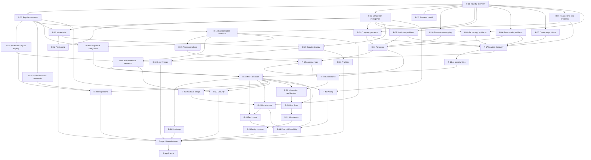

# 00 — RESEARCH EXECUTION ROADMAP
## All-in-One Network Marketing Management Platform

| Field | Value |
|---|---|
| Document ID | 00_RESEARCH_EXECUTION_ROADMAP |
| Version | 1.0 |
| Date | 2026-11-11 |
| Companion | 00_RESEARCH_MASTER_PLAN.md (topic definitions, IDs, methods) |

This roadmap sequences the research in the Master Plan. Time is expressed in **work waves**, not calendar dates, because duration depends on how many documents are produced per working session and whether primary research can be scheduled.

---

## 1. Sequencing principles

1. **Kill-switch topics first.** Legal viability (R-35), wallet/payout legality (R-39), market size (R-02) and competitor reality (R-03) can end or reshape the project; they run before any design work.
2. **Evidence before design.** UX, architecture and wireframes begin only after problem, user and compensation research exist.
3. **Parallelize independent work.** Competitor teardown, regulatory screening and industry research can run side by side.
4. **Narrow before widening.** The MVP decision (R-33) happens before detailed module, API and wireframe documents, so effort goes to what will be built.
5. **Every wave ends with a gate** (Section 5): proceed, adjust, or stop.

---

## 2. Mapping to the brief's nine stages

| Brief stage | Roadmap waves | Notes |
|---|---|---|
| Stage 1 — Plan and roadmap | Wave 0 | Complete with this document |
| Stage 2 — Industry, market, competitor, problem, user research | Waves 1–3 | Legal early screen added to Wave 1 |
| Stage 3 — Business analysis, compensation, financial feasibility | Waves 3–4 | Financial feasibility finalizes after MVP definition |
| Stage 4 — Solution discovery, module research | Wave 4 | |
| Stage 5 — UX, IA, flows, wireframes, UI | Wave 6 | Depends on MVP scope |
| Stage 6 — Technical, architecture, security, integration | Waves 5–6 | Architecture research starts earlier for hierarchy and engine questions |
| Stage 7 — Growth, commercial, compliance, GTM | Wave 7 | Compliance deep-dive already begun in Wave 1 |
| Stage 8 — Consolidation: strategy, PRD, system design | Wave 8 | |
| Stage 9 — Audits and quality | Wave 9 | |

---

## 3. Waves and execution matrix

**Legend:** ∥ = can run in parallel inside the wave · → = must complete before next item.

| Wave | Name | Research items (∥ in parallel) | Entry condition | Exit deliverables | Gate |
|---|---|---|---|---|---|
| 0 | Plan | Master plan, roadmap | Brief received | 00_RESEARCH_MASTER_PLAN, 00_RESEARCH_EXECUTION_ROADMAP | — |
| 1 | Foundations and early screens | ∥ R-01 industry · ∥ R-35 regulatory **screen** (all target markets, high level) · ∥ R-03.0 competitor verification · ∥ R-02 initial source gathering | Wave 0 | 00_RESEARCH_SOURCE_REGISTER (v1), 01_INDUSTRY_RESEARCH, 02 (draft), 03 (verified list), regulatory screen summary | **G1** |
| 2 | Market and competition | R-02 final · R-03 full teardown → R-03 matrix · R-39 wallet/payout legality · R-38 localization/payments | G1 passed | 02, 03, 04, 05 (draft), R-39 brief, market shortlist | **G2** |
| 3 | Problems, users, compensation | ∥ R-04 · R-05 · R-06 · R-07 · R-08 · R-09 → R-10 → R-11 → R-12 · ∥ R-14 compensation · ∥ R-13 business model | G2 passed | 06, 07, 08, 09, 10, 11, 12, 13, 15 (draft) | **G3** |
| 4 | Business analysis and solution discovery | R-15 process analysis → R-17 solution discovery → ∥ R-18 AI · ∥ R-MOD-A…M · R-36 safeguards · R-40 pricing (draft) | G3 passed | 14, 15, 20, 21, 22 (draft) | **G4 (MVP gate)** |
| 5 | MVP and architecture research | R-33 MVP → R-34 roadmap · ∥ R-24 stack · ∥ R-25 architecture · ∥ R-26 database · ∥ R-27 security | G4 passed | 23, 24, 34, 35, 36, 37, 40, 41 | **G5** |
| 6 | UX, integration, scale | ∥ R-19 UX · R-20 IA → R-21 flows → R-22 wireframes → R-23 design system · ∥ R-28 integration · ∥ infrastructure/scalability docs | G5 passed | 26–33, 38, 39, 42, 43, 44 | **G6** |
| 7 | Commercial and compliance completion | ∥ R-29 growth · R-30 loops · R-31 analytics · R-40 pricing final · R-16 financial feasibility · R-32 positioning · ∥ compliance requirements and risk register | G6 passed | 12, 16, 17, 19, 25, 45–54 | **G7** |
| 8 | Consolidation | PRD, FRS, NFR, user stories, acceptance criteria, edge cases, system design, implementation roadmap, QA strategy, executive documents, open questions, decision log | G7 passed | 55–67 | **G8** |
| 9 | Audit | Cross-document consistency audit · traceability check · completeness report | G8 passed | Audit report, corrected documents | **Final** |

R-37 (primary research design) runs in the background from Wave 3 onward and produces interview guides and survey instruments that can be fielded at any time. If primary research is fielded, its results supersede hypotheses and may reopen earlier gates.

---

## 4. Dependency graph

### Critical path
R-01 → R-35 → R-14 → Module research (G, H, C) → R-33 MVP → R-25/R-26 architecture → R-16 financial feasibility → Consolidation → Audit.

The longest uncertainty on the path is **R-35/R-39** (legal), because it may require counsel review that cannot be replaced by desk research.

---

## 5. Decision gates

| Gate | After wave | Question | Pass criteria | Fail action |
|---|---|---|---|---|
| G1 | 1 | Is there any market where direct selling is legal and software for it can be sold? Are there verified competitors, and is the industry real and active? | At least two target markets with a lawful direct-selling framework identified; at least 10 verified active vendors found; no regulatory finding that makes the whole category non-viable | Narrow to viable markets, or stop and report |
| G2 | 2 | Is the addressable market large enough and is there a gap? Is wallet/payout handling feasible without a financial license? | SAM large enough to support the business case under the moderate scenario (threshold set in financial model); at least one under-served segment; feasible payout architecture identified | Re-segment, or change business model (e.g., services-led), or stop |
| G3 | 3 | Are there frequent, severe, expensive problems that incumbents leave unsolved? Is compensation complexity tractable to model? | At least five problems rated high severity with evidence from ≥2 independent source types; compensation taxonomy covers at least 90% of observed plan types | Reposition or narrow to the strongest problem; schedule primary research |
| G4 | 4 | Which features are justified by problem evidence? | Every proposed MVP feature maps to a problem or a mandatory compliance/operational requirement | Remove untraced features |
| G5 | 5 | Is the architecture appropriate for stage and budget, and does the hierarchy/ledger design pass benchmarks? | Written trade-offs; prototype benchmark plan or results; security baseline defined | Revise architecture; reduce MVP scope |
| G6 | 6 | Do user flows, wireframes and integrations cover MVP end to end? | All MVP journeys have flows, error paths and permission rules | Fill gaps before consolidation |
| G7 | 7 | Is the business viable? | Break-even within acceptable horizon in the moderate scenario; compliance requirements assigned to features | Re-price, re-scope, or stop |
| G8 | 8 | Can a development team implement without guessing? | Every requirement has an ID, acceptance criteria and traceability | Fix gaps |
| Final | 9 | Are documents consistent and complete? | Audit findings resolved | Iterate |

Thresholds marked "set in financial model" are intentionally deferred: setting them now would be inventing numbers without evidence.

---

## 6. Parallel tracks

| Track | Content | Can start | Merge point |
|---|---|---|---|
| T1 Industry and legal | R-01, R-35, R-39, R-38 | Wave 1 | G1/G2 |
| T2 Competitive | R-03.0 → R-03 → matrix → gap analysis | Wave 1 | G2 |
| T3 Market | R-02 | Wave 1 (data gathering) | G2 |
| T4 Problems and users | R-04–R-12 | Wave 3 | G3 |
| T5 Compensation | R-14, R-13 | Wave 3 (taxonomy can start in Wave 2) | G3 |
| T6 Technical early probes | Hierarchy storage options, ledger patterns, tenancy options (desk work only) | Wave 3 | G5 |
| T7 Primary research design | R-37 | Wave 3 | Any time fielded |

---

## 7. Research task lists per wave (immediate work queue)

### Wave 1 tasks
| Task | Description | Output |
|---|---|---|
| W1.1 | Definitions: direct selling vs MLM vs pyramid scheme from regulator and association sources | 01_INDUSTRY_RESEARCH §1–2 |
| W1.2 | Business model taxonomy and company types | 01 §3–5 |
| W1.3 | Market size sources: WFDSA global, DSA US, regional | 02 draft; register entries |
| W1.4 | Regulatory screen: US, UK, EU, Bangladesh, India, UAE, SE Asia — existence of statute, licensing, enforcement posture | Regulatory screen summary (to feed 51) |
| W1.5 | Competitor verification: confirm each of 14 named entities, find additional vendors | 03 verification table |
| W1.6 | Source register v1 | 00_RESEARCH_SOURCE_REGISTER |

### Wave 2 tasks (next)
Competitor teardown, feature matrix, review mining, pricing capture, TAM/SAM/SOM, wallet/payout study, payment ecosystem per market.

---

## 8. Resource and tooling plan

| Need | Tool | Note |
|---|---|---|
| Web research | Web search and page fetching | Logged in source register |
| Competitor demos and community reading | Browser tools where available | Some sites block automated access; log gaps |
| Calculations (market sizing, compensation examples, financial scenarios) | Code execution | Scripts saved alongside documents for auditability |
| Diagrams | Mermaid | Embedded in markdown |
| Primary research | Interview and survey instruments prepared; fielding requires founder access to respondents | Marked designed, not conducted |

---

## 9. Risks to the research itself

| ID | Risk | Likelihood | Impact | Mitigation |
|---|---|---|---|---|
| RR-1 | Vendors hide pricing and detail | High | Medium | Mark gaps; use interviews (V-01) |
| RR-2 | Market-size sources conflict | High | Medium | Triangulate; show range |
| RR-3 | Legal findings are ambiguous | Medium | High | Flag for counsel; avoid conclusions beyond sources |
| RR-4 | Community sources skew negative or small-scale | High | Medium | Label bias; weight by source type |
| RR-5 | Volume of documents dilutes quality | High | High | Sequence by decision value; do not create filler |
| RR-6 | Founder assumptions leak into findings | Medium | High | Section 2 challenges in Master Plan; decision log records reasoning |
| RR-7 | Stale information | Medium | Medium | Access dates on every source |

---

## 10. Status tracker

| Wave | Status |
|---|---|
| 0 Plan | Complete |
| 1 Foundations and early screens | In progress |
| 2 Market and competition | Not started |
| 3 Problems, users, compensation | Not started |
| 4 Business analysis, solution discovery | Not started |
| 5 MVP and architecture research | Not started |
| 6 UX, integration, scale | Not started |
| 7 Commercial and compliance | Not started |
| 8 Consolidation | Not started |
| 9 Audit | Not started |

This tracker is updated at the end of every working session.
