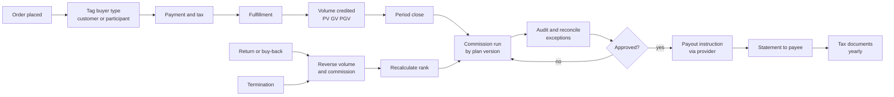

# 11 — USER WORKFLOW ANALYSIS
## How an order becomes a payout, where a change in one place spreads to others, and which handoffs are evidenced

| Field | Value |
|---|---|
| Document ID | 11_USER_WORKFLOW_ANALYSIS |
| Version | 0.1 (Wave 3) |
| Date | 2026-11-11 |
| Research ID | R-12 (with 10); the full ten-process analysis is R-15 in Wave 4 (14_BUSINESS_PROCESS_ANALYSIS) |
| Sources | `S-xxx` register; journeys `J-xx` (10); problems `P-xx` (06) |
| Labels | [VF] · [RB] · [IP] · [HY] · [SR] · [UV] |

## 0. Summary

1. **The core workflow is a chain: order, volume, commission run, approval, payout, statement.** A **return** or **termination** reaches back into that chain and changes results already calculated or paid. That backward reach is where the workflow is hardest and where the legal duties sit (buy-back, cooling-off).
2. **Only the middle of the chain is evidenced by documents:** the commission cycle and payout handling (S-130, S-131, S-132). The ends (order intake, fulfillment, support, team coaching) are **hypothesis**.
3. **Manual handoffs that the postings evidence** (§3): data clean-up before and after each run, manual payment and adjustment requests, reconciliation of direct-deposit data, printing and mailing cheques globally. How often each happens is not stated.
4. **Time matters:** runs are weekly or monthly (S-131), tax forms yearly (S-123), returns can arrive up to 12 months after sale (S-122, a 10% restocking fee after 30 days). **A design must be able to recalculate history**, not only the current period [IP].
5. **Not every step should be automated.** Payout approval, plan approval and termination for cause need a person (§6).

## 1. The core chain

**Reading the chain.** Steps A to E happen per order; F to K per period; L per year; R to T per event, at any time. The backward arrows (R to T into G) are the reason a commission engine needs history and recalculation, not a once-only calculation [IP].

## 2. Where a change spreads (failure propagation)

| Event | What it changes next | Failure if missed | Evidence |
|---|---|---|---|
| **Order mis-tagged** (customer vs participant) | Retail-customer share (CMP-01); qualification; compensation caps | Overstated retail share; wrong cap; weak regulator evidence | S-120 (data in a standardized format, with purchaser identity); [RB] |
| **Refund or return** | Volume, commissions to every level that earned on it, ranks, tax figures | Commission kept after return (vendor-listed leakage, S-138, unsourced); negative balance with no rule (13 EX-8) | S-124, S-015, S-121, S-122 |
| **Plan change** | Calculation of every later period; qualification; disclosures | Past results altered; no record of who approved (CMP-04); disclosures out of date | S-131, S-122 (risk heading); [RB] |
| **Termination or delisting** | Payouts, downline placement, buy-back duty, public lists (India) | Payment to a removed person; orphaned downline; data kept too long | S-085 (secondary), S-124 [SR] |
| **Chargeback** | Order status, volume, commission (same as refund), provider account standing | Commission paid on a disputed sale (S-134 shows reversed disputes) | S-134 [RB for one case] |
| **Exchange rate or fee change** | Payout amounts in local currency | Under- or over-payment | S-138 (vendor, unsourced) [UV] |
| **New-market launch** | Licence evidence, contracts, tax data, local plan variants | Operating before the licence or without required documents | S-043, S-085, S-131 [SR] |

## 3. Handoffs: evidenced and hypothesized

| Handoff | Who to whom | Evidenced? | Source |
|---|---|---|---|
| Data clean-up before and after a commission run | Analyst, data owners | **Yes** | S-131 |
| Test scenarios and reconciliation | Analyst, finance | **Yes** | S-130 |
| Manual payment, adjustment and exception requests under a standard procedure | Support specialist, analyst, finance | **Yes** | S-132 |
| Entering and reconciling direct-deposit data | Payout staff | **Yes** | S-132 |
| Printing, folding and mailing commission cheques globally | Payout staff | **Yes (one company)** | S-132 |
| Fraud research ("bonus buying") | Analyst, compliance | **Yes (one company)** | S-131, S-132 |
| Global tax reporting support | Analyst, finance | **Yes** | S-130 |
| Plan-change regression testing | Analyst, vendor or IT | **Yes** | S-131 |
| Compliance review of plan changes | Compliance, operations | [HY] | — |
| Support agent to finance for refund approval | Support, finance | [HY] | — |
| Warehouse to support for returns received | Warehouse, support | [HY]; not researched | — |
| Team leader to company for training and recognition | Leader, company | [HY]; not researched | — |

**Limit:** three postings at two employers show these duties exist. They do not say how long each step takes, how often it fails, or whether it is solved by software at other companies.

## 4. Timing

| Cycle | Cadence | Source |
|---|---|---|
| Order, volume | Continuous | [IP] |
| Commission run | Weekly and monthly | S-131 [VF for one employer] |
| Payout | Not stated for the employers; plans differ | [UV] |
| Tax documents | Annual (US 1099 forms) | S-123 [UV on current thresholds] |
| Returns window | 30 days for a full refund; up to 12 months with a 10% restocking fee at Nu Skin | S-122 [VF] |
| Malaysian cooling-off | 10 working days | S-015 [SR] |
| State buy-back | Often 12 months, about 90% of net cost | S-124 (undated) [SR] |
| Consent records for recurring charges | 3 years under the proposed FTC rule; rule later vacated, restarted | S-126, S-127 [SR] |

**Design consequence [IP]:** a return up to 12 months later can reach back past several closed commission periods. The engine must define **whether a reversal changes the closed period or posts an adjustment in the current one**. This is a policy and legal question (13 EX-8), not only a technical one.

## 5. Moments of truth (hypotheses)

These are points where trust is gained or lost. All are [HY]; each names the interview question that would test it.

| Moment | Who feels it | Test |
|---|---|---|
| First commission statement | New distributor | "When you first saw a statement, could you tell why you got that number?" |
| A payout that is late or short | Distributor, support | "Last time a payout was wrong, how did you find out?" |
| An unrecognized recurring charge | Customer | "Have you ever been charged for something you did not expect?" |
| A regulator or counsel request | Compliance | "Last request: what did you have to assemble by hand?" |
| A plan change going live | Operations, finance | "Last change: did past payouts alter?" |
| A return after commissions are paid | Finance, upline | "What happens to the commission already paid?" |

## 6. Automate, assist or keep human

| Step | Position | Reason | Label |
|---|---|---|---|
| Buyer-type tagging, volume credit, calculation, reconciliation checks | **Automate** with exception review | Rule-based and repetitive | [IP] |
| Exception triage and variance flags | **Assist** | A person decides | [IP] |
| Payout approval | **Keep human** (preparer and approver separate) | Money movement and fraud control (MH-REQ-02) | [SR] |
| Plan changes | **Keep human**, with simulation and approval | Legal and financial effect (CMP-04) | [SR] |
| Termination for cause | **Keep human** | Legal and fairness | [IP] |
| Earnings-claim review | **Keep human** | FTC guidance treats claims as a legal matter (S-020) | [SR] |
| AI features | **Unsupported either way** | No problem evidence for AI (05 §3, C5) | [UV] |

## 7. What would settle this

- **Process observation or interviews (66 Appendix A):** walk through the last commission run and the last return step by step.
- **Vendor documentation reads (V3):** how existing platforms model reversals and recalculation.
- **Counsel:** whether a reversal may alter a closed period and how negative balances may be recovered (13 EX-8; Q-1 and OQ-09 in 66).
- **Wave 4:** 14_BUSINESS_PROCESS_ANALYSIS will detail the ten processes with actors, inputs, outputs, rules and exceptions.
