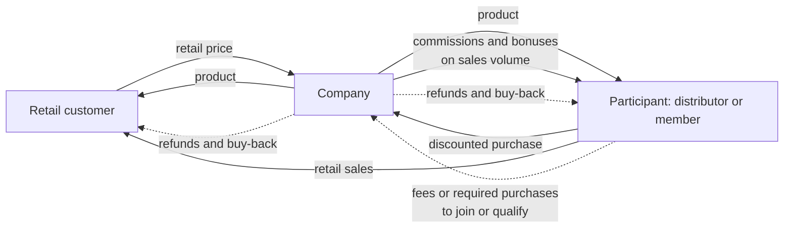

# 12 — BUSINESS MODEL ANALYSIS
## How direct-selling companies make money, and where product revenue ends and recruitment-related payments begin

| Field | Value |
|---|---|
| Document ID | 12_BUSINESS_MODEL_ANALYSIS |
| Version | 0.1 (Wave 3) |
| Date | 2026-11-11 |
| Research ID | R-13 (depends on R-01; informs customer acceptance, OQ-03, and the legal screen, R-35) |
| Sources | `S-xxx` register; requirements `CMP-xx` (51); plan examples in 13 |
| Labels | [VF] · [RB] · [IP] · [HY] · [SR] · [UV] |
| Scope note | This document is about the **customer's** business model (the direct-selling company). The **platform's own** pricing and viability are Wave 4 work (R-16) |

## 0. Summary

1. **Two public companies were read (excerpts only):** Herbalife and Nu Skin (S-121, S-122). They do not represent the small and mid-size operators who are the likelier buyers (A-01, 05 §4). Wave 3 found **no financial disclosure from a small or mid-size company**.
2. **Companies earn from product sold to two buyer groups:** non-participant customers and participants (distributors, members). The filings report counts for each (Nu Skin: **748,796 customers** against **129,311 paid affiliates**, about 5.8 to 1; S-122; Herbalife: 3.1M preferred members, 2.3M distributors, about 750,000 sales leaders; S-121) [VF for counts].
3. **No source read states the share of sales made to non-participants.** Herbalife does not split personal-consumption from retail sales in the excerpt read; Nu Skin's excerpt gives counts, not a revenue split (S-121, S-122) [UV]. This share is **the number regulators care about** (S-020, S-120), and the platform could measure it (CMP-01), but the evidence does not yet show what it is.
4. **Compensation paid is a stated share of sales:** Herbalife says commissions and bonuses are "up to 22% in the aggregate" plus about 1% for the "Mark Hughes bonus" (S-121); Nu Skin states **caps of 30% (Mainland China) and 35% (South Korea)** on compensation (S-122; legal basis not read [UV]). The 2016 FTC order sets a **company-specific cap of 41.75% of rewardable sales** when rewardable sales fall below 80% of total (S-120). These are **three different numbers measuring different things**; do not compare them directly.
5. **Returns are a small share of sales at the two companies:** about **0.1% of net sales** (Herbalife) and **under 5% of revenue** (Nu Skin) (S-121, S-122). Mid-size operators may differ [UV].
6. **A bright line for the platform's customer policy [HY, SR]:** compensation **solely** for enrolling or recruiting is barred in the Herbalife order (S-120) and expressly **not paid** by Nu Skin ("We do not pay any sales compensation for recruiting or sponsoring", S-122). This is the practical test for OQ-03 and CMP-03, and counsel must confirm it for any market.
7. **Founder challenge [IP]:** if the platform's own price rises with a tenant's volume or commissions, the platform's income would depend on the tenant's recruitment-driven volume. A flat or capacity-based price removes that link. This is a design choice to decide in Wave 4, not a finding.

## 1. Revenue streams (the brief's list)

| Stream | What the evidence says | Source | Gap |
|---|---|---|---|
| **Product sales (overall)** | Both companies sell consumer products through independent sellers in many markets (Herbalife 95 markets) | S-121, S-122 | Revenue figures not recorded here; not needed for this analysis |
| **Retail sales** (to non-participants) | Nu Skin counts 748,796 customers; Herbalife reports 3.1M preferred members (what they pay and receive was not read); the Herbalife order requires **retail-sale data in a standardized format** (payment method, products, date, price, purchaser, contact) | S-122, S-121, S-120 | **Share of sales not stated** |
| **Distributor purchases** (resale or personal use) | A study of 13,000+ distributors found few join for personal consumption alone and reasons for staying often differ from reasons for joining | S-135 (abstract) | Split of purchases by purpose **unknown**; discounts by member type not read |
| **Subscription and recurring orders** | A consumer case shows an unrecognized $461 order and cancellation through "manage subscription"; the proposed FTC rule would require separate consent and easy cancellation | S-134, S-126 | Share of revenue from autoship **unknown** |
| **Membership models** | Herbalife has distinct member types (preferred, distributors, sales leaders) | S-121 | Fees, if any, **not read** |
| **Product bundles and starter kits** | A trade review of Young Living flags paying commission on starter kits as a red flag; practitioners name inventory loading as a risk | S-141 (2015–2019 plan), S-125 | Current practice **unknown** |
| **Wholesale and retail pricing; distributor discounts** | Young Living's plan shows a **24% retail commission** (a margin on retail sales) and tiered bonuses | S-141 (dated) | Price structures of the two public companies not read |
| **International expansion** | 95 markets (Herbalife); different compensation caps by market (Nu Skin); licences and filings in licensed markets | S-121, S-122, S-043, S-085 | Market-by-market economics **unknown** |
| **Returns and buy-back** | See summary item 5; statutes in several US states and a 12-month, 90% industry rule | S-121, S-122, S-124 | Small share at public companies |

## 2. Where money flows

The dotted flow from participant to company at the bottom is the **flow regulators treat as a warning sign** when it is large relative to sales to real customers (S-020; Herbalife order, S-120) [SR]. It is drawn here as a **question**, not as a finding about any company.

## 3. Product revenue vs recruitment-related payments: a classification test [SR]

This is the practical test the platform's tenant policy (OQ-03) and the payout-source attribution (CMP-03) would use. **It is a screening framework, not legal advice** (A-07). Counsel must confirm it per market (Q-1, OQ-09).

| Money flow | Treat as | Why | Source |
|---|---|---|---|
| Sale of product to a non-participant | **Product revenue** | An end-consumer purchase | S-120 (retail-sale data), S-020 |
| Distributor purchase for resale to customers | **Product revenue**, but monitor for inventory loading | Legitimate if resold; risky if bought to qualify | S-125, S-020 |
| Distributor purchase for personal use | **Product revenue**, flag separately | Consumption is a recognized reason to buy but not the same as retail; regulators watch how much compensation rests on it | S-135, S-020 |
| Purchase **required to qualify** for rank or pay | **Warning sign** | FTC treats purchases to qualify as evidence of a pyramid | S-020 (via 51) |
| Starter kit whose price carries commission | **Warning sign** (trade-review view) | Pay linked to a joining payment | S-141 (dated trade review) |
| Fee or deposit paid to join or to keep status | **Recruitment-related payment**; prohibited as a deposit in Vietnam | Not for product | S-048 (via 51, CMP-14) |
| Bonus paid **only** for enrolling someone | **Recruitment-related payment**; barred in the Herbalife order and not paid at Nu Skin | Compensation not tied to a sale | S-120, S-122 |
| Commission on a downline member's product purchase | **Compensation on product volume**; depends on whether the volume is end-consumer demand | Depends on the retail share and plan design | S-120, 13 §6 |
| Refund and buy-back to a distributor | **Reversal of product revenue** | Statutory in several markets | S-124, S-015, S-043 |

**What the platform can and cannot do [IP]:** it can tag buyer type, show the retail share, flag qualification by purchase and attribute payouts to their source (CMP-01 to CMP-03). It **cannot decide** whether a plan is lawful. Counsel and regulators do.

## 4. What public disclosures do not tell us

| Question from the brief | Status |
|---|---|
| What share of sales is to non-participant customers? | **Not stated** in either excerpt read [UV] |
| What share of revenue is autoship? | **Unknown** |
| What do mid-size and small operators earn and pay? | **No disclosure found** |
| What share of distributors earn anything? | One company statement: for Young Living (2022), the median Brand Partner earned $23 and the median at the lowest rank $0, "potential gross income" before expenses; **no count of those earning $0** (S-140) |
| What does a returning-distributor or reactivation model look like? | **Not evidenced** |

## 5. Implications (not decisions) [HY]

- **The platform needs a buyer-type field and a payout-source field from day one**, because the legitimate-versus-recruitment question can only be answered with that data (CMP-01, CMP-03).
- **A customer-acceptance policy (OQ-03)** should use the two bright lines in the summary (item 6) and the warning signs in §3, with counsel's review.
- **Market size and willingness to pay** are not touched by this document.

## 6. What would settle this

- **Primary reads:** the full 10-Ks (not only the first 200,000 characters), where retail and personal-consumption sales, member fees and autoship may be disclosed.
- **Mid-size operator data:** interviews (66 Appendix A) on the retail-customer share, autoship share and compensation as a percentage of sales.
- **Counsel:** whether the classification in §3 matches each target market (51 Q-1; OQ-09).
