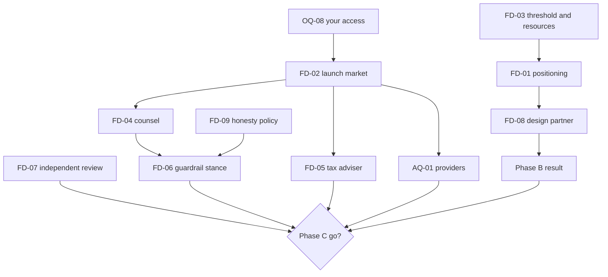

# 35 — OPEN DECISIONS FOR FOUNDERS
## Decisions only the founder can make, with the provisional assumption this audit used

| Field | Value |
|---|---|
| Document ID | GAP-35 |
| Version | 0.1 |
| Date | 2026-11-11 |
| Relation to 66 | Adds FD-01..FD-09 to the original OQ-01..OQ-10. Still-open originals that these decisions depend on are listed in §2 |
| Rule | Work continues on the provisional assumption; nothing below was decided for you |

## 1. New decisions

| ID | Decision | Why it matters | Options | Provisional assumption used in this audit | Needed by |
|---|---|---|---|---|---|
| **FD-01** | **Positioning** | Decides MVP, pricing, competitors and partners | P1 all-in-one (MY/IN) · P2 engine + compliance, API-first · P3 migration · P4 compliance-analytics overlay · P5 non-MLM tools | **Test P4 first, build P2 only if Phase B passes** (33 §4) | Before Phase B |
| **FD-02** | **Launch market**, using the re-score in 18 §3 with **your access** filled in | Language, tax, residency, providers, competition | US · Malaysia · India · other | **Undecided**; Malaysia/India no longer assumed | Before Phase A provider and tax work |
| **FD-03** | **Revenue threshold and resources** (original OQ-04, still open since Wave 2) | Without it, "large enough" and break-even cannot be judged | — | None set | Before Phase C |
| **FD-04** | **Engage counsel** in the launch market for Q-1 (vendor exposure), Q-2/Q-9 (payout design), Q-5 (residency) and the guardrail list BR-GRD (original OQ-09) | GAP-087 is Critical and Unknown | Engage · defer (accept risk) | No counsel; all legal items screening-grade | Before Phase C |
| **FD-05** | **Engage a tax adviser** in the launch market for withholding and year-end forms | GAP-031 Critical | Engage · defer | Not engaged; Grade B summaries only | Before MVP scope freeze |
| **FD-06** | **Guardrail stance**: which configurations the platform blocks, warns on or only reports | Brand, liability, addressable market | Strict (block per BR-GRD-01/02) · Moderate (block + warn) · Neutral (report only) | **Moderate** (24 BR-GRD default proposal) | Before Phase C |
| **FD-07** | **Independent review** of this audit's Critical findings | GAP-103: this audit is not independent | Commission a reviewer · accept | Not commissioned | Before any spend on build |
| **FD-08** | **Design partner** for MVP-A (compliance analytics on their export) | Cheapest demand test | Name one · recruit via interviews | None | Phase B |
| **FD-09** | **Product honesty policy** (no income projections; disclosures from real payouts) | Ethics, regulatory exposure, trust | Adopt · modify | Adopted as a default in 23 §2, 29 CPL-14 | Before Phase C |

## 2. Original decisions still open (from 66)

| ID | Status after this audit |
|---|---|
| OQ-01 Segment and first market | Replaced by FD-01 and FD-02 |
| OQ-03 Acceptance policy | Still assumed "yes"; now paired with FD-06 and FD-09 |
| OQ-04 Resources and threshold | Same as FD-03; **blocks viability since Wave 2** |
| OQ-06 Access to people | Still open; Phase B cannot start without it or a recruitment budget |
| OQ-08 Starting position (languages, relationships, home market) | Feeds FD-02 directly. If your home market is one where MLM operators are not a viable customer base (for example Bangladesh, 51 §3.2), every candidate market is foreign and access cost becomes the deciding criterion |
| OQ-09 Counsel | Same as FD-04 |
| OQ-10 Primary research | Option A chosen; recommend re-weighting the sample to compliance and finance roles and adding the questions in 31 §1 |

## 3. New open questions for advisers (not founder decisions)

| ID | Question | Who |
|---|---|---|
| AQ-01 | Which payment and payout providers accept MLM merchants in the launch market, on what terms, and will the platform's own billing provider serve a vendor to MLM companies? | Providers, in writing |
| AQ-02 | Does Malaysia's s.107D withholding apply to direct-selling commissions as configured, and what does CP58 require from a platform-generated statement? | Malaysian tax adviser |
| AQ-03 | Which TDS provision and rate apply to direct-seller commissions in India today, and does the new Income-tax Act (reported to replace the 1961 Act; not verified in this audit) renumber or change it? | Indian chartered accountant |
| AQ-04 | Is India's in-country storage requirement (Rule 5(5) as reported) in force and what data does it cover? | Indian counsel |
| AQ-05 | Does a processor serving Malaysian tenants need its own DPO from the first tenant, and what breach timelines apply? | Malaysian counsel |
| AQ-06 | What is the current status of the FTC's MLM earnings-claim rulemaking? | US counsel |

## 4. Decision dependencies

