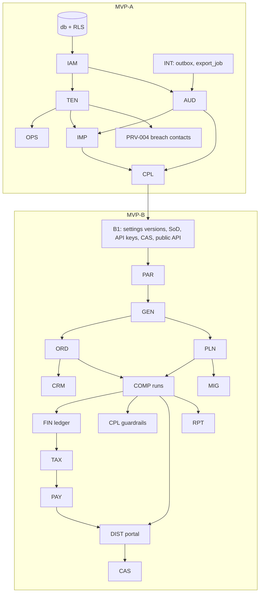

# Module Dependency Map

Arrow = "may call the facade of". Governing source: SDD-03 call matrix as corrected in `context/ARCHITECTURE.md` (conflicts C1–C4). Enforced by `apps/api/test/boundaries.test.ts`.

| Module | Rel | Depends on | Blocks |
|---|---|---|---|
| db, RLS, roles | A | — | everything |
| IAM (001–003, 005) | A | db | all |
| AUD (001, 002) | A | IAM | every state-changing module |
| TEN (001), OPS (001) | A | IAM, AUD | IMP, CPL |
| IMP (001–003) | A | TEN, AUD | CPL |
| CPL (001–006) | A | IMP | — |
| PRV (004) | A | TEN | — |
| B1 foundations | B | A | B2+ |
| PAR, GEN, ORD, CRM | B | B1 | PLN/COMP |
| PLN, COMP, guardrails | B | B2 | FIN |
| FIN, TAX, PAY, adjustments | B | B3 | DIST |
| DIST, disputes, privacy | B | B4 | — |
| MIG, RPT, export | B | B3–B5 | go-live |

Parallelisable once contracts exist: IMP ∥ `packages/compliance`; web screens ∥ API tests; in B2 PAR/GEN ∥ ORD; in B4 TAX ∥ PAY adapters.
