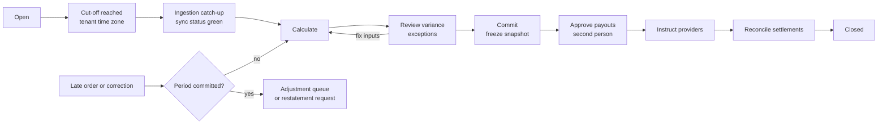

# 27 — MISSING USER FLOWS AND SCREENS
## Operational flows the 17 brief journeys did not cover, and the screen inventory they need

| Field | Value |
|---|---|
| Document ID | GAP-27 |
| Version | 0.1 |
| Date | 2026-11-11 |
| Relation to original | Adds to 10 (J-01..J-17). Flows are hypotheses about how the work should run; error paths are design requirements |

## 1. New flows

### FL-01 Period close (monthly calendar)

**Error paths:** commerce sync behind (block D); run fails mid-way (resume idempotently); approver unavailable (delegation rule, never self-approval); provider rejects batch (retry failed lines only).

### FL-02 Genealogy change or correction (GAP-002, GAP-010)
Request (agent or distributor) → policy check (window, approvals) → evidence → compliance review → **change** (effective date) or **correction** (original date, affected periods listed) → read-model rebuild → notifications. **Errors:** outside window; would create a cycle; target leg occupied (binary); affects committed period (route to FL-07).

### FL-03 Duplicate or multiple-account case (GAP-002)
Signal (shared identity, instrument, address, device) → hold activation or payouts per tenant rule → investigate → merge, allow (with reason) or terminate → history kept on positions.

### FL-04 Succession, divorce or sale of a distributorship (GAP-002)
Request with documents → legal check (tenant) → transfer of position ownership with effective date → new payee tax profile and bank details (FL-10 controls) → notices.

### FL-05 Commission dispute (BR-ADJ-04)
Distributor opens dispute from a statement line → trace attached automatically → analyst review → upheld (adjustment, FL-07 if prior period) or not upheld (explanation) → response time tracked.

### FL-06 Refund or chargeback after payout (GAP-032)
Event ingested → reversal computed per policy (order-line or restatement) → clawback receivable → netted in next run → write-off if under threshold with approval → statement shows separate line.

### FL-07 Restatement of a committed period (GAP-023)
Request with reason → recalculation in a sandbox copy → diff per payee → approval → adjustments posted in the open period → audit record.

### FL-08 Plan change rollout (GAP-097)
Draft → simulate on ≥ 1 historical period → compliance review (guardrails) → filing status per market → field notice → activation on effective date → transition report.

### FL-09 New market launch for a tenant
Licence or registration evidence (CMP-12) → payout and payment providers confirmed eligible (BR-PAY-11) → tax rules configured (BR-TAX) → agreement versions and disclosures → data region → plan variant → go-live checklist.

### FL-10 Bank-detail change (GAP-035)
Change request → re-authentication → notice to old contact → cooling-off → first payout to new details with extra verification.

### FL-11 Vendor support session (GAP-065)
Engineer request with reason and scope → tenant admin approval → time-boxed read-only session → every action logged → session report to tenant.

### FL-12 Data-subject request (GAP-085)
Request → identity verification → access export or erasure (pseudonymise in ledger) → retention exceptions explained → closed within the market's deadline.

### FL-13 Migration with parallel run (GAP-077)
Data mapping → history import (genealogy, ranks, carry, balances) → validation report → parallel run for ≥ 1 full period → per-payee difference report → sign-off → cutover → old system read-only.

### FL-14 Tax year-end (GAP-031)
Year closes → totals per payee per form type → validation (missing tax IDs) → form generation → distribution → export to tenant's filing tool.

### FL-15 Customer reassignment on distributor termination (GAP-040)
Termination effective → reassignment rule applied → notices to customers (if tenant enables) → future orders attributed to new servicer.

## 2. Screen inventory (MVP unless noted)

| ID | Screen | Role | Flows | States to design (14 §4) |
|---|---|---|---|---|
| SC-01 | Periods and runs (home) | Analyst | FL-01 | Empty, running, failed, locked |
| SC-02 | Run review (variance, movers, exceptions) | Analyst, Finance | FL-01 | Partial data, stale sync |
| SC-03 | Payout batches and approvals | Finance | FL-01, FL-10 | Permission-limited (preparer cannot approve), partial failure |
| SC-04 | Plan versions: edit, compare, simulate | Plan admin | FL-08 | Blocked activation, guardrail warning |
| SC-05 | Cap and pool configuration with "who is cut" preview | Plan admin | FL-08 | — |
| SC-06 | Adjustments, disputes and restatements (case view) | Analyst, Compliance | FL-05, FL-06, FL-07 | Approval pending, rejected |
| SC-07 | Genealogy explorer (staff, as-of date) | Analyst, Support | FL-02 | Read-model rebuilding |
| SC-08 | Genealogy change and duplicate cases | Support, Compliance | FL-02, FL-03, FL-04 | Out of window, conflict |
| SC-09 | Participant record (positions, types, tax profile, bank details history) | Support, Finance | FL-04, FL-10 | Masked fields |
| SC-10 | Compliance reports (retail share, personal-consumption share, payout sources) | Compliance | — | Method notes |
| SC-11 | Guardrails and overrides log | Compliance | FL-08 | — |
| SC-12 | Tax configuration and year-end forms | Finance | FL-14 | Missing tax IDs |
| SC-13 | Integrations and sync health | Admin | FL-01 | Behind, failing |
| SC-14 | Vendor access sessions | Tenant admin | FL-11 | Pending, active, expired |
| SC-15 | Privacy requests | DPO | FL-12 | Deadline approaching |
| SC-16 | Migration workspace and parallel-run report | Implementation | FL-13 | Differences outstanding |
| SC-17 | Market launch checklist | Admin, Compliance | FL-09 | Blocked items |
| SC-18 | Distributor: statements and line explanation | Distributor | FL-05 | Clawback lines, withholding lines |
| SC-19 | Distributor: rank status (factual, no income projection) | Distributor | — | Grace period |
| SC-20 | Distributor: team (privacy-limited) | Leader | — | Aggregates beyond depth |
| SC-21 | Distributor: my customers | Distributor | FL-15 | Reassigned customers |
| SC-22 | Distributor: bank details and tax profile | Distributor | FL-10 | Cooling-off active |
| SC-23 | Earnings disclosure (V1) | Compliance | — | Draft vs published |

## 3. Screens to avoid in the MVP

Recruit leaderboards, income calculators, social feeds, native storefront, built-in training video, distributor lead scoring (23 §2).
