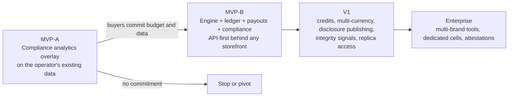

# 01 — PRODUCT VISION
## What we are building, for whom, and the principles that bind every later decision

| Field | Value |
|---|---|
| Document ID | PD-01 |
| Version | 0.1 (draft for founder review) |
| Last updated | 2026-11-12 |
| Owner | Founder / CPO role |
| Depends on | SYN-00 |
| Status | Draft. Positioning is a founder choice made for documentation (DEC-01); it is not yet validated by buyers |

## 1. Vision

Direct-selling companies can **prove what they pay and why**: every commission traceable to a sale, every period reproducible, every compliance figure computed from real transactions, and every distributor able to understand their own statement.

## 2. Mission

Give direct-selling operators a compensation and compliance back end that is correct to the minor unit, explains itself, and sits behind whatever commerce front end they already use; start by proving, on their own data, the compliance figures nobody else computes.

## 3. Product objectives

| # | Objective | Measure | Target |
|---|---|---|---|
| O1 | Prove demand for compliance analytics before building the engine | Phase B pass/fail rule (FD-10 proposal): companies giving a budget commitment and a real export | ≥ 3 budget commitments, ≥ 2 of them with data, within 10–20 qualified conversations (proposed; founder to confirm) |
| O2 | Compliance reports that survive scrutiny | Share of figures reproducible from stored inputs and method version | 100% |
| O3 | Reproducible pay | Replay of a committed period equals the committed output | 100% of periods, exact |
| O4 | Safe switching | Unexplained per-payee differences at go-live after a parallel run | 0 |
| O5 | Money integrity | Unexplained ledger difference per run; duplicate payments | 0; 0 |
| O6 | Lower cost of change | Share of a new tenant's plan rules expressed without a new platform module | Target set by founder after the corpus coverage decision (OQ-12) |
| O7 | Distributor understanding | Pay-related support contacts per 1,000 payees per period | Baseline at first tenant; target after |

Targets marked "proposed" need the founder; none is taken from research evidence, because the research has none.

## 4. Strategic positioning

**Not** "all-in-one network-marketing software". The positioning is **"the compensation and compliance back end you can audit"**, entered through the narrowest wedge:

### 4.1 Two editions, one product

The product is sold as a digital product in two editions built from the same codebase (DEC-17):

| | **Hosted edition (primary)** | **Self-hosted edition (licensed)** |
|---|---|---|
| Who runs it | We do, in regional deployments; each company is a tenant | The buyer, on its own infrastructure; one company per installation |
| Who it suits | Most mid-market buyers; fastest start; MVP-A and MVP-B launch here | Buyers whose policy, regulator or residency rule requires their own servers; overlay buyers who will not send an export outside their network |
| Commercial form | Subscription | Annual licence with updates and support (or perpetual plus mandatory maintenance); fixed-scope implementation |
| Updates | Continuous, by us | Signed packages the licensee applies; engine updates activate only after golden and replay checks pass on their installation |
| Vendor access | Tenant-approved, time-boxed sessions | None by default; licensee-approved sessions or a redacted support bundle |
| Same in both | Engine, ledger invariants, guardrails, honesty policy, market packs, export formats, no tenant-specific code, no source-code edition |
| Sequence | First | After the hosted MVP-B is proven with a design partner (V1). MVP-A may be offered self-hosted earlier if a design partner will only test on its own premises (OQ-26) |

## 5. Target markets and ideal customer profile

**Market: undecided (FD-02).** The core is market-neutral; each launch market needs a market pack (tax, guardrails, windows, filings, languages, providers) confirmed by local advisers. Candidates examined in the research: United States, Malaysia, India. Bangladesh MLM operators are **not** a customer base (no licensed companies; active enforcement).

| ICP attribute | MVP-A (overlay) | MVP-B (engine) |
|---|---|---|
| Company | Licensed or registered direct-selling company in the launch market | Same; mid-market first (hypothesis S2) |
| Situation | Has a back office that can export orders and commission detail; has had, or expects, a regulator, counsel or board question | Changing platform, outgrowing a low-end system, or adding a commerce front end that keeps the comp plan elsewhere |
| Champion | Compliance officer, finance lead or COO with budget authority | COO or CFO with commission analyst and compliance officer |
| Excluded | Companies in enforcement proceedings (ask counsel first); companies seeking "proof our plan is legal"; plans paying solely on recruitment | Same, plus anyone needing platform-held wallets, e-pins or crypto |

## 6. Primary value proposition

| For | Value | Proof the product must give |
|---|---|---|
| Compliance officer | Answer a regulator, counsel or board from the system | Figures with population, method and drill-down to rows |
| Finance | Pay the right people the right amount once | Ledger that balances; idempotent instructions; reconciliation |
| Commission analyst | Close a period without spreadsheets and explain any line | Lifecycle, review, trace, replay |
| Owner | Change the plan without fear or surprise invoices | Simulation, governance, no tenant-specific code |
| Distributor | Understand what I was paid | Statement with "how calculated"; no projections |

## 7. Competitive differentiation

| We will claim | Only when |
|---|---|
| Compliance analytics from transaction data | A design partner has seen it on their own data |
| Explainable pay (per-line provenance) | Trace is reproduced by replay in a demo |
| Proven migration (parallel-run report) | One tenant has gone live with zero unexplained differences |
| Tenant-controlled vendor access | Session log is visible to the tenant |
| **We will not claim** | Breadth; commission accuracy as a novelty; AI; that any plan is lawful; any income outcome for distributors |

## 8. Product principles

1. **Honest by design.** No income projections, potential-earnings calculators or recruit leaderboards. Earnings shown come from real payouts and include zero earners.
2. **Calculate and instruct; never hold funds.** No wallets, e-pins or crypto.
3. **Nothing is overwritten.** History is effective-dated; money and results are append-only; corrections are visible adjustments.
4. **Every number explains itself.** Population, method, version and source rows for reports; rule, inputs and rounding for pay.
5. **Configuration, not custom code.** No tenant-specific branches.
6. **Two people for money and rules.** Preparer is never approver.
7. **The tenant sees what the vendor sees.** No standing vendor access.
8. **Integrate what others do well.** Commerce, LMS, monitoring, general ledger.
9. **Indicators, not verdicts.** The platform reports and guards; it does not certify legality.
10. **One product, two editions.** Hosted and self-hosted run the same code, rules and safeguards; a licence lapse never stops pay.
11. **Evidence before scope.** A feature without a research trace is not built; an unvalidated differentiator is tested cheaply first.

## 9. Long-term direction

If MVP-B succeeds: more market packs; non-cash rewards and multi-currency; published disclosures and partner feeds for claims monitoring; analytical replica; multi-brand tooling and dedicated regional cells; external security attestation timed with the first enterprise prospect. AI is limited to summarising deterministic diffs and drafting configuration for human approval. Directions the research rules out stay out: platform-held value, percentage-of-volume pricing, recruiting tools.
