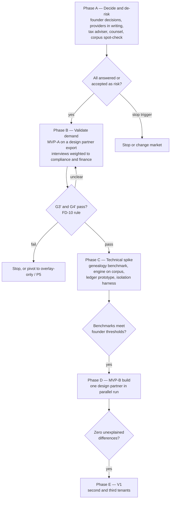

# 02 — PRODUCT STRATEGY
## Sequence, gates, stop triggers, commercial model and risks

| Field | Value |
|---|---|
| Document ID | PD-02 |
| Version | 0.1 (draft for founder review) |
| Last updated | 2026-11-12 |
| Owner | Founder / CPO role |
| Depends on | SYN-00, PD-01; gap audit 31, 33, 35; Phase A |
| Status | Draft |

## 1. Strategy in one sentence

**Prove the narrow whitespace cheaply, then build the engine only if buyers want to replace theirs.**

## 2. Phases and gates

| Gate | Passes when | Source |
|---|---|---|
| Phase A exit | FD-01..FD-06 decided; ≥ 2 eligible providers confirmed in writing for the launch market; tax and counsel questions answered or explicitly accepted as risk | Gap audit 31 §1 |
| G3′ | (a) ≥ 1 problem with frequency evidence and ≥ 1 with willingness-to-pay evidence from buyers; (b) the primitive set covers at least the founder's target share of hold-out plans | Gap audit 31 |
| G4′ | Every MVP feature traces to a gap, problem or compliance requirement **and** to at least one buyer interview or design-partner request | Gap audit 31 |
| FD-10 (proposed) | PASS: ≥ 3 companies name a budget and approver or sign a paid-pilot letter, and ≥ 2 of them send a real one-year export. FAIL: after 10 qualified conversations ≤ 1 sends data, or nobody commits budget after seeing results on their own data | Phase A P4 |
| Phase C exit | Benchmarks in QA TS-29 meet thresholds the founder sets; corpus coverage ≥ target | Gap audit 08 §6 |
| Go-live | Parallel run with zero unexplained differences | Gap audit 31 Phase D |

**No calendar durations are given.** They depend on resources the founder has not stated (FD-03).

## 3. Stop triggers

1. No eligible payment and payout providers in the launch market.
2. Buyers will not pay for compliance analytics **and** will not replace their engine.
3. Counsel finds unacceptable vendor exposure for the chosen guardrail stance.
4. One or none of ten operators with authority would evaluate or pay (original 66 A.6).

## 4. Positioning options considered

| Option | Verdict | Reason |
|---|---|---|
| P1 All-in-one for mid-market in Malaysia and India | Rejected as stated | Breadth is table stakes; low-price competition at home of the largest low-end vendor |
| P2 Engine plus compliance, API-first | **Build path, conditional** | Unbundling market; implementation cost is the top buyer complaint; needs MVP-B |
| P3 Migration tooling and service | Folded into P2 | Switching lever; episodic demand alone |
| P4 Compliance-analytics overlay | **Test first (MVP-A)** | Lowest cost test of the only unclaimed area |
| P5 Non-MLM direct-selling or affiliate tools | Out of scope | Separate study; relevant only if the founder's home market requires it |

## 5. Commercial model (provisional; GAP-075 is open)

| Element | Proposal | Status |
|---|---|---|
| MVP-A | Paid pilot or design-partner prototype, fixed fee | Founder to set |
| MVP-B subscription | Per active payee per month, with band tiers; "active payee" = a participant with at least one committed result line in the billing month (definition must be auditable from the tenant's own export) | Primary candidate |
| Implementation and migration | Fixed-scope packages; parallel-run report included | Use |
| Compliance analytics | Module add-on for tenants not using the engine | Candidate |
| Percentage of sales or commission volume | — | **Rejected** (ties revenue to recruitment volume) |
| Self-hosted edition (DEC-17) | Annual licence by payee band and modules, including updates, market packs and support; or perpetual licence plus mandatory annual maintenance; fixed-scope installation package | Founder to price (OQ-24) |
| Cheap one-time licence without maintenance | — | **Rejected**: the low end already sells from $699; an unmaintained engine pays people wrongly; it is the form the research calls a poor fit |
| Source-code or white-label resale edition | — | **Rejected**: guardrails and ledger invariants could be removed; reproducibility and liability position lost (BR-LIC-05) |
| Payments revenue share | Later, only through a licensed partner | Deferred |

Unit economics cannot be computed: implementation hours per plan, migration hours, support hours, infrastructure cost per tenant, third-party costs, achievable price and sales cycle are all unknown (gap audit 18 §4). Product features that reduce implementation hours (primitive library, golden tests, migration toolkit, later the internal configuration assistant) are **margin features**.

## 6. Go-to-market (minimum, until Phase B)

- Who: compliance, finance or COO contact at licensed operators in the launch market. Not individual distributors.
- Offer: "your five compliance indicators on your own export, under NDA, with pseudonymised data".
- Never: "proof your plan is legal"; any income claim.
- Assets: the MVP-A demo on synthetic data; data terms; pass/fail log (Phase A P4).
- Channels: unverified in research (regulator licence lists, association directories). No growth or go-to-market research exists.

## 7. Risks

| # | Risk | Type | Likelihood | Impact | Response |
|---|---|---|---|---|---|
| R1 | No willingness to pay for compliance analytics (adverse selection: companies that most need it least want it) | Commercial | Unknown | Fatal for MVP-B case | MVP-A gate; stop trigger 2 |
| R2 | Provider refusal in the launch market | Commercial, technical | Medium | Launch blocker | Written confirmation in Phase A; bank-file fallback |
| R3 | Vendor liability for tenants' unlawful plans | Regulatory | Unknown | High | Counsel (Q-1); acceptance policy; guardrails; contract terms |
| R4 | Wrong tax handling | Regulatory | Medium | High | No values shipped without adviser confirmation; basis status visible |
| R5 | Plan long tail makes each tenant a custom build | Product, economic | High (11 of 16 corpus plans) | High | Extension point; modules available to all tenants; coverage target |
| R6 | Engine or genealogy does not meet scale | Technical | Unknown | High | Phase C spike before build |
| R7 | Cross-tenant leak or insider fraud | Security | Low–medium | Severe | Data-layer isolation, CI isolation suite, support sessions, separation of duties |
| R8 | Competing with incumbents on hygiene; long sales cycles | Commercial | High | Medium | Migration proof as lever; integrate commerce |
| R9 | Low-price local competition | Commercial | High in MY and IN | Medium | Do not compete on price; market choice |
| R10 | Product seen as cover for bad actors | Reputation | Medium | High | Honesty policy; "indicators not verdicts"; exclusion list |
| R11 | Research, audit and these documents share one author (an AI system) | Process | Certain | Medium | Independent review (FD-07) before spend |
| R12 | Hypothetical personas drive scope | Product | High | Medium | Interviews; cut stories without evidence |
| R13 | Team capacity unknown | Operational | Unknown | High | FD-03 before roadmap dates |
| R14 | Self-hosted installations run old engine or tax rules, or are operated badly, and pay people wrongly | Product, liability | Medium | High | Signed updates with advisories; pre-activation golden and replay checks; diagnostics; contract terms on update duty; counsel (OQ-25) |
| R15 | Licence piracy or resale of the self-hosted edition | Commercial | Medium | Medium | Signed licence bound to installation; value tied to updates, market packs and support rather than to copy protection; no source edition |
| R16 | Two editions double the test and support load for a small team | Operational | High | Medium | One codebase; self-hosted is the single-tenant cell; ship it only after hosted MVP-B is proven; supported-version policy |

## 8. Dependencies

Founder decisions FD-01..FD-10; counsel; tax adviser; provider answers; a design partner with data; an independent reviewer; a human spot-check of five corpus codings; plans from the launch market.
