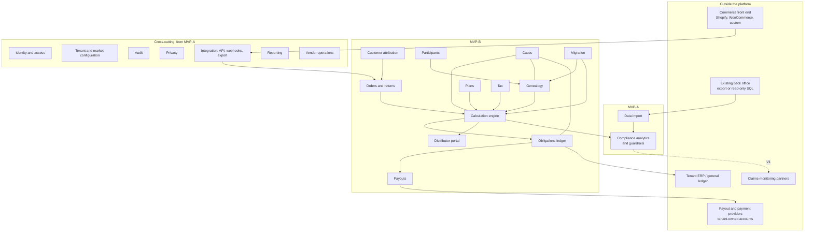
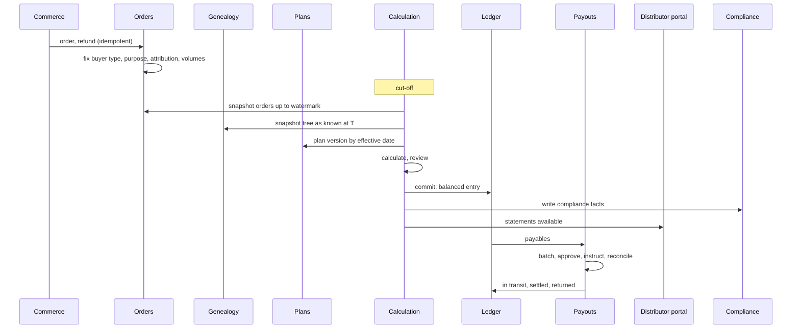

# 03 — PRODUCT MODULE ARCHITECTURE
## Business-level modules, how they interact, and what happened to each of the brief's 25 candidates

| Field | Value |
|---|---|
| Document ID | PD-03 |
| Version | 0.1 (draft for founder review) |
| Last updated | 2026-11-12 |
| Owner | CPO / CTO roles |
| Depends on | SYN-00, PD-01; gap audit 15 §4, 23, 31 |
| Status | Draft |

## 1. Module map

The compliance module reads **compliance facts**. In MVP-A the facts come from imports; in MVP-B the engine writes the same facts from native orders and result lines. The reports do not change.

## 2. Module definitions

Requirements per module are in `02-prd/02_FUNCTIONAL_REQUIREMENTS.md` (prefix shown). Rules are in `02-prd/04_BUSINESS_RULES.md`.

| Module (prefix) | Purpose and business value | Users | Responsibilities | Inputs → Outputs | Depends on | Integrations | Key rules | Security |
|---|---|---|---|---|---|---|---|---|
| **Identity and access** (FR-IAM) | Only the right people act; no one releases money alone | All; vendor ops | Sign-in, MFA, roles with market and brand scope, separation of duties, vendor support sessions, API keys | Credentials → sessions, approvals | — | Identity provider; tenant SSO | BR-SEC-01..06, BR-ADJ-02 | Step-up for approvals; vendor realm separate |
| **Tenant and market configuration** (FR-TEN) | One product for many companies and markets without custom code | Tenant admin; vendor ops | Tenant provisioning and data region; markets, brands, calendars; versioned settings; launch checklist; market packs | Settings → versions used by runs | IAM | — | BR-PER-01, BR-PAY-11, BR-DAT-09 | Money-affecting settings need approval |
| **Data import** (FR-IMP) | Start with the operator's existing data; hold no personal data we do not need | Implementation consultant; compliance officer | Upload, validate, map, load, supersede | Export files → compliance facts, data-quality report | TEN | Back-office export; later read-only SQL | BR-IMP-01..04 | Forbidden-column rejection |
| **Compliance analytics and guardrails** (FR-CPL) | Defensible figures; platform does not help configure unlawful plans | Compliance officer; owner | Reports R1–R5, snapshots, drill-down, guardrails, overrides, basis status; later disclosures, signals, claims feed | Facts or committed runs → snapshots, decisions | IMP or CAL | Monitoring partners (V1) | BR-GRD, BR-CPL, BR-HON | Exports logged |
| **Participants** (FR-PAR) | Correct population and types behind every figure | Support; compliance | Records, effective-dated types, enrolment with market gating, duplicates, status, agreements | Enrolments → participants, positions | TEN, GEN | Commerce enrolment | BR-PTY, BR-REG-04 | Masked sensitive fields |
| **Genealogy** (FR-GEN) | Structure that can be explained at any date | Analyst; support; leader | Positions, bitemporal sponsor and placement, as-of views, change cases, visibility policy, read model | Events → relationship history, tree views | PAR, CAS | — | BR-GEN, BR-DAT-03 | Server-side visibility |
| **Orders and returns** (FR-ORD) | Reliable facts in; nothing recomputed later | Integration; analyst | Idempotent ingestion, connectors, fixed facts, return events, late queue | Commerce events → orders, order events | INT, CRM | Shopify, WooCommerce, API | BR-ATT-02, BR-RET, BR-ORD | API scopes |
| **Customer attribution** (FR-CRM) | Who is paid for a customer | Support; distributor | Serviced-by relationship, attribution precedence, reassignment | Links, codes → servicing rows | PAR | Commerce attribution hints | BR-ATT | Prospect data private (V1) |
| **Plans** (FR-PLN) | Lower cost and risk of change | Plan admin; compliance | Versions, primitives, extension point, caps and pools, simulation, golden datasets, governance, transitions | Rules → validated versions | CPL (guardrails) | — | BR-PLN, BR-CAP | Second approver to activate |
| **Calculation engine** (FR-COMP) | Correct, reproducible pay | Analyst; finance | Period lifecycle, runs, passes, qualification state, review, commit, trace, replay, restatement | Snapshot + plan → result lines, state | ORD, GEN, PLN, TAX | — | BR-PER, BR-MNY, BR-RNK | Commit by non-preparer |
| **Obligations ledger** (FR-FIN) | Totals that can be proved | Finance | Double entry, derived balances, clawbacks, write-offs, GL export | Events → postings, exports | CAL | Tenant ERP | BR-LED, BR-REV | No human posting without a case |
| **Payouts** (FR-PAY) | Pay once, to the right account | Payout officer; finance | Batches, adapters, signed idempotent instructions, reconciliation, bank-detail controls, eligibility, holds | Payables → instructions, settlements | LED, IAM | Payout providers; bank files | BR-PAY | Preparer ≠ approver; cooling-off |
| **Tax** (FR-TAX) | Meet payer duties per market | Finance; distributor | Tax profile, withholding by market pack, year-end forms | Rules + gross → tax lines, forms | CAL, TEN | Tenant filing tools | BR-TAX | Tax ids in sensitive store |
| **Cases** (FR-CAS) | Every exception has reason, evidence and approver | Support; analyst; compliance | One case model for genealogy, duplicates, adjustments, disputes, restatements, returns, privacy | Requests → decisions, effects | IAM, AUD | — | BR-ADJ | Thresholds; related-party blocks |
| **Distributor portal** (FR-DIST) | Trust and fewer support contacts | Distributor; leader | Statement, line explanation, rank status, team, customers, bank and tax details, notifications | Committed results → views | CAL, GEN, PAY | Messaging provider | BR-HON, BR-DAT-03 | Self only; re-authentication |
| **Privacy** (FR-PRV) | Processor duties | DPO | Data-subject requests, pseudonymisation, retention, breach data | Requests → fulfilment | CAS | — | BR-DAT-06..11 | Second approver for erasure |
| **Audit** (FR-AUD) | Evidence for investigation and attestation | Compliance; admin | Append-only log, export logging | Actions → events | — | — | BR-SEC-03, BR-SEC-07 | Separate store |
| **Integration** (FR-INT) | API-first; data is the tenant's | Developers; analysts | Public API, webhooks, sync health, full export, replica (V1) | — | IAM | All external | BR-DAT-12 | Scopes, rate limits |
| **Reporting** (FR-RPT) | Role-specific views with definitions | All staff | Dashboards, saved views | Read models → dashboards | CAL, CPL, LED | — | BR-CPL-01 | Scope by market |
| **Migration** (FR-MIG) | Safe switching | Implementation; finance | History import, parallel run | Legacy extracts → opening state, difference report | GEN, CAL, LED | Legacy back office | BR-MIG | Sign-off |
| **Editions and licensing** (FR-LIC) | Sell the same product hosted and self-hosted without forking it | Licensee admin; vendor ops | Signed licence entitlement, signed updates and market packs with pre-activation checks, installer, diagnostics, redacted support bundle | Licence, packages → entitlement, installed versions | AUD, PLN, COMP | Update feed (optional, outbound) | BR-LIC-01..05 | No vendor access path; lapse never blocks pay |
| **Vendor operations** (FR-OPS) | Operate without standing access | Vendor staff | Tenant list, provisioning, support requests, market packs | — | IAM | — | BR-SEC-01 | Separate realm |

## 3. Module interactions on the core chain

## 4. The brief's 25 candidate modules: decisions

| # | Brief module | Decision | Where | Reason (research) |
|---|---|---|---|---|
| 1 | Company administration | **Build** | TEN | Needed |
| 2 | User and identity management | **Build** | IAM | GAP-065 |
| 3 | Distributor management | **Build** (as Participants) | PAR | GAP-028 |
| 4 | Customer management | **Build narrowly**: customers as participants with servicing relationship | PAR, CRM | GAP-040; full customer account stays with commerce |
| 5 | CRM and lead management | **Not built** in MVP (attribution only); contacts and reminders V1; lead scoring **not recommended** | CRM | GAP-041; pushes toward recruitment |
| 6 | Genealogy and network management | **Build** | GEN | GAP-010..013 |
| 7 | Sales management | **Not a module**; sales facts are ingested orders; dashboards in RPT | ORD, RPT | No evidence of a separate need |
| 8 | Product catalogue | **Integrate**; only a product-to-volume map is kept | ORD | GAP-045 |
| 9 | E-commerce and orders | **Integrate** (ingestion API and connectors); native storefront **not recommended** for MVP | ORD, INT | GAP-045 |
| 10 | Inventory management | **Integrate** (commerce or ERP) | — | GAP-047 |
| 11 | Compensation plan management | **Build** | PLN | GAP-020 |
| 12 | Commission calculation engine | **Build** | COMP | Core |
| 13 | Rank and qualification management | **Build** inside the engine | COMP | GAP-025 |
| 14 | Financial management | **Build as sub-ledger with GL export**; general ledger and accounts payable **not recommended** | FIN | GAP-033 |
| 15 | Payout management | **Build** | PAY | GAP-035 |
| 16 | Distributor wallet or ledger | **Wallet not built** (regulated); ledger of obligations **built** | FIN | 51 §5.4; C-12 |
| 17 | Training and LMS | **Partner** | — | No evidence; vendors exist |
| 18 | Communication | **Transactional notifications only**; messaging platforms integrate | DIST | Specialists sync to back offices |
| 19 | Marketing automation | **Not built**; approved-claims catalogue and disclosure feed for partners in V1 | CPL | GAP-001 |
| 20 | Event management | **Not built** | — | No research trace |
| 21 | Customer support | **Integrate** with the tenant's help desk; platform provides cases for pay, genealogy and privacy | CAS | GAP-046 |
| 22 | Analytics and business intelligence | **Build role dashboards and export**; replica access V1; natural-language reporting V2 | RPT, INT | GAP-062 |
| 23 | AI assistant | **Not in MVP**; V1: variance explainer, internal configuration assistant; recruiting or income AI **not recommended** | AI | GAP-070, GAP-071 |
| 24 | Integration management | **Build** | INT | GAP-045, GAP-004 |
| 25 | Audit and compliance management | **Build**; this is the wedge | AUD, CPL | GAP-081, GAP-087 |

Modules the brief did not list but the research requires: **Data import**, **Tax**, **Cases**, **Privacy**, **Migration**, **Vendor operations**.

## 5. Release boundaries

| Release | Modules active | Not yet |
|---|---|---|
| MVP-A | IAM (basic), TEN (tenant, region, market), IMP, CPL (R1–R5, snapshots, drill-down), AUD, OPS, vendor sessions | Everything else |
| MVP-B | All modules in §2 | V1 items |
| V1 | **Self-hosted edition** (licence, signed updates, installer and diagnostics); non-cash credits, multi-currency, disclosure publishing, integrity signals, claims feed, transfers and account types, subscription events, provisional runs, retention timers, replica, archive, leader dashboard, AI-1 and AI-5 | — |
| V2 / Enterprise | Natural-language reporting, support AI, forecasting, multi-brand tools, dedicated cells as a product, attestations | — |
| Not recommended | Wallets, e-pins, crypto; income projections; recruit leaderboards; AI recruiting content; distributor lead scoring; native storefront in MVP; built-in LMS; social-monitoring crawler; general ledger; percentage-of-volume pricing; tenant-specific code | — |
