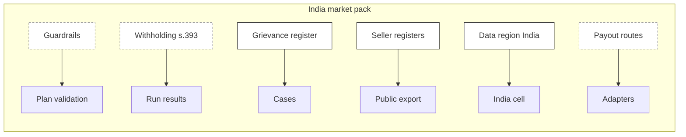

# 04 — MARKET PACKS: INDIA AND BANGLADESH
## Content of the first two market packs, with the basis status of every item

| Field | Value |
|---|---|
| Document ID | PD-04 |
| Version | 0.1 (draft for founder review) |
| Last updated | 2026-11-12 |
| Owner | Product, with Indian and Bangladeshi advisers |
| Depends on | DEC-02 (market-neutral core with packs), DEC-14 (no invented values), DEC-19, DEC-20; FR-CPL-013, FR-TAX-002, FR-TAX-003, FR-DIST-007, FR-TEN-002, FR-TEN-004, FR-PAY-002, FR-PAY-006; Phase 2 research in the sibling folder `research-completion` (documents 70–78) |
| Status | Draft. **Screening-grade content; no counsel or tax adviser has reviewed it.** A pack is not released until every "To confirm" item is confirmed in writing |

## 1. Basis status used in this document

| Status | Meaning | May ship? |
|---|---|---|
| **Confirmed** | Confirmed in writing by the named adviser | Yes |
| **Sourced** | Taken from a dated secondary source (law firm, tax portal) in research 70–71 | No — confirm first |
| **To decide** | Needs a decision by counsel, tax adviser or founder | No |
| **Product default** | A platform behaviour that holds whatever the adviser says (for example, a timer exists); its **value** may still be To confirm | Behaviour yes; value no |

No item in this document is Confirmed today.

## 2. India pack (IN-2026.0)

*Solid outline: product default behaviour. Dashed: values to confirm.*

### 2.1 Legal and compliance

| Item | Pack content | Requirement | Basis status | Source |
|---|---|---|---|---|
| Registration evidence | Tenant records its DPIIT registration; go-live checklist blocks without it | FR-TEN-004 | Sourced | 71 §1 |
| Entry fee | Guardrail **Blocked**: any fee charged to a participant for joining | FR-CPL-007, BR-GRD-02 | Sourced | 71 §1 |
| Pay on enrolment alone | Guardrail **Blocked**: a component whose only trigger is enrolling a person | FR-CPL-007, BR-GRD-01 | Sourced (pyramid prohibition) | 71 §1 |
| Personal purchase requirement to earn | Guardrail outcome **To decide** (Blocked, Warned or Reported); R4 reports it in all cases | FR-CPL-004, FR-CPL-007 | To decide (AQ-10 below) | 71 §1.1; 74 |
| Grievance register | Every complaint has an acknowledgement timer and a resolution timer; breaches are reported | FR-CPL-013 | Product default; values **48 hours / one month** Sourced | 71 §1 |
| Compliance and nodal officer | Named roles stored on the tenant; shown on the public contact page | FR-CPL-013 | Sourced | 71 §1 |
| Seller registers | Export of active and delisted direct sellers for the tenant's website | FR-CPL-013 | Sourced | 71 §1 |
| Written agreement, KYC, ID card | Agreement version accepted, KYC status and ID-card issue date on each participant | FR-CPL-013 | Sourced (Wave 1 primary excerpt) | Research 51 §3.3 |
| Buy-back and cooling-off | **To decide** | — | To decide (AQ-IN-04) | 71 §1.1 |

### 2.2 Tax

| Item | Pack content | Requirement | Basis status |
|---|---|---|---|
| Withholding on commission | Rate, annual threshold per payee, higher rate without PAN, financial year April–March | FR-TAX-002 | Sourced: 2%, ₹20,000, 20% (s.393, Income-tax Act 2025) |
| Payee tax profile | PAN, PAN status | FR-TAX-001 | Product default |
| Return export | Quarterly withholding return data (Form 26Q layout) | FR-TAX-003 | Sourced (form name); layout To confirm |
| GST on commission | **To decide** | — | To decide (AQ-IN-06) |

### 2.3 Data and hosting

| Item | Pack content | Basis status |
|---|---|---|
| Data region | India tenants in an India cell; backups and logs in India | Product default; scope of "consumer data" To decide (AQ-IN-02) |
| DPDP processor duties | Breach notification, erasure by pseudonymisation where ledger retention applies | Sourced (phases to May 2027); counsel |

### 2.4 Payments, language, plan mechanics

| Item | Pack content | Basis status |
|---|---|---|
| Payout routes | Bank file (NEFT/IMPS) first; RazorpayX and Cashfree Payouts after written eligibility | Product default; providers To confirm (AQ-01) |
| Currency | INR, two decimal places | Confirmed by currency standard |
| Languages | English; Hindi and regional languages for distributor statements | To decide (OQ-03) |
| Plan mechanics to support first | Stairstep differential, company-wide pools by shares with per-person monthly caps, accumulated-volume ranks | Research 74 (weak sources) |

## 3. Bangladesh

### 3.1 No MLM pack

There is **no Bangladesh pack for multi-level plans**. Research 70: no MLM licence issued since 2015, active enforcement, central-bank warnings. Tenants cannot select Bangladesh as a market for a plan with any multi-level component.

### 3.2 Conditional single-level affiliate pack (BD-AFF, not specified for build)

Only if Bangladeshi counsel answers AQ-BD-01 favourably.

| Item | Pack content | Basis status |
|---|---|---|
| Plan restriction | Guardrail **Blocked**: any component that pays on a participant's recruits' sales or on recruitment | Product default if the pack exists |
| Withholding | Flat rate on commission; TIN capture | Sourced: 10% (s.94, Income Tax Act 2023); To confirm |
| Data | Restricted data (NID and similar) handling; region | To decide (AQ-BD-06; conflicting sources) |
| Payout route | bKash corporate disbursement file | To confirm |
| Complaint timer | 72 hours (Digital Commerce Guidelines, for e-commerce sellers) | Sourced |
| Currency, language | BDT; Bangla | — |

## 4. Questions that block the packs

| ID | Question | Who | Blocks |
|---|---|---|---|
| AQ-10 | (India AQ-IN-01) Personal purchase requirement to earn: lawful, warned or blocked? | Indian counsel | Guardrail outcome |
| AQ-11 | (AQ-IN-02, -03) Scope of in-country storage; duties of a foreign software vendor | Indian counsel | Region design; contracts |
| AQ-12 | (AQ-IN-04..06) Buy-back and cooling-off; GST on commission; 26Q layout | Counsel; chartered accountant | Reversal rules; tax export |
| AQ-13 | (AQ-BD-01..06) Bangladesh: affiliate outside the 2013 Act? vendor exposure; data localisation | Bangladeshi counsel | BD-AFF pack; founder exposure |
| AQ-01 | Provider eligibility in writing | Providers | Payout adapters |

## 5. Release rule

A pack version is released only when (a) every item it ships has status Confirmed, (b) its tests pass on the golden datasets, and (c) the change notice lists what changed for tenants (FR-LIC-002 for the self-hosted edition).
