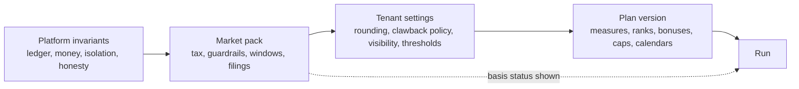

# 04 — BUSINESS RULES
## The rule catalogue: where each rule is set, its basis and how sure we are

| Field | Value |
|---|---|
| Document ID | PRD-04 |
| Version | 0.1 (draft for founder review) |
| Last updated | 2026-11-12 |
| Owner | Product (CPO role) |
| Depends on | Research 13, 51; gap audit 24; Phase A P1 |
| Status | Draft. Not approved |

## 1. Conventions

Rules state capabilities and invariants. **No parameter value (rate, threshold, window length) is set in this catalogue**; values belong to a tenant setting, a plan version or a market pack.

| Column | Meaning |
|---|---|
| **At** | Where the rule is set: **P** platform (same for all tenants) · **T** tenant setting · **M** market pack · **V** plan version |
| **Basis** | The source or decision the rule rests on. `G-S…` and `S-…` are source IDs in the research registers |
| **Status** | **R** primary source read · **S** screening (secondary source) · **D** design rule (our judgement) · **C** needs counsel or a tax adviser before it is relied on |
| **Used by / Tests** | Generated: the requirements that enforce the rule and the test scenarios that prove it |

**Source limits.** The original 57-rule catalogue (`15_BUSINESS_RULES_CATALOG.md`) is named in the research inventory but is **not in the repository folder** (open question OQ-22). Rules from it appear here only where the gap audit quotes or cites their content, and are marked "original catalogue". Rule groups BR-RNK-01..04, BR-REV-01, -03..-05, BR-PAY-01, -03..-05, BR-DAT-01, -02, -04, -05, BR-REG-01..03 and BR-TRM could not be reproduced. A labelled reconstruction (15-R, 12 Nov 2026, in the sibling folder `research-completion`) recovers the subjects of several of these but no further rule text, so none is added here.

## 2. Rule catalogue

### BR-GEN — Genealogy

GAP-002, GAP-010, GAP-013

| ID | Rule | At | Basis | Status | Release | Used by | Tests |
|---|---|---|---|---|---|---|---|
| BR-GEN-01 | A participant may own one or more positions; volume and qualification are evaluated per position unless the plan says per participant | V | G-S25 | R | MVP-B | FR-GEN-001 | TS-22 |
| BR-GEN-02 | Sponsor and placement relationships are separate, each with valid-from and valid-to dates and recorded time, and are never updated in place | P | Audit 08 §4 | D | MVP-B | FR-GEN-002, FR-GEN-003 | TS-61 |
| BR-GEN-03 | A change takes effect from an approved current or future date and never alters committed periods | P | Audit 08 §4 | D | MVP-B | FR-GEN-002, FR-GEN-004 | TS-61 |
| BR-GEN-04 | A correction records the original valid date; committed periods it affects are flagged and handled by the restatement policy (BR-PER-05) | P, T | Audit 08 §4 | D | MVP-B | FR-GEN-002, FR-GEN-004 | TS-03 |
| BR-GEN-05 | Change windows and approval requirements for sponsor and placement changes are plan-version parameters | V | G-S25, G-S26 | R | MVP-B | FR-GEN-004 | TS-45 |
| BR-GEN-06 | Placement into a binary or matrix position is serialised per target leg; the tie-break is deterministic and recorded | P | Audit 08 S6 | D | MVP-B | FR-GEN-005 | TS-45 |
| BR-GEN-07 | Termination changes position status; the tree structure is not modified to implement compression, roll-up or breakaway | P | GAP-013 | D | MVP-B | FR-PAR-005, FR-GEN-009 | TS-02 |
| BR-GEN-08 | Re-parenting of a terminated position's downline, if the plan requires it, is a dated change event with a stated rule per plan version | V | Original BR-TRM-03 | D | MVP-B | FR-GEN-009 | TS-64 |
| BR-GEN-09 | Duplicate-account suspicion blocks activation pending review where the tenant enables it | T | GAP-002, T8 | D | MVP-B | FR-PAR-003 | TS-59 |
| BR-GEN-10 | Succession, divorce division and sale of a distributorship are transfers of position ownership with documents and approval; history stays with the position | T | GAP-002 | C | V1 | FR-PAR-004 | — |
| BR-GEN-11 | Reinstatement is an event on the same position; rank and placement after return follow a rule per plan version | V | Audit 08 S11 | D | MVP-B | FR-PAR-005 | TS-64 |
| BR-GEN-12 | Authorisation checks use the path read model when current and fall back to the system of record when it is stale; a stale read model never widens access | P | This documentation (SDD) | D | MVP-B | FR-GEN-008 | TS-64 |

### BR-PER — Periods and retroactivity

GAP-023

| ID | Rule | At | Basis | Status | Release | Used by | Tests |
|---|---|---|---|---|---|---|---|
| BR-PER-01 | Each plan defines one or more calendars and the time zone of each cut-off | V | G-S25, G-S28 | R | MVP-B | FR-TEN-002, FR-PLN-002, FR-COMP-001 | TS-62 |
| BR-PER-02 | A transaction is assigned to a period by its defined crediting event (payment, shipment or end of cooling-off). UNRESOLVED: which event (D-R1) | V, M | Original BR-VOL-02 | C | MVP-B | FR-COMP-001 | TS-62 |
| BR-PER-03 | Period states are Open, Calculating, Calculated, Committed, Paid, Closed; inputs and outputs are frozen at Committed | P | Incumbent pattern G-S30 | D | MVP-B | FR-COMP-001, FR-COMP-005, FR-COMP-006, FR-COMP-008 | TS-03, TS-60 |
| BR-PER-04 | Transactions arriving after Committed post as adjustments in the current open period by default | P | Incumbent pattern G-S29 | D | MVP-B | FR-ORD-005, FR-COMP-001, FR-COMP-010 | TS-13 |
| BR-PER-05 | A restatement reopens nothing: it recalculates a committed period in a sandbox with approval, a reason and a stored diff; paid amounts are corrected by adjustments, never by editing postings | T | GAP-023 | D | MVP-B | FR-COMP-009 | TS-51 |
| BR-PER-06 | A run is idempotent per tenant, calendar, period and run request id and locked against concurrent runs | P | Audit 15 B4 | D | MVP-B | FR-COMP-002 | TS-14, TS-29 |
| BR-PER-07 | A provisional run is paid and later trued up by a final run that posts only the difference | V | Phase A P1 (N-PROV) | R | V1 | FR-COMP-011 | — |

### BR-MNY — Money arithmetic

GAP-021

| ID | Rule | At | Basis | Status | Release | Used by | Tests |
|---|---|---|---|---|---|---|---|
| BR-MNY-01 | Amounts are held in minor units or fixed-precision decimals; binary floating point is prohibited | P | Audit 09 T1 | D | MVP-B | FR-COMP-012 | TS-67 |
| BR-MNY-02 | Rounding happens once per payout line at a defined step; the rounding mode is a tenant setting with platform default half-up | P, T | Audit 09 | D | MVP-B | FR-TEN-003, FR-COMP-003, FR-COMP-012 | TS-06 |
| BR-MNY-03 | Splits, pools and scaled caps are allocated so that parts sum exactly to the total (largest remainder; ties by payee id ascending) | P | Audit 09 T1, T2 | D | MVP-B | FR-PLN-004, FR-COMP-012 | TS-06, TS-07 |
| BR-MNY-04 | Any unavoidable residue posts to a named residue account | P | Audit 10 §3 | D | MVP-B | FR-COMP-012, FR-FIN-001 | TS-06 |
| BR-MNY-05 | Points-to-currency factors are effective-dated per market and shown on statements | V, M | G-S26 | R | MVP-B | FR-COMP-012 | TS-23 |

### BR-CAP — Caps

GAP-022

| ID | Rule | At | Basis | Status | Release | Used by | Tests |
|---|---|---|---|---|---|---|---|
| BR-CAP-01 | A cap has a scope (bonus types), a base expression, a rate, a method (proportional, priority list, per person) and a residue rule | V, M | G-S02, G-S26 | R | MVP-B | FR-PLN-004 | TS-07, TS-08, TS-09, TS-12 |
| BR-CAP-02 | Per-participant constraints are evaluated before company-level caps | V | G-S02 §I.A.1 | R/C | MVP-B | FR-CPL-002, FR-PLN-004, FR-COMP-003 | TS-09 |
| BR-CAP-03 | Simulation shows, for each cap, the payees affected and amounts removed | P | Audit 09 T3 | D | MVP-B | FR-PLN-004 | TS-08 |

### BR-RNK — Rank and qualification state

GAP-025 (BR-RNK-01..04 are in the original catalogue 15, which is not in the repository; see OQ-22)

| ID | Rule | At | Basis | Status | Release | Used by | Tests |
|---|---|---|---|---|---|---|---|
| BR-RNK-05 | Each position has a paid-as rank per period and a highest-achieved title, stored separately | V | G-S26, G-S28 | R | MVP-B | FR-PLN-002, FR-COMP-004, FR-DIST-003 | TS-63 |
| BR-RNK-06 | Qualification windows (period-end, rolling n periods, per order) are declared per requirement | V | G-S25 | R | MVP-B | FR-PLN-002, FR-COMP-004 | TS-63 |
| BR-RNK-07 | Cross-period state is an output of a committed run and an input to the next; it is never edited directly | P | GAP-025 | D | MVP-B | FR-PLN-008, FR-COMP-004 | TS-25 |
| BR-RNK-08 | Carry-forward has optional conditions, caps and expiry | V | G-S25, G-S28 | R | MVP-B | FR-COMP-004 | TS-04, TS-05 |
| BR-RNK-09 | Several rank ladders may exist per participant | V | G-S26 | R | MVP-B | FR-PLN-002, FR-COMP-004 | TS-63 |

### BR-PTY — Participant types

GAP-028

| ID | Rule | At | Basis | Status | Release | Used by | Tests |
|---|---|---|---|---|---|---|---|
| BR-PTY-01 | Participant types are tenant-defined with flags: can earn, counts as end customer, can sponsor, can hold positions | T | G-S25, G-S26, G-S28 | R | MVP-A | FR-IMP-002, FR-PAR-001 | TS-31 |
| BR-PTY-02 | Type changes are effective-dated and do not re-label past orders | P | GAP-028 | D | MVP-B | FR-PAR-001 | TS-48 |
| BR-PTY-03 | Every participant order carries a purpose (resale, personal use, unspecified) where the market or tenant requires it | T, M | G-S02 | R/C | MVP-B | FR-ORD-003 | TS-65 |

### BR-ATT — Attribution and ownership

GAP-040

| ID | Rule | At | Basis | Status | Release | Used by | Tests |
|---|---|---|---|---|---|---|---|
| BR-ATT-01 | Each customer has one serviced-by relationship at a time, effective-dated | T | GAP-040 | D | MVP-B | FR-CRM-001, FR-DIST-005 | TS-49 |
| BR-ATT-02 | Attribution, buyer type, purpose and line volumes are fixed on the order at ingestion | P | Audit 22 §5 | D | MVP-B | FR-ORD-001, FR-ORD-003, FR-CRM-001 | TS-48 |
| BR-ATT-03 | On termination of the servicing distributor, customers are reassigned by a tenant rule with notice | T | GAP-040 | D | MVP-B | FR-CRM-002 | TS-49 |
| BR-ATT-04 | Fractional roll-ups of customer volume are plan parameters | V | G-S25 | R | MVP-B | FR-CRM-001 | TS-65 |

### BR-ORD — Orders and volume

GAP-045, GAP-047 (BR-ORD-01, -03 and BR-VOL-01..03 are from the original catalogue; content reconstructed from citations)

| ID | Rule | At | Basis | Status | Release | Used by | Tests |
|---|---|---|---|---|---|---|---|
| BR-ORD-01 | Every order records the buyer's participant type at the time of the order (replaces the original binary buyer type, IC-14) | P | Original 15; GAP-028 | D | MVP-B | FR-ORD-001 | TS-47 |
| BR-ORD-04 | An order is unique per tenant, source system and source order id; replays with the same content are no-ops | P | Audit 15 B1 | D | MVP-B | FR-ORD-001, FR-ORD-002 | TS-15 |
| BR-ORD-05 | A run may not start while order sync lag exceeds the tenant threshold at cut-off | P, T | Audit 14 §4 | D | MVP-B | FR-INT-002 | TS-58 |
| BR-VOL-01 | Volume per order line comes from a product-to-volume map effective at the crediting event time | T | Original 15 (cited in audit 12) | D | MVP-B | FR-ORD-001 | TS-47 |
| BR-VOL-03 | Reversal of volume is proportional to the returned lines (see BR-RET-01) | P | Original 15 (cited in audit 12) | D | MVP-B | FR-ORD-004 | TS-47 |

### BR-RET — Returns and exchanges

GAP-047

| ID | Rule | At | Basis | Status | Release | Used by | Tests |
|---|---|---|---|---|---|---|---|
| BR-RET-01 | Returns reverse volume per returned line, not per order | P | GAP-047 | D | MVP-B | FR-ORD-004 | TS-47 |
| BR-RET-02 | An exchange of equal value flagged as such does not reverse and re-credit volume | T | GAP-047 | D | MVP-B | FR-ORD-004 | TS-47 |
| BR-RET-03 | Restocking fees reduce the refund; their effect on volume is a tenant setting | T | S-122 | D | MVP-B | FR-ORD-004 | TS-65 |

### BR-REV — Reversal policy

GAP-032 (BR-REV-01, -03..-05 are in the original catalogue; see OQ-22)

| ID | Rule | At | Basis | Status | Release | Used by | Tests |
|---|---|---|---|---|---|---|---|
| BR-REV-02 | Whether a reversal changes a closed period or posts an adjustment is a tenant policy within platform rules. UNRESOLVED legally (D-R2) | T, M | Original 15; 13 EX-8 | C | MVP-B | FR-FIN-003 | — |
| BR-REV-06 | A chargeback is treated like a refund for volume and pay | P | Original 15 (cited in audit 12) | D | MVP-B | FR-ORD-004, FR-ORD-006 | TS-65 |
| BR-REV-07 | Default clawback method is order-line clawback against future earnings; restatement is available per bonus type | T | G-S29; audit 09 T5 | D/C | MVP-B | FR-FIN-003 | TS-10 |
| BR-REV-08 | Clawback receivables below a tenant threshold may be written off with approval | T | Audit 10 §3 | D | MVP-B | FR-FIN-004 | TS-11 |
| BR-REV-09 | The platform never initiates a debit from a distributor's bank account | P | A-02 | D | MVP-B | FR-FIN-003 | TS-11 |

### BR-TAX — Withholding and reporting

GAP-031

| ID | Rule | At | Basis | Status | Release | Used by | Tests |
|---|---|---|---|---|---|---|---|
| BR-TAX-01 | Withholding rules are effective-dated and market-scoped: rate, threshold, threshold basis, payee conditions | M | G-S12, G-S13 | S/C | MVP-B (market pack) | FR-TAX-001, FR-TAX-002 | TS-18 |
| BR-TAX-02 | Withholding is computed after gross commission and before payout instruction and posts to a withholding liability | P | Audit 10 §3 | D | MVP-B | FR-COMP-003, FR-TAX-002 | TS-38 |
| BR-TAX-03 | Missing tax id applies the market's higher rate where the law sets one | M | G-S13 | S/C | MVP-B (market pack) | FR-TAX-001, FR-TAX-002 | TS-19 |
| BR-TAX-04 | Year-end statements are generated per market form with thresholds per tax year | M | G-S05, G-S12 | S/C | MVP-B (market pack) | FR-TAX-003 | — |

### BR-PAY — Payout integrity

GAP-035 (BR-PAY-01, -03..-05 are in the original catalogue; see OQ-22)

| ID | Rule | At | Basis | Status | Release | Used by | Tests |
|---|---|---|---|---|---|---|---|
| BR-PAY-02 | Payout batches have separate preparer and approver and an audit trail (reconstructed from MH-REQ-02) | P | 51 MH-REQ-02 | D | MVP-B | FR-PAY-001 | TS-42 |
| BR-PAY-06 | Statements itemise each payout line by source (reconstructed from MH-REQ-09) | P | 51 MH-REQ-09 | D | MVP-B | FR-COMP-007, FR-DIST-001, FR-DIST-002 | TS-53 |
| BR-PAY-08 | New or changed bank details trigger re-authentication, notice to the previous contact, and a cooling-off before the first payout | T | Audit 16 T5 | D | MVP-B | FR-IAM-007, FR-PAY-005, FR-DIST-006, FR-DIST-008 | TS-17 |
| BR-PAY-09 | Returned payments move the amount back to the payee's payable balance and open a case | P | Audit 10 §3 | D | MVP-B | FR-PAY-004 | TS-40 |
| BR-PAY-10 | Payout instructions carry idempotency keys and are signed | P | Audit 16 T13 | D | MVP-B | FR-PAY-003 | TS-16 |
| BR-PAY-11 | Payment and payout providers must be confirmed eligible for the tenant's business type in the market before go-live | T, M | G-S04, G-S20 | R | MVP-B | FR-TEN-004, FR-PAY-002, FR-PAY-006 | TS-50 |
| BR-PAY-12 | Payables below the market's minimum payout accumulate; holds are dated events with reason and owner | T, M | 13 §3; GAP-035 | D | MVP-B | FR-PAY-007 | TS-17 |

### BR-LED — Ledger

GAP-030

| ID | Rule | At | Basis | Status | Release | Used by | Tests |
|---|---|---|---|---|---|---|---|
| BR-LED-01 | Every journal entry balances (sum of debits equals sum of credits) and carries an idempotency key, origin reference and approver where a human decided | P | Audit 10 §3 | D | MVP-B | FR-FIN-001 | TS-38 |
| BR-LED-02 | Postings are append-only; balances are sums of postings and are never edited | P | Audit 10 §2 | D | MVP-B | FR-FIN-001, FR-FIN-002 | TS-39, TS-40 |
| BR-LED-03 | The ledger records obligations of the tenant, never funds held by the platform; the word wallet is not used for anything the platform records | P | 51 MH-REQ-01; audit 10 §1 | D | MVP-B | FR-FIN-005 | TS-67 |

### BR-ADJ — Manual adjustments and disputes

GAP-002, GAP-065

| ID | Rule | At | Basis | Status | Release | Used by | Tests |
|---|---|---|---|---|---|---|---|
| BR-ADJ-01 | Every manual adjustment has a reason code, evidence and a case | P | Incumbent pattern G-S30 | D | MVP-B | FR-COMP-010, FR-CAS-001, FR-CAS-002 | TS-42 |
| BR-ADJ-02 | Approvals above a tenant threshold need a second approver; nobody approves what they prepared | T | Audit 16 T6 | D | MVP-B | FR-IAM-004, FR-COMP-006, FR-PAY-001, FR-CAS-002 | TS-42 |
| BR-ADJ-03 | Adjustments to accounts of the approver, declared relatives or accounts created in the last n days are blocked or escalated | T | Audit 16 T6 | D | MVP-B | FR-CAS-002 | TS-42 |
| BR-ADJ-04 | A commission dispute has states opened, under review, resolved upheld, resolved not upheld, and a response time per market where required | T, M | CMP-09 | S | MVP-B | FR-CPL-013, FR-CAS-003 | TS-68 |

### BR-GRD — Platform guardrails

GAP-087. Default proposal (stance Moderate, FD-06); needs founder and counsel

| ID | Rule | At | Basis | Status | Release | Used by | Tests |
|---|---|---|---|---|---|---|---|
| BR-GRD-01 | Blocked: a payout component whose only trigger is enrolling a person, in markets that ban it | P, M | S-020, G-S02, CMP-03 | C | MVP-B | FR-CPL-007 | TS-27 |
| BR-GRD-02 | Blocked: fees or deposits from participants where the market prohibits them | P, M | S-048, CMP-14 | C | MVP-B | FR-CPL-007 | TS-66 |
| BR-GRD-03 | Warned and logged: starter kits carrying commissionable volume; personal-consumption share above a tenant threshold | P | S-141, G-S02 | D | MVP-B | FR-CPL-002, FR-CPL-004, FR-CPL-007, FR-CPL-010 | TS-26 |
| BR-GRD-04 | Reported: retail-customer share, payout-source mix, earnings distribution | P | CMP-01, CMP-05 | D | MVP-A | FR-CPL-001, FR-CPL-003, FR-CPL-005, FR-CPL-007 | TS-31 |
| BR-GRD-05 | Guardrail overrides need a written justification from the tenant and are visible in compliance reports | P | GAP-087 | D | MVP-B | FR-CPL-008 | TS-66 |

### BR-PLN — Plan versions and transitions

GAP-097, GAP-020

| ID | Rule | At | Basis | Status | Release | Used by | Tests |
|---|---|---|---|---|---|---|---|
| BR-CMP-01 | A run uses exactly one plan version, chosen by effective date (original catalogue) | P | Original 15; audit 09 §3 | D | MVP-B | FR-PLN-001, FR-COMP-002 | TS-01 |
| BR-CMP-09 | Currency conversion follows a tenant policy with an effective-dated rate table (original catalogue, narrowed by BR-MNY) | T | Original 15 | D | V1 | FR-FIN-007 | — |
| BR-PLN-01 | Each new plan version declares transition rules for titles, carry balances, streaks and one-time flags | V | G-S28 | D | MVP-B | FR-PLN-001, FR-PLN-008 | TS-24 |
| BR-PLN-02 | A version cannot be activated without a simulation on at least one full historical period | P | GAP-026 | D | MVP-B | FR-PLN-005, FR-PLN-007 | TS-46 |
| BR-PLN-03 | Where a market requires a filing, activation is blocked until the filing status is recorded | M | S-043 | S | MVP-B (market pack) | FR-PLN-007 | TS-46 |
| BR-PLN-04 | Field notice period before activation is a tenant setting | T | GAP-097 | D | MVP-B | FR-PLN-007, FR-DIST-008 | TS-68 |
| BR-PLN-05 | Tenant-specific code branches are prohibited; extensions are expressions or platform-reviewed modules available to all tenants | P | GAP-020; 23 §2 | D | MVP-B | FR-PLN-003 | TS-67 |
| BR-PLN-06 | Every plan version and every engine release must reproduce its golden datasets exactly | P | GAP-026 | D | MVP-B | FR-PLN-006 | TS-43, TS-44, TS-46, TS-60 |

### BR-CRD — Non-cash rewards

GAP-024

| ID | Rule | At | Basis | Status | Release | Used by | Tests |
|---|---|---|---|---|---|---|---|
| BR-CRD-01 | Each credit type has value, expiry, redemption scope and tax treatment flag | T | G-S26, G-S28 | R | V1 | FR-FIN-006 | — |
| BR-CRD-02 | Expiry posts a reversal of the credit liability and notifies the holder in advance | T | GAP-024 | D | V1 | FR-FIN-006 | — |

### BR-SEC — Access

GAP-065

| ID | Rule | At | Basis | Status | Release | Used by | Tests |
|---|---|---|---|---|---|---|---|
| BR-SEC-01 | Vendor staff have no standing access to tenant data; access is a tenant-approved, time-boxed session, logged and visible to the tenant | P | Audit 16 T3 | D | MVP-A | FR-IAM-005, FR-OPS-001, FR-LIC-003 | TS-37 |
| BR-SEC-02 | Payout approvers, tenant admins and vendor staff use multi-factor authentication | P | Audit 16 T10 | D | MVP-A | FR-IAM-002 | TS-35 |
| BR-SEC-03 | Exports and API extraction of personal data are limited, logged and attributed | P | Audit 16 T11 | D | MVP-A | FR-IAM-006, FR-GEN-006, FR-AUD-002, FR-INT-001, FR-RPT-002 | TS-34 |
| BR-SEC-04 | The tenant id is taken from the authenticated session and enforced in the data layer; it is never accepted from the client | P | Audit 16 T1 | D | MVP-A | FR-IAM-001 | TS-21 |
| BR-SEC-05 | A grant of an admin or approver role needs a second admin; a user cannot grant permissions they do not hold | P | Audit 16 T2 | D | MVP-A | FR-IAM-003 | TS-36 |
| BR-SEC-06 | Separation of duties is evaluated from recorded actor ids on the object, not from role names | P | This documentation (SDD) | D | MVP-B | FR-IAM-004 | TS-42 |
| BR-SEC-07 | Audit events are append-only, stored separately from application tables and hash-chained per tenant | P | SEC-09 | D | MVP-A | FR-AUD-001 | TS-56 |

### BR-DAT — Privacy as processor

GAP-085, GAP-061 (BR-DAT-01, -02, -04, -05 are in the original catalogue; see OQ-22)

| ID | Rule | At | Basis | Status | Release | Used by | Tests |
|---|---|---|---|---|---|---|---|
| BR-DAT-03 | Downline visibility follows a field-by-depth policy enforced on the server (original rule made specific by GAP-012) | T | Original 15; GAP-012 | D | MVP-B | FR-GEN-006, FR-GEN-007, FR-DIST-002, FR-DIST-004 | TS-20 |
| BR-DAT-06 | Erasure requests pseudonymise payee identity in the ledger rather than deleting postings, where retention law allows | P, M | GAP-085 | C | MVP-B | FR-PRV-001, FR-PRV-002 | TS-28 |
| BR-DAT-07 | Breach-notification timelines and contacts are configured per market and per tenant | M | G-S14, G-S10 | S | MVP-A | FR-PRV-004 | TS-50 |
| BR-DAT-08 | Prospect data entered by a distributor is private to that distributor by default | T | GAP-041 | D | V1 | FR-CRM-003 | — |
| BR-DAT-09 | Personal data, backups and exports stay in the tenant's configured region | P, M | GAP-061 | D/C | MVP-A | FR-TEN-001 | TS-57 |
| BR-DAT-10 | An archived tenant is read-only; data is retained per law and then deleted | P | GAP-098 | D | V1 | FR-TEN-005 | — |
| BR-DAT-11 | Each data class has a retention period per market; deletion jobs are logged | M | PRV-05 | S | V1 | FR-PRV-003 | — |
| BR-DAT-12 | A tenant can export its complete data in a documented open format at any time | P | GAP-096 | D | MVP-B | FR-INT-003, FR-INT-004 | TS-58 |

### BR-IMP — Overlay import (new in this documentation)

P4, Phase A prototype

| ID | Rule | At | Basis | Status | Release | Used by | Tests |
|---|---|---|---|---|---|---|---|
| BR-IMP-01 | An overlay export may not contain names, contact details, addresses, identity numbers or bank data; a file with such columns is rejected whole | P | Phase A validate_export.py; P4 data terms | D | MVP-A | FR-IMP-001, FR-IMP-004 | TS-32 |
| BR-IMP-02 | Imported amounts are integers in minor units; participant ids are pseudonymous | P | Phase A analytics.py schema | D | MVP-A | FR-IMP-001 | TS-32 |
| BR-IMP-03 | Every compliance figure records the mapping version that produced it | P | This documentation | D | MVP-A | FR-IMP-002 | TS-33 |
| BR-IMP-04 | A re-import supersedes, never deletes, the earlier batch | P | This documentation | D | MVP-A | FR-IMP-003 | TS-33 |

### BR-CPL — Compliance reporting (new and original)

| ID | Rule | At | Basis | Status | Release | Used by | Tests |
|---|---|---|---|---|---|---|---|
| BR-CPL-01 | Every compliance figure stores its population, method version and inputs and can be recomputed identically | P | ENT-21; GAP-081 | D | MVP-A | FR-CPL-001, FR-CPL-006, FR-RPT-001 | TS-31 |
| BR-CPL-03 | Every market-pack rule stores its basis and basis status (screening, primary read, counsel-confirmed) | P | CPL-15 | D | MVP-B | FR-CPL-012, FR-LIC-002 | TS-50 |
| BR-HON-01 | The product contains no income projection, potential-earnings calculator or recruit leaderboard | P | CPL-14; FD-09 | D | MVP-A | FR-CPL-005, FR-DIST-001, FR-DIST-003, FR-DIST-009 | TS-53 |
| BR-HON-02 | Wherever earnings are shown to participants or prospects, the published disclosure is linked when one exists | P | CPL-14 | D | V1 | FR-CPL-009, FR-CPL-011 | — |
| BR-REG-04 | Enrolment and shipping are restricted to markets the tenant has opened (original catalogue) | T, M | Original 15; GAP-006 | D | MVP-B | FR-TEN-004, FR-PAR-002 | TS-50 |
| BR-REG-05 | Where the market pack requires it, enrolment needs acceptance of the current agreement version | M | CMP-06 | S | MVP-B (market pack) | FR-PAR-006 | TS-46 |

### BR-OTH — Other

| ID | Rule | At | Basis | Status | Release | Used by | Tests |
|---|---|---|---|---|---|---|---|
| BR-LOC-01 | Distributor-facing text is delivered in the market's configured languages with locale-aware formats | M | GAP-051 | D | MVP-B (market pack) | FR-DIST-007 | TS-30, TS-54 |
| BR-MIG-01 | Opening balances and opening qualification state from a migration are posted once, with approval, and are identifiable as migration entries | P | GAP-077 | D | MVP-B | FR-MIG-001 | TS-52 |
| BR-MIG-02 | Go-live requires a parallel run with zero unexplained differences | P | GAP-077; audit 31 Phase D | D | MVP-B | FR-MIG-002 | TS-52 |
| BR-AI-01 | No model output may write to plans or the ledger; any AI text that mentions money must cite the lines it summarises | P | GAP-070 | D | V1 | FR-AI-001, FR-AI-002 | — |

### BR-LIC — Editions and licensing (new; founder decision DEC-17)

Both editions are the same codebase; the self-hosted edition is a single-tenant deployment

| ID | Rule | At | Basis | Status | Release | Used by | Tests |
|---|---|---|---|---|---|---|---|
| BR-LIC-01 | A licence lapse never blocks calculation, commit, payout, statements or export; it only stops new engine versions, market-pack updates and support | P | DEC-17 | D | V1 | FR-LIC-001 | TS-69 |
| BR-LIC-02 | Licence verification works offline from a signed file; the product does not require a call to the vendor to run | P | DEC-17 | D | V1 | FR-LIC-001 | TS-69 |
| BR-LIC-03 | Releases, engine versions and market packs are signed; an engine update is activated only after golden and replay checks pass on the installation | P | DEC-17; GAP-026 | D | V1 | FR-LIC-002 | TS-70 |
| BR-LIC-04 | The self-hosted edition gives the vendor no access path; support uses licensee-approved sessions or a redacted bundle | P | DEC-17; GAP-065 | D | V1 | FR-LIC-003 | TS-71 |
| BR-LIC-05 | Both editions are built from one codebase with the same guardrails, honesty policy and ledger invariants; no edition removes them and no source-code edition is offered | P | DEC-17; BR-PLN-05 | D | V1 | FR-LIC-001 | — |

## 3. Unresolved rules (not invented here)

These decisions are open in the research. The product is designed so that either answer is configuration, and the provisional default is named. None is treated as settled.

| ID | Open rule | Why open | Options | Provisional default used in these documents | Who decides |
|---|---|---|---|---|---|
| D-R1 | The crediting event that assigns volume to a period | Depends on market law (cooling-off) and tenant policy; research left open (BR-PER-02) | Payment · shipment · end of cooling-off | Configurable per plan version; no default value shipped | Tenant with counsel |
| D-R2 | Whether a reversal may alter a closed period | Legal and policy question (13 EX-8; 11 §7) | Adjust in open period · restate | Adjust in the open period; restatement only by approved request (BR-PER-04, BR-PER-05) | Tenant with counsel |
| D-R3 | Negative balance after clawback | Practice varies (S-124) | Carry · write off · collect | Carry as receivable, net against future earnings, write off with approval; never debit a bank account (BR-REV-07..09) | Tenant with counsel (Q-10) |
| D-R4, D-R6 | Which configurations the platform blocks, warns on or reports | Founder decision FD-06 and counsel question Q-1 | Strict · Moderate · Neutral | Moderate (BR-GRD-01..05) | Founder with counsel |
| D-R5 | Not identifiable | Defined only in the missing original catalogue | — | — | See OQ-22 |
| — | Withholding rates, thresholds and forms per market | Screening-grade sources only (GAP-031) | — | None shipped; market pack values need a tax adviser (BR-TAX-01..04) | Tax adviser (FD-05) |
| — | Whether distributor-entered prospect data makes the distributor a controller | GAP-041 | — | Tenant is controller, platform is processor, data private to the distributor (BR-DAT-08) | Counsel |
| — | Succession, divorce and sale of a distributorship | GAP-002; legal per market | — | Transfer case with documents (BR-GEN-10), V1 | Counsel |
| — | Unclaimed and dormant balances | "May become legal liabilities in some jurisdictions" is unverified (GAP-035) | — | Dormant balance report only (FR-PAY-007) | Counsel |
| — | Starter-kit, renewal and subscription fees charged to participants | Ten of 21 corpus plans have fees; lawful treatment varies (CMP-14) | Block · warn · allow | Warn; block where the market pack says prohibited (BR-GRD-02, BR-GRD-03) | Founder with counsel |

## 4. Rule precedence

When rules at different levels conflict, the order is: **platform invariants** (P) > **market pack** (M) > **tenant setting** (T) > **plan version** (V). A plan cannot relax a market rule; a tenant cannot relax a platform invariant. Guardrail overrides (BR-GRD-05) are the single controlled exception and are always visible.

