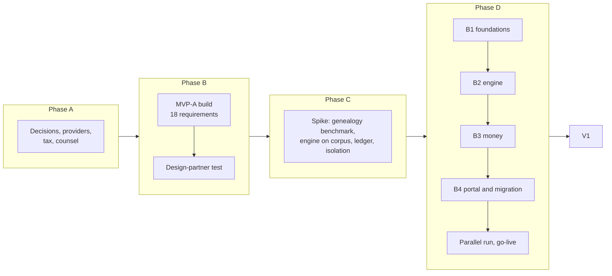

# 07 — MVP AND PRODUCT ROADMAP
## Two MVPs, what each contains, build order, and what is deferred or refused

| Field | Value |
|---|---|
| Document ID | PRD-07 |
| Version | 0.1 (draft for founder review) |
| Last updated | 2026-11-12 |
| Owner | Product |
| Depends on | PD-02, PRD-02; gap audit 31 |
| Status | Draft. **No dates**: team size and budget are unknown (FD-03) |

## 1. Releases at a glance

## 2. MVP-A — compliance-analytics overlay

**Purpose:** test demand for the one unclaimed area, on a design partner's own data. **Is the MVP realistic?** Yes: a working prototype of the report logic exists in the research (Phase A `analytics.py`, with a hand-checked fixture). MVP-A turns it into a multi-tenant service with access control and evidence.

| In | Requirement IDs |
|---|---|
| Sign-in, MFA, roles | FR-IAM-001, -002, -003 |
| Vendor support sessions; vendor console | FR-IAM-005, FR-OPS-001 |
| Tenant and data region | FR-TEN-001 |
| Upload, validation, mapping, load | FR-IMP-001, -002, -003 |
| Reports R1–R5; snapshots and drill-down | FR-CPL-001..006 |
| Audit log; export limits; breach contacts | FR-AUD-001, -002, FR-PRV-004 |

| Out of MVP-A | Why |
|---|---|
| Read-only SQL connector | V1; files are enough for a test |
| Disclosure publication, integrity signals | V1; computation only |
| Any engine, ledger or payout function | Waits for the gate |

**Exit:** FD-10 rule (PD-02 §2). **Screens:** SC-10, 14, 24–28, 30, 39, 46. **Reuse in MVP-B:** identity, tenancy, audit, compliance module and fact tables are the same code.

## 3. MVP-B — engine plus compliance

Built only after G3′, G4′ and the Phase C spike pass. Order follows risk (gap audit 31 §3): wrong money first.

| Increment | Outcome | Requirements |
|---|---|---|
| **B1 Foundations** | Tenants, markets, settings versions, separation of duties, API keys, cases, public API skeleton, outbox | FR-TEN-002..004, FR-IAM-004, -006, FR-CAS-001, FR-INT-001, FR-CPL-012 |
| **B2 Structure and facts** | Participants and types, positions, bitemporal genealogy with cases, read model, visibility; order ingestion, connectors, returns, late queue, attribution | FR-PAR-001..003, -005, -006; FR-GEN-001..009; FR-ORD-001..005; FR-CRM-001, -002; FR-INT-002 |
| **B3 Engine** | Plan versions, primitives, extension point, caps, simulation, golden datasets; calendars, runs, passes, qualification state, review, commit, trace, replay, money rules; guardrails | FR-PLN-001..006; FR-COMP-001..008, -012; FR-CPL-007, -008 |
| **B4 Money** | Ledger, balances, clawbacks, write-offs, GL export; tax profile and market-pack withholding; payouts, adapters, outbox instructions, reconciliation, bank-detail controls, eligibility, holds; adjustments, restatement, manual adjustment cases | FR-FIN-001..005; FR-TAX-001..003; FR-PAY-001..007; FR-COMP-009, -010; FR-CAS-002 |
| **B5 People** | Distributor sign-in, statement, explanation, rank, team, customers, bank and tax self-service, notifications, localisation; disputes; privacy requests | FR-IAM-007; FR-DIST-001..008; FR-CAS-003; FR-PRV-001, -002 |
| **B6 Change and switching** | Plan-change governance and transitions; history import and parallel run; dashboards and saved views; full export; launch checklist complete | FR-PLN-007, -008; FR-MIG-001, -002; FR-RPT-001, -002; FR-INT-003; FR-CPL-013 if the pack needs it |

**Exit:** one design partner live after a parallel run with zero unexplained differences.

**Primitive set for the first engine** (corpus frequency, Phase A P1 §4; to be confirmed against launch-market plans):

| Priority | Mechanisms |
|---|---|
| Must | Personal, group, qualifying and commissionable volume per order line with item rules; sponsor-tree pay; rank thresholds with leg rules, customer counts, paid-as versus title, maintenance and grace; unilevel by level; generations with dynamic compression; differential, override, matching; fast start (flagged by guardrails); one-time bonuses; scoped caps; several calendars; participant types; change windows |
| Should | Pools by shares; fractional roll-up; points-to-currency factor; fee ledger; non-cash reward account (redemption V1) |
| Could (segment decision OQ-13) | Placement tree, binary pairing with carry, serialised placement, several positions per person in use (the data model has them from B2) |
| Extension point | Item-level derived volume, eligibility from profile facts, requirement banking, provisional true-up (V1), volume transfers, rule-triggered genealogy changes, credit-risk gating, breakage, first-N quotas, household rule, rotation assignment, sell-through gate |

## 4. MoSCoW summary

| Class | MVP-A | MVP-B |
|---|---|---|
| Must | All 18 | Ledger and payouts; periods and runs; genealogy model; plan primitives; tax for the launch market; isolation, vendor sessions, privacy tooling; ingestion and attribution; minimal statement |
| Should | — | Compliance analytics native (Must if Phase B confirms); migration toolkit; agreements; saved views; market registers |
| Could | — | Serialised binary placement |
| Won't (this release) | Connector, publication | Everything in §5 |

RICE scoring is **not** applied: reach and impact are unknown without interviews, and a number would be false precision. The research's RICE frame (inputs to collect in Phase B) stands.

## 5. Later, and never

| Stage | Items |
|---|---|
| **V1** | **Self-hosted edition** FR-LIC-001..003 (see §7); FR-FIN-006 credits; FR-FIN-007 multi-currency; FR-CPL-009 disclosure publication; FR-CPL-010 integrity signals; FR-CPL-011 claims feed; FR-PAR-004 transfers; FR-ORD-006 subscriptions; FR-COMP-011 provisional runs; FR-PRV-003 retention; FR-INT-004 replica; FR-TEN-005 archive; FR-CRM-003 contacts; FR-DIST-009 leader dashboard; FR-AI-001, -002; FR-IMP-004 connector |
| **V2 / Enterprise** | Natural-language reporting; support assistant; forecasting; multi-brand tooling; dedicated cells as an offer; external attestation |
| **Integrate or partner** | Storefront; LMS; social-media monitoring; general ledger |
| **Not recommended** | Wallets, e-pins, crypto; income projections; recruit leaderboards; AI recruiting content; lead scoring; percentage-of-volume pricing; tenant-specific code |

## 6. Roadmap risks

(Section 7 below covers the two editions.)

| Risk | Mitigation |
|---|---|
| MVP-B is large for a small team | Increments B1–B6 each end in something testable with the design partner; no storefront, LMS or CRM |
| Market pack work is unknown until FD-02 | Core is market-neutral; pack interfaces are fixed now |
| Primitive set wrong for the launch market | Obtain filed plans from design partners before B3 |
| Dates demanded before evidence | None are given until FD-03 and the spike |

## 7. Editions on the roadmap (DEC-17)

| Step | Hosted edition | Self-hosted edition |
|---|---|---|
| MVP-A | Launches here | Optional: a packaged overlay the design partner runs on its own premises, if a partner will not send an export out (OQ-26). Same reports; no licence server needed for a pilot |
| MVP-B | Launches here with one design partner | **Not offered.** Constraints are honoured so it is cheap later: single-tenant cell is a supported deployment shape; no cloud-specific services in the core; configuration by environment; migrations per database; engine version pinning |
| V1 | Second and third tenants | **First release**: licence entitlement, signed updates and market packs with pre-activation checks, installer with preflight, diagnostics, backup and restore tooling, redacted support bundle (FR-LIC-001..003; SC-47) |
| Later | Dedicated cells; attestations | Supported-version policy (current and previous minor release); air-gapped update procedure |

**Why hosted first:** one environment to prove the engine, ledger and parallel run before supporting installations we cannot see or patch (risks R14, R16).
