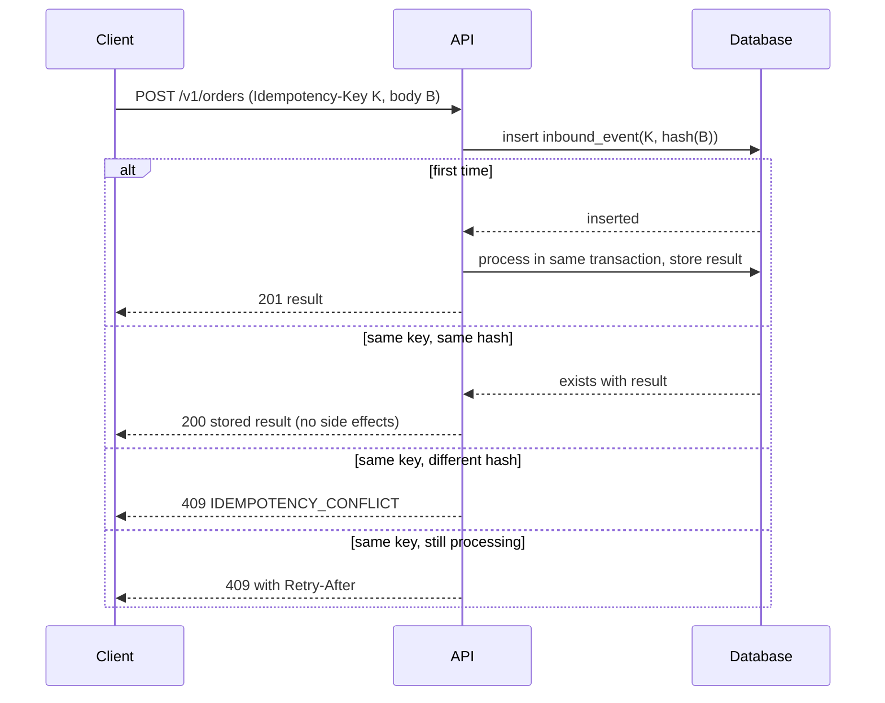

# 03 — API REQUIREMENTS
## Standards every endpoint must meet

| Field | Value |
|---|---|
| Document ID | TRD-03 |
| Version | 0.1 (draft for founder review) |
| Last updated | 2026-11-12 |
| Owner | CTO role |
| Depends on | TRD-01; SDD-06 (API design and catalogue); gap audit 15 §6, 16 |
| Status | Draft |

## 1. Standards

| ID | Topic | Requirement |
|---|---|---|
| TR-API-01 | Style | REST over HTTPS, JSON (UTF-8). Resource nouns, plural; state changes that are not simple updates are sub-resources (`/runs/{id}/commit`). One API serves the web applications, the portal and integrations |
| TR-API-02 | Versioning | Major version in the path (`/v1`). Additive changes do not bump the version. Breaking changes need a new major version; the previous one is supported for at least 12 months (proposal) with `Deprecation` and `Sunset` headers |
| TR-API-03 | Authentication | Staff and portal: OIDC access token (short-lived) from the identity provider. Integrations: API key in `Authorization: Bearer`, hashed at rest. Provider webhooks: provider signature. Vendor: vendor-realm token plus an approved support session for tenant data |
| TR-API-04 | Tenant resolution | Tenant comes from the token or key, never from a path, query or body parameter. Requests set the database session's tenant before any query |
| TR-API-05 | Authorisation | Permission check per endpoint from the permission catalogue; attribute checks (market, brand, downline, self, separation of duties) in the service layer; objects outside scope return 404, not 403, where existence itself is sensitive |
| TR-API-06 | Request validation | Schema-first (OpenAPI 3.1); unknown fields rejected on writes; sizes bounded; money as integer minor units with ISO 4217 currency; timestamps RFC 3339 with offset; ids UUID |
| TR-API-07 | Response standard | Single resource: the object. Collections: `{ "data": [...], "next_cursor": "..." }`. Async work returns `202` with a job resource to poll and a webhook event |
| TR-API-08 | Errors | RFC 9457 problem details: `type`, `title`, `status`, `detail`, `code` (stable machine code such as `GEN_CYCLE`, `MARKET_NOT_LIVE`, `SOD_SELF_APPROVAL`, `PERIOD_COMMITTED`, `IDEMPOTENCY_CONFLICT`), `errors[]` with field pointers, `request_id`. No stack traces or internal ids |
| TR-API-09 | Pagination | Cursor-based, opaque cursor, stable ordering; `limit` default 50, maximum 200; no offset pagination on large tables |
| TR-API-10 | Filtering | Explicit, documented filter parameters per collection; date ranges as `from`/`to`; no free-form query language |
| TR-API-11 | Sorting | `sort=field` or `sort=-field` from an allow-list per collection |
| TR-API-12 | Rate limiting | Per key and per user, token bucket; tiers per key; `429` with `Retry-After`; separate, stricter limits on authentication and public endpoints; pagination caps; no bulk personal-data endpoints without a stated purpose scope |
| TR-API-13 | Idempotency | Every state-changing request from integrations and every money or approval action requires `Idempotency-Key`. Same key and same body returns the original response; same key and different body returns `409 IDEMPOTENCY_CONFLICT`. Keys retained for a setting (proposed 35 days). Natural keys (source order id, provider event id, run request id) are enforced in addition |
| TR-API-14 | Concurrency | Optimistic concurrency with `ETag` and `If-Match` on editable drafts (plan versions, settings, mappings) |
| TR-API-15 | Webhooks out | Signed (HMAC-SHA-256 with per-endpoint secret and timestamp), at-least-once, retries with exponential backoff for 72 hours (proposal), then dead-letter with manual replay; event id for deduplication; payloads carry ids and minimal data, not personal data |
| TR-API-16 | Webhooks in | Signature verification per provider; raw body stored hashed in `inbound_event`; deduplicated by provider event id; handler idempotent; fast `2xx` then asynchronous processing |
| TR-API-17 | Documentation | OpenAPI document generated from the same schemas that validate requests; published per version with examples, error codes, webhook catalogue and a changelog; a sandbox tenant with synthetic data |
| TR-API-18 | Personal data | Responses carry only fields the caller's role and the visibility policy allow; sensitive values masked; unmasking is a separate, audited call |
| TR-API-19 | Caching | Committed, immutable resources (statements, committed run results, published snapshots) carry `ETag` and long `Cache-Control: private`; everything else `no-store` |
| TR-API-20 | Observability | Each response carries `X-Request-Id`; logged with tenant, actor, route, status, latency |
| TR-API-21 | Time and locale | The API is locale-neutral; formatting is done by clients. Period assignment uses the calendar's time zone on the server |

## 2. Idempotency behaviour

## 3. Standard status codes

| Code | Use |
|---|---|
| 200 / 201 / 202 / 204 | Success; created; accepted (async); no content |
| 400 | Malformed request |
| 401 | Missing or invalid credential |
| 403 | Authenticated but lacks permission (when existence is not sensitive); step-up required returns 403 with code `STEP_UP_REQUIRED` |
| 404 | Not found **or** outside caller's scope |
| 409 | State conflict (`PERIOD_COMMITTED`, `RUN_IN_PROGRESS`, `IDEMPOTENCY_CONFLICT`, `GEN_CYCLE`) |
| 412 | `If-Match` failed |
| 422 | Valid syntax, business rule violated (`MARKET_NOT_LIVE`, `GUARDRAIL_BLOCKED`, `OUTSIDE_CHANGE_WINDOW`, `SOD_SELF_APPROVAL`) |
| 429 | Rate limited |
| 503 | Dependency unavailable; safe to retry with the same key |

## 4. Requirements that conflict-check against business rules

| API requirement | Business rule it must not break |
|---|---|
| No `PUT`, `PATCH` or `DELETE` exists for orders, order events, result lines, postings, relationships, audit events, approvals | BR-ATT-02, BR-LED-02, BR-GEN-02 |
| No endpoint sets qualification state or a balance | BR-RNK-07, BR-LED-02 |
| No endpoint initiates a debit from a payee | BR-REV-09 |
| No endpoint returns projected or potential earnings | BR-HON-01 |
| Commit and approval endpoints refuse the preparer | BR-ADJ-02 |
