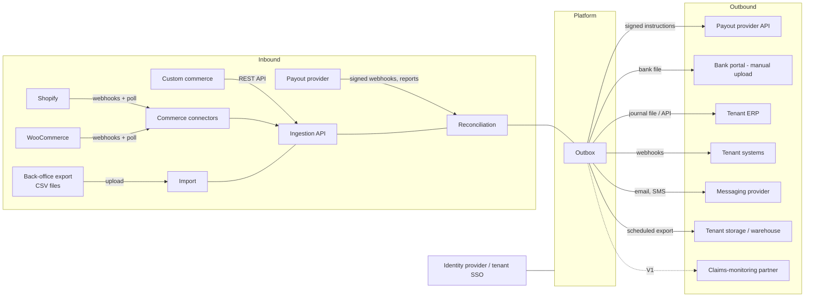
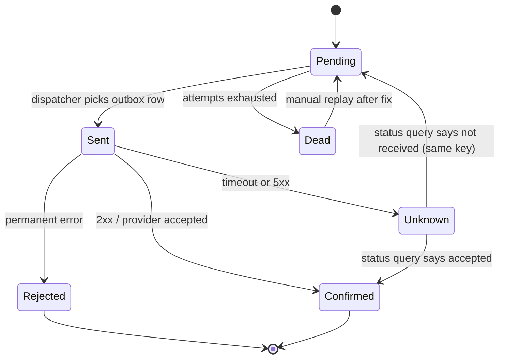

# 05 — INTEGRATION REQUIREMENTS
## Contracts with external systems: data, triggers, failure handling, security

| Field | Value |
|---|---|
| Document ID | TRD-05 |
| Version | 0.1 (draft for founder review) |
| Last updated | 2026-11-12 |
| Owner | CTO role |
| Depends on | TRD-01, TRD-03; gap audit 07 (GAP-004), 10, 12; Phase A P2 |
| Status | Draft. No provider has confirmed anything in writing; provider documentation was not read beyond published policies |

## 1. Integration landscape

**Principles.** (1) Tenants own their merchant, payout and messaging accounts; the platform stores credentials in a secrets manager and acts on the tenant's instruction. (2) Every integration is behind an adapter interface so no flow depends on one provider. (3) Everything inbound is idempotent; everything outbound goes through the outbox.

## 2. Contracts

### 2.1 Back-office export (MVP-A)

| Aspect | Contract |
|---|---|
| Files | `participants.csv`, `orders.csv`, `payout_lines.csv`, UTF-8, header row |
| `participants` | `participant_id` (pseudonymous), `type`, `enrolled_month` (YYYY-MM), `sponsor_id` (for customers: servicing distributor), `market`, `status` |
| `orders` | `order_id`, `month`, `day`, `buyer_id`, `amount_cents`, `volume_cents`, `purpose` (customer, personal, resale, unknown, enrolment), `is_starter_kit`, `refunded_cents`, `refund_month` |
| `payout_lines` | `line_id`, `month`, `payee_id`, `bonus_type`, `source_kind` (retail_sale, downline_volume, enrolment_order, pool, match, clawback, other), `source_order_id`, `amount_cents` |
| Trigger | Manual upload (V1: scheduled read-only SQL pull) |
| Validation | Required columns and types; key uniqueness; references resolve; **no column resembling a name, contact, address, identity number or bank detail** |
| Failure | Whole batch rejected with a row report; nothing stored |
| Security | Upload over TLS to the tenant's region; rejected files deleted; data terms signed first |
| Source | Schema of the Phase A prototype (`analytics.py`, `validate_export.py`). The partner's own codes are mapped by FR-IMP-002 |

### 2.2 Commerce platforms (MVP-B)

| Aspect | Contract |
|---|---|
| Data in | Order created, updated, paid, fulfilled; refund; customer created or updated; (V1) subscription events |
| Required fields | Source order id; line items with SKU, quantity, price, tax; buyer reference; payment and fulfilment times; attribution hint (link, code or sponsor reference); purpose where required |
| Trigger | Store webhook; reconciliation poll (proposed nightly) comparing counts and totals; backfill by date range on demand |
| Mapping | SKU → volume through `product_volume_map`; unknown SKU holds the order in an exception queue |
| Failure | Webhook delivery retried by the store; our handler is idempotent; poll repairs gaps; sync health shows lag and differences; runs blocked when behind (BR-ORD-05) |
| Security | Webhook signature verification; store API token in secrets manager with least scopes; ingestion key scoped `orders:write` |
| Not exchanged | Card data; checkout; product catalogue beyond SKU and class; inventory |
| Open | Which commerce platforms the launch-market buyers actually use (OQ-15); Fluid-type platforms as a third connector |

### 2.3 Payout providers and bank files (MVP-B)

Adapter interface (each adapter implements all five):

| Operation | Contract |
|---|---|
| `submit(instructions)` | Sends one or many instructions with our idempotency key as the provider's client reference; returns provider references or per-line rejections |
| `status(reference)` | Returns pending, accepted, settled, returned or failed; used to resolve ambiguous outcomes **before** any re-send |
| `parseSettlementReport(file)` | Maps report lines to instructions |
| `verifyWebhook(headers, body)` | Verifies the provider signature and extracts the event id |
| `capabilities()` | Methods, currencies, limits, cut-off times, whether beneficiary validation exists |

| Aspect | Contract |
|---|---|
| Data out | Payee reference, masked beneficiary and encrypted bank details as the provider requires, amount in minor units, currency, our idempotency key, narrative |
| Data in | Settlement, return and failure events with provider reference, amount and reason |
| Failure | Timeout → status query → retry with the same key; partial batch rejection → failed lines only; returned payment → amount back to payable and a case; unknown reference → exceptions queue |
| Bank-file adapter | Produces the bank's bulk-payment file for manual upload by the payout officer; accepts the bank's result file; same reconciliation |
| Security | Tenant-owned credentials; signed instructions; allow-list of providers per tenant and market; eligibility evidence recorded (FR-PAY-006) |
| Minimum | Two payout routes per launch market, one of which may be a bank file (ADR-09) |
| **Unknown** | Which providers accept licensed direct-selling merchants in the launch market and on what terms. Desk screen: Stripe prohibits MLM; PayPal requires pre-approval; two Indian providers prohibit "MLM collection fees"; one Malaysian gateway lists MLM as banned or high-risk; specialist payout providers do not document Malaysia or India coverage. **Launch blocker until confirmed in writing** (AQ-01) |

### 2.4 Payment acceptance

Out of the platform's flow: the commerce platform is the merchant's checkout. The platform records the tenant's payment provider and its approval in the launch checklist only.

### 2.5 Tenant ERP (general ledger)

| Aspect | Contract |
|---|---|
| Data out | Balanced journal for a period: mapped account code, debit, credit, currency, market, brand, run id, description |
| Trigger | Period Committed or Closed; on demand |
| Format | CSV and JSON by API; one file per period and market; re-downloadable; versioned if regenerated |
| Failure | Unmapped account blocks the export with a list |
| Security | API key scope `ledger:export`; file link expires |

### 2.6 Identity

OIDC between applications and the identity provider; optional federation to tenant SSO (OIDC or SAML) for staff. Failure: sign-in page shows a retry state; existing sessions continue until expiry.

### 2.7 Messaging

| Aspect | Contract |
|---|---|
| Channels | Email (required); SMS or chat channel where the tenant configures a provider |
| Data out | Template id, locale, recipient contact, minimal variables (never bank details or full amounts in SMS) |
| Failure | Retries; bounce handling marks the contact unverified; mandatory security notices fall back to a second channel |
| Security | Tenant's sender identity; provider credentials in secrets manager |

### 2.8 Full data export and replica

Scheduled export of the published data model (SDD-04 §7) to tenant-owned storage in the tenant's region, CSV and Parquet, with manifest (row counts, checksums, schema version). V1: read-only replica for dedicated tenants.

### 2.9 Outbound webhooks to tenant systems

Events: `run.committed`, `period.closed`, `payout.batch.approved`, `payout.settled`, `payout.returned`, `plan.version.activated`, `compliance.snapshot.ready`, `disclosure.published` (V1). Payload: event id, type, occurred-at, tenant, object ids. Standards in TRD-03 TR-API-15.

### 2.10 Claims-monitoring partners (V1)

Approved-claims catalogue and current disclosure figures by API and webhook. No crawler is built.

### 2.11 Tax filing tools

Year-end forms exported in the market's file format where one exists; the platform does not file. Formats belong to the market pack and need a tax adviser.

### 2.12 Update feed (self-hosted edition, V1)

Outbound-only, optional. The installation fetches a signed index of releases, engine versions, market packs and advisories. Air-gapped installations import the same signed packages by file.

## 3. Failure handling standard

| Rule | Value |
|---|---|
| Retry schedule | Exponential backoff with jitter; proposed 1 min to 6 h, 72 h total for webhooks; payout instructions resolved by status query, not blind retry |
| Dead letters | Visible in the integrations screen with payload reference, last error and replay action |
| Alerts | Outbox age, dead letters, sync lag at cut-off, reconciliation differences |
| Inbound duplicates | Acknowledged without change |

## 4. Integration requirements index

| ID | Requirement | Functional requirement |
|---|---|---|
| TR-INT-01 | Overlay file contract and validator | FR-IMP-001 |
| TR-INT-02 | Idempotent ingestion API | FR-ORD-001 |
| TR-INT-03 | Shopify and WooCommerce connectors with reconciliation | FR-ORD-002 |
| TR-INT-04 | Payout adapter interface, at least two routes per market | FR-PAY-002 |
| TR-INT-05 | Outbox for every external effect | FR-PAY-003 |
| TR-INT-06 | Settlement reconciliation | FR-PAY-004 |
| TR-INT-07 | GL journal export | FR-FIN-005 |
| TR-INT-08 | Webhooks out and in | FR-INT-001 |
| TR-INT-09 | Sync health and run blocking | FR-INT-002 |
| TR-INT-10 | Full export | FR-INT-003 |
| TR-INT-11 | Provider eligibility record | FR-PAY-006 |
| TR-INT-12 | Signed update packages | FR-LIC-002 |
