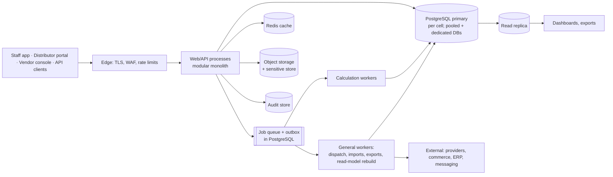
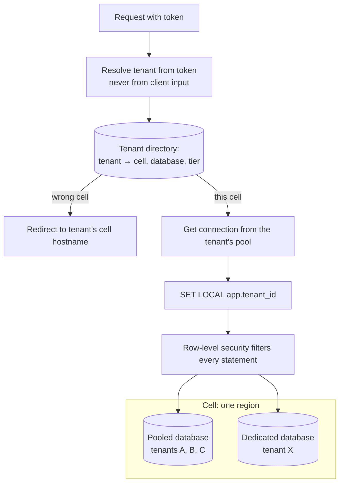

# 01 — SYSTEM DESIGN DOCUMENT
## The engineering blueprint: architecture choice, tenancy, events, failure and recovery

| Field | Value |
|---|---|
| Document ID | SDD-01 |
| Version | 0.1 (draft for founder review) |
| Last updated | 2026-11-12 |
| Owner | CTO / solution architect roles |
| Depends on | PRD-01..07, TRD-01..05 |
| Companion documents | SDD-02 high-level architecture · SDD-03 module design · SDD-04 database · SDD-05 ER diagrams · SDD-06 API · SDD-07 compensation engine · SDD-08 genealogy · SDD-09 financial system · SDD-10 security · SDD-11 deployment |
| Status | Draft. No benchmark has been run; designs marked *spike* must be proven in Phase C |

## 1. Architecture evaluation

| Option | Strengths for this product | Weaknesses for this product | Verdict |
|---|---|---|---|
| **Modular monolith** with a separate calculation worker pool | Ledger posting, run commit and outbox in one database transaction; one deployable for a small team; module boundaries enforced in code; the same artefact is the self-hosted edition | Modules scale together (acceptable: load is in workers and the database); discipline needed to keep boundaries | **Chosen** (ADR-01) |
| Microservices | Independent scaling and deployment | Distributed transactions across ledger, runs and payouts; many more failure modes; operational cost far beyond a small team; self-hosted edition becomes hard to install | Rejected at this stage |
| Hybrid (monolith plus a few services) | Isolate the engine runtime or a regional cell | Only useful after a measured need | **Evolution path**, on triggers below |

**Triggers to separate a part into its own service** (gap audit 15 §4): (a) calculation workers need a different runtime or independent scaling beyond the worker pool; (b) a regional cell must hold one tenant's data; (c) one module's release cadence blocks the others. None is expected before several paying tenants.

**Anticipated scale** (assumption): one large tenant of 2M positions and 3M orders a month produces about 600 MB of result lines and 1.2–2.4M postings per monthly run. That is within one well-run PostgreSQL instance. The risks are **period-end concurrency, run duration and noisy neighbours**, which the design addresses with an ingestion queue, in-memory runs on isolated workers and per-tenant limits, not with distribution.

## 2. Architecture in one picture

See SDD-02 for the full diagram. Shape:

## 3. Multi-tenant architecture

### 3.1 Options

| Model | Isolation | Cost | Residency | Operations | Fit |
|---|---|---|---|---|---|
| Shared database, shared schema, `tenant_id` + row-level security | Logical; a bug could leak unless the data layer enforces | Lowest | Hard (all in one region) | One migration target | Small tenants, **with** data-layer enforcement and isolation tests |
| Schema per tenant | Stronger logical | Medium; migrations per schema; connection and catalogue bloat with many tenants | Same as shared | Many schemas to migrate | No advantage over the other two here |
| Database per tenant | Strong | Higher per tenant | Easy: place the database in the region | Migration per database (automated) | Large tenants; residency-bound tenants; the self-hosted edition |
| Regional cell (whole stack per region) | Strong at region level | Highest | Required where data must stay in country | A stack per region | Each launch region |

### 3.2 Decision (ADR-02)

**Cells per region; inside a cell, a tenant-routing layer that supports both pooled and dedicated databases.** Tenants start pooled where allowed; large or residency-bound tenants get a dedicated database. The self-hosted edition is a cell with one dedicated tenant. Schema-per-tenant is not used.

| Aspect | Design |
|---|---|
| **Tenant identification** | Hostname (`{slug}.{cell-domain}`) selects the identity realm at sign-in; after that the token carries the tenant id. API keys are bound to one tenant |
| **Tenant isolation** | RLS policy on every tenant-scoped table; application role without `BYPASSRLS`; `SET LOCAL app.tenant_id` at transaction start; jobs carry tenant context; storage keys, cache keys and logs prefixed by tenant; CI isolation suite (SEC-28). Dedicated databases still enable RLS (defence in depth, identical code) |
| **Tenant-level configuration** | `tenant_setting_version` (versioned, effective-dated); markets, brands, calendars, participant types |
| **Tenant-specific permissions** | Tenant roles cloned from base roles; assignments scoped by market and brand |
| **Tenant-level branding** | Logo, name, primary colour token and sender identity for the portal and statements; no custom layouts or code |
| **Tenant-level business rules** | Plan versions (rules), tenant settings (policies), market packs selected per market. Never code |
| **Tenant-level integrations** | `provider_config` per tenant and market; credentials in the secrets manager under the tenant's path; webhook endpoints per tenant |
| **Tenant-level data export** | Scheduled full export to tenant storage in region; on-demand export on exit; replica access for dedicated tenants (V1) |
| **Moving a tenant** | Pooled → dedicated: logical replication of the tenant's rows into a new database, short write freeze, directory switch. No application change (NFR-SCAL-01) |
| **Noisy neighbours** | Per-tenant worker concurrency and rate limits; large tenants on dedicated workers |
| **Cross-region genealogy** | One genealogy graph per tenant lives in the tenant's cell. A tenant operating in several countries with in-country storage duties is an open design question (OQ-17); the MVP supports one data region per tenant |

## 4. Event and background processing

At MVP, **domain events stay inside the monolith**: written to the outbox table in the same transaction as the state change and consumed by workers. There is no distributed bus.

### 4.1 Domain events

| Event | Producer | Consumers | Effect |
|---|---|---|---|
| `ImportBatchLoaded` | Import | Compliance | Mark snapshots on the superseded batch Outdated |
| `OrderIngested`, `OrderEventIngested` | Orders | Calculation (open-period inputs), Late queue, Compliance facts | — |
| `GenealogyChanged` | Genealogy | Read-model rebuild; Notifications | Path rebuild; stale flag |
| `PeriodCutOff` | Calculation (scheduler) | Integration health check; analysts' notifications | — |
| `RunCalculated` | Calculation | Review dataset builder | — |
| `RunCommitted` | Calculation | Ledger (same transaction), Statements, Compliance facts, Webhooks, Notifications, GL export | — |
| `PayoutBatchApproved` | Payouts | Instruction dispatcher | — |
| `PayoutSettled`, `PayoutReturned`, `PayoutFailed` | Payouts (reconciliation) | Ledger (same transaction), Cases, Notifications, Webhooks | — |
| `BankDetailChanged` | Payouts | Notifications (old and new contact), Fraud signals | — |
| `PlanVersionActivated` | Plans | Notifications, Webhooks | — |
| `CaseDecided` | Cases | Module that owns the effect (adjustment, genealogy, privacy…) | — |
| `SnapshotReady` | Compliance | Webhooks, Dashboards | — |
| `SupportSessionRequested / Decided / Ended` | Identity | Notifications to tenant admins; session report | — |

### 4.2 Queues and policies

| Queue | Work | Concurrency | Retry | Dead-letter |
|---|---|---|---|---|
| `calc` | Runs, simulations, replays | Per-tenant limit 1 run per calendar; pool sized per cell | No blind retry; a failed run is resumable by request | Run marked Failed with diagnostics |
| `ingest` | Order and order-event processing, connector polls, imports | High; ordered per source order id | Exponential backoff, 10 attempts | Exception queue visible in SC-13 |
| `dispatch` | Outbox: payout instructions, webhooks, notifications, audit shipping | Ordered per aggregate key | Per TRD-05 §3 | Dead letters with manual replay |
| `rebuild` | Path read model, projections, statements | Per tenant | 5 attempts | Alert; views stay marked stale |
| `export` | Journal, drill-down and full exports | Low | 3 attempts | Alert |
| `schedule` | Period cut-offs, retention timers, reconciliations, licence checks | — | — | — |

**Idempotency.** Every handler is safe to run twice: it checks a processed marker keyed by event id, or its write is a natural-key upsert. **Monitoring.** Queue age and depth per queue and tenant; outbox oldest undispatched row; failed-job rate. **Failure recovery.** Workers are stateless; a job whose worker dies becomes visible again after its lease expires.

## 5. Failure and recovery scenarios

| Scenario | What happens | State afterwards | Recovery |
|---|---|---|---|
| **Payout provider fails or times out** | The instruction stays `instructed` with outcome unknown; the dispatcher queries status before any re-send; if not received it re-sends with the **same idempotency key** | Ledger shows the amount in *payout in transit* until resolved | Automatic; after the retry budget the instruction is flagged for the payout officer; batch can be switched to the second route (other adapter or bank file) only after the first provider confirms non-receipt |
| **Provider rejects part of a batch** | Rejected lines become `failed`; their amounts post back from in transit to payable | Batch `partially_settled` | Retry failed lines only, after the cause is fixed through a case |
| **Commission processing is interrupted** (worker crash, deploy, out of memory) | The run was writing to a staging area keyed by run id; nothing is visible; run marked `failed` | Period returns to its previous state (Open or Calculated with the earlier run) | Analyst restarts; the same snapshot is reused, so the result is the one the interrupted run would have produced |
| **Database connectivity is lost** | Web requests fail fast with 503; workers pause; outbox and inbound events are durable in the database so nothing is half-applied; inbound webhooks get non-2xx and are retried by senders | No partial transactions | Automatic on reconnect; failover to the standby if the primary is down (RPO and RTO of NFR-DR); after failover the ledger invariant job runs before payout dispatch resumes |
| **Background jobs fail repeatedly** | Retries with backoff; then dead-letter; alert | Effect not applied; source state unchanged | Fix cause; replay from the dead-letter view |
| **External integration unavailable** (commerce, messaging, ERP) | Commerce: store retries webhooks; poll backfills; sync health turns Behind and **blocks runs at cut-off**. Messaging: retries; security notices fall back to another channel. ERP: export stays downloadable | No data loss | Automatic catch-up; analyst sees the block and its reason |
| **A deployment must be rolled back** | Previous artefact redeployed; migrations are backward-compatible for one release (expand then contract), so the old code runs on the new schema | Engine version is pinned per run, so no committed result depends on the rolled-back code | If a run was *calculated* (not committed) with the faulty engine, it is discarded and re-run. If a faulty engine version **committed** a run, the fix is a restatement, never an edit |
| **A payout is duplicated** | Cannot arise from a retry (same key). If a provider pays twice by its own error, reconciliation shows two settlements for one instruction → exception | Ledger: one settlement posted; the second is an unmatched item | Case with the provider; recovery of funds is between tenant and provider; if the payee keeps the excess by agreement, an approved adjustment creates a clawback receivable |
| **A payout is rejected or returned** | Return event → entry *in transit → payable*; case opened; payee notified | Payee payable restored | Payee corrects details (cooling-off applies); included in the next batch |
| **Order sync behind at cut-off** | Run refused with last successful sync time | Period stays Open | Catch-up, then run |
| **Read model stale or rebuild fails** | Views show a stale notice; authorisation falls back to the system of record and never widens access | — | Retry rebuild |
| **Audit store unavailable** | Audit events buffer in the outbox; money actions are blocked if the buffer passes a limit | — | Drain on recovery; chain verified |
| **Restore from backup** | Point-in-time restore to before the incident; outbox rows after that point are gone, so provider state may be ahead | Possible divergence between ledger and provider | Reconciliation against provider reports is mandatory after any restore; differences become cases |

## 6. Cross-cutting decisions

| Concern | Decision |
|---|---|
| Transactions | One database transaction per business event, containing state change, ledger entry and outbox rows |
| Consistency | Strong within a tenant's database; read replica is eventually consistent and used only for dashboards, exports and reports that state their as-of time |
| Caching | Only immutable or versioned data (plan versions, committed statements, published snapshots); never balances or open-period figures |
| Time | All timestamps UTC in storage; period boundaries computed in the calendar's time zone; the engine receives time as input and never reads the clock |
| Identifiers | UUID version 7; human-facing references (`position_ref`, external ids) are separate columns |
| Configuration | Settings, plans and market packs are versioned data; application configuration by environment |
| Feature flags | Per tenant; evaluated on the server |
| Observability | SDD-11 §6 |

## 7. Architecture decision records

Recorded in `09-governance/02_DECISION_LOG.md`: ADR-01 modular monolith · ADR-02 tenant routing with pooled and dedicated databases · ADR-03 bitemporal append-only genealogy · ADR-04 in-memory tree per run and path read model · ADR-05 declarative primitives plus extension point · ADR-06 money rules · ADR-07 obligations sub-ledger plus GL export · ADR-08 integrate commerce · ADR-09 provider adapters · ADR-10 outbox and idempotency · ADR-11 reporting on replica or export · ADR-12 vendor access by session · ADR-13 erasure by pseudonymisation · ADR-14 brand and market dimensions · ADR-15 compliance fact layer shared by overlay and engine · ADR-16 two editions from one codebase.
