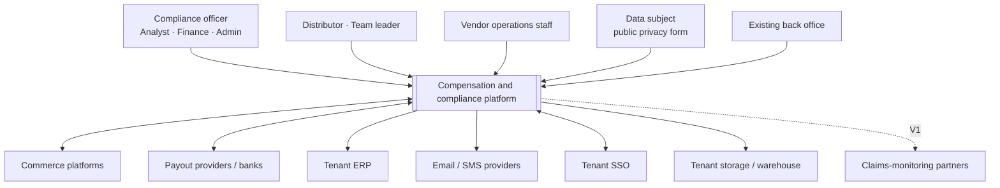
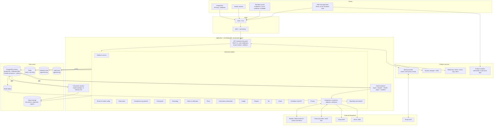
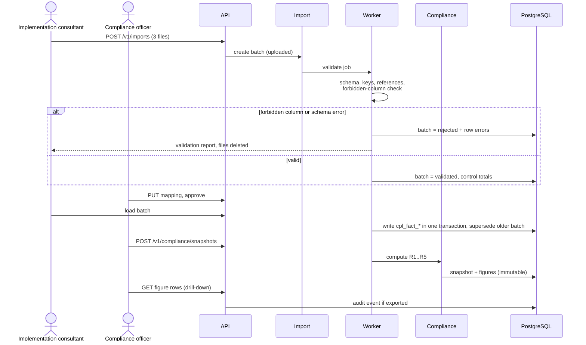
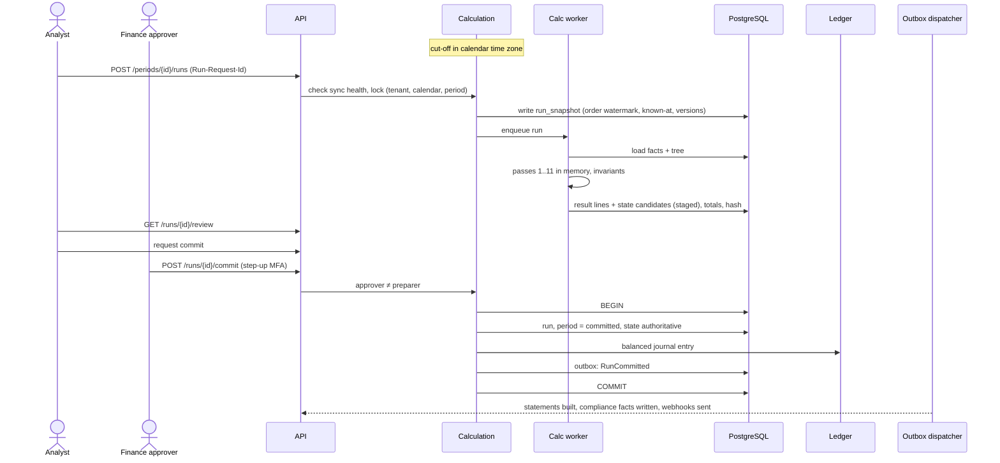

# 02 — HIGH-LEVEL ARCHITECTURE
## Components, their responsibilities and the main runtime flows

| Field | Value |
|---|---|
| Document ID | SDD-02 |
| Version | 0.1 (draft for founder review) |
| Last updated | 2026-11-12 |
| Owner | Solution architect role |
| Depends on | SDD-01, TRD-02 |
| Status | Draft |

## 1. System context

## 2. Container diagram (one cell)

## 3. Component responsibilities

| Component | Responsibility | Technology (provisional, TRD-02) | Scales by |
|---|---|---|---|
| Staff web application | Role-specific admin UI | React, TypeScript | CDN; stateless |
| Distributor portal | Statements, rank, team, customers, details; low bandwidth | Server-rendered React, small bundles | CDN; stateless |
| Vendor console | Tenant operations without business data | Same codebase, separate realm and hostname | — |
| Mobile application | **None at MVP.** The portal is a responsive, installable web application; native apps only if distributor research shows a need (P-09 unverified) | — | — |
| API entry point | TLS termination upstream; authentication; tenant resolution; schema validation; rate limits; idempotency | Node.js process | Horizontal |
| Backend modules | Business logic; each owns its tables | Modular monolith | With API processes |
| General workers | Ingestion, outbox dispatch, read-model rebuild, exports, schedules | Same artefact, worker entry point | Horizontal |
| Calculation workers | Runs, simulations, replays; the engine package has no I/O except through its input and output ports | Same artefact, engine package | Pool with per-tenant limits; memory-optimised instances |
| PostgreSQL | System of record; queue and outbox | PostgreSQL 16+ | Vertical; dedicated DB per large tenant |
| Read replica | Dashboards, reports, exports | Streaming replica | Add replicas |
| Redis | Rate limits; immutable caches | Managed Redis | — |
| Object storage | Evidence, agreements, forms, run snapshot manifests, exports | S3-compatible | — |
| Sensitive store | Identity documents, tax ids, bank-detail ciphertext keys | Separate bucket and KMS hierarchy | — |
| Audit store | Append-only audit events | Separate database or schema with insert-only role; archives to write-once storage | — |
| Identity provider | Authentication, MFA, federation | Self-hosted OIDC provider | — |
| Monitoring | Metrics, traces, logs, alerts | OpenTelemetry to a regional backend | — |
| Analytics | (a) Tenant analytics: replica read models and exports. (b) Product analytics: staff-app usage events without personal data | — | — |

## 4. Main runtime flows

### 4.1 MVP-A: from export to evidence

### 4.2 MVP-B: period close

## 5. Architecture qualities and how they are met

| Quality | Mechanism |
|---|---|
| Financial consistency | Single-transaction commits; database-enforced balance and immutability; idempotency keys |
| Reproducibility | Snapshots; pinned plan, settings, pack and engine versions; pure engine |
| Isolation | Row-level security; routing; namespacing; CI suite |
| Recoverability | Durable queue and outbox in the database; point-in-time recovery; reconciliation after restore |
| Operability by a small team | One artefact; managed data services; no bus; no Kubernetes at MVP |
| Portability and self-hosting | Standard components only (TR-CON-11) |
| Evolvability | Module boundaries; engine behind ports; adapters for every external system |
