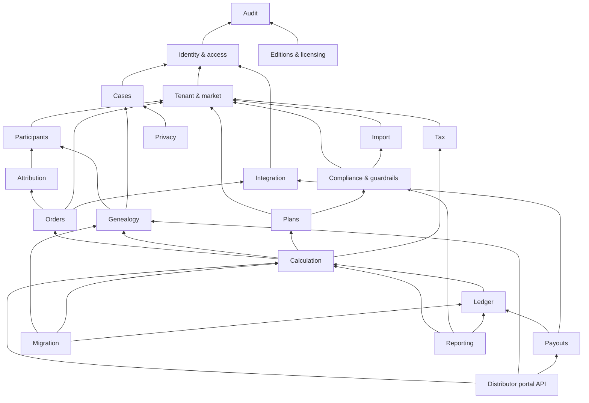
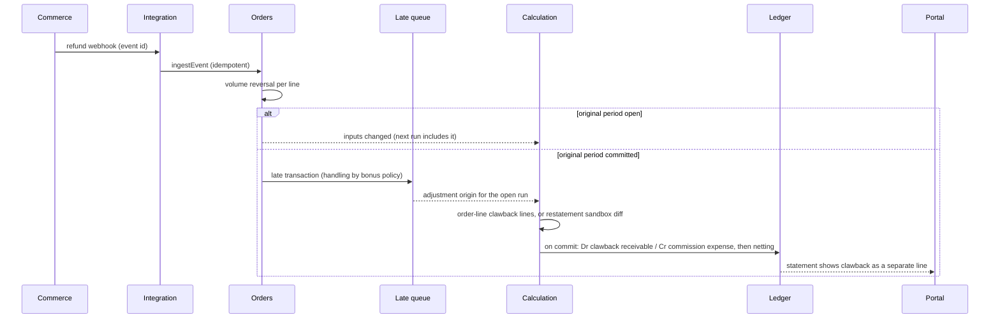

# 03 — MODULE DESIGN
## Module-level architecture: components, interfaces, data ownership, events, failure handling

| Field | Value |
|---|---|
| Document ID | SDD-03 |
| Version | 0.1 (draft for founder review) |
| Last updated | 2026-11-12 |
| Owner | Engineering lead role |
| Depends on | SDD-01, SDD-02, SDD-04, PD-03 |
| Status | Draft |

## 1. Rules for all modules

1. A module owns its tables (SDD-04 catalogue, column *Owner module*). **No module writes another module's tables.**
2. Modules call each other through **in-process interfaces** (typed service facades) or react to **domain events** from the outbox. No module imports another's internals; an architecture test in CI enforces the dependency graph below.
3. A use case that spans modules runs in one database transaction opened by the initiating module; the others take part through their facades.
4. Every external call goes through the Integration module's adapters, from a worker, driven by the outbox.
5. Each module exposes: commands (state-changing), queries (read), events (published), and a permission list.

Arrows point from a module to the modules it may call. Compliance reads calculation output only through compliance facts and events, so there is no cycle between them. Everything may write audit events.

## 2. Module designs

### 2.1 Identity and access (IAM)

| Aspect | Design |
|---|---|
| Responsibilities | Session validation, tenant resolution, permission and attribute checks, approvals, separation of duties, vendor support sessions, API keys |
| Components | `AuthMiddleware`, `TenantResolver`, `PermissionCatalogue`, `PolicyService` (RBAC + ABAC checks), `ApprovalService`, `SupportSessionService`, `ApiKeyService` |
| Data owned | `user_account`, `role`, `role_assignment`, `api_key`, `approval`, `support_session` |
| Interfaces | `authorize(actor, permission, resource)`, `requireStepUp(actor)`, `recordApproval(object, preparer, approver)`, `openSupportSession(...)` |
| Events out | `SupportSessionRequested/Decided/Ended`, `RoleGranted`, `ApprovalRecorded` |
| External | Identity provider (OIDC) |
| Failure handling | Identity provider down: no new sign-ins, existing tokens valid until expiry. Policy errors fail closed |

### 2.2 Tenant and market configuration (TEN)

| Aspect | Design |
|---|---|
| Responsibilities | Tenant directory and routing, markets, brands, calendars (delegated to COMP for periods), settings versions, market packs, launch checklist |
| Components | `TenantDirectory`, `SettingsService` (versioned), `MarketService`, `MarketPackRegistry` (loads signed packs: guardrails, tax rules, windows, languages, forms), `LaunchChecklistService` |
| Data owned | `tenant`, `market`, `brand`, `tenant_setting_version` |
| Interfaces | `settingsAt(tenant, time)`, `marketPack(market, date)`, `isLive(market)` |
| Events out | `SettingsVersionCreated`, `MarketWentLive` |
| Failure handling | Settings writes are optimistic-locked; a missing pack rule blocks go-live, never guesses a value |

### 2.3 Data import (IMP)

| Aspect | Design |
|---|---|
| Responsibilities | Upload, validation, mapping, load, supersede |
| Components | `UploadService`, `SchemaValidator` (includes forbidden-column detector by name patterns and content sampling), `MappingService`, `BatchLoader`, `DataQualityReporter` |
| Data owned | `import_batch`, `import_row_error`, `import_mapping` |
| Interfaces | `factsFor(tenant, market, range)` returns batch ids in force |
| Events out | `ImportBatchLoaded`, `ImportBatchSuperseded` |
| Failure handling | Validation and load are jobs; load is one transaction per batch; rejected files deleted from storage |

### 2.4 Compliance and guardrails (CPL)

| Aspect | Design |
|---|---|
| Responsibilities | Compliance facts, reports R1–R5, snapshots, drill-down, guardrail evaluation and overrides, basis status; later disclosure, signals, claims feed |
| Components | `FactWriter` (from imports and from `RunCommitted`), `ReportEngine` (pure functions over facts, method-versioned), `SnapshotService`, `DrillDownQuery`, `GuardrailEvaluator` (predicates over plan configuration), `OverrideService` |
| Data owned | `cpl_fact_*`, `compliance_report_snapshot`, `compliance_figure`, `guardrail_rule`, `guardrail_decision`, `integrity_signal` |
| Interfaces | `evaluatePlan(planVersion, market) → decisions`, `createSnapshot(...)`, `figureRows(...)` |
| Events in / out | In: `ImportBatchLoaded`, `RunCommitted`. Out: `SnapshotReady`, `GuardrailBlocked` |
| Failure handling | Snapshot computation is a job with deterministic output; inputs superseded mid-run abort and retry; a snapshot is never changed, only marked Outdated |

### 2.5 Participants (PAR), Genealogy (GEN), Attribution (CRM)

| Aspect | Design |
|---|---|
| Responsibilities | PAR: records, types, status, agreements, duplicates. GEN: positions, ownership, bitemporal relationships, as-of queries, cases' effects, visibility, read model. CRM: servicing relationship, attribution precedence, reassignment |
| Components | `ParticipantService`, `TypeService`, `DuplicateMatcher`; `PositionService`, `RelationshipStore` (append-only writer with cycle check and tree lock), `TreeQuery` (as-of, known-at), `VisibilityPolicy`, `PathReadModelBuilder`; `ServicingService`, `AttributionResolver` |
| Data owned | PAR: `participant`, `participant_type`, `participant_type_assignment`, `agreement_acceptance`. GEN: `position`, `position_ownership`, `relationship`, `path_node`. CRM: `customer_servicing` |
| Interfaces | `enrol(...)`, `typeAt(participant, time)`; `snapshotTree(tenant, kind, validAt, knownAt)`, `applyChange(case)`, `applyCorrection(case)`, `isInDownline(viewer, target)`; `attribute(orderFacts)` |
| Events out | `ParticipantEnrolled`, `ParticipantTypeChanged`, `PositionStatusChanged`, `GenealogyChanged`, `CustomersReassigned` |
| Failure handling | Relationship writes serialised per tenant and tree; read-model rebuild is retried and never authoritative (SDD-08) |

### 2.6 Orders (ORD)

| Aspect | Design |
|---|---|
| Responsibilities | Idempotent ingestion, fixed facts, volumes per line, period assignment, return events, late queue |
| Components | `IngestionService`, `VolumeCalculator` (product volume map, item rules), `PeriodAssigner` (crediting event, calendar time zone), `ReturnProcessor`, `LateTransactionQueue`, `ExceptionQueue` |
| Data owned | `order` (`sales_order`), `order_line`, `order_event`, `late_transaction`, `product_volume_map` |
| Interfaces | `snapshotOrders(period, watermark)`, `ingest(order)`, `ingestEvent(event)` |
| Events out | `OrderIngested`, `OrderEventIngested`, `LateTransactionQueued` |
| Failure handling | Unknown SKU or buyer → exception queue, order not lost; events for unknown orders wait and alert |

### 2.7 Plans (PLN)

| Aspect | Design |
|---|---|
| Responsibilities | Plan versions and rules, primitive catalogue, expression type-checker, caps and pools, transitions, golden datasets, simulation requests, governance workflow |
| Components | `PlanVersionService` (state machine), `RuleValidator` (schema, dependency graph), `ExpressionCompiler`, `PlainLanguageRenderer`, `GoldenDatasetRunner`, `SimulationService`, `GovernanceWorkflow` |
| Data owned | `plan`, `plan_version`, `plan_rule`, `plan_transition`, `golden_dataset`, `simulation` |
| Interfaces | `versionFor(plan, time)`, `compiled(planVersion)` (immutable, cacheable) |
| Events out | `PlanVersionSubmitted/Approved/Activated` |
| Failure handling | Activation is transactional and blocked by missing simulation, failing golden case, guardrail block or missing filing status |

### 2.8 Calculation (COMP)

| Aspect | Design |
|---|---|
| Responsibilities | Calendars and periods, run orchestration, snapshots, engine execution, qualification state, review, commit, trace, replay, restatement |
| Components | `PeriodService` (state machine, scheduler), `RunOrchestrator`, `SnapshotBuilder`, **`Engine`** (pure package: loader ports, passes, invariants, trace writer), `ReviewQuery`, `CommitService`, `ReplayService`, `RestatementService` |
| Data owned | `calendar`, `period`, `run`, `run_snapshot`, `result_line`, `qualification_state`, `restatement` |
| Interfaces | `startRun(period, requestId)`, `commit(run, approver)`, `trace(line)`, `replay(run)`, `committedLines(payee, period)` |
| Events out | `PeriodCutOff`, `RunCalculated`, `RunCommitted`, `PeriodPaid`, `PeriodClosed` |
| Failure handling | SDD-07 §9 |

### 2.9 Ledger (FIN), Payouts (PAY), Tax (TAX)

| Aspect | Design |
|---|---|
| Responsibilities | FIN: accounts, entries, postings, balance projection, clawbacks, write-offs, GL export. PAY: batches, instructions, dispatch, reconciliation, bank details, provider records, holds. TAX: profiles, withholding computation (called by the engine's withholding pass), forms |
| Components | `PostingRules` (event → entry), `JournalWriter`, `BalanceProjection`, `ClawbackService`, `GlExporter`; `BatchService`, `InstructionSigner`, `Dispatcher`, `Reconciler`, `BankDetailService`, `HoldService`; `TaxProfileService`, `WithholdingCalculator`, `YearEndFormService` |
| Data owned | FIN: `ledger_account`, `journal_entry`, `posting`, `credit_type`, `fx_rate`. PAY: `payout_batch`, `payout_instruction`, `provider_config`, `bank_detail_version`. TAX: `tax_profile`, `tax_rule`, `tax_line`, `tax_form` |
| Interfaces | `post(event)`, `balances(payee, asOf)`; `prepareBatch(...)`, `approve(batch, approver)`; `withholding(payee, gross, payDate)` |
| Events out | `EntryPosted`, `PayoutBatchApproved`, `PayoutSettled/Returned/Failed`, `BankDetailChanged` |
| Failure handling | SDD-09 §7 |

### 2.10 Cases (CAS), Privacy (PRV), Audit (AUD)

| Aspect | Design |
|---|---|
| Responsibilities | CAS: generic case lifecycle, evidence, SLA timers, approvals; delegates the effect to the owning module. PRV: data-subject requests, personal-data map, pseudonymisation, retention. AUD: append-only event store, chain, search, export logging |
| Components | `CaseService`, `CaseTypeRegistry` (policy checks and effect handlers per type), `SlaTimer`; `PrivacyRequestService`, `Pseudonymiser`; `AuditWriter` (outbox → audit store), `ChainVerifier` |
| Data owned | `case` (`case_file`), `case_event`; `privacy_request`; `audit_event`, `document`, `export_job` |
| Events out | `CaseOpened`, `CaseDecided`; `SubjectErased` |
| Failure handling | A case decision and its effect are one transaction; if the effect fails, the decision is not recorded |

### 2.11 Distributor portal API (DIST), Reporting (RPT)

| Aspect | Design |
|---|---|
| Responsibilities | DIST: read API for statements, explanations, rank, team, customers; write paths delegate to PAY, TAX, CAS. RPT: dashboard read models, saved views |
| Components | `StatementProjection` (built on `RunCommitted`), `ExplanationRenderer` (templates per rule kind over the compact trace), `TeamQuery` (uses `VisibilityPolicy`), `NotificationService`; `DashboardReadModels` |
| Data owned | `statement`, `notification` |
| Failure handling | Projections are rebuildable from committed data; portal reads are cacheable after commit |

### 2.12 Integration (INT), Migration (MIG), Vendor operations (OPS), Editions and licensing (LIC)

| Aspect | Design |
|---|---|
| Responsibilities | INT: public API surface, connectors, provider adapters, inbound events, outbox dispatcher, webhooks, sync health, exports. MIG: staged history import, validation, opening entries, parallel-run comparison. OPS: vendor console. LIC: licence verification, update packages, diagnostics, support bundle |
| Data owned | INT: `inbound_event`, `outbox_event`, `webhook_endpoint`, `webhook_delivery`. LIC: `license_entitlement`, `update_log` |
| Interfaces | `enqueue(effect)` (called inside the caller's transaction), `adapter(providerConfig)`; `entitlement()`; `applyUpdate(package)` |
| Failure handling | TRD-05 §3; a licence problem never blocks calculation or payout (BR-LIC-01) |

## 3. Example cross-module use case: refund after payout

