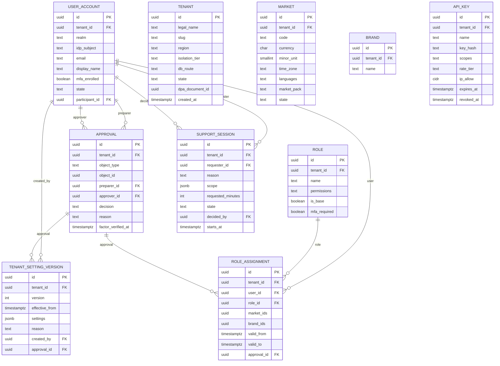
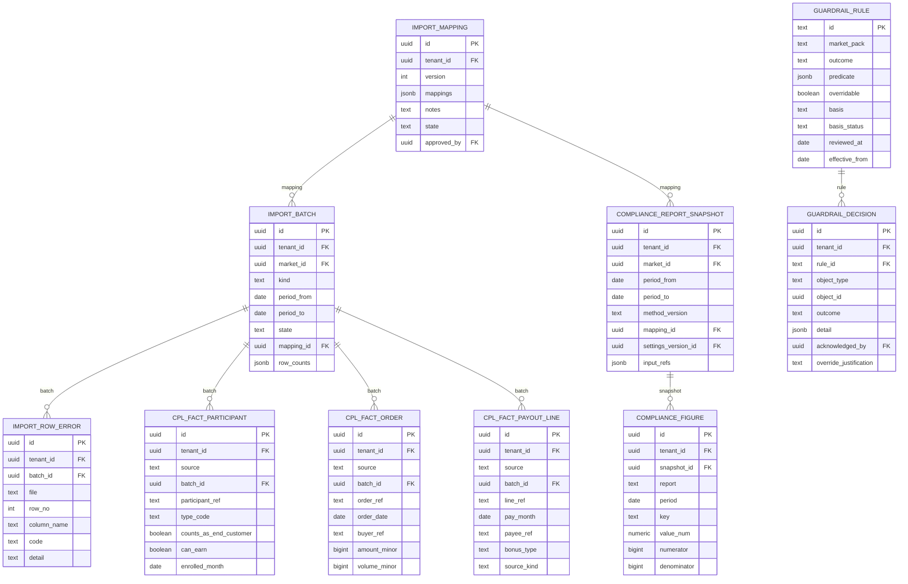
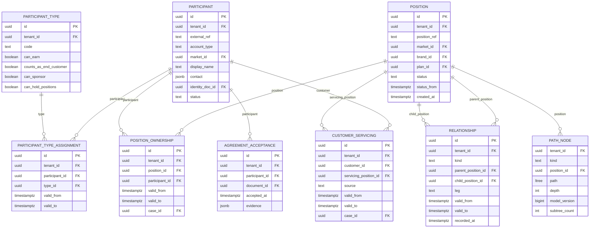
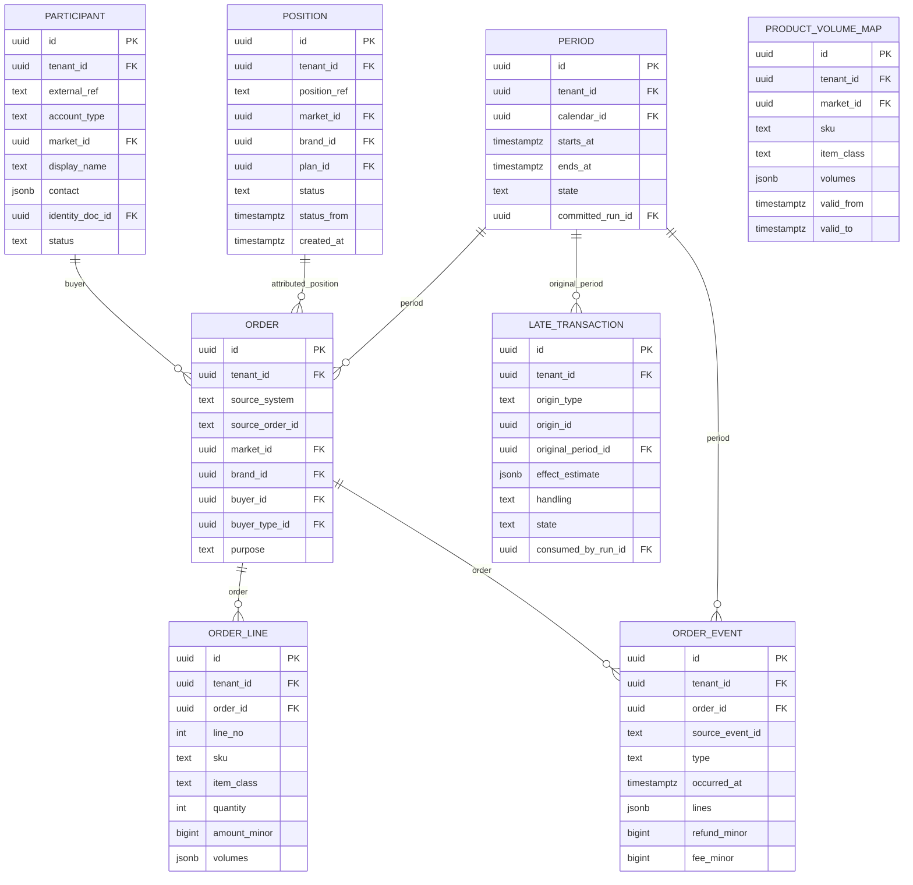
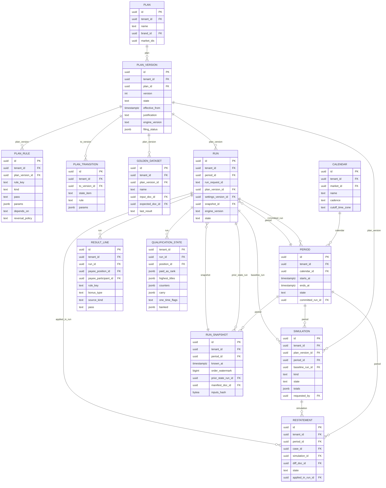
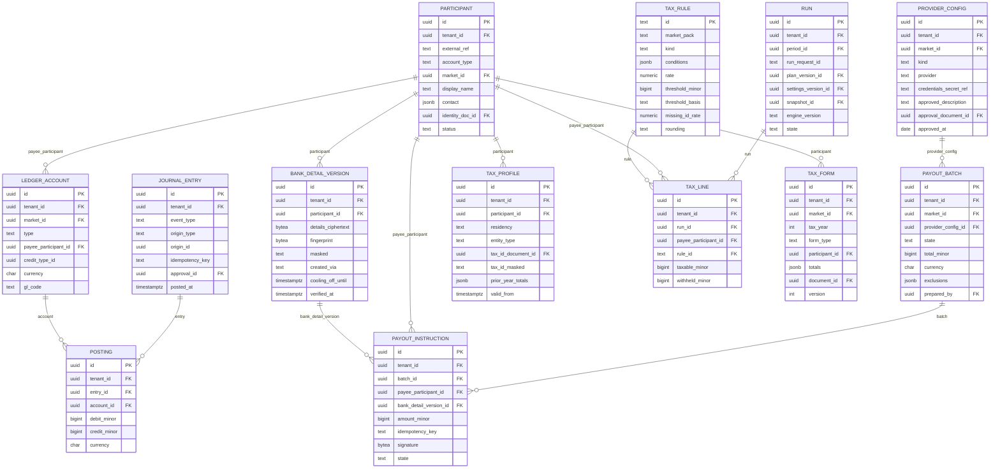
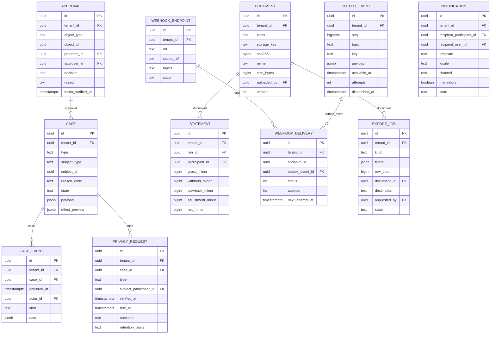

# 05 — ER DIAGRAMS
## Entity-relationship diagrams by domain, generated from the table definitions

| Field | Value |
|---|---|
| Document ID | SDD-05 |
| Version | 0.1 (draft for founder review) |
| Last updated | 2026-11-12 |
| Owner | Product (CPO role) |
| Depends on | SDD-04 |
| Status | Draft. Not approved |

Diagrams are generated from the same source as `04_DATABASE_DESIGN.md`, so they cannot disagree with it. Each entity box shows up to nine columns; the full list is in the database design. `tenant_id` foreign keys are omitted from the diagrams because every tenant-scoped table has one.

### 1. Tenancy, identity and access

### 2. Overlay import and compliance (MVP-A)

### 3. Participants, positions and genealogy

### 4. Orders, returns and attribution

### 5. Plans, periods and calculation

### 6. Ledger, payouts and tax

### 7. Cases, privacy, notifications and integration

