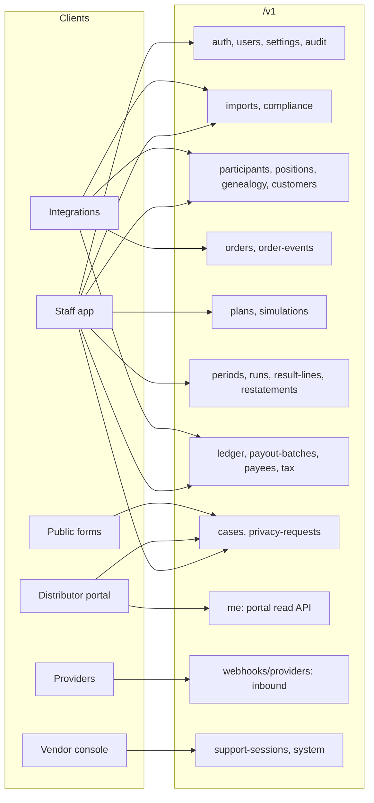
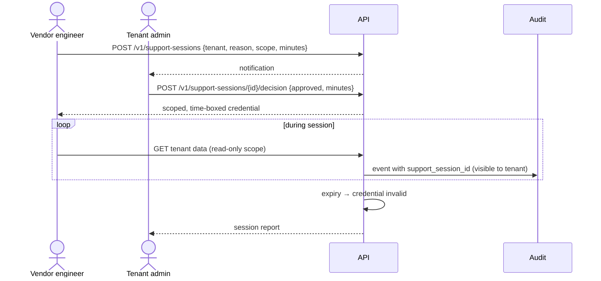

# 06 — API DESIGN
## API boundaries, the endpoint catalogue and representative specifications

| Field | Value |
|---|---|
| Document ID | SDD-06 |
| Version | 0.1 (draft for founder review) |
| Last updated | 2026-11-12 |
| Owner | Backend architect role |
| Depends on | TRD-03 (standards), PRD-02, SDD-03 |
| Status | Draft. Contracts are representative, not final OpenAPI; every endpoint traces to a requirement (catalogue column *Requirements*) |

## 1. API boundaries



| Boundary | Audience | Authentication | Notes |
|---|---|---|---|
| Staff API | Staff web application | OIDC token (staff realm) | Same endpoints are available to tenant automation with API keys where the scope exists |
| Portal API (`/v1/me/...`) | Distributors | OIDC token (portal realm) | Read-mostly; every response filtered to self or permitted downline |
| Integration API | Commerce connectors, tenant systems | API key with scopes | Writes are idempotent |
| Provider webhooks | Payout providers | Provider signature | No tenant token; tenant resolved from the endpoint path secret and provider account |
| Vendor API | Vendor console | OIDC token (vendor realm) | Tenant business data only inside an approved support session |
| Public | Privacy request form; (V1) disclosure page | None; strict rate limits and bot protection | No data returned beyond confirmation |

The API is one surface in one deployable. Module facades sit behind it; the API layer contains no business logic.

## 2. Endpoint catalogue

Paths list the main resource; sub-resources named in *Purpose* follow the same standards.
| ID | Method and path | Purpose | Authentication | Authorisation | Idempotency | Release | Requirements |
|---|---|---|---|---|---|---|---|
| API-01 | `POST /v1/imports` | Create an import batch and upload export files | User session | import.manage | Idempotency-Key required | MVP-A | FR-IMP-001, FR-IMP-003, FR-IMP-004 |
| API-02 | `GET /v1/imports/{id}` | Batch state, control totals, validation report | User session | import.manage | Safe | MVP-A | FR-IMP-001, FR-IMP-003 |
| API-03 | `PUT /v1/import-mappings/{id}` | Save a new mapping version; POST …/approve to approve | User session | mapping.edit, mapping.approve | If-Match version | MVP-A | FR-IMP-002 |
| API-04 | `POST /v1/compliance/snapshots` | Create a report snapshot (async job) | User session | snapshot.create | Idempotency-Key required | MVP-A | FR-CPL-001, FR-CPL-002, FR-CPL-003, FR-CPL-004, FR-CPL-005, FR-CPL-006 |
| API-05 | `GET /v1/compliance/snapshots/{id}` | Snapshot with figures, populations, method and input versions | User session or API key | compliance.read | Safe | MVP-A | FR-CPL-001, FR-CPL-002, FR-CPL-003, FR-CPL-004, FR-CPL-005, FR-CPL-006, FR-CPL-009, FR-CPL-010, FR-RPT-001 |
| API-06 | `GET /v1/compliance/snapshots/{id}/figures/{key}/rows` | Drill-down rows for a figure; ?export=true creates a logged export | User session | compliance.read, export | Safe | MVP-A | FR-CPL-006, FR-AUD-002 |
| API-07 | `POST /v1/auth/sessions` | Sign-in, MFA verification, step-up, refresh, sign-out (sub-resources) | Public, rate limited | — | Not applicable | MVP-A | FR-IAM-001, FR-IAM-002, FR-IAM-007 |
| API-08 | `POST /v1/support-sessions` | Vendor requests access; POST …/{id}/decision by tenant admin; GET …/{id}/log | Vendor session / user session | vendor role / vendor_access.decide | Idempotency-Key required | MVP-A | FR-IAM-005, FR-OPS-001 |
| API-09 | `GET /v1/audit-events` | Search audit events | User session | audit.read | Safe | MVP-A | FR-AUD-001 |
| API-10 | `POST /v1/orders` | Idempotent upsert of an order with lines | API key | orders:write | Idempotency-Key required; natural key source_system + source_order_id | MVP-B | FR-IAM-006, FR-ORD-001, FR-ORD-002, FR-ORD-003, FR-ORD-005, FR-INT-001 |
| API-11 | `POST /v1/order-events` | Refund, return, exchange, chargeback, subscription events | API key | orders:write | Idempotency-Key required; natural key source_event_id | MVP-B | FR-ORD-004, FR-ORD-005, FR-ORD-006 |
| API-12 | `POST /v1/participants` | Enrol a participant (with sponsor and placement); PATCH …/{id}/type, …/{id}/status | API key or user session | participants:write; participant.manage | Idempotency-Key required | MVP-B | FR-PAR-001, FR-PAR-002, FR-PAR-005, FR-PAR-006, FR-GEN-001, FR-GEN-005 |
| API-13 | `GET /v1/positions/{id}/downline` | Downline page for staff or distributor with visibility policy applied | User or portal session | genealogy.read / self downline | Safe | MVP-B | FR-GEN-006, FR-GEN-007, FR-GEN-008 |
| API-14 | `GET /v1/genealogy/tree` | Subtree as of a valid date and known-at time (staff) | User session | genealogy.read | Safe | MVP-B | FR-GEN-002, FR-GEN-003, FR-GEN-007 |
| API-15 | `POST /v1/genealogy-cases` | File a change or correction; POST …/{id}/decision | User session | case.genealogy.create / approve | Idempotency-Key required | MVP-B | FR-GEN-002, FR-GEN-004 |
| API-16 | `POST /v1/plans/{id}/versions` | Create or edit a draft version; POST …/{v}/submit, …/approve, …/schedule; guardrail decisions returned | User session | plan.edit, plan.approve | If-Match version; Idempotency-Key on transitions | MVP-B | FR-CPL-007, FR-CPL-008, FR-GEN-009, FR-PLN-001, FR-PLN-002, FR-PLN-003, FR-PLN-004, FR-PLN-007, FR-PLN-008, FR-AI-002 |
| API-17 | `POST /v1/simulations` | Simulate a plan version on a period; GET result and comparison; golden dataset runs | User session | plan.simulate | Idempotency-Key required | MVP-B | FR-PLN-004, FR-PLN-005, FR-PLN-006 |
| API-18 | `POST /v1/periods/{id}/runs` | Start a run; GET run status; POST …/replay | User session | run.execute | Run-Request-Id required | MVP-B | FR-COMP-001, FR-COMP-002, FR-COMP-003, FR-COMP-008, FR-COMP-011, FR-COMP-012 |
| API-19 | `GET /v1/runs/{id}/review` | Review dataset: totals, variance, movers, exceptions, changes | User session | run.review | Safe | MVP-B | FR-COMP-004, FR-COMP-005, FR-COMP-010, FR-RPT-001, FR-AI-001 |
| API-20 | `POST /v1/runs/{id}/commit` | Commit a calculated run (approver, step-up) | User session AAL2 fresh | run.commit; not preparer | Idempotency-Key required | MVP-B | FR-IAM-004, FR-COMP-006 |
| API-21 | `GET /v1/result-lines/{id}/trace` | Compact or expanded calculation trace | User session | trace.read | Safe | MVP-B | FR-COMP-007 |
| API-22 | `POST /v1/restatements` | Request a restatement; GET diff; POST decision | User session | restatement.request / approve | Idempotency-Key required | MVP-B | FR-COMP-009, FR-FIN-003 |
| API-23 | `GET /v1/ledger/accounts/{id}/postings` | Postings and balances; GET /v1/payees/{id}/balances | User session | ledger.read | Safe | MVP-B | FR-FIN-001, FR-FIN-002, FR-FIN-003, FR-FIN-006, FR-FIN-007, FR-RPT-002 |
| API-24 | `POST /v1/ledger/journal-exports` | Generate a GL journal export for a period | User session or API key | ledger.export | Idempotency-Key required | MVP-B | FR-FIN-005 |
| API-25 | `POST /v1/payout-batches` | Prepare a batch; POST …/{id}/submit, …/approve, …/retry-failed | User session (approve: AAL2 fresh) | payout.prepare / payout.approve; not preparer | Idempotency-Key required | MVP-B | FR-IAM-004, FR-PAY-001, FR-PAY-002, FR-PAY-003, FR-PAY-007 |
| API-26 | `POST /v1/webhooks/providers/{provider}` | Inbound provider webhook (settlement, return, failure) | Provider signature | Provider allow-list per tenant | Provider event id deduplicated | MVP-B | FR-PAY-004 |
| API-27 | `PUT /v1/payees/{id}/bank-details` | New bank-detail version; PUT …/tax-profile | Portal session (fresh) or case | self / case approval | Idempotency-Key required | MVP-B | FR-PAY-005, FR-TAX-001, FR-DIST-006 |
| API-28 | `GET /v1/me/statements` | Portal: statements, statement detail, rank status, customers, notifications | Portal session | self | Safe | MVP-B | FR-CRM-003, FR-FIN-002, FR-DIST-001, FR-DIST-003, FR-DIST-005, FR-DIST-007, FR-DIST-008 |
| API-29 | `GET /v1/me/statement-lines/{id}/explanation` | Plain-language explanation of a line | Portal session | self | Safe | MVP-B | FR-DIST-002 |
| API-30 | `POST /v1/cases` | Open a case (adjustment, dispute, duplicate, write-off, grievance); POST …/{id}/decision | User or portal session | by case type | Idempotency-Key required | MVP-B | FR-CPL-013, FR-PAR-003, FR-PAR-004, FR-FIN-004, FR-CAS-001, FR-CAS-002, FR-CAS-003 |
| API-31 | `POST /v1/privacy-requests` | Open and fulfil data-subject requests (public form variant is rate limited) | Public / user session | privacy.manage | Idempotency-Key required | MVP-B | FR-PRV-001, FR-PRV-002, FR-PRV-003 |
| API-32 | `POST /v1/exports` | Schedule or run a full data export; GET manifest | User session or API key | export.full | Idempotency-Key required | MVP-B | FR-TEN-005, FR-INT-003, FR-INT-004 |
| API-33 | `Outbound webhooks` | run.committed, period.closed, payout.settled, payout.returned, plan.activated, disclosure.published | HMAC signature | Tenant-configured endpoints | Event id; retries with backoff | MVP-B | FR-CPL-011, FR-INT-001 |
| API-34 | `GET /v1/me/team` | Portal: privacy-limited team search and node view | Portal session | self downline, visibility policy | Safe | MVP-B | FR-GEN-006, FR-DIST-004, FR-DIST-009 |
| API-35 | `PUT /v1/customers/{id}/servicing` | Set or change the servicing position (effective-dated) | User session or API key | servicing.manage | Idempotency-Key required | MVP-B | FR-CRM-001, FR-CRM-002 |
| API-36 | `POST /v1/tax/year-end-forms` | Generate year-end forms for a market and year | User session | tax.forms | Idempotency-Key required | MVP-B | FR-TAX-003 |
| API-37 | `GET /v1/integrations/health` | Connector and provider health and reconciliation differences | User session | integration.read | Safe | MVP-B | FR-ORD-002, FR-INT-002 |
| API-38 | `POST /v1/migrations/parallel-runs` | History import jobs and parallel-run comparisons; POST sign-off | User session | migration.manage / signoff | Idempotency-Key required | MVP-B | FR-MIG-001, FR-MIG-002 |
| API-39 | `PUT /v1/settings/{key}` | Versioned settings, markets, brands, calendars, provider records, market checklist, tenant provisioning (vendor) | User or vendor session | settings.manage and item-specific | If-Match version | MVP-A | FR-TEN-001, FR-TEN-002, FR-TEN-003, FR-TEN-004, FR-CPL-012, FR-PAY-006, FR-TAX-002, FR-PRV-004 |
| API-40 | `POST /v1/users` | Invite users; roles and role assignments; approvals of privileged grants | User session | user.manage | Idempotency-Key required | MVP-A | FR-IAM-003 |
| API-41 | `GET /v1/system/licence` | Self-hosted edition: licence state, installed versions, update check, diagnostics, support bundle (sub-resources; POST to load licence or apply update) | User session AAL2 | system.manage | Idempotency-Key on POST | V1 | FR-LIC-001, FR-LIC-002, FR-LIC-003 |

## 3. Representative specifications

Format: endpoint and method · authentication · authorisation · request · response · validation · error codes · idempotency.

### 3.1 API-01 `POST /v1/imports` (MVP-A)

| Item | Specification |
|---|---|
| Authentication / authorisation | Staff token; `import.manage` |
| Request | `multipart/form-data`: `market` (code), `period_from`, `period_to` (YYYY-MM), files `participants`, `orders`, `payout_lines` |
| Response `202` | `{ "id": "…", "state": "uploaded", "links": { "self": "/v1/imports/{id}" } }` |
| Validation | Synchronous: file presence, size limit, content type. Asynchronous: schema, keys, references, forbidden columns |
| Errors | `400 FILE_MISSING` · `413 FILE_TOO_LARGE` · `422 MARKET_UNKNOWN` · async outcome `rejected` with `FORBIDDEN_COLUMN`, `SCHEMA_MISMATCH`, `ORPHAN_REFERENCE`, `DUPLICATE_KEY` rows |
| Idempotency | `Idempotency-Key` required; replay returns the same batch |

### 3.2 API-04 `POST /v1/compliance/snapshots` (MVP-A)

```json
// request
{ "market": "DEMO", "period_from": "2025-01", "period_to": "2025-12", "reports": ["R1","R2","R3","R4","R5"] }
// response 202
{ "id": "snp_…", "state": "computing" }
// GET /v1/compliance/snapshots/{id} → 200
{ "id": "snp_…", "state": "ready", "method_version": "1.0", "mapping_version": 3,
  "inputs": { "batches": ["imp_…"] },
  "figures": [
    { "report": "R1", "period": "2025-01", "key": "customer_share_pct", "value": "62.50",
      "numerator_minor": 10000, "denominator_minor": 16000, "population_count": 3,
      "rows": "/v1/compliance/snapshots/snp_…/figures/R1.2025-01.customer_share_pct/rows" } ] }
```

| Item | Specification |
|---|---|
| Authorisation | `snapshot.create` (create); `compliance.read` (read) |
| Validation | Period range within loaded batches; reports from the allowed set |
| Errors | `422 NO_DATA_FOR_RANGE` · `409 INPUTS_CHANGING` (a load is in progress) |
| Idempotency | Key required; a snapshot is immutable, later state only `outdated` |

### 3.3 API-10 `POST /v1/orders`

```json
{ "source_system": "shopify", "source_order_id": "5123998", "market": "MY",
  "buyer": { "external_ref": "C-88121", "type_hint": "customer" },
  "attribution": { "kind": "link", "position_ref": "POS-000123" },
  "purpose": "customer",
  "paid_at": "2027-03-28T09:15:00+08:00", "fulfilled_at": null,
  "currency": "MYR", "amount_minor": 25900, "tax_minor": 1554,
  "lines": [ { "line_no": 1, "sku": "SKU-1001", "quantity": 1, "amount_minor": 25900 } ] }
```

| Item | Specification |
|---|---|
| Authentication / authorisation | API key; scope `orders:write`; key's market scope includes `market` |
| Response | `201` with order id, resolved `buyer_type`, `attributed_position`, `period_id`, per-line `volumes`; `200` on replay |
| Validation | Σ line amounts = amount; currency = market currency; market Live; quantity > 0; timestamps not in the future beyond tolerance |
| Processing | Volumes from `product_volume_map` at the crediting event time; facts fixed; period assigned; if that period is committed → late transaction (response includes `"late": true`) |
| Errors | `401`, `403` · `422 MARKET_NOT_LIVE` · `422 UNKNOWN_SKU` (order accepted into the exception queue with `202` when the tenant enables hold-and-map) · `409 IDEMPOTENCY_CONFLICT` |
| Idempotency | Key required; natural key `(source_system, source_order_id)`; a changed body for an existing order is rejected: changes arrive as order events |

### 3.4 API-18 `POST /v1/periods/{id}/runs` and API-20 `POST /v1/runs/{id}/commit`

| Item | Start run | Commit |
|---|---|---|
| Authentication | Staff token | Staff token with factor verified inside the step-up window |
| Authorisation | `run.execute` | `run.commit`; caller is not the run's preparer or a contributor |
| Request | Header `Run-Request-Id` | `{ "acknowledged_exceptions": ["exc_…"] }` |
| Response | `202 { "run_id", "state": "queued" }`; same id for a concurrent or repeated request | `200 { "run_id", "state": "committed", "journal_entry_id", "totals" }` |
| Validation | Period at or past cut-off and in state Open or Calculated; sync healthy | Run Calculated and latest for the period; review opened; no blocking exception |
| Errors | `409 PERIOD_COMMITTED` · `422 SYNC_BEHIND` (with `last_sync_at`) · `422 BEFORE_CUTOFF` | `403 STEP_UP_REQUIRED` · `422 SOD_SELF_APPROVAL` · `409 RUN_SUPERSEDED` · `500 INVARIANT_FAILED` (transaction rolled back, alert) |
| Idempotency | `Run-Request-Id` | `Idempotency-Key`; a second commit returns the first result |

### 3.5 API-14 `GET /v1/genealogy/tree`

`GET /v1/genealogy/tree?root=POS-000123&kind=sponsor&as_of=2027-03-15&known_at=2027-04-01T00:00:00Z&depth=2&limit=100`

| Item | Specification |
|---|---|
| Authorisation | `genealogy.read` (staff). Distributors use API-13 and API-34, which apply the visibility policy |
| Response | `{ "root": {...}, "data": [ { "position_ref", "parent_ref", "depth", "status", "paid_as_rank", "children_count" } ], "next_cursor", "read_model": "current" }` (or `"system_of_record"` when the read model is stale or a historical view is requested) |
| Validation | `depth` ≤ 5 per request; `known_at` ≤ now; `as_of` required when `known_at` is given |
| Errors | `404` root unknown or outside scope |

### 3.6 API-15 `POST /v1/genealogy-cases`

```json
{ "type": "correction", "kind": "sponsor", "position_ref": "POS-000456",
  "proposed_parent_ref": "POS-000789", "valid_from": "2027-01-10",
  "reason_code": "DATA_ENTRY_ERROR", "evidence_document_ids": ["doc_…"] }
```

| Item | Specification |
|---|---|
| Response `201` | Case with `policy_check` (window result, approvals needed), `structural_check` (cycle, slot), `affected_periods` and `estimated_impact` for corrections |
| Errors | `422 GEN_CYCLE` · `422 OUTSIDE_CHANGE_WINDOW` · `422 GEN_SLOT_TAKEN` · `422 EVIDENCE_REQUIRED` |
| Decision | `POST /v1/genealogy-cases/{id}/decision` `{ "decision": "approved" }` by a different user with `case.genealogy.approve` |

### 3.7 API-25 `POST /v1/payout-batches`

| Item | Specification |
|---|---|
| Request | `{ "market": "MY", "provider_config_id": "…", "periods": ["per_…"], "include_carried": true }` |
| Response `201` | Batch in Draft with `total_minor`, `count`, `exclusions: [ { "payee", "reason": "COOLING_OFF" or "BELOW_MINIMUM" or "HOLD" or "TAX_PROFILE_MISSING" or "DUPLICATE_CASE" } ]` |
| Sub-resources | `/submit` (preparer) · `/approve` (approver, step-up) · `/retry-failed` |
| Validation | Provider eligible and on the allow-list; instruction amount ≤ payee payable at approval time (re-checked in the approval transaction) |
| Errors | `422 PROVIDER_NOT_ELIGIBLE` · `422 SOD_SELF_APPROVAL` · `409 BALANCE_CHANGED` (batch returns to Draft) |
| Idempotency | Key on create and on each transition |

### 3.8 API-26 `POST /v1/webhooks/providers/{provider}` (inbound)

| Item | Specification |
|---|---|
| Authentication | Provider signature over the raw body; timestamp tolerance |
| Processing | Store `inbound_event` (dedupe on provider event id) → `2xx` → worker maps to instruction by provider reference → ledger entry 3 or 4 (SDD-09) |
| Errors | `401` bad signature · unknown reference becomes a reconciliation exception, still `2xx` |

### 3.9 API-27 `PUT /v1/payees/{id}/bank-details`

| Item | Specification |
|---|---|
| Authentication | Portal token with re-authentication inside the last minutes (step-up), or staff acting through an approved case |
| Request | Market-specific bank fields; never logged |
| Response `201` | `{ "version_id", "masked": "•••• 4821", "cooling_off_until": "…" }` |
| Side effects | Notices to previous and new contact; hold on payouts inside cooling-off; fraud signal if the fingerprint is shared above the threshold |
| Errors | `403 STEP_UP_REQUIRED` · `422 INVALID_BANK_DETAILS` |

### 3.10 API-28 / API-29 portal statements

`GET /v1/me/statements?limit=12` → list of periods with `net_minor`, `payout_status`.
`GET /v1/me/statements/{run_id}` →

```json
{ "period": "2027-03", "currency": "MYR",
  "totals": { "gross_minor": 123456, "withheld_minor": 2469, "clawback_minor": 0, "adjustment_minor": 0, "net_minor": 120987 },
  "positions": [ { "position_ref": "POS-000123", "paid_as_rank": "R2",
     "lines": [ { "id": "rl_…", "bonus": "unilevel", "amount_minor": 12500, "explain": "/v1/me/statement-lines/rl_…/explanation" } ] } ],
  "payout": { "status": "settled", "date": "2027-04-05" },
  "disclosure_url": null }
```

`GET /v1/me/statement-lines/{id}/explanation` → `{ "title": "Level 2 commission", "sentences": ["5% of 2,500.00 commissionable volume from 2 orders on your second level."], "inputs": { "rate": "5%", "base": "2,500.00", "rank_used": "R1", "period": "March 2027", "rounding": "to the nearest sen" } }`. No other person's name or contact appears. Responses for committed runs are cacheable. **No endpoint returns a projection of future or potential earnings.**

### 3.11 API-08 support sessions



## 4. Webhook event catalogue (outbound)

| Event | Payload ids | When |
|---|---|---|
| `compliance.snapshot.ready` | snapshot | Snapshot computed |
| `run.committed` | run, period, totals | Commit |
| `period.closed` | period | Close |
| `payout.batch.approved` | batch | Approval |
| `payout.settled` / `payout.returned` / `payout.failed` | instruction, batch | Reconciliation |
| `plan.version.activated` | plan, version | Activation |
| `case.decided` | case, type, decision | Decision |

## 5. Consistency checks against requirements

- Every endpoint in the catalogue names at least one functional requirement (generated; none is orphaned: QA-04 §4.7).
- No mutation endpoint exists for immutable resources (TRD-03 §4).
- Role-specific dashboards in the UX documents are served by the same endpoints with permission and scope filters; no separate "dashboard API" bypasses authorisation.
