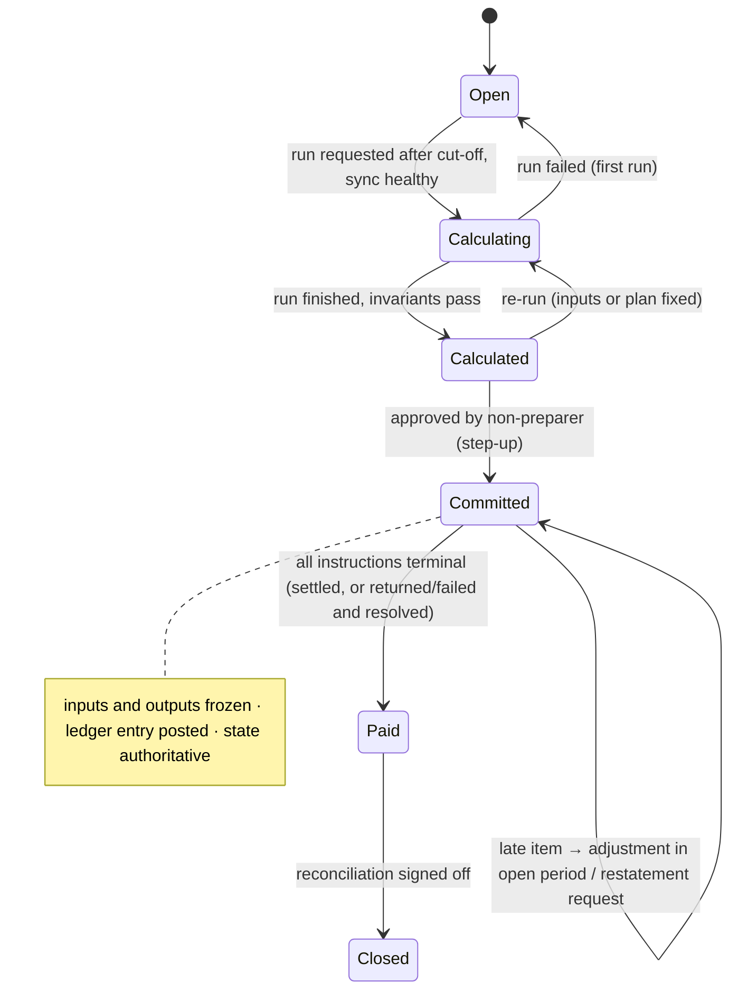
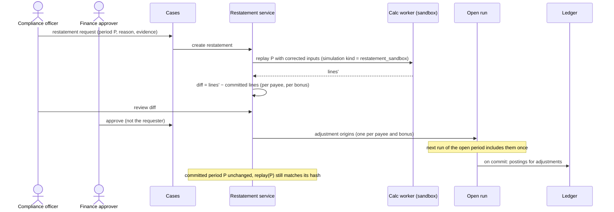
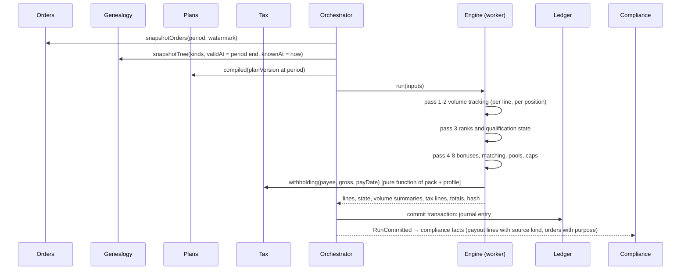

# 07 — COMPENSATION ENGINE DESIGN
## Configuration model, execution, periods, versioning, snapshots, reversals, simulation and audit

| Field | Value |
|---|---|
| Document ID | SDD-07 |
| Version | 0.1 (draft for founder review) |
| Last updated | 2026-11-12 |
| Owner | Financial systems architect role |
| Depends on | TRD-01 §4; PRD-04; research 13; gap audit 09; Phase A P1 |
| Status | Draft. Performance is unproven until the Phase C spike. Plan examples use hypothetical numbers |

## 1. Design goals

| Goal | Mechanism |
|---|---|
| No hardcoded compensation model | Plans are versioned data built from primitives; a long tail handled by a controlled extension point |
| Financial consistency | Frozen inputs → pure calculation → invariants → single-transaction commit with the ledger entry |
| Reproducibility | Run = f(snapshot, plan version, settings version, market-pack version, engine version); nothing else |
| Explainability | Compact trace per line; full trace by replay |
| Change without fear | Simulation, golden datasets, transition rules, governance |

## 2. The engine as a pure component

```mermaid
flowchart LR
  subgraph IN[Input ports - read only]
    O[Orders and order events<br/>up to watermark]
    T[Tree snapshot<br/>valid at period end, known at T]
    S[Prior qualification state<br/>from last committed run]
    P[Compiled plan version]
    C[Settings version + market pack]
    A[Adjustment origins<br/>late items, cases, restatements]
    X[Tax profiles as of pay date]
  end
  ENG[[Engine<br/>no clock · no randomness · no I/O<br/>defined iteration order]]
  subgraph OUT[Output ports]
    L[Result lines + compact traces]
    Q[Qualification state candidates]
    V[Volume summaries per position]
    TX[Tax lines]
    CT[Control totals + ordered hash]
    W[Warnings and exceptions]
  end
  IN --> ENG --> OUT
```



The orchestrator (module COMP) owns all I/O: it builds the snapshot, feeds the engine, and stores outputs in a staging area keyed by run id. The engine package can be compiled for another runtime without touching the rest (TRD-02 §3).

## 3. Configuration model

A plan version is a document of **rules**. Each rule has a key, a kind from the primitive catalogue, parameters, a pass, and declared dependencies. Illustration (hypothetical plan; values are examples, not recommendations):

```json
{
  "plan": "Core plan", "version": 7, "effective_from": "2027-02-01T00:00:00+08:00",
  "calendars": ["monthly"],
  "measures": [
    {"key": "pv",  "kind": "volume.personal", "source": "line.volumes.qv", "exclude_item_classes": ["starter_kit", "sample"]},
    {"key": "cv",  "kind": "volume.line",     "source": "line.volumes.cv"},
    {"key": "gv",  "kind": "volume.group",    "of": "pv", "tree": "sponsor", "include_self": true},
    {"key": "active_customers", "kind": "count.customers", "window": {"type": "period"}, "min_order_volume": 1}
  ],
  "ladders": [
    {"key": "main", "ranks": [
      {"key": "R1", "requires": [{"measure": "pv", "gte": 100}]},
      {"key": "R2", "requires": [{"measure": "gv", "gte": 700}, {"measure": "active_customers", "gte": 2}],
       "maintenance": {"grace_periods": 1}}
    ]}
  ],
  "bonuses": [
    {"key": "retail", "kind": "pay.retail_margin", "source_kind": "retail_sale", "rate": 0.25, "reversal_policy": "order_line"},
    {"key": "unilevel", "kind": "pay.percent_by_level", "tree": "sponsor", "measure": "cv",
     "levels": [0.08, 0.05, 0.04, 0.04, 0.04], "compression": "dynamic", "requires_rank": "R1",
     "source_kind": "downline_volume", "reversal_policy": "order_line"},
    {"key": "rank_bonus", "kind": "pay.percent_of_measure", "measure": "gv",
     "by_rank": {"R1": 0.05, "R2": 0.10}, "source_kind": "downline_volume", "reversal_policy": "restatement"},
    {"key": "match", "kind": "pay.matching", "of": ["rank_bonus"], "tree": "sponsor", "generations": 1, "rate": 0.20,
     "source_kind": "match", "reversal_policy": "restatement"},
    {"key": "pool", "kind": "pay.pool", "base": {"measure": "cv", "scope": "market"}, "rate": 0.0625,
     "allocation": {"type": "shares", "by_rank": {"R2": 1}}, "source_kind": "pool"}
  ],
  "caps": [
    {"key": "cap_leaders", "scope": ["rank_bonus", "match"], "base": {"expr": "net_sales(market)"}, "rate": 0.10,
     "method": {"type": "priority", "reduce": ["match"]}, "residue": "retain_as_breakage"}
  ],
  "transitions": [{"state_item": "carry.*", "rule": "carry"}, {"state_item": "titles.main", "rule": "map", "map": {"Leader": "R2"}}]
}
```

### 3.1 Primitive catalogue (first engine)

| Family | Kinds | Corpus evidence (plans of 21) |
|---|---|---|
| Volume measures | personal, line, group, personally-enrolled group, derived expression; per-line item rules (exclude classes, tax-exclusive base, category crediting) | 19–21; item rules 4 |
| Counts | customers, personally enrolled, qualified legs; with own definition of "active" | 14 |
| Hierarchy | sponsor tree; placement tree with legs (data model from the start; pairing Could) | 21; 7 |
| Qualification | thresholds, leg limits, windows (period, rolling n, per order), profile-fact predicates | 21; 15; 8 |
| Ladders | several per participant; paid-as and title; maintenance, grace, demotion | 9–13 |
| Payout functions | retail margin; percent by level; generations with compression; differential; override; matching; fast start; flat and one-time; pool (shares, rank-ordered, first-N) | 16; 16; 10; 10; 16; 10; 5 |
| Limits | per order, per period, per person, scoped company caps with method and residue | 13 |
| State | carry with conditions, cap, expiry; streak counters; one-time flags; banked points | 8; 10 |
| Timing | several calendars; pay-date rules | 11 |
| Conversion | points-to-currency factor, effective-dated per market | 4 |
| Attribution | fractional roll-up of customer volume | 4 |

### 3.2 Extension point (ADR-05)

| Tier | What | Who writes it | Controls |
|---|---|---|---|
| 1 Primitives | Catalogue above | Plan administrator (configuration) | Schema validation, guardrails, simulation |
| 2 Expressions | A typed, pure expression language over measures, state and profile facts: arithmetic on decimals, comparisons, `min`, `max`, `if`, aggregations over a declared scope. No loops, no I/O, bounded evaluation cost | Implementation consultant | Type check; at least one golden case per expression; recorded verbatim in traces |
| 3 Platform modules | A named, parameterised calculation shipped in the platform codebase behind a fixed interface (inputs: snapshot view and parameters; output: lines or state). Available to every tenant | Vendor engineers only | Code review; golden tests; engine version bump; never tenant-specific |

Mechanisms observed in the corpus that are **not** tier 1 (requirement banking, volume transfers, credit-risk gating, sell-through gates, rotation assignment, household rule, rule-triggered genealogy change) start as tier 3 modules or as events in other modules, and are promoted to primitives when a second tenant needs them.

## 4. Calculation orchestration and ordering

Passes run in this fixed order. Inside a pass, rules run in dependency order, and payees in ascending position id.

| # | Pass | Does | Note |
|---|---|---|---|
| 0 | Transition | Applies transition rules on the first run of a new plan version | Produces the transition report |
| 1 | Line volume | Computes each measure per order line; applies return and reversal effects of the period | Item rules here |
| 2 | Position volume | Aggregates personal measures; one bottom-up pass for group measures; leg and roll-up measures | In-memory tree, O(N) |
| 3 | Qualification | Evaluates requirements, windows, counts; paid-as rank per ladder; titles; maintenance and grace; counters and carry | Stores what was evaluated and on which data |
| 4 | Individual bonuses | Retail, level, generation, differential, override, fast start, flat, one-time | One-time bonuses use once-only keys |
| 5 | Matching | Percent of other payees' pass-4 bonuses | Never on a reversed bonus |
| 6 | Pools | Base scoped by market; allocation by shares, rank order or first-N with deterministic ties | Largest remainder |
| 7 | Per-participant constraints | For example a maximum share of a participant's pay from personal-use volume | Before company caps (BR-CAP-02) |
| 8 | Caps | Scoped company caps by method: proportional (largest remainder), priority list, per person; residue per rule | TS-07, TS-08, TS-09 |
| 9 | Adjustments | Late transactions, clawbacks by policy, manual adjustments, restatement differences | Each with origin id |
| 10 | Minimums and rounding | Converts points to currency by the effective factor; rounds **once per payout line**; posts residue lines | BR-MNY-02 |
| 11 | Netting and withholding | Nets clawback receivable against gross per payee; computes withholding from the market pack and tax profile | Produces tax lines; gross = net + withholding |
| 12 | Invariants and totals | Checks TR-ENG-16; computes control totals and the ordered hash | A failure aborts the run |

```mermaid
flowchart LR
  P0[0 Transition] --> P1[1 Line volume] --> P2[2 Position volume] --> P3[3 Qualification] --> P4[4 Individual bonuses] --> P5[5 Matching] --> P6[6 Pools] --> P7[7 Per-person constraints] --> P8[8 Caps] --> P9[9 Adjustments] --> P10[10 Rounding] --> P11[11 Netting + withholding] --> P12[12 Invariants]
```



## 5. Period management



| Rule | Design |
|---|---|
| Period assignment | By the plan's crediting event (parameter; D-R1 open) converted to the calendar's time zone; half-open interval [start, end) |
| Several calendars | Each calendar has its own periods and runs; a monthly run may read state produced by weekly runs through declared dependencies |
| Late transactions | Detected at ingestion when the target period is Committed or later; queued with estimated effect; default handling by the bonus's reversal policy |
| Run lock | Advisory lock on (tenant, calendar, period); unique (tenant, period, run request id) |
| Cut-off guard | Ingestion watermark must have passed the cut-off and sync health must be Healthy |

## 6. Versioning and snapshot strategy

| Versioned thing | How | Pinned on the run |
|---|---|---|
| Plan | `plan_version`, immutable from approval, content hash | `plan_version_id` |
| Tenant settings | `tenant_setting_version` | `settings_version_id` |
| Market pack | Signed pack version | In snapshot manifest |
| Engine | Semantic version; old versions remain runnable | `engine_version` |
| Inputs | `run_snapshot` | `snapshot_id` |

**Snapshot contents (by reference, not by copy, where the source is immutable):**

| Input | Why it is stable | Reference stored |
|---|---|---|
| Orders, lines, order events | Insert-only | Ingestion sequence watermark; period id |
| Genealogy | Bitemporal, append-only | `known_at` instant: the tree is "rows recorded at or before `known_at`, not superseded at `known_at`, valid at the evaluation date" |
| Prior state | Output of a committed run | `prior_state_run_id` |
| Adjustment origins | Consumed once | List of origin ids in the manifest |
| Product volume map, participant types, tax profiles | Effective-dated | Evaluation dates; rows are never updated in place |

The manifest (JSON in object storage, hashed) lists these references plus row counts. Because every referenced source is append-only or effective-dated, a later correction cannot change what the snapshot resolves to. For defence against accidental mutation, the orchestrator also stores an **input hash** computed while loading; replay recomputes it and fails loudly on a mismatch.

**Historical reproducibility:** `replay(run)` loads by the manifest, runs the pinned engine version with pinned plan and settings, and compares the ordered hash of lines with `run.lines_hash` (FR-COMP-008, TS-03).

## 7. Transaction handling

| Step | Transaction |
|---|---|
| Start run | Insert `run_snapshot` and `run` (queued) |
| Calculate | Worker writes staged result lines and state candidates in batches under the run id; visible only through the run |
| Commit | **One transaction:** `run.state = committed`; `period.state = committed`, `committed_run_id`; state candidates become authoritative; journal entry with postings (SDD-09 §3); adjustment origins marked consumed; outbox rows (`RunCommitted`). Deferred constraints verify the entry balances and totals match |
| After commit | Workers build statements, compliance facts and exports from the outbox |

A Calculated run that is superseded by a re-run is marked `discarded`; its staged lines are dropped by partition.

## 8. Reversals and restatements

| Policy (per bonus) | Mechanics | When to use | Money effect in the research's test (TS-10) |
|---|---|---|---|
| **Order-line clawback** (default) | For a refunded order in a committed period, generate negative lines equal to the lines whose trace cites that order, at the amounts paid | Bonuses that pay directly on the order | A −50.00, C 0.00: leaves A with 30.00 and C with 16.00 against true 15.00 and 3.00 |
| **Restatement** | Sandbox re-run of the original period for affected payees with the corrected inputs; difference becomes adjustment lines | Rank-dependent and matching bonuses | A −65.00, C −13.00: exact |
| **Write-off threshold** | Receivable below a tenant threshold written off with approval | Small amounts | — |

The tenant sees this comparison in simulation before choosing. Reversal lines always appear in the **open** period with a link to the original period and order; committed lines are never edited. Clawbacks post to the payee's clawback receivable and are netted in pass 11.



## 9. Simulation environment

| Use | Inputs | Output | Storage |
|---|---|---|---|
| Plan change (FR-PLN-005) | Historical snapshot + draft plan version | Per-payee and per-bonus diff against the committed run; distribution of change; cap effects; guardrail flags | `simulation`, `sim_result_line` |
| Golden dataset (FR-PLN-006) | Fixture inputs | Exact expected lines | Pass or fail report |
| Parallel run (FR-MIG-002) | Imported history + legacy payout file | Per-payee difference with classification | `simulation` kind `parallel_run` |
| Restatement sandbox | Committed snapshot with corrected inputs | Diff | `simulation` kind `restatement_sandbox` |

All use the same engine code path and the same passes; a flag only redirects output storage. Simulations never write state, ledger or outbox.

## 10. Audit trail

**Compact trace per line** (stored in `result_line.trace`, about 1 KB):

```json
{
  "rule": "unilevel", "pass": 4, "plan_version": 7, "engine": "1.4.2",
  "payee_position": "POS-000123", "rank_evaluated": {"main": "R1"},
  "inputs": {"level": 2, "source_position": "POS-000456", "measure": "cv", "volume_minor": 250000,
             "orders": ["ord_…a1", "ord_…b7"], "compressed_over": ["POS-000321"]},
  "rate": "0.05", "raw": "12500.00", "cap": null, "rounding": {"mode": "half_up", "to_minor": 12500},
  "tree_ref": {"kind": "sponsor", "known_at": "2027-03-01T02:00:00Z"}
}
```

Full detail (every intermediate value) is produced by replaying the rule for that payee. The run itself records preparer, approver with factor time, snapshot, versions, totals and hash. Distributors see a template rendered from the compact trace with downline sources reduced to what the visibility policy allows (FR-DIST-002).

## 11. Interactions with other modules



| Interaction | Contract |
|---|---|
| Orders → engine | Immutable facts with volumes per measure per line; reversal events of the period |
| Genealogy → engine | Arrays: position ids, parent index per tree kind, status at evaluation date, owner; built once per run |
| Volume tracking | Engine output `volume summaries` per position and measure, stored with the run for reporting and leader views; never recomputed live |
| Ranks | Qualification state candidates, authoritative at commit |
| Ledger | One entry per commit: gross by payee to payable net of withholding, withholding to liability, residue and breakage to their accounts |

## 12. Failure handling

| Failure | Behaviour |
|---|---|
| Worker dies | Run `failed`; staged output dropped; restart reuses the snapshot |
| Invariant fails | Run `failed` with the violated invariant and offending lines; nothing can be committed |
| Out of memory | Fails like a crash; the tenant is moved to a larger worker class; the spike sets sizing |
| Plan compile error at run time | Impossible by design: only approved, compiled versions are runnable; if it happens, run fails |
| Two run requests | Second returns the first's run id |
| Engine defect found after commit | Fix in a new engine version; affected periods corrected by restatement; old version stays for replay |

## 13. Items for the Phase C spike

1. Run time and memory on 50k, 500k and 2M positions for three tree shapes (TS-29).
2. Expression evaluator cost per payee.
3. Size and write time of result lines and traces at 600k lines.
4. Corpus coverage: configure five hold-out plans end to end and count mechanisms needing tier 3.
5. Determinism across machines and engine builds (hash equality).
