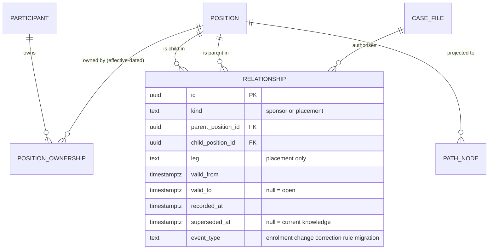
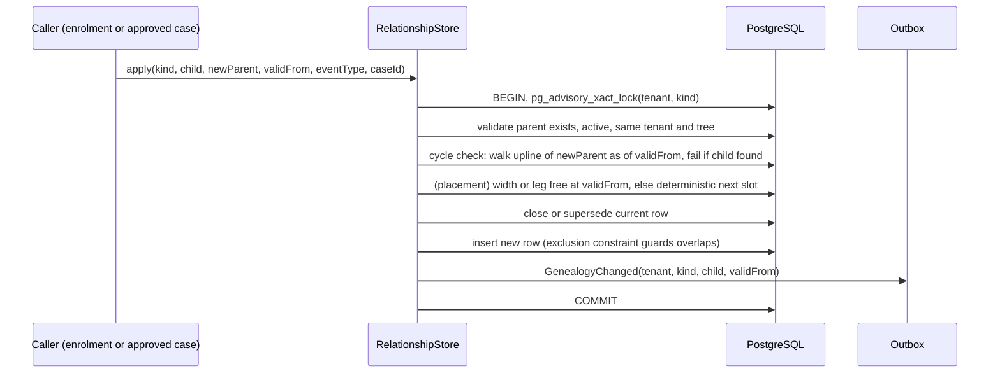
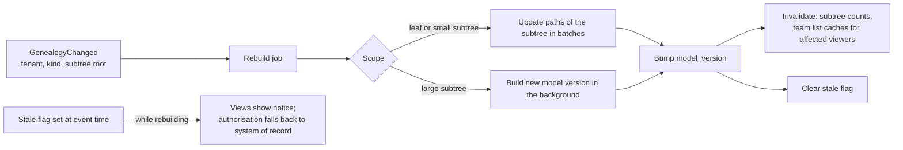

# 08 — GENEALOGY ENGINE DESIGN
## Positions, bitemporal relationships, traversal, change, history, performance and cache invalidation

| Field | Value |
|---|---|
| Document ID | SDD-08 |
| Version | 0.1 (draft for founder review) |
| Last updated | 2026-11-12 |
| Owner | Database / backend architect roles |
| Depends on | TRD-01 §5; SDD-04; gap audit 08 |
| Status | Draft. **Not benchmarked.** Workload figures are assumptions |

## 1. Model



| Concept | Rule |
|---|---|
| **Position ≠ participant** | The tree is made of positions. A participant may own several (business centres); ownership is effective-dated |
| **Two trees** | `sponsor` (who enrolled whom) and `placement` (where the position sits, with a leg for binary or a slot for matrix). Each bonus names the tree it uses |
| **Valid time** | When the relationship is true in the business |
| **Recorded time** | When the system learned it. A row with `superseded_at` set was once believed and is kept |
| **Root** | Each tenant tree has one company root position per kind |

## 2. Events and their effect on rows

Example: B is under S1. On day 200 an approved **change** moves B under S2 from day 201. Later, on day 300, a **correction** establishes that C (enrolled day 10 under S1) should have been under S3 from day 10.

| Event | Rows before | Rows after | Committed periods |
|---|---|---|---|
| Enrolment of B under S1 on day 1 | — | `(S1→B, valid [1, ∞), recorded 1)` | None affected |
| **Change** of B to S2 effective day 201, recorded day 200 | `(S1→B, valid [1, ∞))` | `(S1→B, valid [1, 201), recorded 1)` closed; `(S2→B, valid [201, ∞), recorded 200)` | None: past validity is unchanged |
| **Correction** of C to S3 from day 10, recorded day 300 | `(S1→C, valid [10, ∞), recorded 10)` | `(S1→C, valid [10, ∞), recorded 10, superseded 300)`; `(S3→C, valid [10, ∞), recorded 300)` | Periods between day 10 and day 300 are **flagged**; replay still gives the old result because their `known_at` is before day 300; the restatement policy decides adjustments |
| Termination of B on day 250 | — | No relationship change; `position.status = terminated` from day 250 | None |
| Rule-generated change (for example loss of sponsorship rights) | — | As a change, with `event_type = rule` and the rule id | None |

Closing a row sets `valid_to` once; superseding sets `superseded_at` once. No other update is possible (trigger).

**Query "tree as of D, as known at T":**

```sql
SELECT child_position_id, parent_position_id, leg
FROM   relationship
WHERE  tenant_id = :tenant AND kind = :kind
  AND  valid_from <= :D AND (valid_to IS NULL OR valid_to > :D)
  AND  recorded_at <= :T AND (superseded_at IS NULL OR superseded_at > :T);
```

`T = now` gives current knowledge; `T = run.snapshot.known_at` gives exactly what a run saw.

## 3. Structure versus calculation

**The tree structure never changes to implement a pay rule** (BR-GEN-07).

| Behaviour | Where it lives |
|---|---|
| Placement, spillover, approved moves, corrections, re-parenting when a plan requires it on termination | **Structural**: dated events in `relationship` |
| Compression (standard or dynamic), roll-up of volume past inactive positions, breakaway, dynamic generations, fractional roll-up | **Calculation-time**: pure functions of the snapshot and the plan version, in the engine (SDD-07) |

## 4. Writing relationships safely



| Concern | Design |
|---|---|
| Concurrency | Advisory transaction lock per (tenant, tree kind) serialises structural writes; enrolment volume is low enough for this. For binary auto-placement the lock is per target leg where contention is measured (FR-GEN-005) |
| Cycle check | Upline walk from the proposed parent using the path read model when current, or a recursive query when stale; depth-bounded |
| Deterministic placement | The plan's rule (for example outside leg, weakest leg, left-to-right breadth-first) with ties broken by enrolment time then position id; the tie-break is stored on the row's case or enrolment record |
| Change windows | Checked from plan-version parameters before a case can be approved (BR-GEN-05) |
| Validation errors | `GEN_CYCLE`, `GEN_SLOT_TAKEN`, `OUTSIDE_CHANGE_WINDOW`, `AFFECTS_COMMITTED_PERIOD` (the last is a warning that routes to the restatement policy, not a refusal) |

## 5. Traversal strategies

| Workload | Strategy | Reason |
|---|---|---|
| **Calculation** | Load the snapshot once into flat arrays: `id[]`, `parentIndex[]` per kind, `status[]`, `owner[]`; order nodes so that children come after parents (one topological sort); group volumes by a single reverse pass; upline payments by following `parentIndex` | O(N) time and memory; no SQL recursion; deterministic. Assumed 2M positions at a few hundred bytes each is hundreds of megabytes: feasible for a worker |
| **Interactive subtree and upline** | `path_node` with PostgreSQL `ltree`: `path <@ :ancestor_path` for subtree, `path @> :node_path` for upline; GiST index | Ancestor and descendant tests without recursion |
| **Authorisation** ("is target in viewer's downline, at what depth") | `ltree` comparison of two paths; depth = difference of levels | One index lookup per check |
| **As-of history view** | Recursive query on `relationship` with the bitemporal predicate, depth-limited and paginated | Rare, staff-only; correctness over speed |
| **Organisational reporting** | Volume summaries stored per position by each committed run, aggregated by path prefix | No live recursion |

Options rejected (gap audit 08 §5): closure table (rows grow as N × depth; every move rewrites many rows; poor for deep binary legs), nested sets (writes too expensive), graph database (second store not justified).

**`ltree` limits to respect:** labels up to 1,000 characters and paths up to 65,535 labels (source G-S35). A binary spillover leg several thousand deep is within the label limit but produces long paths; path length and index size at depth 5,000 are a **spike item**. Fallback if paths prove too large: store a chunked path (skip pointers every k levels) and resolve ancestor tests in at most depth ÷ k steps.

## 6. Read model and cache invalidation



| Item | Rule |
|---|---|
| Source of truth | `relationship`. `path_node` is rebuildable at any time and is never read by the engine |
| Staleness | Set in the same transaction as the write; cleared when the rebuild commits |
| Authorisation while stale | Recursive check on `relationship` for the specific pair; if that cannot complete within its limit the request is **denied**, never allowed (BR-GEN-12) |
| Cached items | Subtree counts and first-level lists, keyed by `(tenant, kind, model_version, position)`; a new model version makes old keys unreachable |
| Not cached | Anything derived from open-period volumes |
| Only current knowledge | The read model reflects valid-now, known-now. Historical views use the system of record |
| Consistency check | Nightly: number of `path_node` rows equals active positions; sampled paths verified against `relationship` |

## 7. Visibility policy (privacy)

Policy document (tenant setting, safe default shipped):

| Relationship of viewer to target | Default fields |
|---|---|
| Self | All own data |
| Personally sponsored (depth 1 in sponsor tree) | Name, rank, status, contact (if the tenant enables), personal volume |
| Depth 2 to n (n = tenant setting) | Name, rank, status |
| Beyond n | Counts and volume aggregates only |
| Outside downline | Nothing; response identical to not found |
| Customers | Only the servicing distributor sees a customer; uplines see counts |

Enforced in `VisibilityPolicy` on the server for every portal endpoint; export limits and rate limits apply; scraping patterns alert (SEC-45).

## 8. Relationship changes that span features

| Scenario | Handling |
|---|---|
| Several positions per person | Each position is a node; `position_ownership` links them; statements roll up per owner |
| Move of a subtree | One change row for the subtree root; descendants keep their rows; read model rebuilds the subtree's paths |
| Merge of duplicate accounts | Case decides the surviving participant; ownership of positions transferred; positions and their history remain |
| Transfer, succession, divorce (V1) | New `position_ownership` row from the effective date; tree unchanged |
| Reinstatement | Status event on the same position; plan rule decides rank and placement |
| Company merger, multi-brand (Enterprise) | Brand dimension on positions and plans exists; merge tooling later |
| One genealogy across countries with in-country storage | Open (OQ-17). MVP: one data region per tenant |

## 9. Performance plan (replaces the never-run benchmark V-06)

| Test | Dataset | Proposed target |
|---|---|---|
| Bottom-up group-volume pass | 50k, 500k, 2M positions; balanced binary, deep-leg binary (depth 5,000), wide unilevel | Within NFR-PERF-04 and -05 |
| Upline payment walk, n levels per order | Same trees, 1M orders | Part of the same targets |
| Subtree search and authorisation | `ltree` model | NFR-PERF-07 |
| Move a subtree of 100k | Read-model rebuild | NFR-PERF-08 |
| Replay after a correction | Bitemporal model | Identical hash |
| Snapshot load from PostgreSQL to arrays | 2M positions | ≤ 2 minutes (proposed) |

Thresholds are proposals; the founder or CTO confirms them before the spike so the result cannot move the bar.
