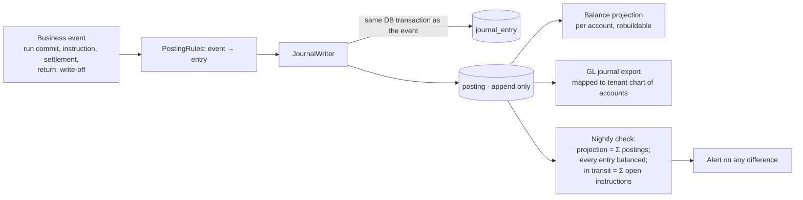
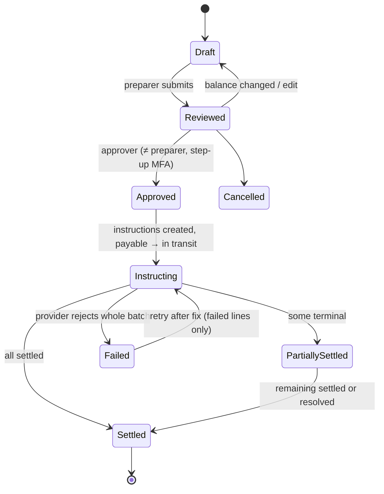
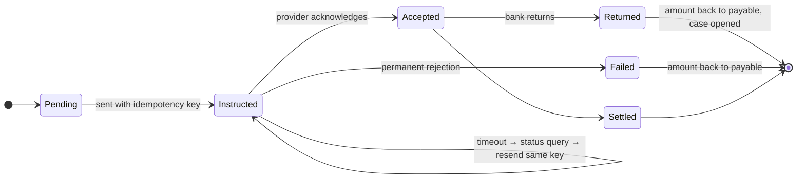
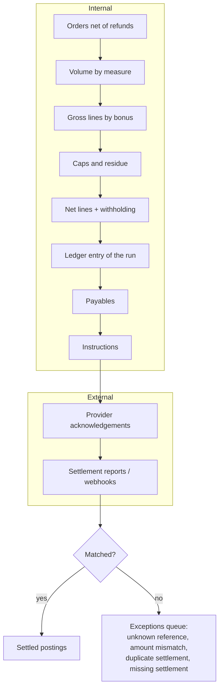
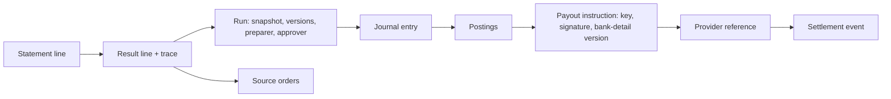

# 09 — FINANCIAL SYSTEM DESIGN
## Obligations ledger, postings, payouts, reversals, chargebacks, reconciliation, idempotency and approvals

| Field | Value |
|---|---|
| Document ID | SDD-09 |
| Version | 0.1 (draft for founder review) |
| Last updated | 2026-11-12 |
| Owner | Financial systems architect role |
| Depends on | TRD-01 §6; SDD-04; SDD-07; gap audit 10; research 51 §5 |
| Status | Draft. Tax and legal items are screening-grade. Example amounts are hypothetical and verified by `08-qa/verification/verify_calculations.py` |

## 1. Boundaries: five things that must not be confused

| Thing | What it is | Platform role |
|---|---|---|
| Commission statement | A document showing a payee what they earned and why | Generate |
| **Obligations ledger** | Double-entry record of what the **tenant owes** each payee and what payees owe back | **System of record** |
| Wallet or stored value | A balance a payee can hold, spend or withdraw | **None.** The word is not used |
| Payment processing | Card acceptance and disbursement by licensed providers | Integrate through adapters; never touch funds |
| Regulated account | Bank or e-money account | None |

The tenant's bank and general ledger are outside the platform. The platform's ledger ends at "instruction settled".

## 2. Accounts

One set per tenant and market (currency), created at market set-up. Payee-level accounts are created on first use.

| Account type | Normal balance | Per | Meaning |
|---|---|---|---|
| `commission_expense` | Debit | Market | Gross compensation earned |
| `payee_payable` | Credit | Payee | Owed to the payee, not yet instructed |
| `withholding_payable` | Credit | Market | Withheld, to be remitted by the tenant |
| `payout_in_transit` | Credit | Market | Instructed, not yet settled (clearing) |
| `clawback_receivable` | Debit | Payee | Owed back by the payee after a reversal |
| `rounding_residue` | Either | Market | Minor units from allocation |
| `breakage` | Credit | Market | Amounts earned by rule but retained (unpaid by cap residue rule or title mismatch), disclosed |
| `write_off` | Debit | Market | Clawbacks not recovered |
| `credit_liability` (V1) | Credit | Payee and credit type | Non-cash rewards outstanding |
| `settled_clearing` | Debit | Market | Contra account for settled payouts; the tenant's bank entry is made in its own general ledger from the export |

## 3. Posting rules

Every event produces exactly one balanced entry with an idempotency key derived from the event. Amounts in the example are for one payee.

| # | Event | Idempotency key | Debit | Credit |
|---|---|---|---|---|
| 1 | Run committed: gross 100.00, withholding 2.00 | `run:{run_id}` (one entry for the whole run) | Commission expense 100.00 | Payee payable 98.00; Withholding payable 2.00 |
| 2 | Payout instructed 98.00 | `instr:{instruction_id}:instructed` | Payee payable 98.00 | Payout in transit 98.00 |
| 3 | Provider confirms settlement | `instr:{id}:settled` | Payout in transit 98.00 | Settled clearing 98.00 |
| 4 | Payout returned or failed after instruction | `instr:{id}:returned` | Payout in transit 98.00 | Payee payable 98.00 |
| 5 | Refund after payout: clawback 40.00 | `claw:{origin_id}` (within the run entry of the open period) | Clawback receivable 40.00 | Commission expense 40.00 |
| 6 | Netting against next run's gross of 25.00 | Part of that run's entry | Payee payable 25.00 | Clawback receivable 25.00 |
| 7 | Write-off of remaining 15.00 (approved) | `writeoff:{case_id}` | Write-off 15.00 | Clawback receivable 15.00 |
| 8 | Manual adjustment +10.00 (approved case) | Within the run entry, origin = case | Commission expense 10.00 | Payee payable 10.00 |
| 9 | Rounding residue of 0.02 on a pool | Within the run entry | Rounding residue 0.02 | Commission expense 0.02 (or the reverse, by sign) |
| 10 | Cap residue retained as breakage 15,000.00 | Within the run entry | Commission expense 15,000.00 | Breakage 15,000.00 |
| 11 | Migration opening balance 55.00 payable | `migration:{batch}:{payee}` | Commission expense (opening) 55.00 | Payee payable 55.00 |
| 12 | Chargeback | Same as refund (5) by policy | — | — |
| 13 | Chargeback reversed in the merchant's favour | `claw-rev:{origin_id}` | Commission expense | Clawback receivable (or payable if already netted) |

**Worked check (TS-38).** Gross 1,234.56 at a fixture withholding rate of 2%: withholding 24.69, payable 1,209.87; 1,234.56 = 1,209.87 + 24.69.

**Worked cycle (TS-40).** Commit 98.00 → instruct → return → re-instruct → settle. Payable: +98 −98 +98 −98 = 0. In transit: +98 −98 +98 −98 = 0. Settled clearing: 98.

## 4. Ledger mechanics

| Property | Enforcement |
|---|---|
| Balanced | Deferred constraint trigger: Σ debit = Σ credit per entry at commit |
| Append-only | `UPDATE`, `DELETE` revoked and blocked by trigger on `journal_entry` and `posting` |
| Idempotent | Unique `(tenant_id, idempotency_key)`; a duplicate returns the existing entry |
| Attributable | `origin_type`, `origin_id`, `approval_id` on the entry |
| Derived balances | Projection table updated in the same transaction for speed; verified against postings nightly and rebuildable |
| No human posting | The only entry points are posting rules triggered by approved objects |
| Period reporting | Postings carry `posted_at`; exports group by period through the origin run or batch |

## 5. Payout processing

| Step | Design |
|---|---|
| Selection | Payees with `payee_payable` ≥ market minimum and no hold. Holds: bank-detail cooling-off, open duplicate case, missing tax profile where the pack requires, manual hold with reason |
| Review | Totals, counts, exclusions with reasons, comparison with the committed run |
| Approval | Different person; step-up; thresholds for a second approver from settings |
| Instruction | For each payee: instruction row with key and signature; ledger entry 2; outbox row. All in one transaction |
| Dispatch | Worker calls the adapter; stores provider reference; never re-sends without a status query when the outcome is unknown |
| Signature | HMAC or asymmetric signature over (tenant, instruction id, payee, bank-detail version, amount, currency, key) with a per-tenant signing key from the secrets manager; verified before dispatch so that a tampered row is refused (threat T13) |

## 6. Refund reversals and chargebacks

| Case | Flow |
|---|---|
| Refund, period still open | Volume reversed in inputs; no ledger effect yet |
| Refund after commit, before payout | Late transaction → adjustment in the open period; the earlier payable is reduced by netting in the next run. (Batches already approved are not altered; the receivable is recovered from future earnings.) |
| Refund after payout | Clawback line by the bonus's policy → entry 5 → netting 6 → carried receivable → optional write-off 7 |
| Partial return | Per line (BR-RET-01); restocking fee reduces the refund, volume effect by setting |
| Exchange of equal value | No reversal (BR-RET-02) |
| Chargeback | Treated as a refund for volume and pay (BR-REV-06); if later won by the merchant, entry 13 |
| Cooling-off and buy-back windows | Market-pack parameters determine when volume is credited and how long reversals may arrive (D-R1, CPL-07) |
| Negative balance | Never a negative payable: the shortfall is a positive `clawback_receivable`. The platform never debits a payee's bank account (BR-REV-09) |

## 7. Reconciliation

| Control | Check | Frequency |
|---|---|---|
| Run control totals | Σ lines = run total; Σ lines by payee = payable + withholding postings; residue and breakage explained | At commit (blocking) |
| Ledger integrity | Every entry balanced; projection = Σ postings | Nightly |
| In-transit ageing | Σ `payout_in_transit` = Σ instructions in instructed or accepted; items older than the provider's settlement window flagged | Daily |
| Provider reconciliation | Each settlement line matches one instruction by reference and amount | Per report or webhook |
| Period close | Period → Paid when all instructions terminal; → Closed after sign-off that exceptions are resolved | Per period |
| GL export | Export balances and equals ledger movement for the period | Per export |

## 8. Transaction idempotency

| Boundary | Key | Guard |
|---|---|---|
| Run request | `(tenant, period, run_request_id)` | Unique index; advisory lock |
| Ledger entry | `(tenant, idempotency_key)` derived from origin | Unique index |
| Payout instruction | `(tenant, idempotency_key)`; same key sent to the provider | Unique index; provider-side idempotency |
| Inbound provider event | `(tenant, provider, event_id)` | `inbound_event` unique index; handler checks instruction state |
| Adjustment origin | `(run_id, origin_type, origin_id)` | Unique index on result lines |
| Order and order event | `(tenant, source_system, source_id)` | Unique index |

## 9. Approval controls

| Action | Preparer | Approver | Extra |
|---|---|---|---|
| Commit run | Commission analyst | Finance approver | Step-up; review opened |
| Approve payout batch | Payout officer | Finance approver | Step-up; second approver above a threshold |
| Manual adjustment | Commission analyst | Finance approver | Reason, evidence, related-party and new-account blocks |
| Write-off | Finance manager | Finance approver | Threshold |
| Restatement | Compliance officer or analyst | Finance approver | Diff reviewed |
| Clawback policy or rounding mode change | Tenant admin | Finance approver | Effective at a period boundary |
| Bank-detail change by staff | Support agent (case) | Second staff member | Evidence; cooling-off still applies |
| Opening balances (migration) | Implementation consultant | Tenant Finance approver | Once |

Enforced twice: service layer (`PolicyService`) and database (`CHECK approver_id <> preparer_id`).

## 10. Auditability: the chain

Any link can be followed in either direction from the staff screens (SC-02, SC-33, SC-03).

## 11. Tax in the money flow

Withholding is computed in engine pass 11 from the payee's tax profile and the market pack's rule in force on the pay date; it reduces the payable and credits `withholding_payable`. Remittance to the authority is the tenant's act outside the platform; the tenant records it in its own ledger. Year-end forms are generated from tax lines and must equal ledger totals (AC-18.2). **No rate, threshold or form layout is defined in this design.**

## 12. Currency

MVP-B: one currency per market; every amount carries its currency; no conversion. V1: `fx_rate` table with source and time; conversion at one defined pass; FX difference account; statements show original, rate and converted amounts (GAP-034).

## 13. Open items

| Item | Owner |
|---|---|
| Legal treatment of clawbacks and negative balances per market (Q-10, D-R3) | Counsel |
| Whether unclaimed balances create duties (GAP-035) | Counsel |
| Whether Option 1 (calculate and instruct) needs any licence in the launch market (Q-2) | Counsel |
| Withholding rules and forms | Tax adviser |
| Provider capabilities (idempotency support, status query, settlement report formats) | Providers; adapters designed after written answers |
