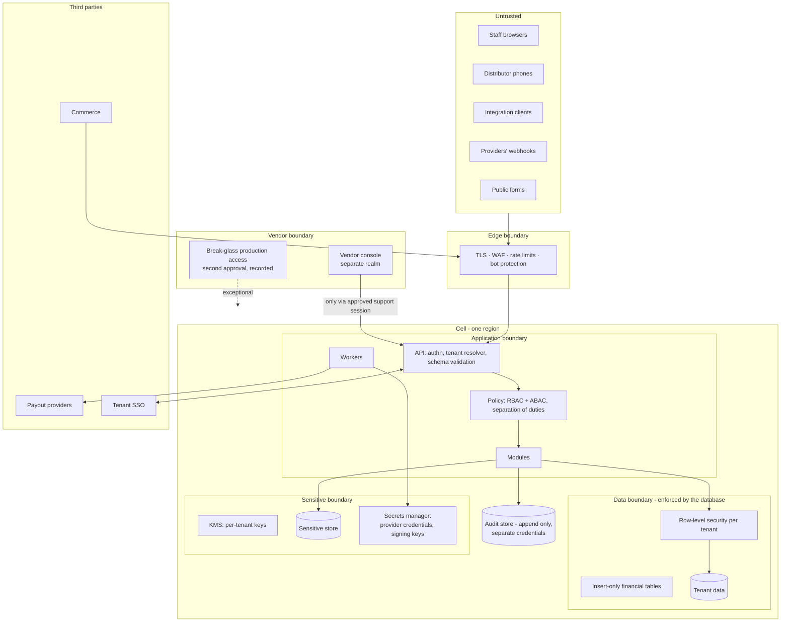
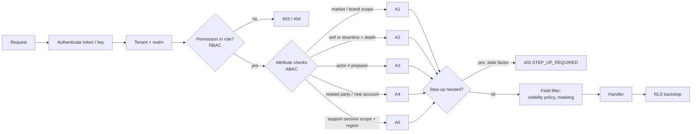

# 10 — SECURITY ARCHITECTURE
## Threat model, trust boundaries, tenant isolation strategy and control design

| Field | Value |
|---|---|
| Document ID | SDD-10 |
| Version | 0.1 (draft for founder review) |
| Last updated | 2026-11-12 |
| Owner | Cybersecurity architect role |
| Depends on | TRD-04; SDD-01 §3; gap audit 16 |
| Status | Draft. Needs review by an independent security engineer before build |

## 1. What an attacker wants

The platform never holds funds, so the targets are **payout instructions, bank details, plan rules and manual adjustments**, plus the **personal data of very large distributor populations** and, uniquely for a multi-tenant vendor, **access to many companies at once**.

## 2. Trust boundaries

## 3. Threat model

STRIDE categories: **S**poofing, **T**ampering, **R**epudiation, **I**nformation disclosure, **D**enial of service, **E**levation of privilege. T-numbers keep the gap audit's numbering (16 §1); T14 onward are added.

| # | Threat | STRIDE | Actor | Prevent | Detect | Respond |
|---|---|---|---|---|---|---|
| T1 | Cross-tenant data access | I, E | Attacker; bug | Tenant from token only; RLS on every table; routing; namespaced keys; dedicated DB for large tenants | CI isolation suite; anomaly on rows of another tenant in a response (canary rows per tenant) | Incident runbook; notify affected tenants (PRV-02) |
| T2 | Privilege escalation inside a tenant | E | Tenant user | Least-privilege roles; second admin for privileged grants; cannot grant what you lack | Alert on new admin | Role-change history |
| T3 | Vendor staff reads tenant data | I | Our staff | No standing access; approved, scoped, time-boxed sessions; region-bound | Every action logged and visible to tenant | Tenant-visible log; session report |
| T4 | Genealogy scraping | I | Distributor, leader | Server-side visibility policy; depth and page limits; no bulk endpoints | Rate limits; pattern alerts | Export log; suspend portal session |
| T5 | Bank-detail change before payout | T, S | Account takeover; insider | Re-authentication; notices to old contact; cooling-off; staff changes only by case with second person | Many payees to one account; changes just before pay day | Hold payouts; case |
| T6 | Manual adjustment fraud | T | Tenant staff | Reason and evidence; thresholds; no self-approval; related-party and new-account blocks | Adjustment volume by user; adjustments to young accounts | Immutable case history |
| T7 | Plan-rule manipulation | T | Tenant staff | Versions need simulation and approval; committed periods immutable | Diff alert when a change concentrates gains on few payees | Version diff and approver |
| T8 | Fake, duplicate, multiple accounts | S | Distributors | Duplicate matching on hashed attributes; market identity rules | Clusters sharing attributes | Duplicate case |
| T9 | Volume manipulation (bonus buying, inventory loading) | T | Distributors | Plan design; guardrail warnings | Integrity signals (V1); R4 report | Compliance case |
| T10 | Account takeover, session hijack | S | External | MFA for privileged roles; step-up; short sessions; refresh rotation with reuse detection; device binding for approvers | New device on approver; impossible travel | Revoke sessions |
| T11 | API abuse and mass extraction | I, D | Integrators; attackers | Scoped keys; rate limits; pagination caps; IP allow-lists | Volume anomalies per key | Revoke key |
| T12 | Sensitive document exposure | I | Any | Separate encrypted store; signed short-lived URLs; masked display | Many documents by one user | Access log |
| T13 | Payout instruction tampering or replay | T | Attacker; bug | Signed instructions verified before dispatch; idempotency keys; provider allow-list | Reconciliation breaks | Instruction trail |
| T14 | Malicious or malformed import or upload | T, D | Tenant user; attacker | Content-type inspection; size limits; malware scan; CSV parsed defensively (no formula execution in exports: values prefixed when starting with `=`, `+`, `-`, `@`) | Validation reports | Reject batch |
| T15 | Forged inbound webhook | S, T | Attacker | Provider signature and timestamp; dedupe by event id; settlement amounts must match instruction | Unknown reference exceptions | Ignore; alert |
| T16 | Server-side request forgery through tenant-configured webhook URLs | I, E | Tenant user | HTTPS only; resolve and block private and link-local ranges; egress proxy | Egress logs | Disable endpoint |
| T17 | Injection (SQL, script) | T, I, E | Attacker | Parameterised queries; output encoding; strict content security policy; expression language is not SQL and has no I/O | WAF signals; error rates | Patch |
| T18 | Repudiation of approvals | R | Staff | Approval records with actor, factor time, object hash; hash-chained audit | Chain verification | Evidence export |
| T19 | Tampering with history (ledger, results, audit) | T | Insider with DB access | Insert-only tables; application role lacks UPDATE and DELETE; break-glass access recorded; audit in separate store with separate credentials | Chain break; projection mismatch; replay mismatch | Restore; investigate |
| T20 | Denial of service at period end | D | Attacker; load | Rate limits; queue-based ingestion; worker limits per tenant; autoscaling web tier | Latency and queue alerts | Shed non-critical work |
| T21 | Supply-chain compromise | T, E | Dependency attacker | Pinned dependencies; signed artefacts; vulnerability scanning; minimal images | Scanner alerts | Patch within NFR-SEC-07 |
| T22 | Secrets leak | I | Insider; bug | Secrets manager; no secrets in logs, code or DB; rotation | Secret scanning in CI and logs | Rotate; revoke |
| T23 | Extension expression abuse (resource exhaustion, data access) | D, I | Tenant staff | Pure, typed language; bounded evaluation; can read only the payee's declared inputs | Evaluation cost metrics | Reject version |
| T24 | Self-hosted edition: tampered release or market pack; licence forgery | T, S | Attacker; licensee | Signed packages verified offline; signed licence bound to installation | Verification failure log | Refuse package; read-only mode on invalid licence (never on mere expiry) |
| T25 | Overlay data re-identification | I | Our staff; attacker | Pseudonymous ids only; forbidden-column rejection; data terms; region-bound storage; deletion on request | — | Delete batch |

## 4. Tenant isolation strategy

Layered so that one failure does not expose a tenant:

| Layer | Control |
|---|---|
| 1 Identity | Token bound to one tenant and realm; API key bound to one tenant |
| 2 Request | Tenant resolver sets context once; no handler accepts a tenant id; cross-cell requests redirected |
| 3 Data access | `SET LOCAL app.tenant_id` at transaction start; a query without it fails because RLS denies by default |
| 4 Database | RLS policy `USING (tenant_id = current_setting('app.tenant_id')::uuid)` and `WITH CHECK` on every tenant-scoped table; application role has no `BYPASSRLS`; migrations run as a separate role; a migration test fails if a tenant table lacks a policy |
| 5 Placement | Dedicated database or cell for large and residency-bound tenants |
| 6 Other stores | Object keys, cache keys, queue jobs, logs and exports carry the tenant prefix; per-tenant encryption keys for sensitive data |
| 7 Verification | Generated cross-tenant test for every endpoint in CI (TS-21); canary rows; periodic penetration test |
| 8 People | Vendor access only through support sessions; break-glass with second approval |

## 5. Authorisation architecture

**Role-specific dashboards are supported by the same model** (consistency check requested in the brief): each dashboard and navigation item is tied to a permission; the server returns the navigation model for the user's permissions and scopes, and each data endpoint enforces them again.

### Base role matrix (summary; full matrix is test fixture TS-36)

| Capability | Tenant admin | Analyst | Plan admin | Finance approver | Payout officer | Compliance officer | Support | DPO | Executive | Distributor |
|---|---|---|---|---|---|---|---|---|---|---|
| Users, roles, settings | ● (2nd admin for privileged) | — | — | approve money settings | — | — | — | — | — | — |
| Imports, mapping | ● | — | — | — | — | approve mapping | — | — | — | — |
| Compliance reports | read | read | read | read | — | ● | — | read | read | — |
| Plans: edit / approve / activate | — | read | edit | activate (2nd) | — | approve | — | — | — | — |
| Run: execute / commit | — | execute | — | commit | — | — | — | — | — | — |
| Payout: prepare / approve | — | — | — | approve | prepare | hold | — | — | — | — |
| Adjustments, restatements | — | propose | — | approve | — | request, review | — | — | — | — |
| Genealogy cases | — | read | — | — | — | approve | file | — | — | request own |
| Participant record | read | read | — | read | read | read | read (masked) | read | — | self |
| Unmask sensitive field | — | — | — | step-up, audited | step-up, audited | — | — | step-up, audited | — | self |
| Ledger, exports | — | read | — | ● | read | read | — | — | — | — |
| Privacy requests | — | — | — | — | — | — | — | ● | — | request own |
| Audit log | ● | — | — | — | — | ● | — | read | — | — |
| Vendor session decisions | ● | — | — | — | — | — | — | — | — | — |
| Statements | — | staff view | — | staff view | — | — | staff view (masked) | — | — | self |

## 6. Data protection design

| Data | Protection |
|---|---|
| Bank details | Encrypted per tenant before storage; fingerprint (keyed hash) for duplicate detection; masked value for display; decrypted only by the dispatcher inside a worker at instruction time |
| Tax ids, identity documents | Sensitive store; masked column for display; unmask is a separate audited call with step-up |
| Contact data | In `participant.contact`; visible by role and visibility policy; removed on pseudonymisation |
| Overlay facts | Pseudonymous; no direct identifiers accepted |
| Logs and traces | No personal data, secrets or bank details; automated scanning |
| Backups | Encrypted; in region; same access controls; pseudonymisation is not applied retroactively to backups, which age out by retention |
| Exports | Logged, limited, expiring links; destination in the tenant's region |

## 7. Security operations

| Area | Design |
|---|---|
| Logging and audit | Audit events through the outbox to a separate append-only store; hash chain per tenant; daily verification |
| Monitoring | Alerts for T1 canaries, new admins, bank-detail clusters, adjustment volume, chain break, unbalanced entry attempts, replay mismatch, dead letters |
| Incident response | Runbook with severity levels, tenant notification within contractual and market timelines, affected-subject report from the personal-data map |
| Vulnerability management | Dependency and container scanning in CI; patch targets NFR-SEC-07; penetration test before the first MVP-B production tenant |
| Change management | Reviewed changes; signed artefacts; deploy approval by someone other than the author |
| Attestation readiness | Controls mapped to SOC 2 and ISO 27001 from the start (SEC-12); evidence comes from audit log, CI records and access reviews |

## 8. Self-hosted edition: shared responsibility

| Control | Hosted edition | Self-hosted edition |
|---|---|---|
| Infrastructure security, network, backups, patching of OS and database | Vendor | **Licensee** (guide and preflight check provided) |
| Application security controls (RBAC, separation of duties, immutability, audit, signing) | Vendor | Built in; cannot be disabled by configuration |
| Updates and market packs | Vendor applies | Licensee applies signed packages; advisories show exposure |
| Vendor access | Approved sessions | None by default |
| Incident response and breach notification | Vendor as processor | Licensee as controller and operator; vendor supports through the bundle |
| Identity provider | Vendor-operated | Licensee-operated (reference configuration provided) |

## 9. Residual risks and open questions

| Item | Status |
|---|---|
| Vendor liability for tenant plans (Q-1) | Unknown; counsel |
| Whether MFA should be mandatory for distributors | Optional by default; revisit with fraud evidence |
| Device and behavioural signals for duplicate detection raise privacy questions | Needs DPO and counsel view per market |
| Cross-region genealogy under residency rules | Open (OQ-17) |
| This threat model has had no independent review | FD-07 |
