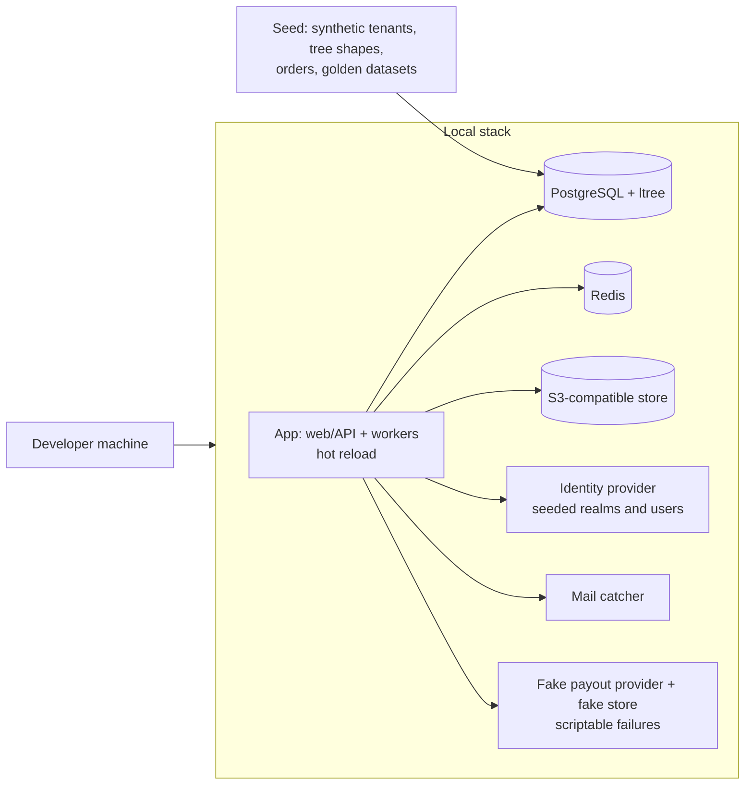
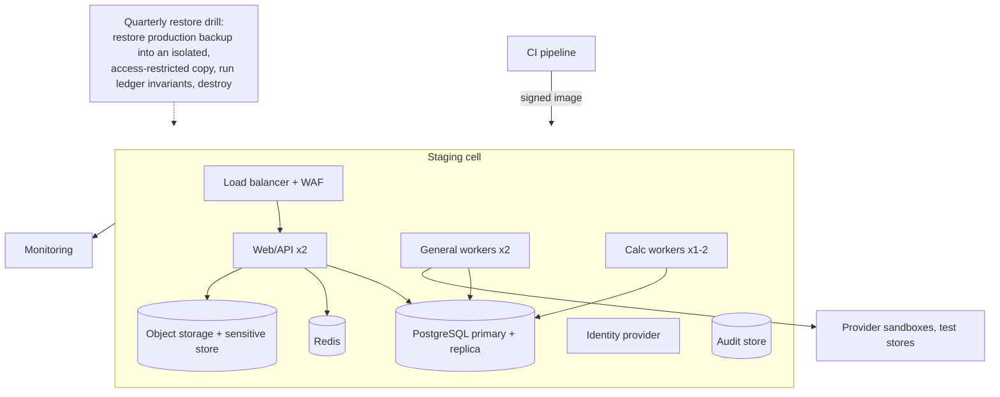
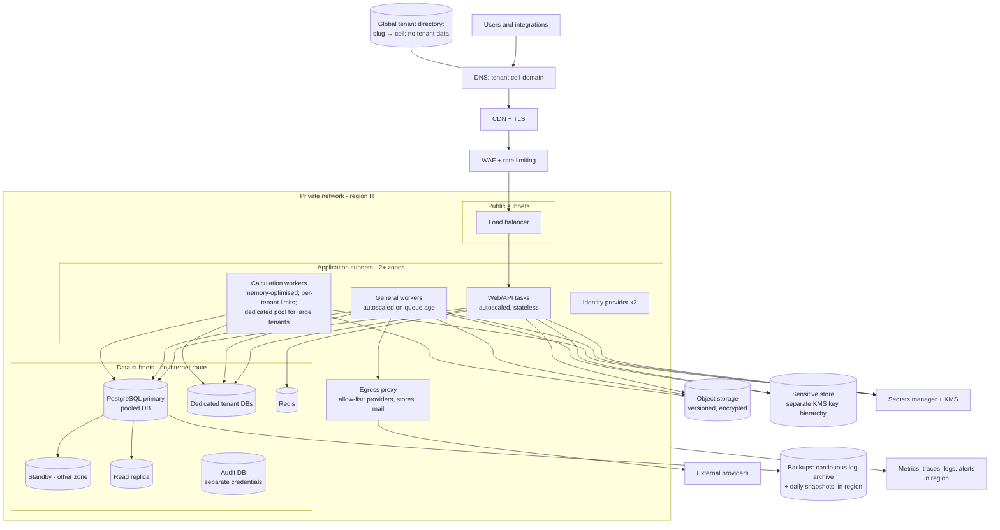
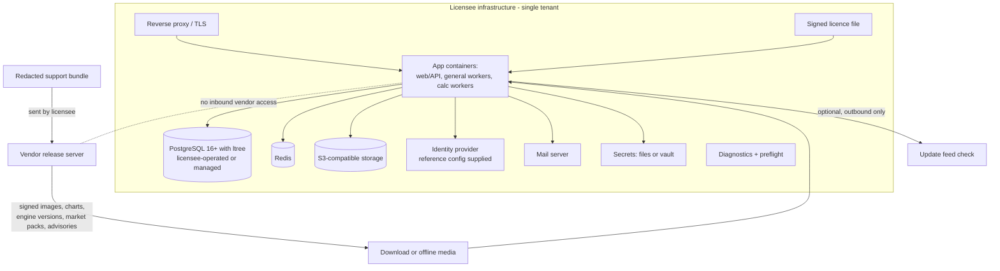

# 11 — DEPLOYMENT ARCHITECTURE
## Development, staging and production environments; pipeline; operations; the self-hosted package

| Field | Value |
|---|---|
| Document ID | SDD-11 |
| Version | 0.1 (draft for founder review) |
| Last updated | 2026-11-12 |
| Owner | DevOps architect role |
| Depends on | TRD-01 §8, TRD-02, SDD-01 |
| Status | Draft. Cloud provider and regions are provisional until the launch market is chosen (OQ-19) |

## 1. Environments

| Environment | Purpose | Data | Scale | Access |
|---|---|---|---|---|
| Local | Development | Synthetic (generator from the research prototype's `synth.py` approach) | Containers on a laptop | Developer |
| CI | Automated tests | Fixtures; golden datasets | Ephemeral | Pipeline |
| Development | Integration of merged work | Synthetic | Small, shared | Engineers |
| Staging | Release candidate verification; provider sandboxes; restore drills | Synthetic and anonymised only; **never production personal data** | Production-like topology, smaller | Engineers; design-partner preview by invitation |
| Production (per region = cell) | Tenants | Real | Sized per cell | No routine human access; break-glass only |

## 2. Development environment

The fake provider can time out, reject lines, return payments and duplicate webhooks on demand, so idempotency tests run locally and in CI.

## 3. Staging environment

## 4. Production environment (one cell)

| Element | Design |
|---|---|
| Cells | One per region; independent; a tenant lives in exactly one. A small global directory maps tenant slug to cell and holds no business data |
| Zones | Web, workers and database standby across at least two availability zones |
| Network | Database and cache in subnets without internet routes; outbound only through an allow-listing egress proxy |
| Database | Managed PostgreSQL; synchronous or semi-synchronous standby; one read replica for dashboards and exports; dedicated databases created by the routing tooling |
| Calculation workers | Separate task definition with larger memory; concurrency 1 run per tenant calendar; a large tenant can be pinned to its own pool |
| Identity provider | Per cell, highly available; realms staff, portal, vendor |
| Secrets | Secrets manager paths per tenant for provider credentials and signing keys; KMS keys per tenant for sensitive data |

## 5. CI/CD

```mermaid
flowchart LR
  PR[Pull request] --> L[Lint + type check]
  L --> ST[Static rules:<br/>no float in money paths ·<br/>no tenant-id branches ·<br/>module boundary test ·<br/>secret scan]
  ST --> UT[Unit + property tests]
  UT --> GD[Golden datasets<br/>+ replay sample<br/>+ differential vs previous engine]
  GD --> IT[Integration tests with fake provider:<br/>idempotency, ledger invariants]
  IT --> ISO[Cross-tenant isolation suite<br/>generated from OpenAPI]
  ISO --> MIG[Migration check:<br/>forward-only, RLS policy on new tables,<br/>no rewrite of insert-only tables]
  MIG --> SEC[Dependency + image scan]
  SEC --> IMG[Build signed image + SBOM]
  IMG --> DEVE[Deploy dev] --> STGE[Deploy staging<br/>+ smoke + accessibility scan]
  STGE --> APR{Release approval<br/>by non-author}
  APR --> PRODC[Production: one cell at a time,<br/>canary tasks, automatic rollback on error budget]
  IMG --> PKG["Self-hosted package, V1:<br/>signed images, charts, market packs"]
```

| Topic | Design |
|---|---|
| Environment configuration | Environment variables and mounted secrets; the same image in every environment and in the self-hosted package |
| Database migrations | Run per database by a migration job before the new version takes traffic; expand-then-contract so the previous version still works (rollback) |
| Rollback | Redeploy previous image; no down-migrations; engine versions are additive, so a rollback never invalidates a committed run |
| Release timing | No production deployment inside a tenant's cut-off-to-commit window in that cell unless it is a fix for that process |
| Feature flags | Per tenant; server-side |

## 6. Monitoring, logging and alerting

| Signal | Examples | Alert |
|---|---|---|
| Service | Request rate, errors, latency per route and tenant | Error budget burn |
| Runs | Duration, lines, memory, failures, variance against previous run | Failed run; run longer than target |
| Ingestion | Lag per connector, exception queue size, reconciliation differences | Lag at cut-off |
| Outbox and queues | Oldest undispatched row; queue age; dead letters | Age > 5 min (proposed); any dead letter in `dispatch` |
| Payouts | Instruction failure and return rates; in-transit ageing | Rate above tenant threshold |
| Ledger | Unbalanced entry attempts; projection mismatch; replay mismatch | Any |
| Security | Sign-in failures, new admins, vendor sessions, audit chain | Chain break; canary hit |
| Database | Connections, replication lag, bloat, slow queries | Replication lag; storage |

Logs are structured with tenant id, correlation id and actor id, without personal data. Traces link API requests to jobs through the outbox event id. Each tenant gets a status view of its own run, ingestion and payout health (SC-01, SC-13).

## 7. Backup, disaster recovery and scaling

| Topic | Design |
|---|---|
| Backups | Continuous write-ahead-log archiving plus daily snapshots, encrypted, in region; object storage versioned; audit archives to write-once storage |
| Targets | RPO ≤ 5 min and RTO ≤ 4 h are **proposed** (NFR-DR); the founder sets them |
| Zone failure | Automatic failover to the standby; web and workers already multi-zone |
| Region failure | Restore into a second region **only if** the tenant's residency rules allow it; otherwise wait for the region. This limit must be stated in contracts |
| Restore drill | Quarterly: restore, run ledger and audit-chain verification, replay a sample of committed periods |
| After any restore | Mandatory reconciliation against provider reports before payout dispatch resumes (SDD-01 §5) |
| Scaling | Web tier horizontally on CPU and latency; general workers on queue age; calculation workers by pool size and instance memory; database vertically, then dedicated databases for the largest tenants |

## 8. Self-hosted edition package (V1)

| Aspect | Design |
|---|---|
| Form | Versioned container images; Compose file for small installations; Helm chart for Kubernetes; no source code |
| Topology | The hosted cell with exactly one tenant; row-level security stays on; same migrations |
| Minimum infrastructure | Published per payee band after the spike; includes PostgreSQL extensions, backup target, time synchronisation |
| Preflight | Refuses to install on unsupported versions, missing encryption or no backup target |
| Updates | Signed packages; pre-activation golden and replay checks; rollback on failed migration; advisories for known defects by version |
| Market packs | Delivered as signed data packages with basis status; effective by date, never retroactive |
| Licence | Signed file, offline verification; expiry never blocks runs or payouts (BR-LIC-01) |
| Support | Redacted bundle or licensee-approved session; vendor has no credentials |
| Not included | Managed backups, monitoring service, identity operations: the licensee's responsibility (SDD-10 §8) |

## 9. Cost notes

Infrastructure cost per tenant (pooled against dedicated) is an **unknown unit-economics input** (gap audit 18 §4); it is measured in the spike and at the first tenants. The design keeps the fixed cost per cell low: one database cluster, one cache, managed containers, no bus, no Kubernetes at MVP.
