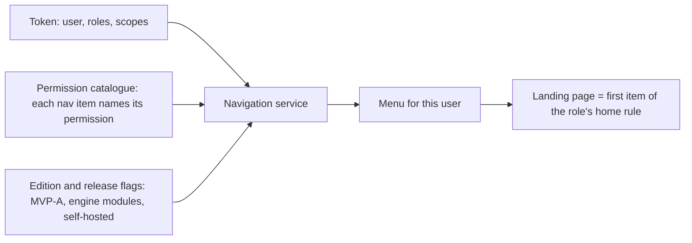
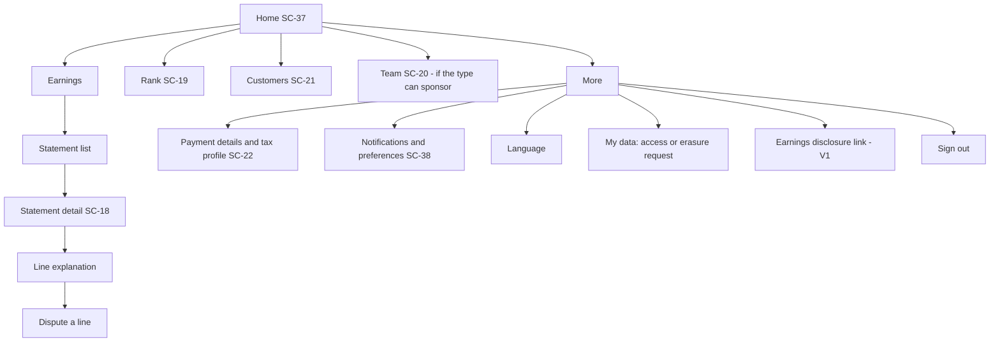

# 02 — INFORMATION ARCHITECTURE
## Applications, navigation by role, modules, pages, settings, search, notifications, profile

| Field | Value |
|---|---|
| Document ID | UX-02 |
| Version | 0.1 (draft for founder review) |
| Last updated | 2026-11-12 |
| Owner | UX architect role |
| Depends on | UX-01; WF-01 (screen inventory); gap audit 14 §2 |
| Status | Draft |

## 1. Four application areas

| Area | Audience | Hostname pattern | Layout |
|---|---|---|---|
| Staff application | Tenant staff | `{tenant}.{cell-domain}` | Left sidebar, top bar, content |
| Distributor portal | Distributors, leaders | `{tenant}.{cell-domain}/portal` (or tenant's own domain) | Mobile-first; bottom navigation on phones, top navigation on desktop |
| Vendor console | Vendor staff | Separate hostname and identity realm | Sidebar |
| Public pages | Anyone | Tenant domain | Single column |

## 2. Navigation is generated from permissions

The server returns a navigation model built from the user's permissions and market scope. Items the user cannot use are **absent**, not disabled. Roles are bundles of permissions, so a custom tenant role gets the right menu automatically.

## 3. Staff application: global structure

```mermaid
flowchart TB
  ROOT[Staff application]
  ROOT --> HOME[Home - by role]
  ROOT --> PER[Periods]
  ROOT --> PLN[Plans]
  ROOT --> PPL[People]
  ROOT --> ORD[Orders]
  ROOT --> CAS[Cases]
  ROOT --> PAY[Payouts]
  ROOT --> FIN[Finance]
  ROOT --> CPL[Compliance]
  ROOT --> DAT[Data]
  ROOT --> SET[Settings]
  PER --> PER1[Periods and runs SC-01]
  PER --> PER2[Run review SC-02]
  PER --> PER3[Late transactions SC-32]
  PLN --> PLN1[Plan versions SC-04]
  PLN --> PLN2[Caps and pools SC-05]
  PLN --> PLN3[Simulations and golden datasets SC-42]
  PLN --> PLN4[Change workflow SC-44]
  PPL --> PPL1[Search SC-36]
  PPL --> PPL2[Participant record SC-09]
  PPL --> PPL3[Genealogy explorer SC-07]
  PPL --> PPL4[Rank and qualification SC-43]
  ORD --> ORD1[Orders and returns SC-31]
  CAS --> CAS1[All cases SC-06]
  CAS --> CAS2[Genealogy and duplicates SC-08]
  CAS --> CAS3[Privacy requests SC-15]
  PAY --> PAY1[Batches and approvals SC-03]
  PAY --> PAY2[Reconciliation SC-34]
  FIN --> FIN1[Ledger and exports SC-33]
  FIN --> FIN2[Tax SC-12]
  CPL --> CPL0[Overview SC-46]
  CPL --> CPL1[Reports SC-10 and drill-down SC-26]
  CPL --> CPL2[Guardrails log SC-11]
  CPL --> CPL3[Disclosure SC-23 - V1]
  CPL --> CPL4[Integrity signals SC-45 - V1]
  DAT --> DAT1[Imports SC-24]
  DAT --> DAT2[Mapping SC-25]
  DAT --> DAT3[Migration SC-16]
  SET --> SET1[Users and roles SC-28]
  SET --> SET2[Tenant settings SC-29]
  SET --> SET3[Markets and launch checklist SC-17]
  SET --> SET4[Integrations SC-13]
  SET --> SET5[Vendor access SC-14]
  SET --> SET6[Audit log SC-30]
  SET --> SET7[System - self-hosted SC-47]
```

### 3.1 Navigation by role

● = shown; **H** = landing page; — = absent.

| Section | Executive | Tenant admin | Analyst | Plan admin | Finance approver | Payout officer | Compliance officer | Support | DPO | Impl. consultant |
|---|---|---|---|---|---|---|---|---|---|---|
| Home | **H** Executive overview | Settings home | Periods | Plans | Approvals | Batches | Compliance overview | Search | Privacy | Data |
| Periods | — | — | **H** ● | read | ● (review, commit) | read | read | — | — | read |
| Plans | — | — | read | **H** ● | activate | — | review | — | — | ● |
| People | — | read | ● | — | read | read | ● | **H** ● (masked) | read | ● |
| Orders | — | — | ● | — | read | — | read | ● | — | ● |
| Cases | — | — | ● | — | approvals | returned payments | ● | ● | privacy | — |
| Payouts | — | — | — | — | **H** approve | **H** ● | holds | — | — | — |
| Finance | read | — | read | — | ● | read | read | — | — | — |
| Compliance | read | read | read | read | read | — | **H** ● | — | read | mapping |
| Data | — | ● | — | — | — | — | mapping approval | — | — | **H** ● |
| Settings | — | **H** ● | — | — | money settings approval | — | market sign-off; audit | — | breach contacts | — |

In **MVP-A** only Home (Compliance overview), Compliance, Data and Settings (users, vendor access, audit) exist; the same shell grows in MVP-B.

### 3.2 Top bar (all staff pages)

| Element | Behaviour |
|---|---|
| Tenant name and market switcher | Lists markets in the user's scope; "All markets" where permitted; choice persists per user |
| Global search | Opens a command palette (shortcut `/` or `Ctrl K`): people, positions, orders, statements, cases, runs; results grouped; masked fields; respects scope |
| Period context chip | On period-scoped pages shows calendar, period and state with a lock icon when committed |
| Notifications bell | In-app list: approvals waiting for me, run finished, sync behind, case assigned, vendor-access request, deadline approaching. Each links to the object. Email mirrors by preference; approvals and security notices cannot be turned off |
| Help | Context help for the page; glossary |
| User menu | Profile (name, language, time zone display, MFA devices, sessions), sign out |

## 4. Distributor portal

| Item | Rule |
|---|---|
| Bottom navigation (phone) | Home · Earnings · Rank · Customers · More. Team replaces Customers in the bar only for types that can sponsor and have a downline, otherwise Team sits under More. Never more than five |
| Home | Latest net pay with payout status; alerts (cooling-off active, dispute updated, plan change notice); rank chip |
| No dashboard of targets | No recruit counts, no "next rank in X" prompts, no projected amounts |
| Several positions | Position switcher appears only when the person owns more than one; default view is per person |

## 5. Vendor console

Tenants (list: name, region, tier, state, job health) · Support sessions (requests, active, history) · Provisioning · Market packs (versions, basis status, release notes) · Releases (self-hosted packages, advisories) · Vendor audit log. **No route** leads to tenant business data; an approved session opens the tenant's staff application in a clearly marked read-only "support session" frame with a countdown.

## 6. Settings structure

| Group | Pages | Changes are |
|---|---|---|
| People and access | Users; roles; pending approvals; API keys | Immediate after approval; audited |
| Company | Markets (with launch checklist); brands; languages; branding (logo, name, colour token) | Versioned |
| Calendars and periods | Calendars; cut-off time zones | Effective at a period boundary |
| Participants | Participant types and flags; purpose requirement; agreement versions | Versioned; approval |
| Money policies | Rounding mode; clawback policy per bonus; write-off threshold; minimum payout; cooling-off length; adjustment thresholds | Versioned; finance approval; effective at a period boundary |
| Privacy | Visibility policy; breach contacts; retention (V1) | Versioned; DPO approval |
| Compliance | Report thresholds (R2 flag, R4 day and thresholds); guardrail acknowledgements | Versioned |
| Integrations | Commerce connectors; payout providers and eligibility records; webhooks; exports | Audited |
| Vendor access | Requests; sessions; logs | — |
| Audit | Audit log | Read-only |
| System (self-hosted) | Licence; updates; diagnostics; support bundle | Second approver for updates |

Every versioned setting shows "effective from", who changed it, the reason and a history drawer.

## 7. Search

| Scope | Finds | Notes |
|---|---|---|
| Global (staff) | Participant by external id, name (staff only), position ref; order by source id; case by id; run and period; statement by payee and period | Trigram search on names; exact on ids; grouped results; keyboard navigation |
| Within a list | Server-side filter on the list's fields | Saved views |
| Genealogy explorer | Position or person, then tree context | As-of date applies |
| Portal Team | Name or id **within own downline only** | Visibility policy; outside downline returns nothing |
| Audit log | Actor, action, object, time range | — |

## 8. Notifications

| Event | Staff in-app | Staff email | Distributor |
|---|---|---|---|
| Approval waiting (run, batch, plan, adjustment, role grant) | ● | ● mandatory | — |
| Run finished or failed | ● | optional | — |
| Sync behind at cut-off | ● | ● | — |
| Case assigned or deadline near | ● | optional | — |
| Vendor access requested | ● | ● mandatory (admins) | — |
| Statement ready | — | — | ● in-app, email or SMS by preference |
| Payout sent, returned or held | — | — | ● |
| Bank details changed | — | — | ● **mandatory, to old and new contact** |
| Dispute update | ● (assignee) | optional | ● |
| Plan change notice | — | — | ● mandatory |

## 9. User profile

Staff: display name, language, time-zone display, MFA devices, active sessions, notification preferences, saved views. Distributor: language, contact verification, notification channels, MFA option, payment details and tax profile (SC-22), data requests.

## 10. Naming rules

Labels use the glossary in UX-05 §9. One concept, one word: "Period", "Run", "Commit", "Statement", "Payout batch", "Position", "Sponsor", "Placement", "Case", "Snapshot". "Wallet" is never used.
