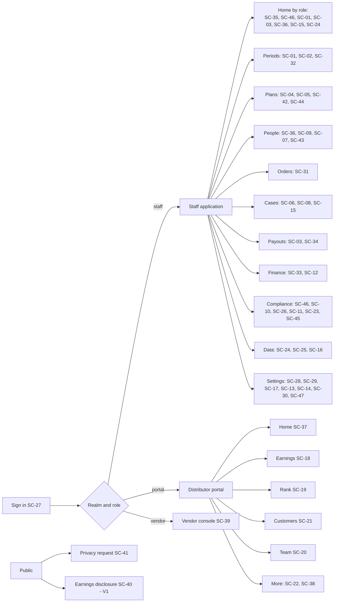

# 03 — APPLICATION SITEMAP
## Every route, the screen behind it, and who can reach it

| Field | Value |
|---|---|
| Document ID | UX-03 |
| Version | 0.1 (draft for founder review) |
| Last updated | 2026-11-12 |
| Owner | UX architect role |
| Depends on | UX-02; WF-01 |
| Status | Draft. Route names are proposals for consistency, not a frontend contract |

## 1. Sitemap overview

## 2. Staff application routes

| Route | Screen | Release | Permission | Notes |
|---|---|---|---|---|
| `/signin`, `/signin/mfa`, `/signin/enrol` | SC-27 | A | public | Tenant resolved from hostname |
| `/` | Role home | A | any | Redirects by home rule |
| `/overview` | SC-35 | B | `dashboard.exec` | |
| `/compliance` | SC-46 | A | `compliance.read` | MVP-A home |
| `/compliance/reports` | SC-10 | A | `compliance.read` | `?from&to&market` |
| `/compliance/reports/snapshots/:id` | SC-10 | A | `compliance.read` | Immutable snapshot view |
| `/compliance/reports/snapshots/:id/figures/:key` | SC-26 | A | `compliance.read` | Drill-down |
| `/compliance/guardrails` | SC-11 | B | `guardrail.read` | |
| `/compliance/disclosure` | SC-23 | V1 | `disclosure.publish` | |
| `/compliance/signals` | SC-45 | V1 | `compliance.read` | |
| `/data/imports`, `/data/imports/:id` | SC-24 | A | `import.manage` | |
| `/data/mappings/:id` | SC-25 | A | `mapping.edit` | |
| `/data/migration` | SC-16 | B | `migration.manage` | |
| `/periods` | SC-01 | B | `period.read` | Calendar tabs |
| `/periods/:id/runs/:runId/review` | SC-02 | B | `run.review` | |
| `/periods/late` | SC-32 | B | `late.manage` | |
| `/plans`, `/plans/:id/versions/:v` | SC-04 | B | `plan.read` | |
| `/plans/:id/versions/:v/caps` | SC-05 | B | `plan.edit` | |
| `/plans/:id/versions/:v/simulations/:simId` | SC-42 | B | `plan.simulate` | |
| `/plans/:id/versions/:v/change` | SC-44 | B | `plan.approve` | |
| `/people/search` | SC-36 | B | by role | Also the command palette |
| `/people/:participantId` | SC-09 | B | `participant.read` | Tabs: profile, positions, types, status, customers, tax, bank, cases |
| `/people/:participantId/qualification` | SC-43 | B | `participant.read` | |
| `/genealogy` | SC-07 | B | `genealogy.read` | `?root&kind&asOf&knownAt` |
| `/orders`, `/orders/:id` | SC-31 | B | `order.read` | |
| `/cases`, `/cases/:id` | SC-06 | B | `case.*.read` | Filter by type |
| `/cases/genealogy/new`, `/cases/duplicates` | SC-08 | B | `case.genealogy.*`, `case.duplicate.*` | |
| `/cases/privacy` | SC-15 | B | `privacy.manage` | |
| `/payouts/batches`, `/payouts/batches/:id` | SC-03 | B | `payout.prepare` or `payout.approve` | |
| `/payouts/reconciliation` | SC-34 | B | `payout.reconcile` | |
| `/finance/ledger`, `/finance/ledger/accounts/:id` | SC-33 | B | `ledger.read` | |
| `/finance/tax` | SC-12 | B | `tax.read` | |
| `/settings/users`, `/settings/roles` | SC-28 | A | `user.manage` | |
| `/settings/company`, `/settings/policies`, … | SC-29 | A/B | `settings.manage` | Sections per UX-02 §6 |
| `/settings/markets/:code/launch` | SC-17 | B | `market.manage` | |
| `/settings/integrations` | SC-13 | B | `integration.manage` | |
| `/settings/vendor-access` | SC-14 | A | `vendor_access.decide` | |
| `/settings/audit` | SC-30 | A | `audit.read` | |
| `/settings/system` | SC-47 | V1 | `system.manage` | Self-hosted edition only |
| `/profile` | Profile | A | self | |

## 3. Distributor portal routes

| Route | Screen | Release | Notes |
|---|---|---|---|
| `/portal/signin` | SC-27 | B | One-time code or password |
| `/portal` | SC-37 | B | Home |
| `/portal/earnings` | SC-18 (list) | B | Committed periods only |
| `/portal/earnings/:runId` | SC-18 (detail) | B | Cacheable |
| `/portal/earnings/:runId/lines/:lineId` | SC-18 (explanation) | B | Sheet on phone, side panel on desktop |
| `/portal/earnings/:runId/lines/:lineId/dispute` | SC-18 → case | B | |
| `/portal/rank` | SC-19 | B | |
| `/portal/customers`, `/portal/customers/:id` | SC-21 | B | |
| `/portal/team`, `/portal/team/:positionRef` | SC-20 | B | Visibility policy |
| `/portal/more/payment-details` | SC-22 | B | Re-authentication to change |
| `/portal/more/notifications`, `/portal/more/language` | SC-38 | B | |
| `/portal/more/my-data` | Privacy request | B | |

## 4. Vendor console routes

| Route | Screen | Release |
|---|---|---|
| `/tenants`, `/tenants/:id` | SC-39 | A |
| `/support-sessions` | SC-39 | A |
| `/provisioning/new` | SC-39 | A |
| `/market-packs`, `/releases` | SC-39 | B / V1 |
| `/audit` | Vendor audit log | A |

## 5. Public routes

| Route | Screen | Release |
|---|---|---|
| `/privacy-request` | SC-41 | B |
| `/earnings-disclosure` | SC-40 | V1 |

## 6. Deep links and state in URLs

Filters, sort, period, market and as-of dates live in the query string so that a link reproduces the view (subject to the recipient's permissions). Links to committed objects are permanent. A link to something outside the recipient's scope shows "Not found or not available to you" without confirming existence.
