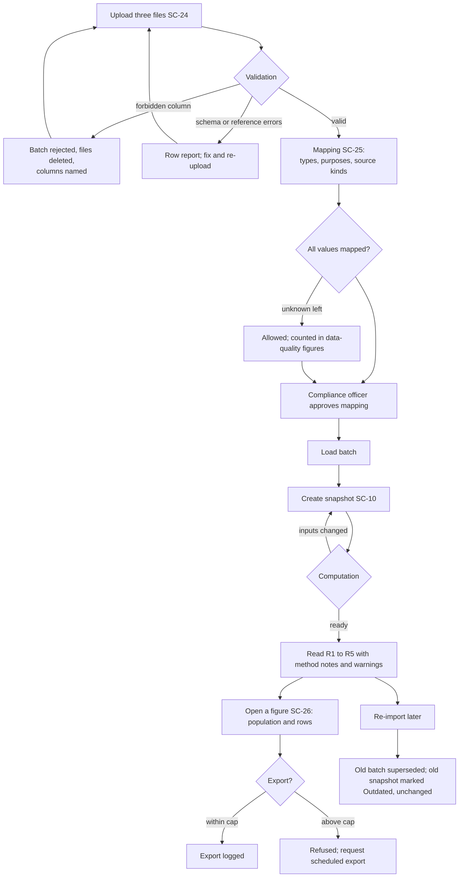
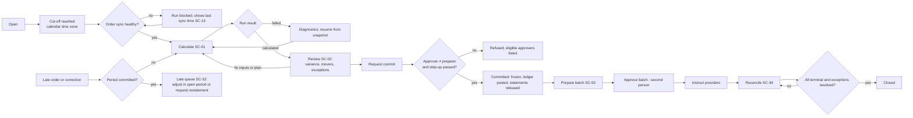
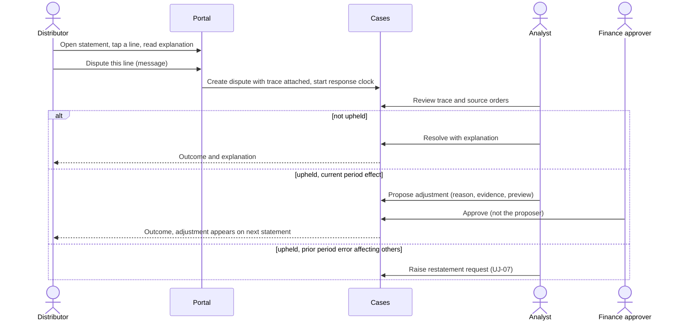
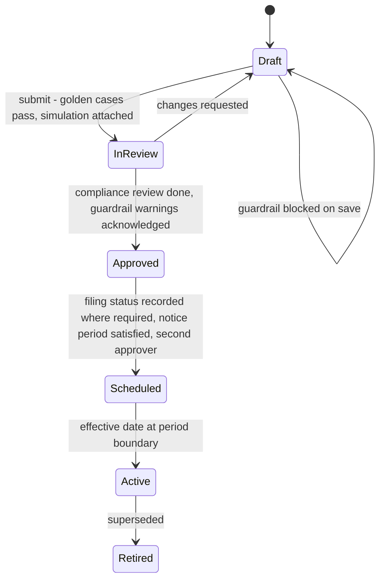
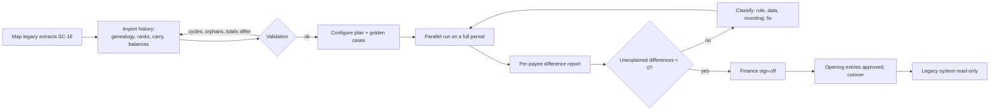

# 04 — USER JOURNEYS
## Complete journeys for the important workflows, with decision points, errors and alternative flows

| Field | Value |
|---|---|
| Document ID | UX-04 |
| Version | 0.1 (draft for founder review) |
| Last updated | 2026-11-12 |
| Owner | UX architect role |
| Depends on | UX-01..03; PRD-05; gap audit 27 (flows FL-01..FL-15) |
| Status | Draft. Journeys are hypotheses about how the work should run; error paths are design requirements. The original journey maps J-01..J-17 are not in the repository (OQ-22) |

Journey IDs: `UJ-nn`. FL-nn are the gap audit's flow IDs.

## UJ-01 Compliance evidence from an existing export (MVP-A) — the demand test

| Element | Content |
|---|---|
| Persona / entry | Implementation consultant and compliance officer; Data › Imports |
| Intent | "Show me our retail share and payout sources from our own data" |
| Completion | A ready snapshot with five reports, each figure openable to its rows |
| Requirements | FR-IMP-001..003, FR-CPL-001..006 |

| Step | User action | System response | Errors and alternatives |
|---|---|---|---|
| 1 | Chooses market and period range, drops files | Batch `uploaded`; validation job with progress | File too large; missing file |
| 2 | Reads validation report | Row counts, control totals, errors by code | Forbidden column: whole batch rejected |
| 3 | Maps values | Distinct values with counts; target vocabulary | Unknown allowed, shown as a data-quality warning |
| 4 | Approves mapping | New mapping version | Approver must hold `mapping.approve` |
| 5 | Loads | Facts written in one transaction | Interrupted: batch stays `mapped`; retry |
| 6 | Creates snapshot | `computing` → `ready` | No data for range |
| 7 | Reads, drills down | Figures with population and method | — |

## UJ-02 Period close (FL-01)

| Element | Content |
|---|---|
| Personas / entry | Commission analyst, finance approver, payout officer; Periods (SC-01) |
| Intent | Close the period and pay correctly |
| Completion | Period Closed; all payouts settled or resolved |
| Requirements | FR-COMP-001..006, FR-PAY-001..004 |

| Decision point | Rule |
|---|---|
| Sync healthy | Lag below tenant threshold and no failing connector |
| Re-run | Calculated runs are disposable; the latest one is reviewed |
| Approver unavailable | Delegation rule lists eligible approvers; never self-approval |
| Provider rejects batch | Retry failed lines only |

## UJ-03 Genealogy change or correction (FL-02)

| Step | User action | System response | Decision / error |
|---|---|---|---|
| 1 | Support agent opens the participant, chooses Request genealogy change (SC-08) | Form: tree kind, change or correction, proposed parent, dates, evidence | — |
| 2 | Submits | Policy check (window, approvals); structural check (cycle, slot) | Outside window → rejected or exception route; cycle → refused; slot taken → next slot proposed |
| 3 | — | For corrections: affected committed periods and estimated impact computed | — |
| 4 | Compliance officer reviews (SC-06) | Evidence, checks, impact | Approve, reject, ask for more evidence |
| 5 | Approves | Change: row closed and new row from the effective date. Correction: old row superseded, corrected row from the original date | Affects committed periods → choose adjustment in the open period or a restatement request (UJ-07) |
| 6 | — | Read model rebuild; notifications to affected positions | Views show stale notice until rebuilt |

Completion: case closed; history shows both rows; replay of past periods unchanged.

## UJ-04 Duplicate or multiple-account case (FL-03)

Signal (shared hashed identity, payment fingerprint, address, device) → activation or payouts held if the tenant enables holds → support compares records side by side (SC-08) → compliance decides: **merge** (ownership of positions moves; history kept), **allow with reason** (for example a plan that grants several positions), or **terminate** → notifications. Error: a merge that would create a cycle or double ownership is blocked.

## UJ-05 Commission dispute (FL-05)

Errors: dispute window passed (explanation shown); second dispute on the same line while one is open (blocked).

## UJ-06 Refund or chargeback after payout (FL-06)

Event ingested → volume reversed per line → original period committed? → late transaction → reversal by the bonus's policy (order-line clawback or restatement) → clawback receivable → netted in the next run → remainder carried → write-off below threshold with approval → statement shows a separate clawback line with the order reference. The platform never debits the distributor.

## UJ-07 Restatement of a committed period (FL-07)

Request with reason and evidence (SC-06) → sandbox recalculation → diff per payee and bonus → review → approval by a different person → adjustments in the open period → audit record. Alternative: empty diff closes the case. The committed period is never reopened.

## UJ-08 Plan change rollout (FL-08)

Steps: draft (SC-04) → simulate on at least one full historical period (SC-42) → compliance review with guardrails (SC-44) → filing status per market → field notice → activation on the effective date → transition report at the first run. Errors: missing simulation, failing golden case, missing filing, notice period too short: each blocks with its reason.

## UJ-09 New market launch for a tenant (FL-09)

Checklist (SC-17): licence or registration evidence → payout and payment providers confirmed eligible with evidence → tax rules reviewed (basis status visible) → agreement versions and disclosures → data region → plan variant → compliance sign-off → Live. Until Live, enrolments and orders for the market are rejected. Alternative: a mandatory rule still at screening status needs a written risk acceptance.

## UJ-10 Bank-detail change (FL-10)

| Step | Distributor | System |
|---|---|---|
| 1 | Opens Payment details (SC-22) | Shows masked current details |
| 2 | Enters new details | Asks for re-authentication |
| 3 | Re-authenticates | Validates format; creates a new version; sets cooling-off |
| 4 | — | Notifies old and new contact; shows "Payouts will use the new details from [date]" |
| 5 | — | Payouts due inside cooling-off are held and shown as held on the statement |

Errors: re-authentication fails; details shared with other payees above the threshold (case opened; payout held). Staff can change details only through a case with evidence and a second person.

## UJ-11 Vendor support session (FL-11)

Vendor engineer requests access with reason, scope and duration (SC-39) → tenant admins notified → admin approves for a period or denies (SC-14) → read-only, time-boxed session with a visible banner and countdown → every action logged and visible to the tenant → automatic expiry → session report. Alternative: no decision before the request expires → auto-denied.

## UJ-12 Data-subject request (FL-12)

Request from the portal, the public form (SC-41) or staff → identity verification → DPO works the case (SC-15) → access export, correction, or erasure by pseudonymisation → retention exceptions explained → closed within the market deadline. Errors: verification fails; open payable or legal hold defers erasure with an explanation.

## UJ-13 Migration with parallel run (FL-13)

## UJ-14 Tax year-end (FL-14)

Year closes → totals per payee per form type → validation list of missing tax ids → forms generated in the market's format → distribution to payees → export for the tenant's filing tool. Regeneration creates a new version. Formats and thresholds come from the market pack.

## UJ-15 Customer reassignment on termination (FL-15)

Termination approved and effective → reassignment rule applied (sponsor, company or customer's choice) → notices if the tenant enables them → future orders attributed to the new servicer; past orders unchanged → both distributors' customer lists reflect it (SC-21).

## UJ-16 Distributor reads a statement

| Step | Action | Response |
|---|---|---|
| 1 | Opens the portal from the "statement ready" notice | Home (SC-37): net pay, payout status |
| 2 | Taps the amount | Statement (SC-18): net first, then gross, withholding, clawbacks, adjustments; lines by position and bonus |
| 3 | Taps a line | Explanation: rule, base, rate, rank used, period, rounding |
| 4 | Optional: Dispute | UJ-05 |
| 5 | Optional: Download | Document in the chosen language |

Alternatives: period not yet committed (status only, no estimate); payout held (reason and what to do); offline (last loaded statement with its time).

## UJ-17 First sign-in and role set-up (MVP-A)

Vendor provisions the tenant with region → first admin invited → admin signs in, enrols a factor (SC-27) → invites colleagues and assigns roles (SC-28); privileged grants need a second admin → records breach contacts → the consultant can upload. Error: sole admin cannot remove their own admin role.

## UJ-18 Self-hosted update (V1)

Licensee admin opens System (SC-47) → sees installed versions, advisories and available packages → downloads or imports a signed package → system verifies signature and compatibility, takes a pre-update snapshot, runs golden datasets and a replay sample against the new engine → results shown → second approver activates → on failure automatic rollback with a report. A lapsed licence shows a notice but never blocks runs or payouts.

## Journey-to-screen coverage

| Journey | Screens |
|---|---|
| UJ-01 | SC-24, 25, 10, 26, 46 |
| UJ-02 | SC-01, 02, 03, 34, 32, 13 |
| UJ-03, UJ-04 | SC-09, 08, 06, 07 |
| UJ-05 | SC-18, 06 |
| UJ-06, UJ-07 | SC-31, 32, 06, 33 |
| UJ-08 | SC-04, 05, 42, 44, 11 |
| UJ-09 | SC-17, 13, 12, 29 |
| UJ-10 | SC-22, 09 |
| UJ-11 | SC-39, 14, 30 |
| UJ-12 | SC-41, 15 |
| UJ-13 | SC-16, 42 |
| UJ-14 | SC-12 |
| UJ-15 | SC-09, 21 |
| UJ-16 | SC-37, 18, 19 |
| UJ-17 | SC-27, 28, 29 |
| UJ-18 | SC-47 |
