# 03 — ADMIN WIREFRAMES
## Staff application and vendor console: low-fidelity wireframes and per-screen structure

| Field | Value |
|---|---|
| Document ID | WF-03 |
| Version | 0.1 (draft for founder review) |
| Last updated | 2026-11-12 |
| Owner | UX architect role |
| Depends on | WF-01 (inventory), WF-02 (specification), UX-02, UX-05 |
| Status | Draft. Low-fidelity structure only: no colour, brand or final copy. Not usability-tested |

Wireframes are SVG files in `wireframes/`, generated from layout specifications; grey boxes are placeholders for data. Template **T1** (staff shell: top bar, left sidebar, content) is defined in WF-02 §2. The sidebar in each drawing shows the navigation of the release the screen belongs to (three items in MVP-A, eleven in MVP-B).

## 1. MVP-A: compliance overlay

### SC-46 — Compliance overview (overlay home)

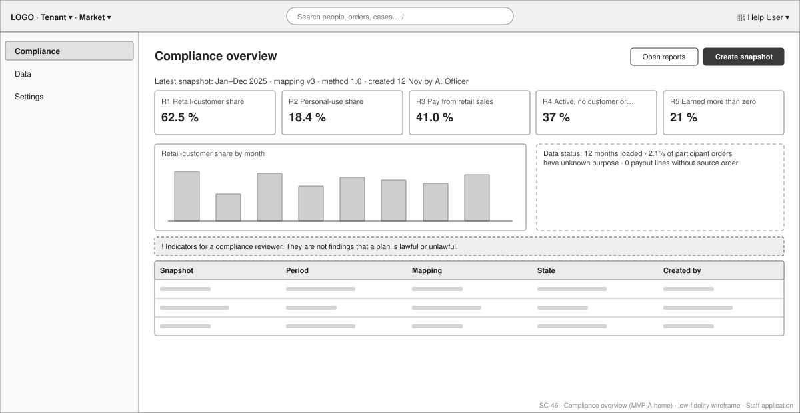

| Aspect | Specification |
|---|---|
| Release / requirements | MVP-A / FR-CPL-001, FR-RPT-001 |
| Layout template | T1 staff shell |
| Main content | Latest R1 to R5 headline figures; data coverage; warnings |
| Components (cards, tables, charts, forms, filters) | KPI cards; trend sparkline; data status panel |
| Primary button | Create snapshot |
| Secondary and contextual actions | Open reports; open imports |
| Entry and exits | From: Sign-in landing in MVP-A. To: SC-10, SC-24 |
| Permissions | compliance.read |

- Each card opens the report at that figure (SC-10).
- States: empty (no data → 'Upload an export to begin' with link to SC-24), computing (progress), outdated snapshot (badge, figures unchanged).
- Responsive: cards wrap 2 per row below 900 px; chart above data status.

### SC-24 — Data imports

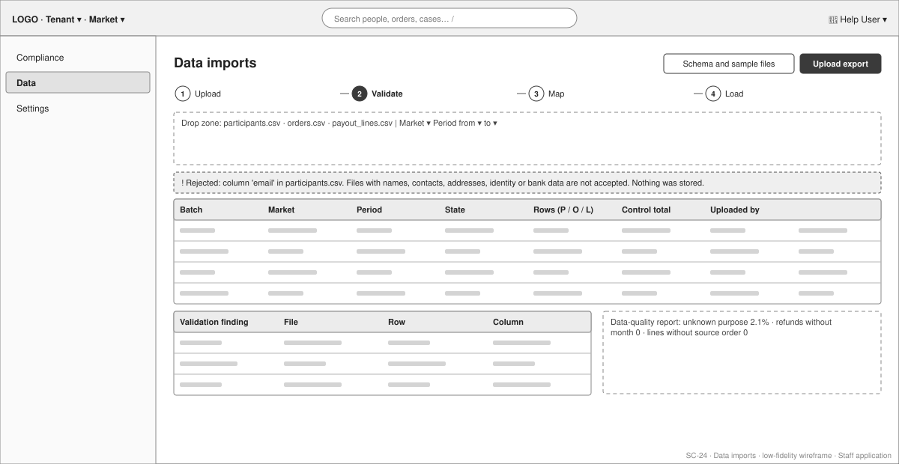

| Aspect | Specification |
|---|---|
| Release / requirements | MVP-A / FR-IMP-001, FR-IMP-003, FR-IMP-004 |
| Layout template | T1 staff shell |
| Main content | Batches with state, counts, control totals; validation errors |
| Components (cards, tables, charts, forms, filters) | Upload zone; batch table; validation report |
| Primary button | Upload files / Load |
| Secondary and contextual actions | Download error report; view batches |
| Entry and exits | From: Overlay nav Data. To: SC-25, SC-10 |
| Permissions | import.manage |

- Primary action changes with the batch state: Upload → View report → Open mapping → Load.
- States: validating (job progress), rejected (banner + row report download), superseded (greyed row, still readable).
- A re-import of a loaded period supersedes the earlier batch (BR-IMP-04).

### SC-25 — Import mapping

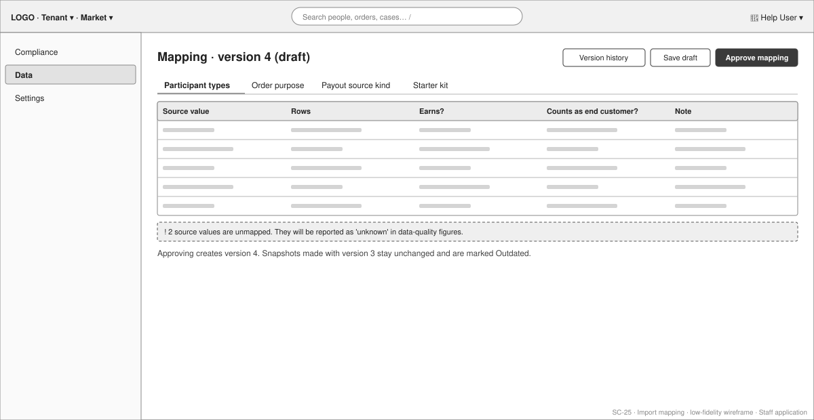

| Aspect | Specification |
|---|---|
| Release / requirements | MVP-A / FR-IMP-002 |
| Layout template | T1 staff shell |
| Main content | Distinct values with counts; target category; version history |
| Components (cards, tables, charts, forms, filters) | Mapping table; version selector |
| Primary button | Approve mapping |
| Secondary and contextual actions | Add note |
| Entry and exits | From: From SC-24. To: SC-24, SC-10 |
| Permissions | mapping.edit; mapping.approve |

- Approve is available to the compliance officer only; the consultant can save drafts.
- Validation: every value mapped or explicitly left unknown.

### SC-10 — Compliance reports

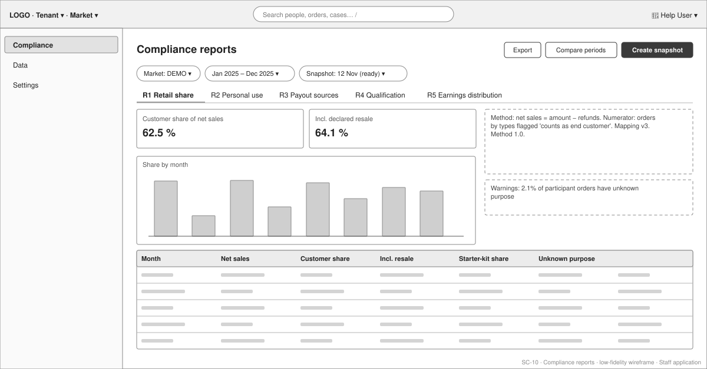

| Aspect | Specification |
|---|---|
| Release / requirements | MVP-A / FR-CPL-001, FR-CPL-002, FR-CPL-003, FR-CPL-004, FR-CPL-005, FR-CPL-006 |
| Layout template | T1 staff shell |
| Main content | Figures with populations, method notes, data-quality warnings, trend |
| Components (cards, tables, charts, forms, filters) | Period selector; figure cards; charts; method drawer; snapshot list |
| Primary button | Create snapshot |
| Secondary and contextual actions | Open figure; export; compare periods |
| Entry and exits | From: Nav Compliance; overlay home. To: SC-26, SC-46 |
| Permissions | compliance.read; snapshot.create |

- Every figure and table cell is a link to its drill-down (SC-26).
- The method panel is always visible beside the figures.
- States: snapshot outdated (badge), partial year for R5 (labelled, not publishable), denominator zero (figure shows '—' with reason).

### SC-26 — Figure drill-down

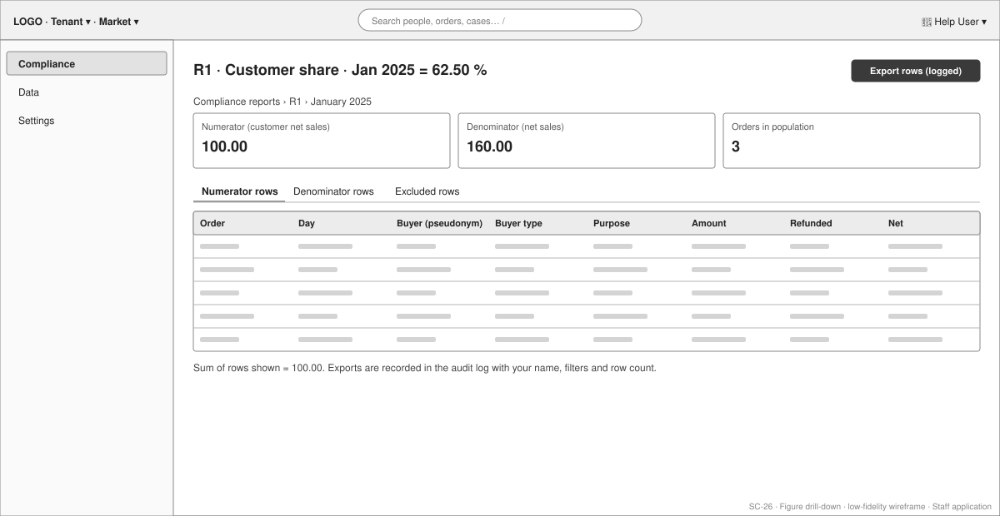

| Aspect | Specification |
|---|---|
| Release / requirements | MVP-A / FR-CPL-006, FR-AUD-002 |
| Layout template | T1 staff shell |
| Main content | Definition; numerator and denominator rows; sums |
| Components (cards, tables, charts, forms, filters) | Definition panel; paged table |
| Primary button | Export (logged) |
| Secondary and contextual actions | Page; filter |
| Entry and exits | From: From SC-10. To: SC-10 |
| Permissions | compliance.read; export |

- Sums of row sets must equal the figure's components (AC-41.1).
- Export above the role cap is refused with a path to a scheduled export.

### SC-27 — Sign-in and second factor

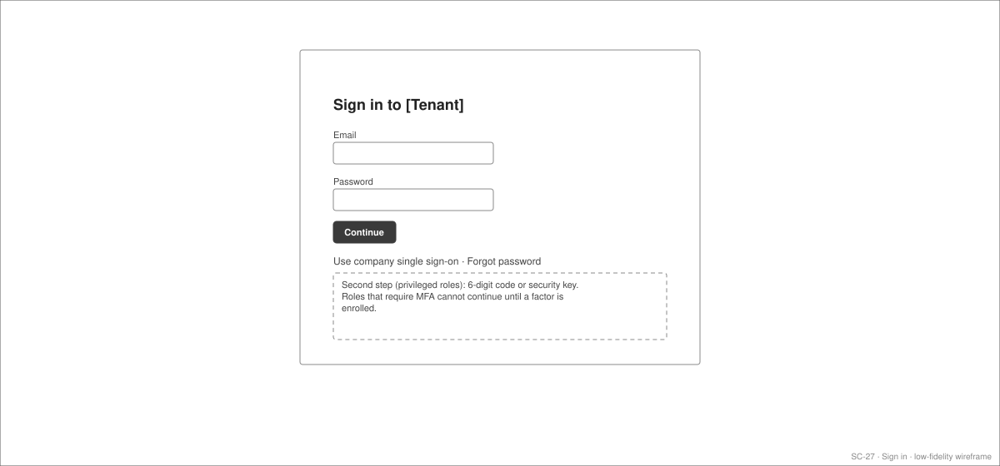

| Aspect | Specification |
|---|---|
| Release / requirements | MVP-A / FR-IAM-001, FR-IAM-002, FR-IAM-007 |
| Layout template | T4 centred card |
| Main content | Credential fields; factor prompt |
| Components (cards, tables, charts, forms, filters) | Form |
| Primary button | Sign in |
| Secondary and contextual actions | Enrol factor; recover |
| Entry and exits | From: Tenant URL. To: role home |
| Permissions | public |

- Generic error messages; lockout after repeated failures (AC-35.2).
- Tenant resolved from the hostname; no tenant picker.

### SC-28 — Users and roles

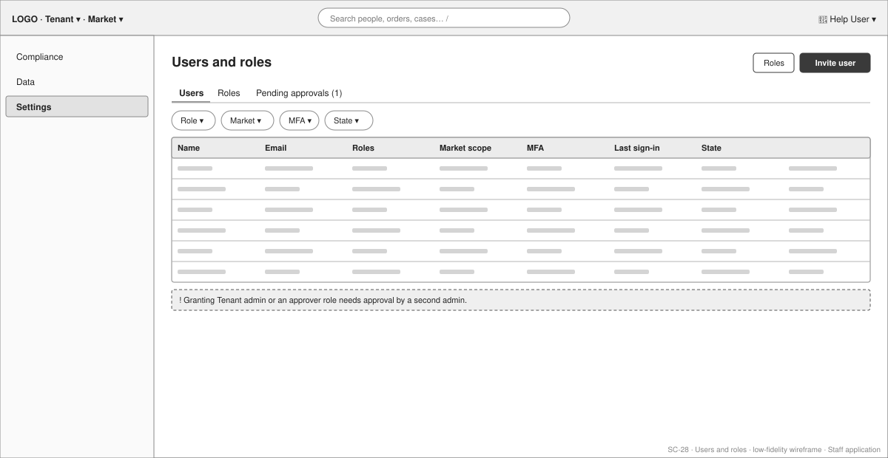

| Aspect | Specification |
|---|---|
| Release / requirements | MVP-A / FR-IAM-003 |
| Layout template | T1 staff shell |
| Main content | Users with roles, scopes, MFA state; role permission matrix; pending approvals |
| Components (cards, tables, charts, forms, filters) | Table; role editor; permission matrix |
| Primary button | Invite / Assign role |
| Secondary and contextual actions | Approve privileged grant; deactivate |
| Entry and exits | From: Nav Settings › Users. To: SC-30 |
| Permissions | user.manage |

- Role editor shows the permission matrix; conflicting duty pairs are refused with an explanation.
- The sole remaining admin cannot remove their own admin role.

### SC-14 — Vendor access sessions

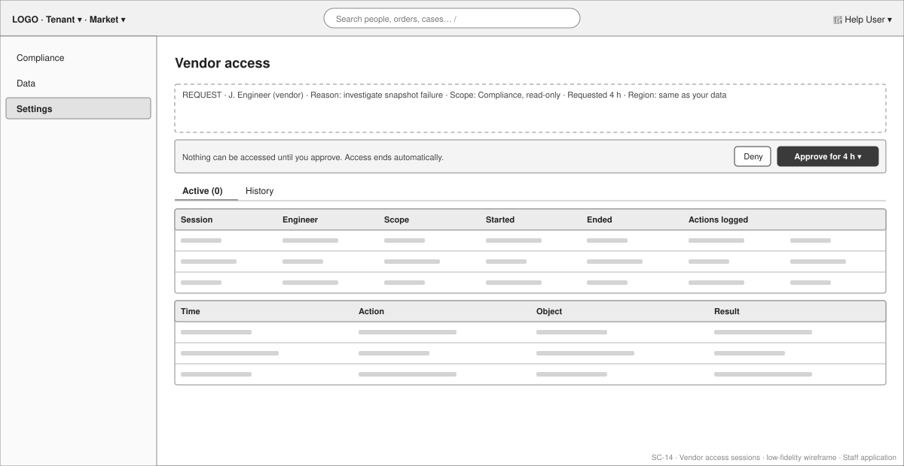

| Aspect | Specification |
|---|---|
| Release / requirements | MVP-A / FR-IAM-005 |
| Layout template | T1 staff shell |
| Main content | Requests with reason, scope; active sessions; session logs |
| Components (cards, tables, charts, forms, filters) | Request cards; log table |
| Primary button | Approve / Deny |
| Secondary and contextual actions | Set duration; end session now |
| Entry and exits | From: Notification; nav Settings › Vendor access. To: SC-30 |
| Permissions | vendor_access.decide |

- The second table is the per-session log, visible to the tenant.
- States: pending, active (countdown + End now), expired, denied, auto-denied (no decision).

### SC-30 — Audit log

*No drawn wireframe. Structure specified below.*

| Aspect | Specification |
|---|---|
| Release / requirements | MVP-A / FR-AUD-001, FR-AUD-002 |
| Layout template | T1 staff shell |
| Main content | Events with actor, action, object, time |
| Components (cards, tables, charts, forms, filters) | Filter bar; table; event drawer |
| Primary button | Search |
| Secondary and contextual actions | Open event; export |
| Entry and exits | From: Nav Settings › Audit. To: — |
| Permissions | audit.read |

### SC-39 — Vendor operations console

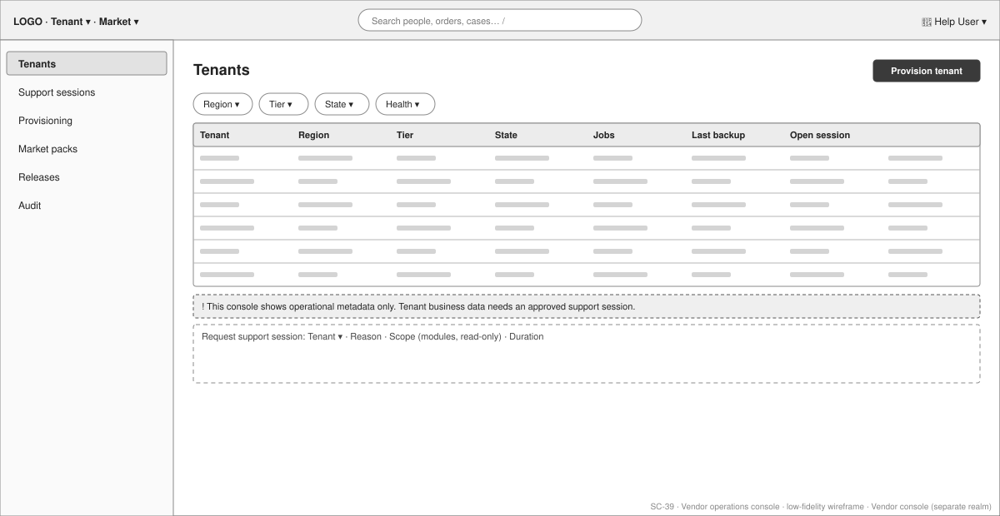

| Aspect | Specification |
|---|---|
| Release / requirements | MVP-A / FR-IAM-005, FR-TEN-001, FR-TEN-005, FR-OPS-001 |
| Layout template | T1 staff shell (vendor console variant) |
| Main content | Tenants with region, tier, state, job health; session requests |
| Components (cards, tables, charts, forms, filters) | Table; request modal; provisioning wizard |
| Primary button | Request support session |
| Secondary and contextual actions | Provision tenant; maintain market packs |
| Entry and exits | From: Vendor sign-in. To: — |
| Permissions | vendor roles |

- No route leads to participant, order or payout data.
- An approved session opens the tenant's staff application in a marked read-only frame with a countdown.

## 2. Periods and runs

### SC-01 — Periods and runs (analyst home)

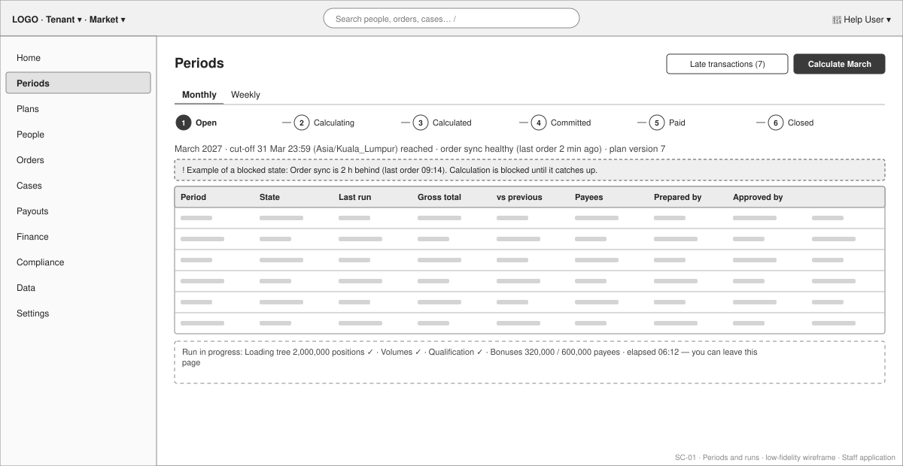

| Aspect | Specification |
|---|---|
| Release / requirements | MVP-B / FR-COMP-001, FR-COMP-002, FR-COMP-008, FR-COMP-011, FR-INT-002, FR-RPT-001 |
| Layout template | T1 staff shell |
| Main content | Calendars; periods with state, cut-off, sync health, last run totals, blockers |
| Components (cards, tables, charts, forms, filters) | State timeline; period table; health banner; progress panel |
| Primary button | Calculate / open review |
| Secondary and contextual actions | Replay; open late queue; open batches |
| Entry and exits | From: Sign-in landing for analysts; nav Periods. To: SC-02, SC-32, SC-03, SC-13 |
| Permissions | period.read; run.execute |

- The only primary button is the next valid action for the newest unfinished period.
- States: empty (no periods → connect store or import history), running (stages, safe to leave), failed (diagnostics + Resume), locked (committed: lock icon, 'Request restatement').
- Responsive (≥1024 px): table scrolls horizontally inside its container; state timeline wraps.

### SC-02 — Run review

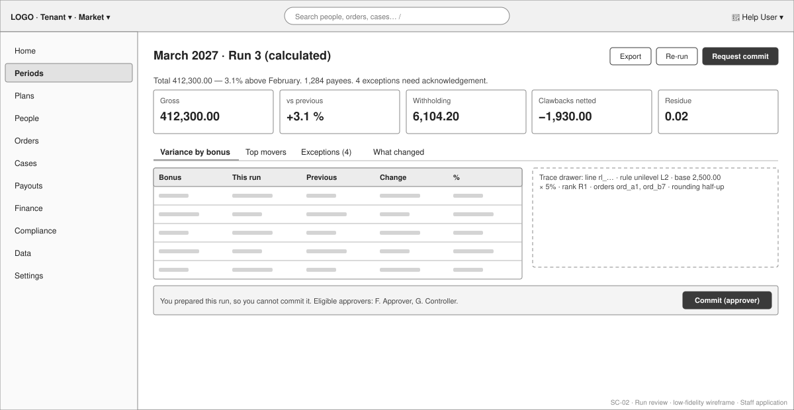

| Aspect | Specification |
|---|---|
| Release / requirements | MVP-B / FR-IAM-004, FR-COMP-003, FR-COMP-005, FR-COMP-006, FR-COMP-007, FR-COMP-010, FR-COMP-012, FR-AI-001 |
| Layout template | T1 staff shell |
| Main content | Totals vs previous run; variance by bonus; top movers; exceptions; what changed |
| Components (cards, tables, charts, forms, filters) | KPI cards; variance table; movers table; exception list; trace drawer; approval bar |
| Primary button | Request commit / Commit (approver) |
| Secondary and contextual actions | Export; open line trace; re-run |
| Entry and exits | From: From SC-01. To: SC-01, SC-06, SC-03 |
| Permissions | run.review; run.commit (approver, step-up) |

- Commit opens a critical-approval dialog: totals, variance, exceptions acknowledged one by one, step-up authentication.
- States: stale sync after run (banner, commit blocked), superseded by a newer run (read-only), permission-limited (preparer sees commit disabled with reason).

### SC-32 — Late-transaction queue

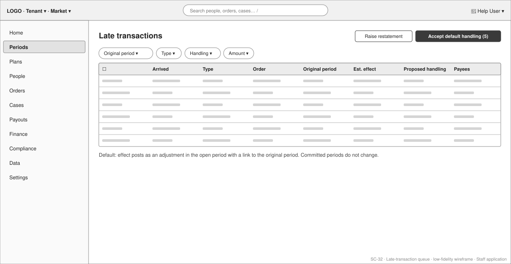

| Aspect | Specification |
|---|---|
| Release / requirements | MVP-B / FR-ORD-005 |
| Layout template | T1 staff shell |
| Main content | Items with original period, effect estimate, proposed handling |
| Components (cards, tables, charts, forms, filters) | Table; bulk bar; preview modal |
| Primary button | Accept default (bulk with preview) |
| Secondary and contextual actions | Raise restatement |
| Entry and exits | From: From SC-01. To: SC-06, SC-01 |
| Permissions | late.manage |

- Bulk accept shows a preview: count, total effect, affected payees.
- Items whose bonus policy is 'restatement' propose a restatement request instead.

## 3. Plans

### SC-04 — Plan versions: edit, compare, simulate

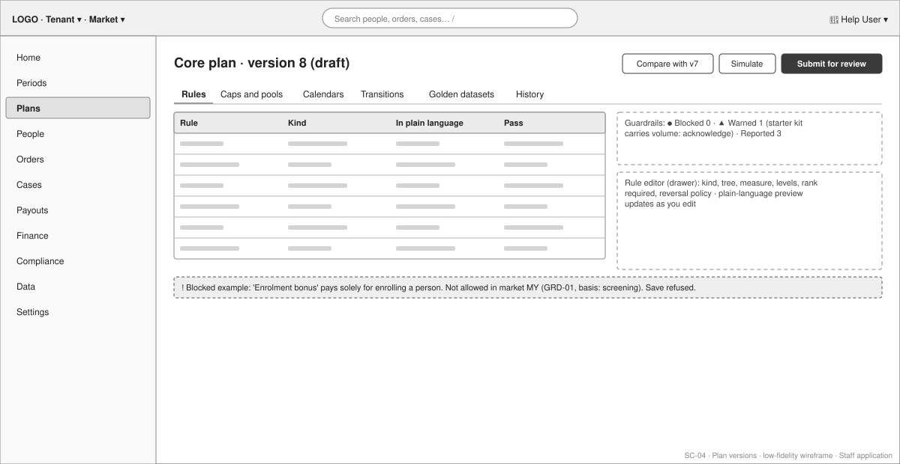

| Aspect | Specification |
|---|---|
| Release / requirements | MVP-B / FR-CPL-007, FR-GEN-009, FR-PLN-001, FR-PLN-002, FR-PLN-003, FR-PLN-005, FR-AI-002 |
| Layout template | T1 staff shell |
| Main content | Rule list in plain language; parameters; guardrail outcomes; version diff |
| Components (cards, tables, charts, forms, filters) | Version header; rule list; rule editor drawer; diff view; guardrail panel |
| Primary button | Save draft / Simulate |
| Secondary and contextual actions | Compare versions; submit for review; view guardrails |
| Entry and exits | From: Nav Plans. To: SC-05, SC-42, SC-44, SC-11 |
| Permissions | plan.edit; plan.read |

- Diff view shows changed rules side by side in plain language.
- States: guardrail blocked (save refused with rule id), activation blocked (no simulation, failing golden case, missing filing), immutable (approved or active: read-only).

### SC-05 — Cap and pool configuration

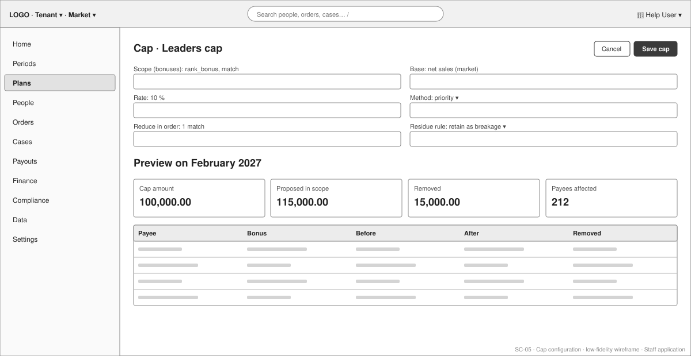

| Aspect | Specification |
|---|---|
| Release / requirements | MVP-B / FR-PLN-004 |
| Layout template | T1 staff shell |
| Main content | Scope, base, rate, method, priority, residue; preview of payees and amounts removed |
| Components (cards, tables, charts, forms, filters) | Form; priority list; preview table |
| Primary button | Save cap |
| Secondary and contextual actions | Preview on period |
| Entry and exits | From: From SC-04. To: SC-04, SC-42 |
| Permissions | plan.edit |

- Changing the method re-computes the preview so the difference between proportional and priority is visible before saving.
- Validation: priority list must cover the scope; residue rule required.

### SC-42 — Simulation results and golden datasets

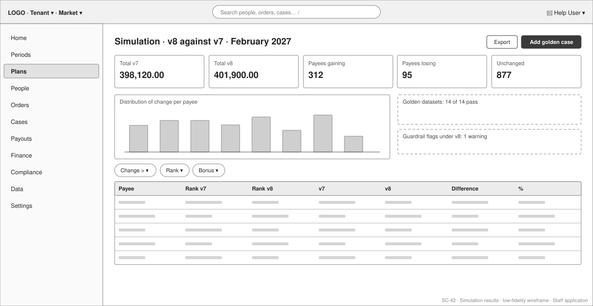

| Aspect | Specification |
|---|---|
| Release / requirements | MVP-B / FR-PLN-005, FR-PLN-006 |
| Layout template | T1 staff shell |
| Main content | Totals v1 vs v2; distribution of change; payee table; golden pass or fail |
| Components (cards, tables, charts, forms, filters) | KPI cards; histogram; table; golden list |
| Primary button | Run simulation |
| Secondary and contextual actions | Export; add golden case |
| Entry and exits | From: From SC-04. To: SC-04, SC-44 |
| Permissions | plan.simulate |

- Totals reconcile to each run (AC-10.1).
- A failing golden case lists the failing lines and blocks submission.

### SC-44 — Plan change workflow

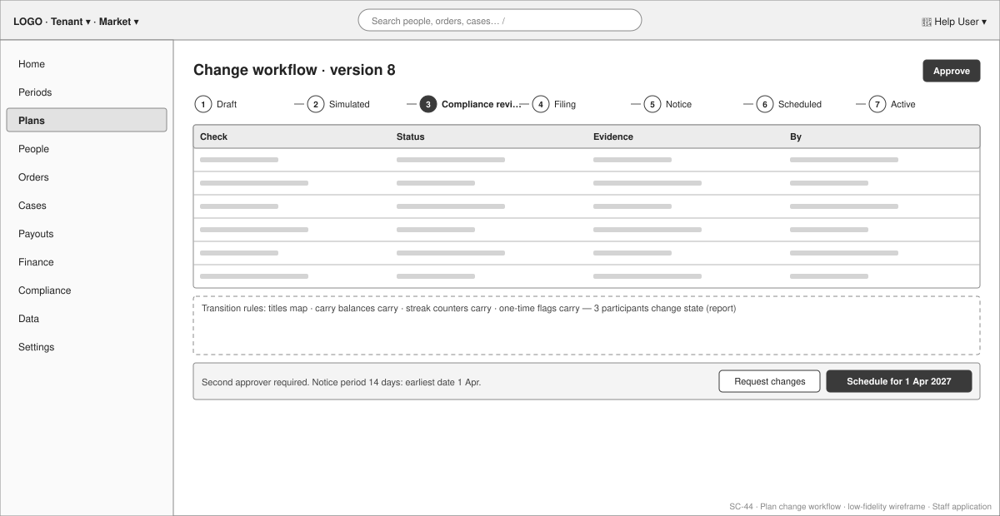

| Aspect | Specification |
|---|---|
| Release / requirements | MVP-B / FR-PLN-007, FR-PLN-008 |
| Layout template | T1 staff shell |
| Main content | Checklist: simulation, guardrails, filing per market, notice, transition rules |
| Components (cards, tables, charts, forms, filters) | Stepper; checklist; approval bar |
| Primary button | Approve / Schedule |
| Secondary and contextual actions | Record filing; set notice |
| Entry and exits | From: From SC-04. To: SC-04, SC-42 |
| Permissions | plan.approve |

- Each check row explains what is missing; a blocked step cannot be skipped.
- Filing row appears only where the market pack requires a filing.

## 4. People and genealogy

### SC-36 — Global search

*No drawn wireframe. Structure specified below.*

| Aspect | Specification |
|---|---|
| Release / requirements | MVP-B / FR-RPT-002 |
| Layout template | T1 staff shell |
| Main content | Grouped results with masked fields |
| Components (cards, tables, charts, forms, filters) | Command palette; result groups |
| Primary button | Search |
| Secondary and contextual actions | — |
| Entry and exits | From: Header search. To: SC-09, SC-31 |
| Permissions | by role |

### SC-09 — Participant record

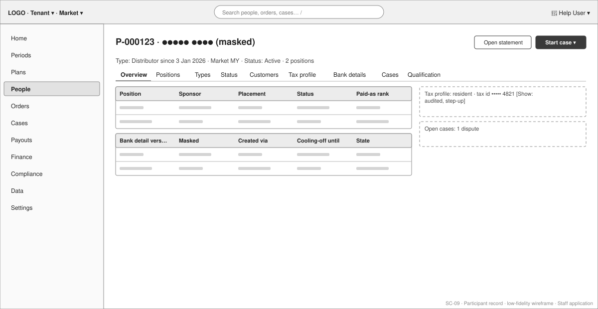

| Aspect | Specification |
|---|---|
| Release / requirements | MVP-B / FR-PAR-001, FR-PAR-002, FR-PAR-005, FR-PAR-006, FR-GEN-001, FR-CRM-001, FR-CRM-002, FR-PAY-005, FR-TAX-001 |
| Layout template | T1 staff shell |
| Main content | Identity (masked), types history, positions, status history, servicing, tax profile, bank detail history, cases |
| Components (cards, tables, charts, forms, filters) | Header; tabs; history tables; masked fields |
| Primary button | Start case |
| Secondary and contextual actions | Unmask field (audited); open statement; open tree |
| Entry and exits | From: Search; links. To: SC-07, SC-06, SC-43, SC-18 |
| Permissions | participant.read; unmask needs extra permission |

- Sensitive fields are masked; 'Show' is a separate audited action with step-up.
- All history tabs are read-only tables of effective-dated rows.

### SC-07 — Genealogy explorer (staff, as-of)

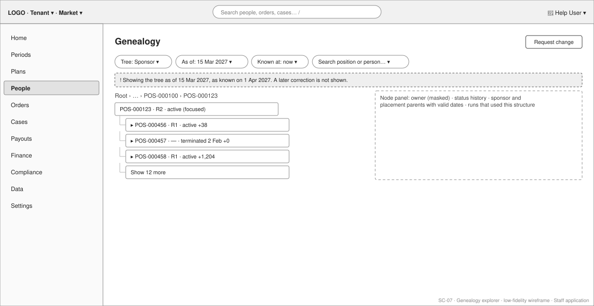

| Aspect | Specification |
|---|---|
| Release / requirements | MVP-B / FR-GEN-001, FR-GEN-002, FR-GEN-003, FR-GEN-005, FR-GEN-007, FR-GEN-008 |
| Layout template | T1 staff shell |
| Main content | Focused node, breadcrumbs to root, children with counts, status and rank |
| Components (cards, tables, charts, forms, filters) | Search box; date selectors; tree kind toggle; lazy tree; node panel |
| Primary button | Search |
| Secondary and contextual actions | Set as-of and known-at; switch sponsor or placement tree; open participant |
| Entry and exits | From: Nav Genealogy. To: SC-09, SC-08 |
| Permissions | genealogy.read |

- Never renders a whole tree: focused node, breadcrumb, first level, lazy expansion, counts on collapsed branches.
- States: read model rebuilding (notice; depth-limited view from the system of record).
- Keyboard: arrow keys move, right expands, left collapses; an indented-list alternative is always available.

### SC-08 — Genealogy change and duplicate cases

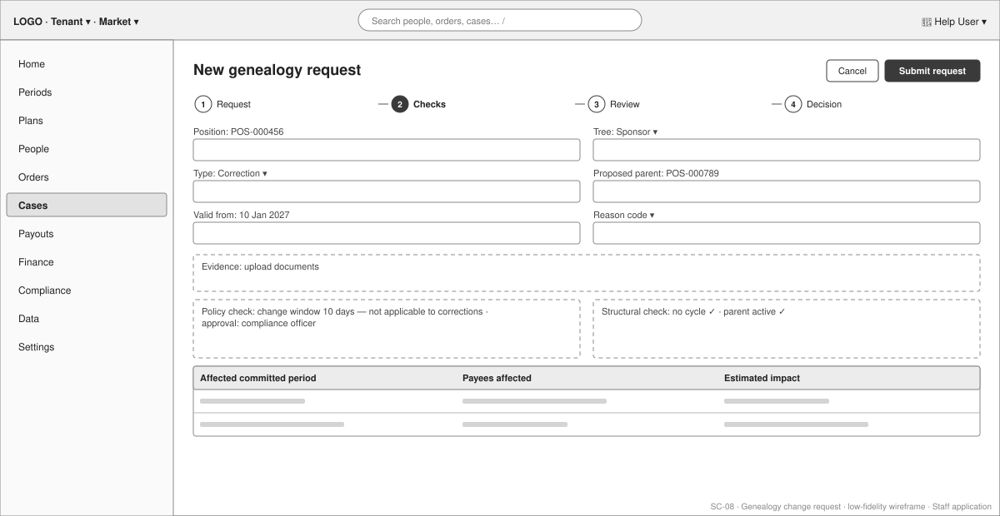

| Aspect | Specification |
|---|---|
| Release / requirements | MVP-B / FR-PAR-003, FR-PAR-004, FR-GEN-004, FR-CAS-001 |
| Layout template | T1 staff shell |
| Main content | Request form; policy check result; affected periods and impact; duplicate comparison |
| Components (cards, tables, charts, forms, filters) | Form wizard; policy result panel; side-by-side comparison |
| Primary button | Submit request / Approve |
| Secondary and contextual actions | Compare records; view affected periods |
| Entry and exits | From: From SC-07, SC-09, Cases. To: SC-06, SC-07 |
| Permissions | case.genealogy.*; case.duplicate.* |

- Change = effective from a date onward; correction = from the original date, listing affected committed periods.
- Errors: outside window, would create a cycle, target slot taken.
- The duplicate-case variant shows two records side by side with matching attributes highlighted.

### SC-43 — Rank and qualification detail (staff)

*No drawn wireframe. Structure specified below.*

| Aspect | Specification |
|---|---|
| Release / requirements | MVP-B / FR-COMP-004 |
| Layout template | T1 staff shell |
| Main content | Paid-as, titles, counters, carry, flags per period with source run |
| Components (cards, tables, charts, forms, filters) | Period table; diff highlight |
| Primary button | — |
| Secondary and contextual actions | Compare periods |
| Entry and exits | From: From SC-09. To: SC-09 |
| Permissions | participant.read |

## 5. Orders and cases

### SC-31 — Orders and returns (ingested)

*No drawn wireframe. Structure specified below.*

| Aspect | Specification |
|---|---|
| Release / requirements | MVP-B / FR-ORD-001, FR-ORD-003, FR-ORD-004, FR-ORD-006, FR-RPT-002 |
| Layout template | T1 staff shell |
| Main content | Orders with buyer type, purpose, attribution, volumes, period, events |
| Components (cards, tables, charts, forms, filters) | Filterable table; order detail with event timeline |
| Primary button | Search |
| Secondary and contextual actions | Open order; saved views |
| Entry and exits | From: Nav Orders. To: SC-09, SC-32 |
| Permissions | order.read |

### SC-06 — Cases: adjustments, disputes, restatements

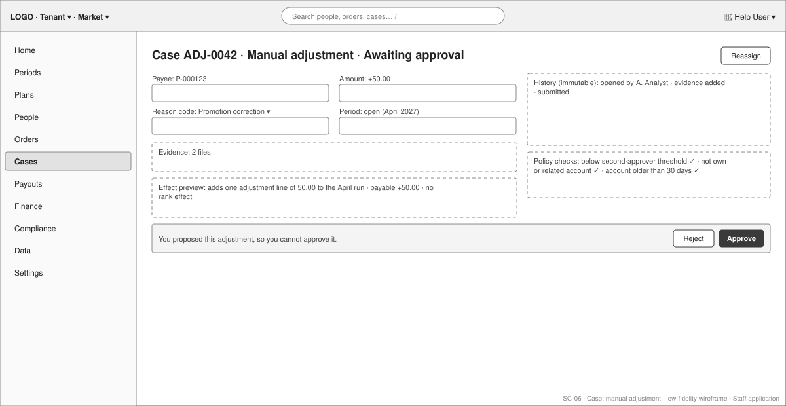

| Aspect | Specification |
|---|---|
| Release / requirements | MVP-B / FR-CPL-013, FR-COMP-007, FR-COMP-009, FR-FIN-003, FR-CAS-001, FR-CAS-002, FR-CAS-003 |
| Layout template | T1 staff shell |
| Main content | Case list by type and state; case detail with history, evidence, effect preview, approvals |
| Components (cards, tables, charts, forms, filters) | Filterable table; case layout with timeline; evidence uploader; effect preview; approval bar |
| Primary button | Approve / Reject / Submit |
| Secondary and contextual actions | Attach evidence; preview effect; reassign |
| Entry and exits | From: Nav Cases; links from lines and queues. To: SC-02, SC-09, SC-33 |
| Permissions | case.<type>.read/act |

- The same case layout serves disputes (trace attached automatically) and restatements (diff per payee and bonus).
- States: approval pending, rejected (reason), blocked by policy (escalation path).

### SC-15 — Privacy requests

*No drawn wireframe. Structure specified below.*

| Aspect | Specification |
|---|---|
| Release / requirements | MVP-B / FR-PRV-001, FR-PRV-002, FR-PRV-003 |
| Layout template | T1 staff shell |
| Main content | Requests with type, deadline, state |
| Components (cards, tables, charts, forms, filters) | Table with deadline indicators; case detail |
| Primary button | Fulfil |
| Secondary and contextual actions | Verify identity; record retention basis |
| Entry and exits | From: Nav Privacy. To: SC-06 |
| Permissions | privacy.manage |

## 6. Payouts and finance

### SC-03 — Payout batches and approvals

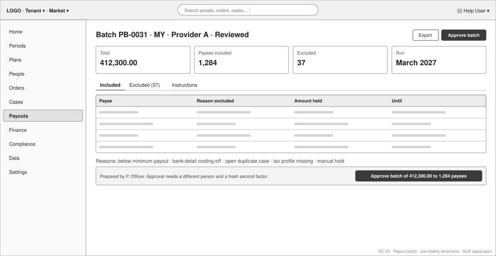

| Aspect | Specification |
|---|---|
| Release / requirements | MVP-B / FR-IAM-004, FR-PAY-001, FR-PAY-002, FR-PAY-003, FR-PAY-007 |
| Layout template | T1 staff shell |
| Main content | Batches with state, totals, counts; inclusion and exclusion lists with reasons; instruction status |
| Components (cards, tables, charts, forms, filters) | Batch table; detail with tabs Included, Excluded, Instructions; approval bar |
| Primary button | Prepare batch / Approve |
| Secondary and contextual actions | Retry failed lines; open exclusions; open payee |
| Entry and exits | From: Nav Payouts. To: SC-34, SC-09, SC-06 |
| Permissions | payout.prepare; payout.approve |

- After approval the Instructions tab shows per-line state: instructed, accepted, settled, returned, failed; 'Retry failed lines' only.
- States: balance changed since draft (affected line recalculated, batch back to Draft), provider not eligible (blocked).

### SC-34 — Payout reconciliation and returned payments

*No drawn wireframe. Structure specified below.*

| Aspect | Specification |
|---|---|
| Release / requirements | MVP-B / FR-PAY-004 |
| Layout template | T1 staff shell |
| Main content | Settled, returned, failed, unmatched with amounts |
| Components (cards, tables, charts, forms, filters) | Summary cards; exception table |
| Primary button | Resolve item |
| Secondary and contextual actions | Open case; import report |
| Entry and exits | From: Nav Payouts › Reconciliation. To: SC-03, SC-06 |
| Permissions | payout.reconcile |

### SC-33 — Ledger and journal export

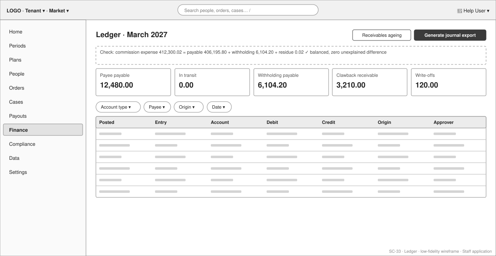

| Aspect | Specification |
|---|---|
| Release / requirements | MVP-B / FR-FIN-001, FR-FIN-002, FR-FIN-003, FR-FIN-004, FR-FIN-005, FR-FIN-006, FR-FIN-007, FR-RPT-002 |
| Layout template | T1 staff shell |
| Main content | Accounts with balances; postings; exports; receivables |
| Components (cards, tables, charts, forms, filters) | Account table; postings table; export panel |
| Primary button | Generate export |
| Secondary and contextual actions | Open account; receivables ageing; propose write-off |
| Entry and exits | From: Nav Finance. To: SC-06, SC-34 |
| Permissions | ledger.read; export |

- Every row links to its origin (run, batch, case).
- No edit or delete control exists anywhere on this screen.
- Export blocked with a list when an account has no mapping to the tenant's chart of accounts.

### SC-12 — Tax configuration and year-end forms

*No drawn wireframe. Structure specified below.*

| Aspect | Specification |
|---|---|
| Release / requirements | MVP-B / FR-TAX-002, FR-TAX-003 |
| Layout template | T1 staff shell |
| Main content | Rules with effective dates and basis status; year totals; missing ids |
| Components (cards, tables, charts, forms, filters) | Rules table; year-end wizard; validation list |
| Primary button | Generate forms |
| Secondary and contextual actions | Fix missing tax ids; export |
| Entry and exits | From: Nav Tax. To: SC-09 |
| Permissions | tax.read; tax.forms |

## 7. Compliance (engine releases)

### SC-11 — Guardrails and overrides log

*No drawn wireframe. Structure specified below.*

| Aspect | Specification |
|---|---|
| Release / requirements | MVP-B / FR-CPL-007, FR-CPL-008 |
| Layout template | T1 staff shell |
| Main content | Decisions with rule id, basis status, outcome, version; overrides with justification |
| Components (cards, tables, charts, forms, filters) | Table; detail drawer |
| Primary button | Approve override |
| Secondary and contextual actions | Filter by outcome |
| Entry and exits | From: Nav Compliance. To: SC-04 |
| Permissions | guardrail.read; override.approve |

### SC-23 — Earnings disclosure builder

*No drawn wireframe. Structure specified below.*

| Aspect | Specification |
|---|---|
| Release / requirements | V1 / FR-CPL-009, FR-CPL-011 |
| Layout template | T1 staff shell |
| Main content | Snapshot figures; template; versions |
| Components (cards, tables, charts, forms, filters) | Editor; preview; version list |
| Primary button | Publish |
| Secondary and contextual actions | Preview; compare versions |
| Entry and exits | From: Nav Compliance. To: SC-40, SC-10 |
| Permissions | disclosure.publish |

### SC-45 — Integrity signals

*No drawn wireframe. Structure specified below.*

| Aspect | Specification |
|---|---|
| Release / requirements | V1 / FR-CPL-010 |
| Layout template | T1 staff shell |
| Main content | Flags with evidence |
| Components (cards, tables, charts, forms, filters) | Table |
| Primary button | Open case |
| Secondary and contextual actions | Set thresholds |
| Entry and exits | From: Nav Compliance. To: SC-06 |
| Permissions | compliance.read |

## 8. Data and settings

### SC-16 — Migration workspace and parallel-run report

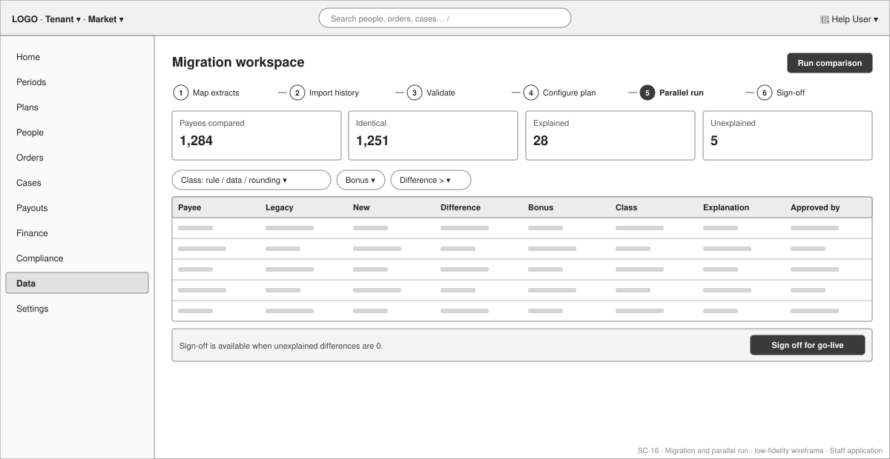

| Aspect | Specification |
|---|---|
| Release / requirements | MVP-B / FR-MIG-001, FR-MIG-002 |
| Layout template | T1 staff shell |
| Main content | Import steps and validation; per-payee differences by class |
| Components (cards, tables, charts, forms, filters) | Stepper; validation list; difference table; sign-off bar |
| Primary button | Run comparison / Sign off |
| Secondary and contextual actions | Upload extracts; map; classify differences |
| Entry and exits | From: Implementation menu. To: SC-42, SC-04 |
| Permissions | migration.manage; signoff |

- Import validation blocks on cycles, orphans and balance mismatches.
- Each difference is classified and either fixed or explained and approved.

### SC-17 — Market launch checklist

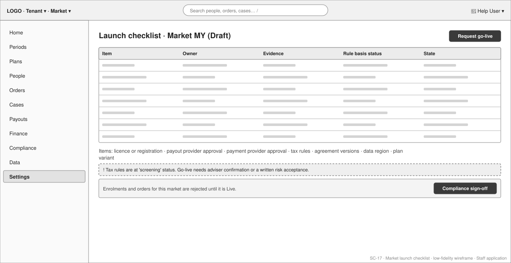

| Aspect | Specification |
|---|---|
| Release / requirements | MVP-B / FR-TEN-004, FR-CPL-012, FR-PAY-006 |
| Layout template | T1 staff shell |
| Main content | Items with owner, evidence, basis status, state |
| Components (cards, tables, charts, forms, filters) | Checklist; evidence uploader; sign-off bar |
| Primary button | Request go-live / Sign off |
| Secondary and contextual actions | Attach evidence |
| Entry and exits | From: Nav Settings › Markets. To: SC-13, SC-12, SC-29 |
| Permissions | market.manage; market.signoff |

- Each row opens an evidence uploader.
- Blocked items are named in the go-live refusal.

### SC-13 — Integrations and sync health

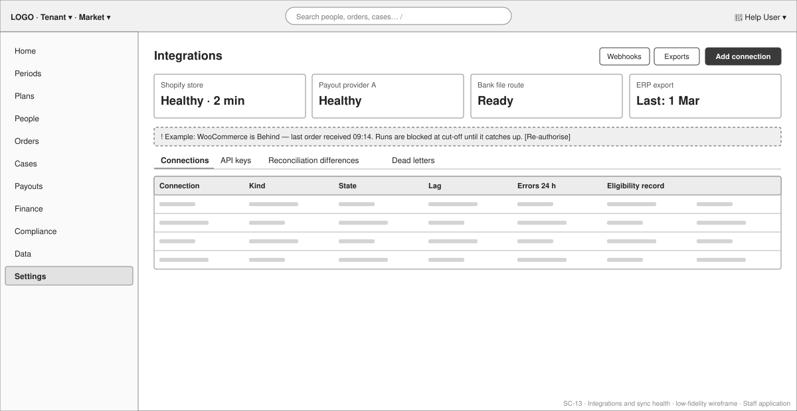

| Aspect | Specification |
|---|---|
| Release / requirements | MVP-B / FR-IAM-006, FR-ORD-001, FR-ORD-002, FR-PAY-002, FR-PAY-006, FR-INT-001, FR-INT-002, FR-INT-003, FR-INT-004 |
| Layout template | T1 staff shell |
| Main content | Connectors and providers with state, lag, errors; API keys; webhooks; exports |
| Components (cards, tables, charts, forms, filters) | Status cards; tables; key creation modal |
| Primary button | Re-authorise / Create key |
| Secondary and contextual actions | Backfill; view differences; manage webhooks; export schedule |
| Entry and exits | From: Nav Settings › Integrations. To: SC-01, SC-17 |
| Permissions | integration.manage |

- API key creation shows the key once; only a hash is stored.
- Payout connections show the provider approval evidence and date (FR-PAY-006).

### SC-29 — Tenant settings

*No drawn wireframe. Structure specified below.*

| Aspect | Specification |
|---|---|
| Release / requirements | MVP-B / FR-TEN-002, FR-TEN-003, FR-PRV-004 |
| Layout template | T1 staff shell |
| Main content | Markets, brands, calendars, participant types, policies (rounding, clawback, visibility, thresholds), breach contacts |
| Components (cards, tables, charts, forms, filters) | Section list; forms; version history drawer |
| Primary button | Save with effective date |
| Secondary and contextual actions | View versions; request approval |
| Entry and exits | From: Nav Settings. To: SC-17, SC-13 |
| Permissions | settings.manage |

### SC-35 — Executive overview

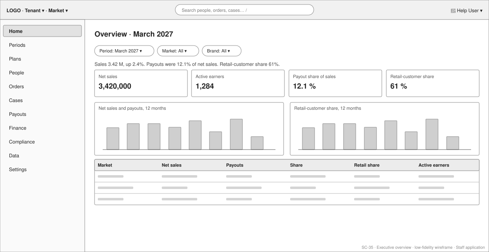

| Aspect | Specification |
|---|---|
| Release / requirements | MVP-B / FR-RPT-001 |
| Layout template | T1 staff shell |
| Main content | Sales, active earners, payout share of sales, retail share, by market |
| Components (cards, tables, charts, forms, filters) | KPI cards; trend charts; market table |
| Primary button | Change period or market |
| Secondary and contextual actions | Open definition; open compliance |
| Entry and exits | From: Sign-in landing for executives. To: SC-10 |
| Permissions | dashboard.exec |

- Every figure has an (i) popover with its definition and links to its source.
- Partial-data banner when sync is behind.
- No income projection or recruit count appears.

### SC-47 — Licence, updates and diagnostics (self-hosted edition)

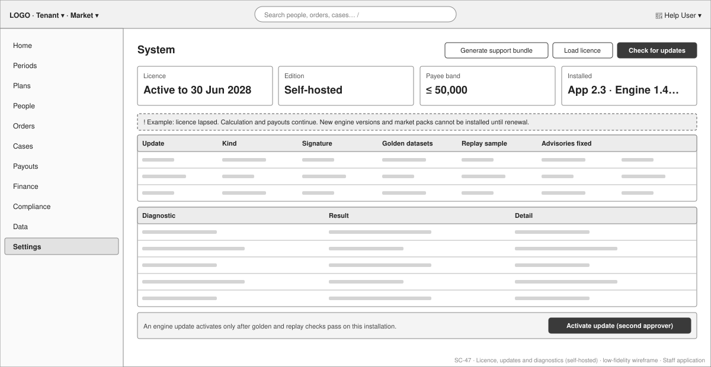

| Aspect | Specification |
|---|---|
| Release / requirements | V1 / FR-LIC-001, FR-LIC-002, FR-LIC-003 |
| Layout template | T1 staff shell |
| Main content | Entitlement state and limits; installed versions; available updates and advisories; health checks; last backup and restore test |
| Components (cards, tables, charts, forms, filters) | Status cards; update list with check results; diagnostics table |
| Primary button | Apply update (second approver) |
| Secondary and contextual actions | Load licence; run diagnostics; generate support bundle |
| Entry and exits | From: Nav Settings › System. To: SC-30 |
| Permissions | system.manage |

- Diagnostics: job queues, outbox age, replication, last backup, last restore test, time sync.
- The support bundle shows a redaction summary before export.

