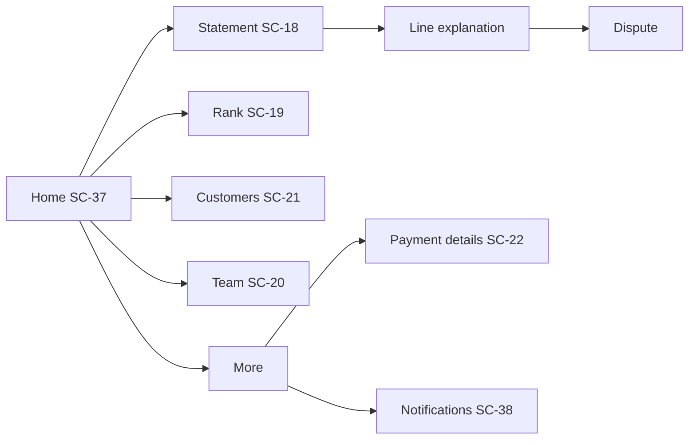
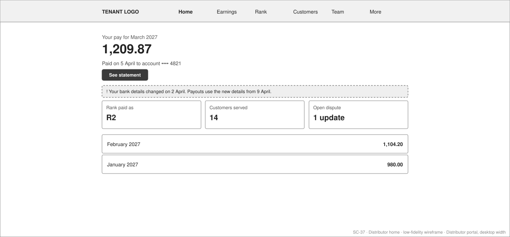
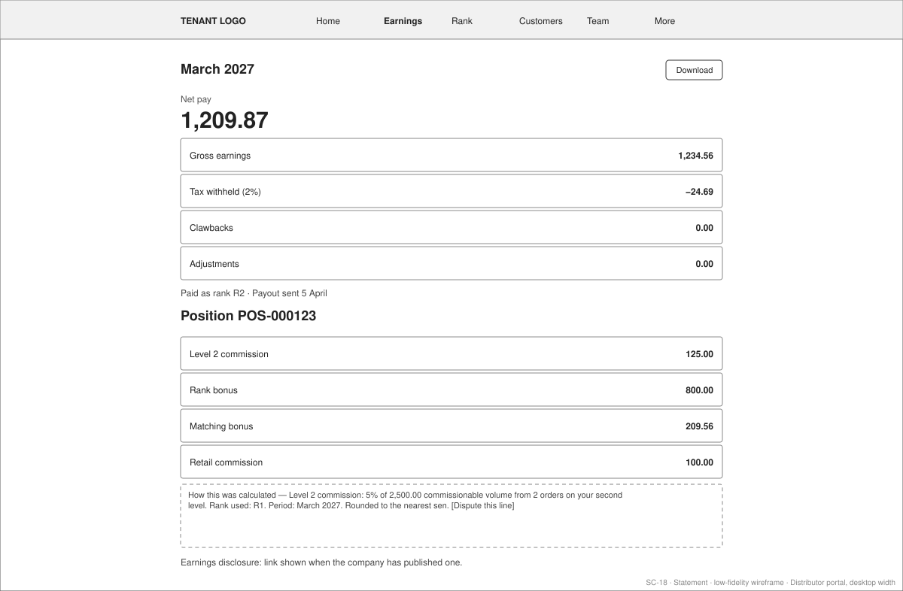
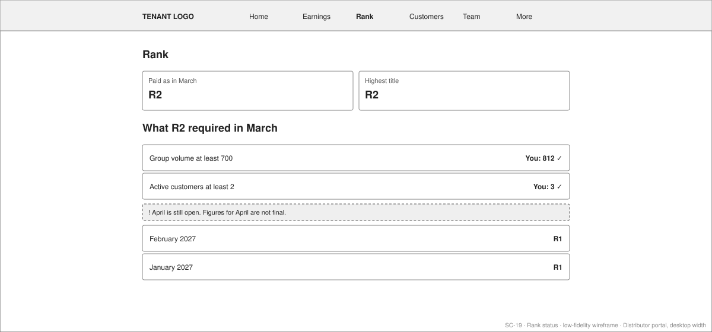
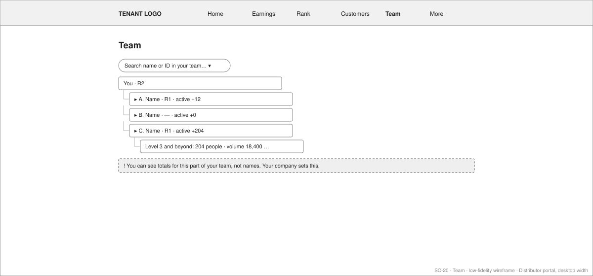
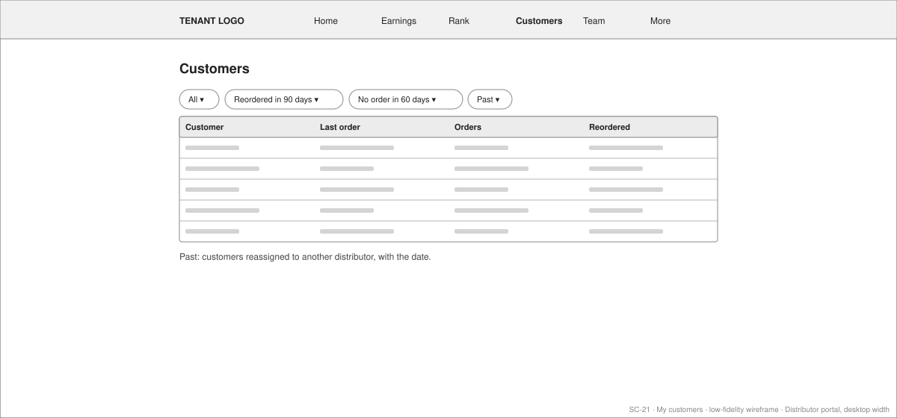
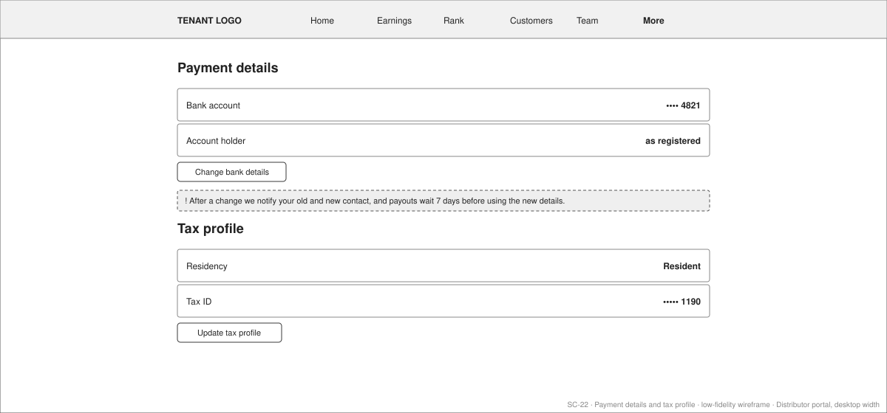

# 04 — DISTRIBUTOR WIREFRAMES
## Distributor portal at desktop and tablet width

| Field | Value |
|---|---|
| Document ID | WF-04 |
| Version | 0.1 (draft for founder review) |
| Last updated | 2026-11-12 |
| Owner | UX architect role |
| Depends on | WF-01 (inventory), WF-02 (specification), UX-02, UX-05 |
| Status | Draft. Low-fidelity structure only: no colour, brand or final copy. Not usability-tested |

The portal is designed phone-first (WF-06). This document shows the same screens at desktop width using template **T2** (portal: top navigation, single centred column of at most 720 px). Content and order are identical to the phone layouts; nothing is added on larger screens except side-by-side placement of the line explanation.

### SC-37 — Distributor home (mobile)

| Aspect | Specification |
|---|---|
| Release / requirements | MVP-B / FR-IAM-007, FR-DIST-001, FR-DIST-007 |
| Layout template | T2 portal |
| Main content | Latest net pay and payout status; rank; alerts (cooling-off, dispute update) |
| Components (cards, tables, charts, forms, filters) | Summary cards; bottom navigation |
| Primary button | Open latest statement |
| Secondary and contextual actions | Notifications; rank; customers |
| Entry and exits | From: Portal sign-in. To: SC-18, SC-19, SC-21, SC-38 |
| Permissions | self only |

- No targets, projections or recruit counts.
- States: no committed period yet (explains when the first statement appears), payout held (reason and end date).

### SC-18 — Distributor: statements and line explanation

| Aspect | Specification |
|---|---|
| Release / requirements | MVP-B / FR-FIN-002, FR-CAS-003, FR-DIST-001, FR-DIST-002, FR-DIST-007 |
| Layout template | T2 portal |
| Main content | Gross, withholding, clawbacks, adjustments, net, payout status, per position groups, disclosure link |
| Components (cards, tables, charts, forms, filters) | Period picker; summary block; grouped line list; explanation sheet |
| Primary button | Open line explanation |
| Secondary and contextual actions | Download; dispute line; switch period |
| Entry and exits | From: Portal home; notification. To: SC-37, SC-19, SC-22 |
| Permissions | self only |

- Net = gross − withholding − clawback ± adjustment, always shown as lines.
- Committed periods only; an open period shows status, never an estimate.
- No other person's personal data in explanations.

### SC-19 — Distributor: rank status

| Aspect | Specification |
|---|---|
| Release / requirements | MVP-B / FR-COMP-004, FR-DIST-003 |
| Layout template | T2 portal |
| Main content | Paid-as rank, titles, requirements with measured values, grace status |
| Components (cards, tables, charts, forms, filters) | Status block; requirement list; history list |
| Primary button | — |
| Secondary and contextual actions | View history |
| Entry and exits | From: Portal nav Rank. To: SC-18 |
| Permissions | self only |

- States: grace period active (explained with end period), plan change in progress (transition notice).

### SC-20 — Distributor: team

| Aspect | Specification |
|---|---|
| Release / requirements | MVP-B / FR-GEN-006, FR-GEN-007, FR-DIST-004, FR-DIST-009 |
| Layout template | T2 portal |
| Main content | Permitted fields by depth; aggregates beyond |
| Components (cards, tables, charts, forms, filters) | Search; lazy list tree; limited-data notice |
| Primary button | Search |
| Secondary and contextual actions | Expand branch |
| Entry and exits | From: Portal nav Team. To: SC-37 |
| Permissions | self downline |

- Outside your own downline nothing is returned, identical to 'not found'.

### SC-21 — Distributor: my customers

| Aspect | Specification |
|---|---|
| Release / requirements | MVP-B / FR-CRM-001, FR-CRM-003, FR-DIST-005 |
| Layout template | T2 portal |
| Main content | Customers with last order, repeat indicator; reassigned history |
| Components (cards, tables, charts, forms, filters) | List; filter chips |
| Primary button | Filter |
| Secondary and contextual actions | Open customer |
| Entry and exits | From: Portal nav Customers. To: SC-37 |
| Permissions | self only |

- Contact fields appear only if the tenant's policy allows.

### SC-22 — Distributor: bank details and tax profile

| Aspect | Specification |
|---|---|
| Release / requirements | MVP-B / FR-PAY-005, FR-TAX-001, FR-DIST-006 |
| Layout template | T2 portal |
| Main content | Masked details; cooling-off status; tax profile |
| Components (cards, tables, charts, forms, filters) | Masked fields; form; status banner |
| Primary button | Save change (re-authenticate) |
| Secondary and contextual actions | View history |
| Entry and exits | From: Portal nav Profile. To: SC-38 |
| Permissions | self only, fresh authentication |

- The cooling-off length is a tenant setting; the screen shows the actual date.
- States: cooling-off active, change refused (re-authentication failed), under review (shared-account signal).

### SC-38 — Distributor notifications and profile

*No drawn wireframe. Structure specified below.*

| Aspect | Specification |
|---|---|
| Release / requirements | MVP-B / FR-DIST-008 |
| Layout template | T2 portal |
| Main content | Inbox; preferences |
| Components (cards, tables, charts, forms, filters) | List; toggles |
| Primary button | — |
| Secondary and contextual actions | Change language; channel preferences |
| Entry and exits | From: Portal nav More. To: SC-22 |
| Permissions | self only |

## Content rules for all portal screens

- Net pay first, then how it was reached.
- Committed data only; open periods show status, never estimates.
- No income projection, potential earnings, next-rank prompt or recruit count (BR-HON-01).
- Every limit is explained (visibility policy, cooling-off, holds).
- Local language and locale formats from the market pack.
