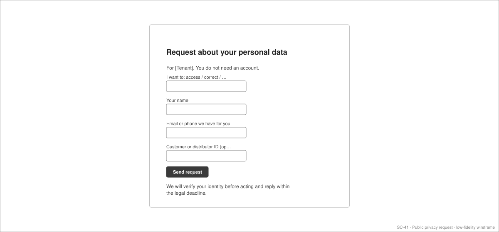
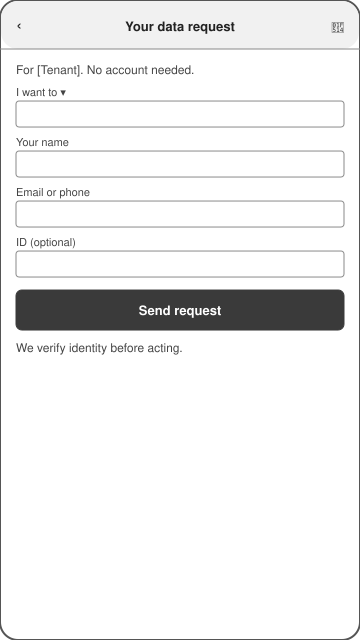

# 05 — CUSTOMER WIREFRAMES
## Customer-facing touchpoints, and why there are so few

| Field | Value |
|---|---|
| Document ID | WF-05 |
| Version | 0.1 (draft for founder review) |
| Last updated | 2026-11-12 |
| Owner | UX architect role |
| Depends on | WF-01 (inventory), WF-02 (specification), UX-02, UX-05 |
| Status | Draft. Low-fidelity structure only: no colour, brand or final copy. Not usability-tested |

## 1. Scope decision

Retail customers are **not users of this product**. Under the chosen product boundary the storefront, customer account, order history, subscription management and customer support belong to the tenant's commerce platform and help desk (integrated, not built: GAP-045, GAP-046). Customers exist in the platform as participants of a type flagged *counts as end customer*, with a servicing relationship, so that attribution and the retail-customer share are correct.

| Brief screen | Decision | Where the need is met |
|---|---|---|
| Customer storefront | Not built | Tenant's commerce platform; orders arrive through the ingestion API |
| Customer account, order history | Not built | Commerce platform |
| Subscription management | Not built | Commerce platform (merchant of record holds consent records); V1 consumes subscription events |
| Customer support | Not built | Tenant's help desk; the platform's cases cover pay, genealogy and privacy only |
| Purpose tag at checkout (resale or personal use, for participant orders) | **Specified as a contract**, not a screen | Connector passes `purpose`; where the store cannot ask, the order is stored as unspecified and counted in data-quality figures |
| Attribution (which distributor served this customer) | Contract | Link or code captured by the store and passed as an attribution hint |

Two public pages are customer-facing:

### SC-41 — Public privacy request form

| Aspect | Specification |
|---|---|
| Release / requirements | MVP-B / FR-PRV-001 |
| Layout template | T4 centred card |
| Main content | Request type; identity details |
| Components (cards, tables, charts, forms, filters) | Form |
| Primary button | Submit |
| Secondary and contextual actions | — |
| Entry and exits | From: Link on tenant site. To: — |
| Permissions | public, rate limited |

- Confirmation page shows a reference number only.

**Phone layout**

| Aspect | Specification |
|---|---|
| Release / requirements | MVP-B / FR-PRV-001 |
| Layout template | T3 phone, no bottom navigation |
| Main content | Request type; identity details |
| Components (cards, tables, charts, forms, filters) | Form |
| Primary button | Submit |
| Secondary and contextual actions | — |
| Entry and exits | From: Link on tenant site. To: — |
| Permissions | public, rate limited |

- Rate limited and bot-protected; the response never confirms whether a person exists.

### SC-40 — Public earnings disclosure page

*No drawn wireframe. Structure specified below.*

| Aspect | Specification |
|---|---|
| Release / requirements | V1 / FR-CPL-009 |
| Layout template | T4 single column, public |
| Main content | Published disclosure version |
| Components (cards, tables, charts, forms, filters) | Static page |
| Primary button | — |
| Secondary and contextual actions | Change language |
| Entry and exits | From: Link from statements and tenant site. To: — |
| Permissions | public |

Structure of SC-40 (V1): tenant name and "Earnings disclosure for [year]"; one-sentence plain summary (for example the share of participants who received any commission); table of bands with the number and share of participants in each, **including the zero band**; basis statement (gross commissions net of clawbacks, before expenses); population definition; version and publication date; language switch. No call to action to join.

## 2. If the boundary changes

If interviews show buyers want one vendor for commerce and compensation (the condition named in GAP-045), a storefront, customer account and subscription screens would become a separate product increment with their own inventory. Nothing in the current data model prevents it: customers, servicing and orders already exist.
