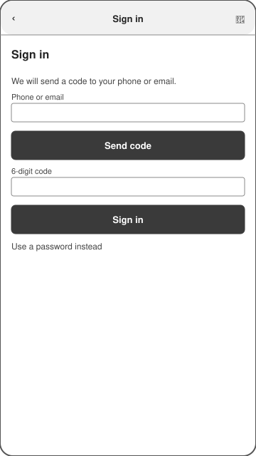
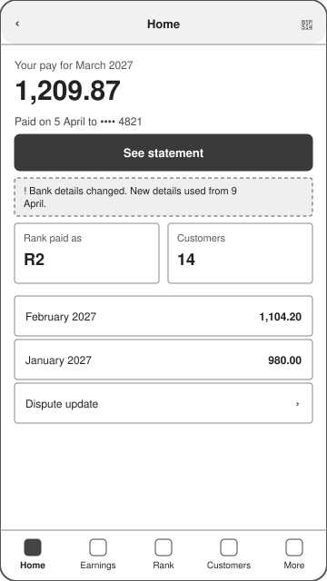
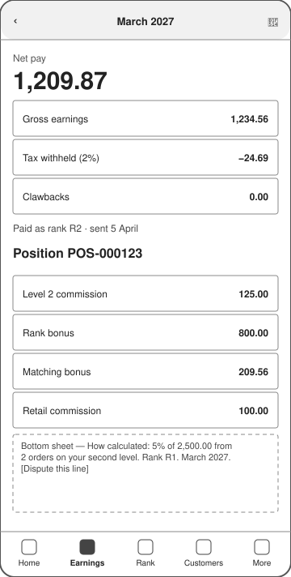
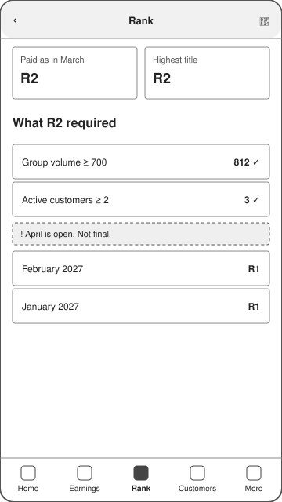
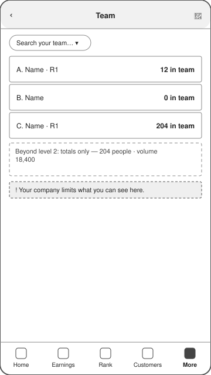
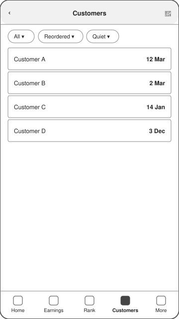
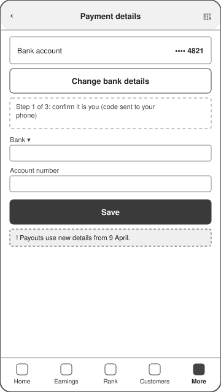

# 06 — MOBILE WIREFRAMES
## Phone layouts for the distributor portal and public pages; mobile behaviour of staff approvals

| Field | Value |
|---|---|
| Document ID | WF-06 |
| Version | 0.1 (draft for founder review) |
| Last updated | 2026-11-12 |
| Owner | UX architect role |
| Depends on | WF-01 (inventory), WF-02 (specification), UX-02, UX-05 |
| Status | Draft. Low-fidelity structure only: no colour, brand or final copy. Not usability-tested |

Phone wireframes use template **T3** (360 px wide: top bar with back and title, one content column with 16 px margins, bottom navigation of at most five items). They are drawn at the smallest supported width; larger phones gain only margin.

## 1. Distributor portal on a phone

### SC-27 — Sign-in and second factor

| Aspect | Specification |
|---|---|
| Release / requirements | MVP-A / FR-IAM-001, FR-IAM-002, FR-IAM-007 |
| Layout template | T3 phone |
| Main content | Credential fields; factor prompt |
| Components (cards, tables, charts, forms, filters) | Form |
| Primary button | Sign in |
| Secondary and contextual actions | Enrol factor; recover |
| Entry and exits | From: Tenant URL. To: role home |
| Permissions | public |

- Distributor sign-in: one-time code by default; numeric keyboard for the code; generic error text.

### SC-37 — Distributor home (mobile)

| Aspect | Specification |
|---|---|
| Release / requirements | MVP-B / FR-IAM-007, FR-DIST-001, FR-DIST-007 |
| Layout template | T3 phone |
| Main content | Latest net pay and payout status; rank; alerts (cooling-off, dispute update) |
| Components (cards, tables, charts, forms, filters) | Summary cards; bottom navigation |
| Primary button | Open latest statement |
| Secondary and contextual actions | Notifications; rank; customers |
| Entry and exits | From: Portal sign-in. To: SC-18, SC-19, SC-21, SC-38 |
| Permissions | self only |

- One column; primary action in thumb reach; at most five bottom-navigation items.
- Offline: last loaded content with its time.

### SC-18 — Distributor: statements and line explanation

| Aspect | Specification |
|---|---|
| Release / requirements | MVP-B / FR-FIN-002, FR-CAS-003, FR-DIST-001, FR-DIST-002, FR-DIST-007 |
| Layout template | T3 phone |
| Main content | Gross, withholding, clawbacks, adjustments, net, payout status, per position groups, disclosure link |
| Components (cards, tables, charts, forms, filters) | Period picker; summary block; grouped line list; explanation sheet |
| Primary button | Open line explanation |
| Secondary and contextual actions | Download; dispute line; switch period |
| Entry and exits | From: Portal home; notification. To: SC-37, SC-19, SC-22 |
| Permissions | self only |

- Tapping a line opens the explanation as a bottom sheet.
- Net first; withholding and clawbacks as separate labelled lines.
- Server-rendered; readable without scripts.

### SC-19 — Distributor: rank status

| Aspect | Specification |
|---|---|
| Release / requirements | MVP-B / FR-COMP-004, FR-DIST-003 |
| Layout template | T3 phone |
| Main content | Paid-as rank, titles, requirements with measured values, grace status |
| Components (cards, tables, charts, forms, filters) | Status block; requirement list; history list |
| Primary button | — |
| Secondary and contextual actions | View history |
| Entry and exits | From: Portal nav Rank. To: SC-18 |
| Permissions | self only |

- Facts only: requirements and measured values. No 'earn up to', no next-rank prompts.

### SC-20 — Distributor: team

| Aspect | Specification |
|---|---|
| Release / requirements | MVP-B / FR-GEN-006, FR-GEN-007, FR-DIST-004, FR-DIST-009 |
| Layout template | T3 phone |
| Main content | Permitted fields by depth; aggregates beyond |
| Components (cards, tables, charts, forms, filters) | Search; lazy list tree; limited-data notice |
| Primary button | Search |
| Secondary and contextual actions | Expand branch |
| Entry and exits | From: Portal nav Team. To: SC-37 |
| Permissions | self downline |

- List drill-in instead of a drawn tree on phones.
- The API returns only permitted fields; nothing is hidden client-side.

### SC-21 — Distributor: my customers

| Aspect | Specification |
|---|---|
| Release / requirements | MVP-B / FR-CRM-001, FR-CRM-003, FR-DIST-005 |
| Layout template | T3 phone |
| Main content | Customers with last order, repeat indicator; reassigned history |
| Components (cards, tables, charts, forms, filters) | List; filter chips |
| Primary button | Filter |
| Secondary and contextual actions | Open customer |
| Entry and exits | From: Portal nav Customers. To: SC-37 |
| Permissions | self only |

- Table becomes a card list with the three most important fields.

### SC-22 — Distributor: bank details and tax profile

| Aspect | Specification |
|---|---|
| Release / requirements | MVP-B / FR-PAY-005, FR-TAX-001, FR-DIST-006 |
| Layout template | T3 phone |
| Main content | Masked details; cooling-off status; tax profile |
| Components (cards, tables, charts, forms, filters) | Masked fields; form; status banner |
| Primary button | Save change (re-authenticate) |
| Secondary and contextual actions | View history |
| Entry and exits | From: Portal nav Profile. To: SC-38 |
| Permissions | self only, fresh authentication |

- One question group per screen; numeric keyboard for account number; re-authentication first.

## 2. Mobile rules

| Topic | Rule |
|---|---|
| Navigation | Bottom bar: Home · Earnings · Rank · Customers · More. Team sits under More unless the participant type can sponsor and has a downline, in which case it replaces Customers |
| Reach | Primary action in the lower half of the screen; targets at least 44 × 44 px; 8 px minimum spacing |
| Tables | Become stacked cards with the three most important fields; the rest behind a tap |
| Detail | Opens as a full-screen page or a bottom sheet (line explanation, filters) instead of a drawer |
| Forms | One question group per screen; correct keyboard type; values kept on connection loss |
| Trees | List drill-in with counts, never a drawn tree |
| Weight | Server-rendered; statement core readable without scripts; page budget NFR-PERF-06 |
| Offline | Last loaded content with its time; actions that need the server say so |
| Language | Market languages; text can grow 40% without breaking layout; right-to-left ready |
| Installable | The portal can be added to the home screen; no native app in MVP (mobile need unverified, P-09) |

## 3. Staff application on small screens

The staff application targets 1024 px and wider. Two tasks are supported on tablets and, in read-and-approve form, on phones, because approvers may be away from a desk:

| Task | Small-screen behaviour |
|---|---|
| Approve a run commit (SC-02) | Summary sentence, totals and variance cards, exception list as cards, approval bar pinned to the bottom, step-up authentication; tables reduce to bonus, amount and change |
| Approve a payout batch (SC-03) | Totals, counts, exclusion reasons with counts, approval bar pinned; per-payee lists paged |
| Decide a vendor access request (SC-14) | Request card with approve or deny |

All other staff screens show a notice below 1024 px: the page is usable with horizontal scrolling of tables but is not optimised. **No separate mobile layouts are drawn for staff screens**; this is recorded as a known limit in the readiness report.

## 4. Screens without a phone layout

SC-38 (notifications and profile) follows the list pattern of SC-21 and is specified in text only.
