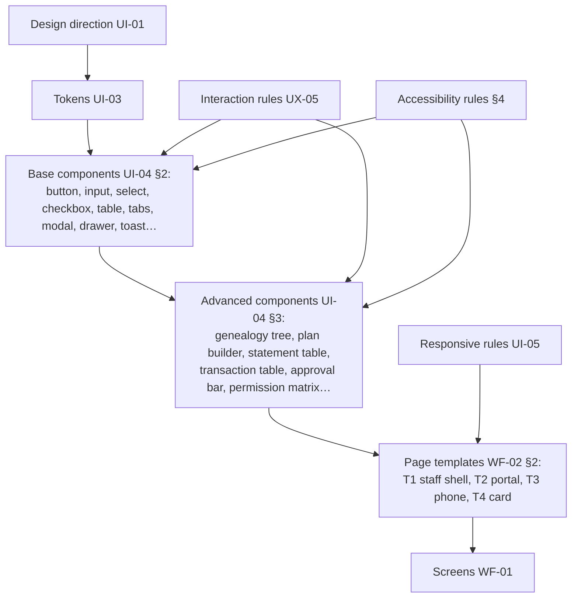

# 02 — DESIGN SYSTEM
## How the visual system is organised, governed and made accessible

| Field | Value |
|---|---|
| Document ID | UI-02 |
| Version | 0.1 (draft for founder review) |
| Last updated | 2026-11-12 |
| Owner | Design system architect role |
| Depends on | UI-01; UX-05 |
| Status | Draft. Specification only: no component has been built or tested |

## 1. Structure

| Layer | Contains | Changes need |
|---|---|---|
| Tokens | Colour, type, space, shape, elevation, motion, icons | Design-system owner; contrast re-check |
| Base components | Generic controls and containers | Owner review; accessibility test |
| Advanced components | Domain components built from base components | Owner and product review; usability test for the five highest-risk screens |
| Templates | Page shells | Owner and UX review |
| Screens | Compositions; no new visual rules | Product review |

## 2. Principles of the system

1. **Semantic tokens only** in components: no raw colours, sizes or shadows.
2. **One component per job.** If two components do the same thing, one is removed.
3. **Behaviour is part of the component.** Each has defined states, keyboard support and accessible names (UI-04).
4. **State language is global.** Lock, held, stale, blocked and outdated look and read the same everywhere (UI-03 §2.4).
5. **Content rules ship with components.** Button labels name the action and object; empty states say what will appear and offer the first step.
6. **Two densities, not two systems.** Staff and portal share components; they differ by density tokens and templates.
7. **Honesty constraints are system rules.** No component exists for leaderboards, earnings projections or celebratory feedback.

## 3. Themes and branding

| Theme | Scope | Status |
|---|---|---|
| House light | All applications | First release |
| Tenant accent | Portal, statements, emails: logo, name, one accent colour (contrast-checked) | First portal release |
| Dark | — | Later; token structure allows it |
| High contrast | Respects the operating system's forced-colours mode; borders and focus rings must survive it | Tested per component |

## 4. Accessibility (WCAG 2.2 level AA)

The target is WCAG 2.2 AA for the staff application and the portal (NFR-ACC-01). Requirements by principle, with the WCAG 2.2 success criteria they answer:

| Principle | Requirement | Criteria |
|---|---|---|
| Perceivable | Text alternatives for icons and charts (each chart has a data table) | 1.1.1 |
| | Structure conveyed by semantics: headings, landmarks, table headers with scope, form labels | 1.3.1 |
| | Reflow at 320 CSS px without two-dimensional scrolling, except data tables, which get a stacked-card alternative on the portal | 1.4.10 |
| | Text contrast ≥ 4.5:1 (3:1 for large text); non-text contrast ≥ 3:1 for control boundaries, focus indicators and meaningful graphics | 1.4.3, 1.4.11 |
| | No information by colour alone | 1.4.1 |
| | Text resizable to 200%; text-spacing overrides do not break layouts | 1.4.4, 1.4.12 |
| | Content on hover or focus (tooltips, popovers) is dismissible, hoverable and persistent | 1.4.13 |
| Operable | Every function by keyboard; no traps; logical focus order; visible focus that is not obscured by sticky bars | 2.1.1, 2.1.2, 2.4.3, 2.4.7, 2.4.11 |
| | Skip link; descriptive page titles; multiple ways to reach pages (navigation, search) | 2.4.1, 2.4.2, 2.4.5 |
| | Target size ≥ 24 × 24 CSS px everywhere; ≥ 44 × 44 px on the portal by policy | 2.5.8 |
| | Dragging is never required (priority lists and column order also have move-up and move-down buttons) | 2.5.7 |
| | Session time-outs warn and allow extension; no time limits on reading or approving | 2.2.1 |
| | No flashing; motion can be reduced | 2.3.1 |
| Understandable | Page language set; language of parts marked in multilingual content | 3.1.1, 3.1.2 |
| | Consistent navigation, identification and placement of help | 3.2.3, 3.2.4, 3.2.6 |
| | Errors identified in text, with suggestions; labels and instructions present; legal and financial submissions are reversible, checked or confirmed | 3.3.1, 3.3.2, 3.3.3, 3.3.4 |
| | No redundant entry within a process; authentication does not rely on a cognitive test (one-time codes can be pasted; password managers and passkeys work) | 3.3.7, 3.3.8 |
| Robust | Name, role and value exposed for all custom components; status messages announced without moving focus | 4.1.2, 4.1.3 |

**Component-specific accessibility** (tree view, data grid, combobox, dialog, tabs) follows the WAI-ARIA Authoring Practices patterns; details in UI-04.

**Testing:** automated checks in CI on every component and on key screens; manual keyboard and screen-reader passes (at least one desktop and one mobile screen reader) on the five highest-risk screens and all portal pages before release (QA TS-54). Automated tools find only part of the issues, so manual testing is mandatory.

**Where "as applicable" matters:** the vendor console and implementation tools (migration workspace) are internal or specialist tools; they follow the same components and therefore inherit most of the conformance, but manual audit priority goes to the portal and the staff screens used daily.

## 5. Content and localisation rules

| Rule | Detail |
|---|---|
| Externalised text | No text in code or images; message catalogues per locale |
| Expansion | Layouts tolerate 40% longer strings; no fixed-width buttons |
| Direction | Logical properties (start, end) so right-to-left scripts work without redesign |
| Numbers, dates, currency | Formatted by locale; currency code or symbol per market; time zone shown wherever a cut-off is involved |
| Plurals and gender | Message format with plural rules; avoid gendered phrasing |
| Tone | Plain, factual, respectful; never promotional about earnings |

## 6. Governance

| Topic | Rule |
|---|---|
| Source of truth | Token JSON and a coded component library with documentation pages; the design tool mirrors them |
| Versioning | Semantic versions; breaking changes need a migration note |
| Contribution | A new component needs: a job no existing component does, states, keyboard model, accessible name rules, content rules, responsive behaviour |
| Quality gates | Automated accessibility tests; visual regression tests; contrast check on token changes |
| Deprecation | Announced one minor version ahead; removed in the next major |
| Editions | Hosted and self-hosted editions use the same library; SC-47 uses only existing components |

## 7. Status against the brief

| Brief item | Where | Status |
|---|---|---|
| Design direction | UI-01 | Specified; brand undecided |
| Design tokens | UI-03 | Specified with measured contrast |
| Component library | UI-04 | Specified; not built |
| Advanced components | UI-04 §3 | Specified; need prototyping and testing |
| Responsive design | UI-05 | Specified |
| Accessibility | §4 | Requirements specified; not tested |
| Finished interface | — | **Does not exist**; this is a system specification |
