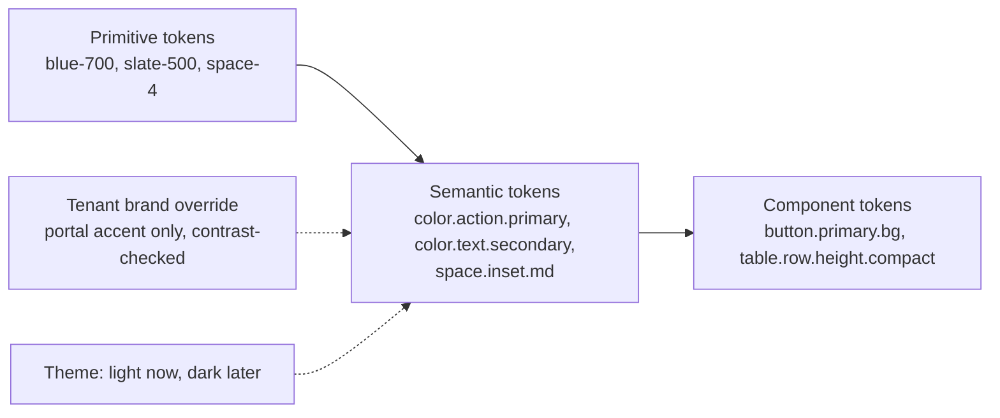

# 03 — DESIGN TOKENS
## Semantic tokens for colour, type, space, shape, elevation, layout, motion and icons

| Field | Value |
|---|---|
| Document ID | UI-03 |
| Version | 0.1 (draft for founder review) |
| Last updated | 2026-11-12 |
| Owner | Design system architect role |
| Depends on | UI-01 |
| Status | Draft. Values are a coherent starting set; contrast ratios below were computed with the WCAG relative-luminance formula. Final values follow the brand decision (OQ-23) and usability testing |

## 1. Token structure

Three tiers. Components use **only** semantic or component tokens, never primitives or raw values.

Naming: `category.role.variant.state`, for example `color.bg.danger.subtle`, `color.border.focus`, `space.stack.lg`.

## 2. Colour

### 2.1 Primitives

| Token | Value | | Token | Value |
|---|---|---|---|---|
| `slate-950` | #0F172A | | `blue-800` | #173E82 |
| `slate-700` | #334155 | | `blue-700` | #1E4FA3 |
| `slate-600` | #475569 | | `blue-50` | #EEF4FC |
| `slate-500` | #64748B | | `green-700` | #1B7F4B |
| `slate-400` | #94A3B8 | | `green-800` | #14633A |
| `slate-300` | #CBD5E1 | | `green-50` | #E8F5EE |
| `slate-200` | #E2E8F0 | | `amber-800` | #7A4900 |
| `slate-100` | #F1F5F9 | | `amber-700` | #8A5200 |
| `slate-50` | #F8FAFC | | `amber-50` | #FFF4D6 |
| `white` | #FFFFFF | | `red-700` | #B42318 |
| `info-700` | #175CD3 | | `red-800` | #912018 |
| `info-800` | #1849A9 | | `red-50` | #FDECEA |
| `info-50` | #EAF2FF | | | |

### 2.2 Semantic colour tokens (light theme)

| Token | Primitive | Use | Contrast (measured) |
|---|---|---|---|
| `color.text.primary` | slate-950 | Body, headings, amounts | 17.85:1 on white |
| `color.text.secondary` | slate-600 | Labels, captions | 7.58:1 on white |
| `color.text.tertiary` | slate-500 | Placeholder, helper text | 4.76:1 on white; 4.55:1 on slate-50 |
| `color.text.disabled` | slate-400 | Disabled labels only (exempt from contrast; never for information) | 2.56:1 |
| `color.text.on-action` | white | Text on primary buttons | 7.77:1 on blue-700 |
| `color.text.link` | blue-700 | Links | 7.77:1 on white |
| `color.bg.page` | slate-50 | Page background | — |
| `color.bg.surface` | white | Cards, tables, panels | — |
| `color.bg.subtle` | slate-100 | Table header, hover, selected row tint | — |
| `color.bg.overlay` | slate-950 at 50% | Scrim behind modals | — |
| `color.border.default` | slate-300 | Dividers, card and table borders (decorative separation) | 1.48:1 (not relied on to identify controls) |
| `color.border.control` | slate-500 | Borders of inputs, checkboxes, unselected controls | 4.76:1 on white (meets 3:1 for non-text) |
| `color.border.focus` | blue-700 | Focus ring, 2 px, with 2 px offset | 7.77:1 on white |
| `color.action.primary` | blue-700 | Primary button, selected tab, active nav | — |
| `color.action.primary.hover` | blue-800 | Hover and pressed | 10.25:1 with white text |
| `color.action.subtle` | blue-50 | Selected row, active nav background | blue-700 text 7.02:1 |
| `color.success.text` / `.bg` | green-800 / green-50 | Success messages, positive state chips | 6.51:1 |
| `color.success.icon` | green-700 | Icons, chart positive | 5.02:1 on white |
| `color.warning.text` / `.bg` | amber-800 / amber-50 | Warnings, held, behind, stale | 6.89:1 |
| `color.danger.text` / `.bg` | red-800 / red-50 | Errors, failed, blocked | 7.58:1 |
| `color.danger.action` | red-700 | Destructive button | 6.57:1 with white text |
| `color.info.text` / `.bg` | info-800 / info-50 | Neutral information, in progress | 7.27:1 |

### 2.3 Rules

- Negative amounts: `color.text.primary` with a minus sign; the danger colour is **not** used for negative numbers (a clawback is a fact, not an error).
- Disabled controls use `color.text.disabled` and are accompanied by a visible reason.
- Tenant accent (portal only) replaces `color.action.primary` if it has ≥ 4.5:1 against white and white text has ≥ 4.5:1 against it; otherwise the house accent is kept.

### 2.4 State colour mapping

| State (period, run, batch, case, connection) | Semantic family | Icon |
|---|---|---|
| Open, Draft | Neutral (slate) | circle outline |
| Calculating, Instructing, Computing, In review | Info | progress |
| Calculated, Reviewed, Awaiting approval | Info | eye / clock |
| Committed, Approved | Neutral strong with **lock** | lock |
| Paid, Settled, Closed, Healthy, Ready | Success | check |
| Held, Cooling-off, Behind, Stale, Outdated, Grace | Warning | pause / clock |
| Failed, Rejected, Returned, Blocked, Lapsed | Danger | alert |
| Superseded, Discarded, Retired, Expired | Neutral muted | archive |

### 2.5 Data visualisation palette

Proposed sequence for categories (chosen to differ in hue and lightness; **not yet checked** with a colour-vision simulator, which is required before use): `#1E4FA3`, `#C2410C`, `#0F766E`, `#7C3AED`, `#A16207`, `#475569`. Single-series charts use the accent. Charts never rely on colour alone: direct labels, patterns for more than four series, and a table alternative.

### 2.6 Dark theme (structure only)

Semantic tokens are theme-independent names. A dark theme would map `color.bg.page` → slate-950, `color.text.primary` → slate-50 (17.06:1), `color.text.secondary` → slate-300 (12.02:1), `color.action.primary` → #8DB4F0 with slate-950 text (8.43:1). Not in the first release.

## 3. Typography

| Token | Size / line height | Weight | Use |
|---|---|---|---|
| `font.display` | 32 / 40 px | 600 | The one key number (net pay, run total) |
| `font.title.lg` | 24 / 32 | 600 | Page title (portal) |
| `font.title.md` | 20 / 28 | 600 | Page title (staff) |
| `font.heading` | 16 / 24 | 600 | Section heading |
| `font.body.lg` | 16 / 24 | 400 | Portal body; all inputs on phones |
| `font.body.md` | 14 / 20 | 400 | Staff body, tables |
| `font.body.sm` | 13 / 18 | 400 | Compact tables, captions |
| `font.caption` | 12 / 16 | 500 | Labels in cards, chips, table headers |
| `font.mono` | 13 / 18 | 400 | Ids, keys, code |

| Token | Value |
|---|---|
| `font.family.sans` | Inter, "Noto Sans", system-ui, sans-serif (script-specific Noto families added per market pack) |
| `font.family.mono` | "JetBrains Mono", ui-monospace, monospace |
| `font.weight.regular / medium / semibold` | 400 / 500 / 600 |
| `font.numeric` | tabular-nums lining-nums on all amounts, counts, dates and ids |
| Letter case | Sentence case everywhere; no all-caps except short chip labels where the script has case |
| Maximum line length | 75 characters for prose |

Text must remain usable at 200% zoom and with user text-spacing overrides (WCAG 1.4.4, 1.4.12).

## 4. Spacing

Base unit 4 px.

| Token | Value | Typical use |
|---|---|---|
| `space.0` | 0 | — |
| `space.1` | 4 px | Icon to label |
| `space.2` | 8 px | Inside chips; between related controls |
| `space.3` | 12 px | Table cell padding (compact) |
| `space.4` | 16 px | Card padding (compact); phone margins; cell padding (comfortable) |
| `space.5` | 20 px | — |
| `space.6` | 24 px | Card padding; grid gutter; between form groups |
| `space.8` | 32 px | Between page sections |
| `space.10` | 40 px | — |
| `space.12` | 48 px | Header height; top of page content |
| `space.16` | 64 px | Empty-state padding |

## 5. Borders, radii, shadows

| Token | Value | Use |
|---|---|---|
| `border.width.default` | 1 px | Dividers, cards, inputs |
| `border.width.strong` | 2 px | Focus ring, selected tab underline |
| `radius.sm` | 4 px | Inputs, buttons, chips in tables |
| `radius.md` | 8 px | Cards, modals, drawers' inner panels |
| `radius.full` | 999 px | Filter chips, avatars |
| `shadow.none` | none | Default surfaces |
| `shadow.overlay` | 0 8px 24px rgba(15,23,42,0.16) | Menus, popovers |
| `shadow.modal` | 0 16px 48px rgba(15,23,42,0.24) | Modals, drawers |

## 6. Breakpoints and grid

| Token | Min width | Columns | Gutter | Margin | Applies to |
|---|---|---|---|---|---|
| `bp.xs` | 360 px | 4 | 16 | 16 | Phone (portal) |
| `bp.sm` | 600 px | 8 | 16 | 24 | Large phone, small tablet |
| `bp.md` | 1024 px | 12 | 24 | 24 | Staff minimum; tablet landscape |
| `bp.lg` | 1280 px | 12 | 24 | 32 | Desktop |
| `bp.xl` | 1440 px | 12 | 24 | auto (content max 1440) | Wide desktop |

Fixed dimensions: header 48 px; sidebar 208 px (56 px collapsed); drawer 420–720 px; portal column maximum 720 px; form maximum 640 px; modal widths 400, 560, 720 px.

## 7. Z-index

| Token | Value | Layer |
|---|---|---|
| `z.base` | 0 | Content |
| `z.sticky` | 100 | Sticky table headers, action bars |
| `z.header` | 200 | Header, sidebar |
| `z.drawer` | 300 | Drawers, bottom sheets |
| `z.modal` | 400 | Modal and its scrim |
| `z.popover` | 500 | Menus, popovers, date pickers (may sit above a modal) |
| `z.toast` | 600 | Toasts |
| `z.tooltip` | 700 | Tooltips |

## 8. Motion

| Token | Value | Use |
|---|---|---|
| `motion.duration.fast` | 120 ms | Hover, focus, small state changes |
| `motion.duration.base` | 200 ms | Drawer, modal, sheet enter and exit |
| `motion.easing.standard` | cubic-bezier(0.2, 0, 0, 1) | All |
| Reduced motion | When the user prefers reduced motion, transitions become instant fades of ≤ 80 ms | Accessibility |
| Prohibited | Auto-playing, looping or celebratory animation; anything flashing more than three times a second | Calm; WCAG 2.3.1 |

## 9. Iconography

| Rule | Value |
|---|---|
| Family | One open-licence outline set (for example Lucide), 24 px grid, 1.5 px stroke |
| Sizes | 16 px (inline, tables), 20 px (buttons, navigation), 24 px (empty states, headers) |
| Colour | Inherits text colour; semantic colour only in state chips and banners |
| Labelling | Icon-only buttons have an accessible name and a tooltip; state icons always sit beside a text label |
| Reserved meanings | Lock = committed or read-only by state · eye-off = masked · shield = guardrail · clock = waiting or cooling-off · link = trace or source · alert triangle = warning · octagon = blocked |
| Not used | Trophies, medals, flames, rockets, money bags |

## 10. Component tokens (examples)

| Token | Value |
|---|---|
| `button.height.md` / `.lg` | 36 px / 44 px (portal and phones use lg) |
| `input.height.md` / `.lg` | 36 px / 44 px |
| `table.row.height.comfortable` / `.compact` | 44 px / 32 px |
| `table.header.bg` | `color.bg.subtle` |
| `chip.height` | 24 px |
| `target.min` | 24 × 24 px (staff), 44 × 44 px (portal) |
| `focus.ring` | 2 px `color.border.focus`, 2 px offset, never removed |

## 11. Delivery format

Tokens are maintained as one JSON source (W3C design-tokens format) and exported to CSS custom properties and to the design tool. The semantic layer is the contract; primitives may change with the brand decision without touching components.
