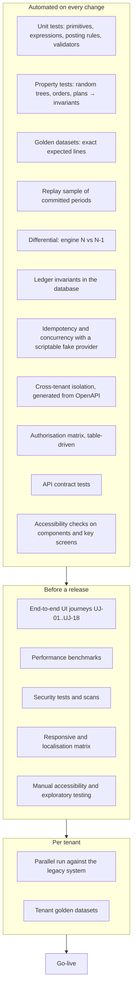
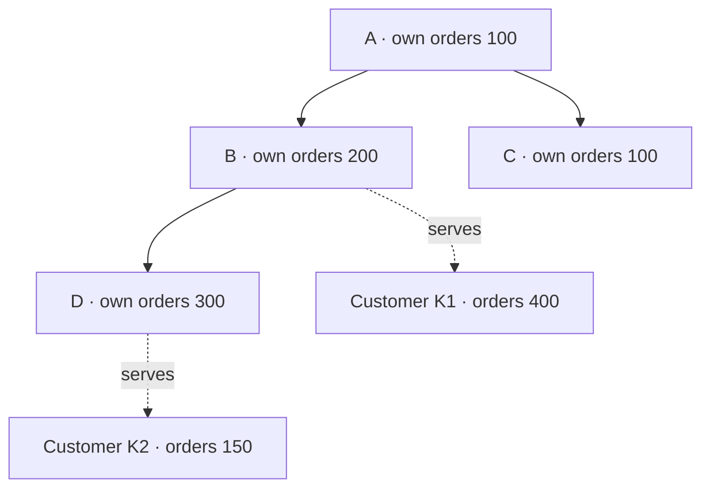

# 01 — QA AND ACCEPTANCE SPECIFICATION
## How we prove the product works: strategy, test types, verified calculations, release gates

| Field | Value |
|---|---|
| Document ID | QA-01 |
| Version | 0.1 (draft for founder review) |
| Last updated | 2026-11-12 |
| Owner | QA architect role |
| Depends on | PRD-02, PRD-04, PRD-06; SDD-07, SDD-09; gap audit 30 |
| Companion documents | QA-02 test scenarios (71) · QA-03 edge cases · QA-04 traceability · `verification/verify_calculations.py` |
| Status | Draft. No test has been executed against a product: none exists. Calculated expected values have been verified by script (55 of 55 checks pass) |

## 1. Quality goals

| Goal | Proof |
|---|---|
| Pay is correct to the minor unit | Golden datasets; property tests; ledger invariants |
| Pay is reproducible | Replay of committed periods; differential tests between engine releases |
| Money cannot be released or changed by one person, twice, or silently | Separation-of-duties tests; idempotency tests; append-only tests |
| One tenant can never see another's data | Generated isolation suite over every endpoint |
| Compliance figures are reproducible and explainable | Fixture with hand-checked values; snapshot recomputation; drill-down sums |
| Users can understand and operate the product | Usability, accessibility, responsive and localisation tests |

## 2. Test strategy by layer

| Test type | What it proves | Scope and method | Scenarios |
|---|---|---|---|
| **Functional** | Each requirement behaves as its acceptance criteria state | One or more tests per AC (QA-04 shows the mapping; every AC has a test) | TS-13, 17, 32–34, 45–52, 57–59, 61, 64, 68–70 |
| **Business rule** | Each rule in PRD-04 holds | Rule-to-test mapping generated in PRD-04; 13 rules still without a test (V1 or unresolved) are listed in QA-04 §4.5 | All |
| **Compensation calculation** | Engine output equals independently computed expected lines | Golden datasets per primitive, per corpus plan and per tenant; §5–§6 below | TS-01, 02, 04–12, 22–25, 43, 44, 62, 63, 65 |
| **Genealogy** | Structure, history and visibility are correct | Bitemporal queries; cycle and overlap constraints; placement races; read-model equivalence with the system of record | TS-03, 20, 45, 61, 64 |
| **Financial transaction** | Ledger balances, is append-only and idempotent; reversals are consistent | Database-level tests; full payout cycles; clawback and write-off paths | TS-11, 38–41 |
| **Permission** | Each role and scope can do exactly what the matrix says | Table-driven over the permission catalogue × base roles × market scopes; separation of duties | TS-36, 42 |
| **Multi-tenant isolation** | No endpoint leaks across tenants | For every endpoint in the OpenAPI document: tenant A's credential with tenant B's ids; build fails if an endpoint is uncovered; canary rows | TS-21 |
| **API** | Contracts, validation, errors, pagination, idempotency, rate limits | Contract tests from OpenAPI; negative tests per error code; replay and conflict cases | TS-14–16, 41, part of 59 |
| **Integration** | Connectors and adapters behave under failure | Fake store and fake provider with scripted time-outs, partial rejections, returns, duplicate and out-of-order webhooks; reconciliation | TS-15, 16, 40, 41, 58 |
| **UI** | Screens show the right data and states | Journey tests UJ-01..18 on key paths; state coverage per WF-02 §3; honesty check (no projection content) | TS-53, 59 |
| **Responsive** | Layouts follow UI-05 | Viewport matrix UI-05 §8 | TS-55 |
| **Accessibility** | WCAG 2.2 AA | Automated checks plus manual keyboard and screen-reader passes on the five highest-risk screens and all portal pages | TS-54 |
| **Security** | Controls of TRD-04 hold | MFA and step-up; session handling; vendor-session enforcement; audit chain tamper; export limits; signed instructions; upload handling; dependency and image scans; independent penetration test before the first MVP-B production tenant | TS-35, 37, 56, 71 |
| **Performance** | Proposed targets of PRD-03 are met or revised | Synthetic trees and order loads; period-end burst; statement page budget | TS-29, 30 |
| **Regression** | Nothing that worked breaks | Entire automated suite on every change; differential engine test; visual regression of components | TS-60 |
| **Tax** | Market-pack rules are applied as configured | Fixtures confirmed by a tax adviser per market; boundary cases | TS-18, 19 |
| **Privacy** | Requests are fulfilled without breaking the ledger | Pseudonymisation; region checks | TS-28, 57 |
| **Editions** | Self-hosted behaves like hosted and is safe to update | Licence states; update package checks; bundle redaction | TS-69–71 |

## 3. Engine invariants (property tests)

For randomly generated trees, orders, plans and event sequences, after every run:

| # | Invariant |
|---|---|
| I1 | Σ result lines = run total |
| I2 | For every allocation (pool, split, scaled cap): Σ parts = total, exactly |
| I3 | No cap is exceeded for its scope |
| I4 | For every payee: gross = net payable + withholding (+ netted clawback) |
| I5 | The journal entry of the run balances and equals the run's totals |
| I6 | No line is paid to a position terminated before the period unless the plan version allows it |
| I7 | Matching never pays on a bonus that was reversed in the same run |
| I8 | A once-only bonus is never paid twice to the same position |
| I9 | Running twice on the same snapshot gives the same ordered hash |
| I10 | Adding an order to one position never reduces another position's volume measures |
| I11 | The read model answers "is X in Y's downline" identically to the system of record |
| I12 | After any sequence of payout events, payable ≥ 0 and in-transit = Σ open instructions |

## 4. Golden datasets

| Level | Content | Owner |
|---|---|---|
| Primitive | One or more fixtures per primitive kind and option (TS-01, 02, 04, 05, 12, 43, 44…) | Platform |
| Corpus plan | At least five hold-out plans from the Phase A corpus configured end to end with expected lines derived from the plan documents' own examples | Platform (Phase C spike) |
| Tenant | Examples from the tenant's plan document plus periods from the parallel run | Implementation consultant with the tenant |
| Regression | Every defect found becomes a fixture | Platform |

A golden dataset is an input bundle (tree, orders, prior state, plan version, settings) and the **exact** expected lines. Expected values are produced independently of the engine (by hand or by a separate script) and reviewed by a second person.

## 5. Compensation calculation tests with verified expected results

All inputs are **hypothetical**. Every value in the *Expected* column is asserted by `verification/verify_calculations.py` (output in `verification/verification_output.txt`).

| Test | Inputs | Expected | Rule proven |
|---|---|---|---|
| TS-01 Unilevel | Rates 8, 5, 4, 4, 4%; level volumes 1,000; 2,500; 4,000; 6,000; 8,000 | 80.00 + 125.00 + 160.00 + 240.00 + 320.00 = **925.00** | Percent by level |
| TS-02 Compression | Chain volumes 1,000; 2,500 (inactive); 4,000; 6,000; 8,000; 5,000 | Without: **800.00**. With: **1,040.00** | Compression is a calculation behaviour (BR-GEN-07) |
| TS-04 Binary 2:3 | Left 620, right 900, unit 100 | **3 pairs**; carry left **20**, right **0** | Pairing ratio and carry |
| TS-05 Carry cap | Carry 2,800 + 900 new, cap 3,000; next period unqualified | **3,000**, then **0** | BR-RNK-08 |
| TS-06 Pool | 62,500.00 over 66 shares (40×1, 10×2, 2×3) | Naive rounding pays 62,500.02; largest remainder pays **62,500.00** | BR-MNY-03 |
| TS-07 Proportional cap | 8 lines summing 9,403.93; cap 8,328.12 | Naive 8,328.14; exact **8,328.12** | BR-MNY-03 |
| TS-08 Priority cap | Sales 1,000,000; cap 10% on team 70,000 + leadership 45,000; reduce leadership | Team **70,000.00**, leadership **30,000.00** (proportional would give 60,869.57 and 39,130.43) | BR-CAP-01 |
| TS-09 Order-structure cap | G1 500,000; G2 300,000 (> ⅓); net sales 1,000,000; rate 41.75%; in-scope proposed 340,000 | Base **750,000**; 75% < 80%; cap **313,125.00**; factor **0.9210** on in-scope lines only | BR-CAP-01, -02 |
| TS-10 Refund cascade | GV 800 incl. refunded order 500; 10% at ≥ 700 else 5%; match 20% | Paid A 80.00, C 16.00. Order-line: A −50.00, C 0. Restatement: A **−65.00**, C **−13.00** | BR-REV-07 |
| TS-11 Netting | Receivable 40.00; next earnings 25.00 | Payable **0.00**; receivable **15.00** carried | BR-REV-09 |
| TS-12 Fast start | Order 1,200; 20% cap 200; upline 10% cap 80 | **200.00** and **80.00** | Per-order cap |
| TS-22 Multi-position | 100.10 + 250.25 + 49.65 | **400.00** | BR-GEN-01 |
| TS-38 Withholding | Gross 1,234.56; fixture rate 2% | Withheld **24.69**; payable **1,209.87**; entry balances | BR-TAX-02, BR-LED-01 |
| TS-43 Override vs differential | GV 6,000; 3% or (21% − 15%) | **180.00** or **360.00** | Plan must state the model |
| TS-44 Matching | 10% of 10.00 and 480.00 | **1.00**, **48.00** | Pass order |
| Tie-break | 100.00 over three equal shares, payees P1, P2, P3 | **33.34, 33.33, 33.33** | Deterministic allocation |

## 6. Worked end-to-end example (golden dataset G-E2E-01)

A small complete run that exercises volumes, ranks, four bonus types, matching, a priority cap with exact allocation, withholding, the ledger entry and the compliance figures.

**Structure and orders (one monthly period, one market)**

**Plan (hypothetical)**: PV = own orders + serviced customers' orders. GV = PV of self and sponsor-tree downline. Rank R1 if PV ≥ 100; R2 if GV ≥ 700. Retail commission 25% of serviced customers' orders. Unilevel 8% of level-1 PV and 5% of level-2 PV. Rank bonus 5% of GV at R1, 10% at R2. Matching 20% of the rank bonus of personally sponsored positions. Cap: rank bonus + matching ≤ 20% of net sales; method priority, reduce matching first, then rank bonus proportionally; residue not earned. Withholding: fixture 2% on gross for every payee.

| Step | A | B | C | D | Total |
|---|---|---|---|---|---|
| PV | 100 | 600 | 100 | 450 | — |
| GV | 1,250 | 1,050 | 100 | 450 | — |
| Rank | R2 | R2 | R1 | R1 | — |
| Retail commission | — | 100.00 | — | 37.50 | 137.50 |
| Unilevel | 56.00 + 22.50 = 78.50 | 36.00 | — | — | 114.50 |
| Rank bonus (before cap) | 125.00 | 105.00 | 5.00 | 22.50 | 257.50 |
| Matching (before cap) | 22.00 | 4.50 | — | — | 26.50 |
| **Cap:** net sales 1,250.00 × 20% = 250.00; in scope 284.00; excess 34.00 | | | | | |
| Matching after cap (priority 1: −26.50) | 0.00 | 0.00 | — | — | 0.00 |
| Rank bonus after cap (−7.50, largest remainder) | 121.36 | 101.94 | 4.85 | 21.85 | 250.00 |
| **Gross** | **199.86** | **237.94** | **4.85** | **59.35** | **502.00** |
| Withholding 2% | 4.00 | 4.76 | 0.10 | 1.19 | 10.05 |
| **Net payable** | 195.86 | 233.18 | 4.75 | 58.16 | 491.95 |

**Ledger entry at commit:** Dr commission expense 502.00 · Cr payee payable 491.95 · Cr withholding payable 10.05. Balanced.

**Allocation detail:** rank bonus scaled to 250.00: raw 121.3592, 101.9417, 4.8544, 21.8447; floors sum 249.98; the two remaining cents go to the largest fractional parts (A and D).

**Compliance facts from the same run:** R1 customer share = 550 ÷ 1,250 = **44.00%**. R3 payout sources: retail sale 137.50 ÷ 502.00 = **27.39%**; downline volume (unilevel + rank bonus) 364.50 ÷ 502.00 = **72.61%**; matching 0%.

**Follow-on cases on the same dataset (expected values to be added to the fixture when the engine exists):** (a) refund of K1's order after commit under each clawback policy; (b) correction of D's sponsor from B to C recorded after commit, then replay; (c) the same period under a proportional cap method.

## 7. Compliance report verification (MVP-A)

Fixture TS-31 (three participants, three orders, four payout lines, from the Phase A prototype's hand-checked test):

| Figure | Expected |
|---|---|
| R1 net sales | 160.00 |
| R1 customer share; with declared resale | 62.50%; 62.50% (the resale order was fully refunded) |
| R2 personal-use share of rewarded volume | 60.00%; 1 payee above a one-third flag |
| R3 January: retail sale; downline volume | 80.65%; 19.35%; year clawbacks −2.40 |
| R4 active distributors; with no customer order; late threshold crossings; of which refunded | 1; 100%; 1; 1 |
| R5 population; earned more than zero; median | 2; 50.00%; 14.30 |

Additional checks: recomputation of a snapshot gives identical figures; drill-down row sums equal figure components; a superseded batch leaves old snapshots unchanged.

## 8. Financial operation verification

| Check | Method | Expected |
|---|---|---|
| Transaction consistency | Kill the process at each step of commit, instruct, settle and return in an automated fault-injection test | Either the whole business event is applied (state, ledger entry, outbox) or none of it |
| Reversal consistency | Commit → instruct → return → re-instruct → settle (TS-40) | Payable 0, in transit 0, settled 98.00; one balanced entry per step |
| Clawback consistency | TS-11 with write-off | Receivable never negative; write-off only with approval; no debit instruction exists |
| Immutability | Attempt UPDATE and DELETE on postings, entries, result lines, relationships (TS-39) | Rejected by the database |
| Idempotency | Duplicate run request, duplicate order, retried instruction, duplicate webhook (TS-14–16, 41) | One effect each |
| Reconciliation after restore | Restore to a point before settlements arrived, then reconcile | Differences surface as exceptions; no duplicate instruction is sent |

## 9. Acceptance and release gates

| Gate | Criteria |
|---|---|
| **Requirement ready for build** | Has research trace, story, acceptance criteria and at least one test scenario (QA-04). Currently true for all MVP-A and MVP-B requirements except FR-CPL-013 (market-pack registers), and not yet true for the 14 V1 requirements that have no acceptance criteria |
| **Change merged** | Automated suite green, including isolation, golden, replay sample, ledger invariants and static checks |
| **Engine release** | 100% golden pass; differential test shows zero unexplained differences; replay of sampled committed periods identical |
| **MVP-A release** | TS-21, 31–37, 56, 57 pass; accessibility check of SC-10, 24–28, 46; data terms and breach contacts in place |
| **MVP-B release candidate** | All MVP-B scenarios pass; performance targets met or formally revised; penetration test findings of high severity closed; restore drill done |
| **Tenant go-live** | Parallel run with zero unexplained differences (BR-MIG-02); launch checklist complete; tenant golden datasets pass |
| **Market pack release** | Every rule has a basis and status; tax fixtures confirmed by the adviser; pack signed |
| **Self-hosted release (V1)** | TS-69–71 pass; upgrade path tested from the previous supported version; installation guide and preflight verified on a clean environment |

## 10. Defect severity

| Severity | Definition | Rule |
|---|---|---|
| S1 | Wrong money, cross-tenant exposure, lost or duplicated payout, broken replay, security bypass | Blocks any release; root cause and a new fixture required |
| S2 | Wrong figure in a report, wrong state shown, blocked critical journey | Blocks release |
| S3 | Function impaired with a workaround | Fix scheduled |
| S4 | Cosmetic | Backlog |

## 11. Test data and environments

Synthetic data only outside production (seeded generators for trees of chosen shapes, order patterns including period-end bursts and refunds, payout lines). No production personal data in staging. Provider and store fakes are scriptable. A design partner's export is used only inside its tenant, under the data terms.

## 12. Limits of this specification

- Expected values exist for primitives and one end-to-end example; **corpus-plan and tenant golden datasets do not exist yet**.
- Performance targets are proposals (PRD-03); the benchmark has not been run.
- Tax tests use fixture rates; real rules need an adviser.
- 13 business rules have no test yet (V1 or unresolved content); 14 V1 requirements and FR-CPL-013 have no acceptance criteria (QA-04 §4).
- Usability and accessibility testing with real users has not happened.
