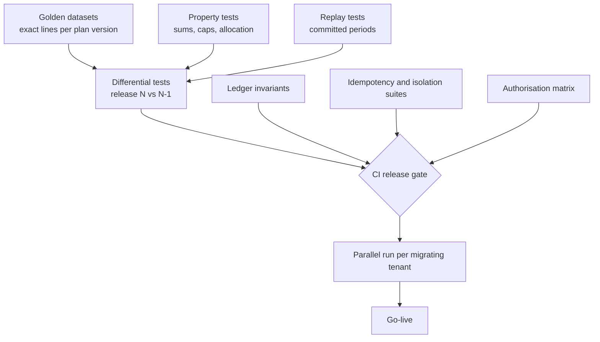

# 02 — TEST SCENARIOS
## The test catalogue with expected results and the criteria and rules each test proves

| Field | Value |
|---|---|
| Document ID | QA-02 |
| Version | 0.1 (draft for founder review) |
| Last updated | 2026-11-12 |
| Owner | Product (CPO role) |
| Depends on | QA-01, PRD-06, PRD-04; gap audit 30 |
| Status | Draft. Not approved |

Seed scenarios TS-01 to TS-30 keep their IDs from the gap audit (30 §2). Expected values of every calculation scenario are reproduced by `08-qa/verification/verify_calculations.py`; all inputs are **hypothetical**. Scenarios marked *market pack* use fixture rates only: real rates and thresholds must come from a tax adviser.

| ID | Layer | Scenario | Expected result | Proves | Release |
|---|---|---|---|---|---|
| TS-01 | Golden | Unilevel five levels at 8, 5, 4, 4, 4 percent on level volumes 1,000; 2,500; 4,000; 6,000; 8,000 | Level payouts 80.00, 125.00, 160.00, 240.00, 320.00; total 925.00 | AC-44.1, BR-CMP-01 | MVP-B |
| TS-02 | Golden | Compression: chain of six members, second inactive, same rates; volumes 1,000; 2,500; 4,000; 6,000; 8,000; 5,000 | 800.00 without compression; 1,040.00 with compression; relationship rows unchanged | AC-44.2, BR-GEN-07 | MVP-B |
| TS-03 | Replay | Correction of a sponsor after period commit, then replay of the committed period | Committed output unchanged (hash equal); correction flagged with affected periods | AC-01.1, AC-01.2, AC-03.1, BR-GEN-04, BR-PER-03 | MVP-B |
| TS-04 | Golden | Binary pairing 620 against 900 at ratio 2:3, pair unit 100 | 3 pairs; carry 20 on the left, 0 on the right | BR-RNK-08 | MVP-B |
| TS-05 | Golden | Carry-forward capped at 3,000 per side, kept only while qualified | Carry truncated to 3,000; zeroed in the first unqualified period | BR-RNK-08 | MVP-B |
| TS-06 | Property | Pool of 62,500.00 over 66 shares (40 holders with 1, 10 with 2, 2 with 3) | Largest-remainder allocations sum to exactly 62,500.00; naive per-share rounding would pay 62,500.02 | AC-14.1, BR-MNY-03, BR-MNY-02, BR-MNY-04 | MVP-B |
| TS-07 | Property | Proportional cap 8,328.12 over 8 lines summing 9,403.93 (cap rate 0.8856) | Scaled lines sum exactly to 8,328.12; naive per-line rounding would pay 8,328.14 | AC-11.2, BR-MNY-03, BR-CAP-01 | MVP-B |
| TS-08 | Golden | Cap 10% of sales 1,000,000 on team bonus 70,000 and leadership bonus 45,000, method priority = leadership | Team 70,000.00 unchanged; leadership 30,000.00. Proportional method on the same inputs gives 60,869.57 and 39,130.43 | AC-11.1, BR-CAP-01, BR-CAP-03 | MVP-B |
| TS-09 | Golden | Order-structure cap: component G1 500,000, G2 300,000 (above one third of G1+G2); total net sales 1,000,000; in-scope pay proposed 340,000; rate 41.75% | Rewardable base 750,000; ratio 75% below 80%; cap 313,125.00 on in-scope lines only (factor 0.9210); out-of-scope lines untouched | BR-CAP-01, BR-CAP-02 | MVP-B |
| TS-10 | Golden | Refund after payout with rank threshold 700 (10% above, 5% below) on group volume 800 including refunded order 500; matching 20% | Paid A 80.00, C 16.00. Order-line clawback: A −50.00, C 0.00. Restatement: A −65.00, C −13.00 | AC-20.1, AC-20.2, BR-REV-07 | MVP-B |
| TS-11 | Ledger | Clawback 40.00 against next earnings 25.00, then approved write-off | Payable 0.00; receivable 15.00 carried; write-off posts 15.00 only with approval; no debit instruction exists | AC-20.3, BR-REV-08, BR-REV-09 | MVP-B |
| TS-12 | Golden | Fast start 20% capped 200 per order, upline 10% capped 80, order 1,200 | 240 capped to 200.00; 120 capped to 80.00 | BR-CAP-01 | MVP-B |
| TS-13 | Functional | Order dated inside a committed period arrives | Queued as late transaction; adjustment line in the open run linked to the original period; committed period hash unchanged | AC-08.1, AC-22.2, BR-PER-04 | MVP-B |
| TS-14 | Idempotency | Two concurrent run requests for the same period | One run executes; both callers get the same run id | AC-06.3, BR-PER-06 | MVP-B |
| TS-15 | Idempotency | Duplicate order webhook | One order; second delivery acknowledged without change | AC-22.1, BR-ORD-04 | MVP-B |
| TS-16 | Idempotency | Payout instruction retried after timeout | Provider sandbox shows one payment; same idempotency key on both attempts | AC-16.1, BR-PAY-10 | MVP-B |
| TS-17 | Functional | Bank detail changed two days before payout with cooling-off longer than two days | Payout held; notices to old and new contact recorded | AC-17.1, AC-47.1, BR-PAY-08, BR-PAY-12 | MVP-B |
| TS-18 | Tax | Market-pack fixture: payee just below and just above the configured prior-year threshold | Zero withholding below; configured rate above; values from configuration only | AC-18.1, BR-TAX-01 | MVP-B (market pack) |
| TS-19 | Tax | Market-pack fixture: payee without tax id where the pack sets a higher rate | Higher configured rate applied and shown | AC-19.1, BR-TAX-03 | MVP-B (market pack) |
| TS-20 | Authorisation | Leader requests a node outside their downline by id | 404 identical to an unknown id | AC-05.2, BR-DAT-03, AC-05.1 | MVP-B |
| TS-21 | Isolation | Tenant A credential used against every endpoint with Tenant B object ids (generated from the OpenAPI document) | Every request fails without leaking existence; suite fails the build if an endpoint is not covered | AC-29.2, BR-SEC-04 | MVP-A |
| TS-22 | Golden | Participant with three positions earning 100.10, 250.25 and 49.65 | Statement grouped per position; person total 400.00 | AC-04.1, BR-GEN-01 | MVP-B |
| TS-23 | Golden | Points-to-currency factor changed between two periods | Each period uses its own effective factor; statement shows the factor | BR-MNY-05 | MVP-B |
| TS-24 | Golden | Streak counter of 24 periods carried across a plan version change with transition rule carry | Counter is 25 after the first period under the new version; transition report lists the participant if the rule changes the value | AC-27.2, BR-PLN-01 | MVP-B |
| TS-25 | Golden | One-time rank bonus; participant demoted and re-qualified | Bonus not paid a second time (once-only key) | BR-RNK-07 | MVP-B |
| TS-26 | Guardrail | Starter kit configured to carry commissionable volume | Warning stored as guardrail decision; acknowledgement required | AC-26.2, BR-GRD-03 | MVP-B |
| TS-27 | Guardrail | Bonus triggered only by enrolment in a market whose pack bans it | Save refused with rule id | AC-26.1, BR-GRD-01 | MVP-B |
| TS-28 | Privacy | Erasure request for a payee with ledger history | Identity fields pseudonymised in primary and read models; postings and lines intact; request logged | AC-30.1, BR-DAT-06 | MVP-B |
| TS-29 | Performance | Synthetic trees of 50k, 500k and 2M positions (balanced binary, deep-leg binary depth 5,000, wide unilevel); bottom-up volume pass and full run | Within the proposed targets NFR-PERF-04 and NFR-PERF-05 (to be confirmed at the Phase C spike) | BR-PER-06 | MVP-B |
| TS-30 | Localisation | Statement in the market's second language on a throttled 3G-class profile | Within NFR-PERF-06 budget; no untranslated keys; locale number format | AC-34.1, BR-LOC-01 | MVP-B (market pack) |
| TS-31 | Golden | Overlay fixture: participants D1, D2 (distributors), C1 (customer); orders O1 C1 100.00 customer, O2 D2 60.00 personal, O3 D2 40.00 resale on day 28 fully refunded next month; payout lines to D1: retail 25.00 (O1), unilevel 3.60 (O2), unilevel 2.40 (O3), clawback −2.40 next month | R1 net sales 160.00, customer share 62.50%, with declared resale 62.50%; R2 personal-use share 60.00%, 1 payee above the one-third flag; R3 retail 80.65%, downline 19.35%, year clawbacks −2.40; R4 1 active, 100% with no customer order, 1 late crossing of which 1 refunded; R5 population 2, 50.00% above zero, median 14.30 | AC-24.2, AC-25.2, AC-21.1, BR-CPL-01, BR-GRD-04, BR-PTY-01 | MVP-A |
| TS-32 | Functional | Upload with forbidden column (email, phone, bank_account, national_id, address) | Batch rejected whole; columns named; zero rows stored | AC-39.1, BR-IMP-01, BR-IMP-02, AC-39.3 | MVP-A |
| TS-33 | Functional | Re-import of a loaded period, then recomputation of an old snapshot | Old batch Superseded and readable; old snapshot figures unchanged and reproducible; new snapshot uses the new batch | AC-39.2, AC-40.1, BR-IMP-04, BR-IMP-03 | MVP-A |
| TS-34 | Functional | Drill-down on each R1 to R5 figure | Row sets returned; sums equal figure components; export creates an audit event with row count | AC-41.1, AC-54.1, BR-SEC-03 | MVP-A |
| TS-35 | Security | Privileged role without MFA; lockout after repeated failures; step-up on approval | Forced enrolment; temporary lock with generic message; approval refused until factor verified | AC-35.1, AC-35.2, AC-07.2, BR-SEC-02 | MVP-A |
| TS-36 | Authorisation | Table-driven role matrix: every permission against every base role and market scope | Each role can do exactly what the matrix states; privileged grants need a second admin | AC-36.1, AC-36.2, BR-SEC-05 | MVP-A |
| TS-37 | Security | Vendor user without session requests tenant data; approved read-only session attempts a write; session expiry | Refused and logged in both logs; write blocked; access ends at expiry | AC-29.1, AC-29.3, AC-57.1, BR-SEC-01 | MVP-A |
| TS-38 | Ledger | Commit of a run with gross 1,234.56 and withholding 2.00% (fixture rate) | Withholding 24.69; payable 1,209.87; entry balances: expense 1,234.56 = payable 1,209.87 + withholding 24.69 | AC-14.2, AC-18.1, BR-LED-01, BR-TAX-02 | MVP-B |
| TS-39 | Ledger | UPDATE or DELETE on posting or journal_entry by the application role | Statement rejected by the database; alert raised | AC-14.3, BR-LED-02 | MVP-B |
| TS-40 | Ledger | Full payout cycle for one payee: commit 98.00 payable, instruct, return, re-instruct, settle | Payable 0.00, in transit 0.00 at the end; each step one balanced entry; sum of postings per account equals projection | AC-16.2, AC-47.2, BR-PAY-09, BR-LED-02 | MVP-B |
| TS-41 | Idempotency | Same settlement webhook twice; webhook for unknown reference | One settlement posting; unknown reference lands in exceptions queue | AC-16.3 | MVP-B |
| TS-42 | Functional | Separation of duties on run commit, batch approval, plan activation, adjustment | Preparer refused on each; different approver succeeds | AC-07.1, AC-49.1, BR-ADJ-02, BR-SEC-06, BR-PAY-02, BR-ADJ-01, BR-ADJ-03 | MVP-B |
| TS-43 | Golden | Differential against override on stairstep breakaway, group volume 6,000 (override 3%; differential 21% − 15%) | Override 180.00; differential 360.00; the plan rule states which model applies | BR-PLN-06 | MVP-B |
| TS-44 | Golden | Matching bonus 10% of downline bonuses 10.00 and 480.00 | 1.00 and 48.00, computed in the matching pass after individual bonuses | BR-PLN-06 | MVP-B |
| TS-45 | Functional | Genealogy change outside window; change creating a cycle; concurrent enrolments into one slot | Rejected with rule; refused GEN_CYCLE; exactly one takes the slot | AC-02.1, AC-02.2, AC-42.1, BR-GEN-05, BR-GEN-06 | MVP-B |
| TS-46 | Functional | Plan activation without simulation; without filing status in a pack that requires it; with failing golden case | Blocked in each case with the reason | AC-10.2, AC-10.3, AC-27.1, BR-PLN-02, BR-PLN-03, BR-PLN-06, BR-REG-05 | MVP-B |
| TS-47 | Functional | Return of one of two lines; equal-value exchange | Only that line's volume reversed; no reversal for the exchange | AC-45.1, AC-45.2, BR-RET-01, BR-RET-02, BR-VOL-01, BR-VOL-03, BR-ORD-01 | MVP-B |
| TS-48 | Functional | Type change customer to distributor on 10 June; May report recomputed | May orders remain customer orders | AC-21.2, BR-PTY-02, BR-ATT-02 | MVP-B |
| TS-49 | Functional | Termination with reassignment rule = sponsor | Customers move from the effective date; past orders keep attribution; views of both distributors correct | AC-23.1, AC-52.1, BR-ATT-03, BR-ATT-01 | MVP-B |
| TS-50 | Functional | Market not Live: enrolment and order; go-live without provider approval or breach contact | Rejected MARKET_NOT_LIVE; go-live blocked naming the item | AC-38.1, AC-38.2, AC-53.1, BR-PAY-11, BR-REG-04, BR-DAT-07, BR-CPL-03 | MVP-B |
| TS-51 | Functional | Restatement: sandbox diff, approval, adjustments | Diff stored; adjustments equal diff; no posting edited; original period hash unchanged | AC-09.1, BR-PER-05 | MVP-B |
| TS-52 | Functional | Parallel run with a legacy payout file; import with a genealogy cycle | Per-payee difference report; sign-off blocked while unexplained differences exist; cyclic import blocked | AC-28.1, AC-28.2, BR-MIG-02, BR-MIG-01 | MVP-B |
| TS-53 | UI | Statement and rank pages scanned for projection content; statement arithmetic | No projected income or recruiting target; net = gross − withholding − clawback | AC-51.1, AC-04.2, AC-12.1, BR-HON-01, BR-PAY-06 | MVP-B |
| TS-54 | Accessibility | WCAG 2.2 AA automated scan plus manual keyboard and screen-reader pass on the five highest-risk screens and all distributor pages | No level A or AA failures; tree and tables operable by keyboard | BR-LOC-01 | MVP-B |
| TS-55 | Responsive | Distributor screens at 360, 768 and 1280 px; admin screens at 1024 and 1440 px | Layouts follow the responsive specification; no horizontal scroll on distributor pages at 360 px | AC-34.1 | MVP-B |
| TS-56 | Security | Audit chain tamper test; tax id masking and audited unmasking; export above cap | Break detected; masked by default; export refused | AC-54.2, AC-48.1, BR-SEC-07 | MVP-A |
| TS-57 | Functional | Data region: writes, backups and export destinations checked against tenant region; out-of-region support session | All in region; session needs explicit region approval | AC-31.1, BR-DAT-09 | MVP-A |
| TS-58 | Functional | Sync lag above threshold at cut-off; dashboards against run and snapshot totals; scheduled full export counts | Run refused; dashboard figures equal sources; manifest counts reconcile | AC-06.2, AC-55.1, AC-56.1, AC-32.1, BR-ORD-05, BR-DAT-12 | MVP-B |
| TS-59 | Functional | Run review dataset; qualification state display and direct-edit attempt; adjustment once-only; dispute trace attachment; settings back-dating; duplicate hold; agreement requirement; trace by replay; journal export; integrity flags | Each behaves as its acceptance criterion states | AC-06.1, AC-46.1, AC-46.2, AC-49.2, AC-50.1, AC-37.1, AC-43.1, AC-42.2, AC-13.1, AC-15.1, AC-33.1, AC-18.2, AC-24.1, AC-25.1, AC-22.3, AC-17.2, AC-03.2, AC-10.1, BR-GEN-09 | MVP-B |
| TS-60 | Regression | Differential test: new engine release against previous on all golden datasets and replay of sampled committed periods | Zero unexplained differences; release blocked otherwise | BR-PLN-06, BR-PER-03 | MVP-B |
| TS-61 | Functional | Bitemporal rows: enrolment, approved change with a future effective date, then query as of dates before and after | One row valid before, the new row valid after; earlier row closed, not updated in place; no committed period output changes | AC-03.2, BR-GEN-02, BR-GEN-03 | MVP-B |
| TS-62 | Golden | Orders credited one second before and one second after cut-off in the calendar's time zone, on a plan with a weekly and a monthly calendar | Each order lands in the period its crediting event falls in for each calendar; the crediting event used is the configured one | BR-PER-01, BR-PER-02 | MVP-B |
| TS-63 | Golden | Two rank ladders; a position whose title is above its paid-as rank; a requirement evaluated on a rolling window of four periods | State stores both ladders, title and paid-as separately; the rolling requirement uses exactly the four periods | BR-RNK-05, BR-RNK-06, BR-RNK-09 | MVP-B |
| TS-64 | Functional | Reinstatement of a terminated position; rule-generated re-parenting on termination; authorisation while the read model is stale | Same position id reinstated with dated event; re-parenting rows carry event type rule and the rule id; stale model falls back to system of record and never returns a node outside the downline | BR-GEN-08, BR-GEN-11, BR-GEN-12 | MVP-B |
| TS-65 | Golden | Restocking fee with volume effect off and on; chargeback; participant order without purpose where required; 70/30 roll-up of customer volume | Refund reduced by fee in both, volume effect per setting; chargeback reverses volume like a refund; purpose stored unspecified and counted; volume credited 70 and 30 | BR-RET-03, BR-REV-06, BR-PTY-03, BR-ATT-04 | MVP-B |
| TS-66 | Guardrail | Participant fee configured where the pack prohibits fees; override of a warned decision with justification | Fee save refused with rule id; override stored as a new decision row with justification and approver and appears in the compliance report | BR-GRD-02, BR-GRD-05 | MVP-B |
| TS-67 | Static | Build-time checks: no binary float type in money code paths; no branch on a tenant identifier in engine code; no occurrence of the word wallet in the UI message catalogue | Build fails on any finding | BR-MNY-01, BR-PLN-05, BR-LED-03 | MVP-B |
| TS-68 | Functional | Activation scheduled sooner than the tenant notice period; dispute left unanswered past the market response time | Scheduling refused; dispute escalated and shown as overdue | BR-PLN-04, BR-ADJ-04 | MVP-B |
| TS-69 | Functional | Self-hosted licence: valid, expired, wrong installation id, invalid signature, clock rolled back, no network | Valid and expired both calculate and pay; expired refuses new versions; wrong id or invalid signature gives read-only mode with export; rollback detected; offline works | AC-58.1, AC-58.4, BR-LIC-01, BR-LIC-02 | V1 |
| TS-70 | Functional | Update package: bad signature; failing golden dataset; failing migration; valid package | First three refused or rolled back with report; valid one activates after second approval; committed runs still replay on their pinned engine | AC-58.2, BR-LIC-03 | V1 |
| TS-71 | Security | Support bundle redaction scan on a seeded installation; vendor access attempt without a session on a self-hosted installation | No personal data, bank details or secrets in the bundle; no vendor access path exists without a licensee-approved session | AC-58.3, BR-LIC-04 | V1 |

## Coverage by layer

