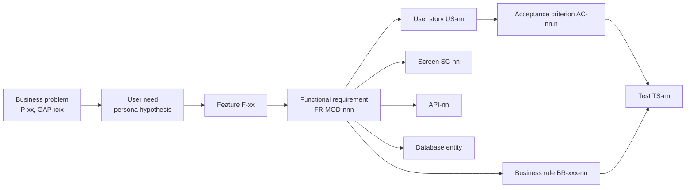

# 04 — REQUIREMENTS TRACEABILITY
## Problem → need → feature → requirement → story → acceptance → screen → API → entity → test, with the disconnected items listed

| Field | Value |
|---|---|
| Document ID | QA-04 (also satisfies deliverable 07_REQUIREMENTS_TO_DESIGN_TRACEABILITY) |
| Version | 0.1 (draft for founder review) |
| Last updated | 2026-11-12 |
| Owner | Product (CPO role) |
| Depends on | All PRD, SDD, wireframe and QA documents |
| Status | Draft. Not approved |

## 1. How the trace works

This document is **generated** from the same structured source as the functional requirements, stories, acceptance criteria, database design, screen inventory and test scenarios (`09-governance/traceability-data/spec.json`). A broken reference stops generation, so every ID below exists in its home document.

Business problems and user needs are carried by the research IDs in the third column: `GAP-…` (gap audit 04), `F-…` (features, gap audit 23), `CMP-…` and `MH-REQ-…` (legal research 51), `SEC-/PRV-/CPL-…` (gap audit 29). Their one-line statements are in `00-research-synthesis/00_MASTER_RESEARCH_SYNTHESIS.md` §3 and §7.

## 2. Forward trace matrix

| Requirement | Release | Research trace (problem, gap, feature, compliance) | Stories | Acceptance | Screens | APIs | Entities | Tests |
|---|---|---|---|---|---|---|---|---|
| FR-IAM-001 Tenant-scoped authentication and sessions | MVP-A | GAP-065, SEC-01 | US-35 | AC-35.1, AC-35.2 | SC-27 | API-07 | user_account, audit_event | TS-21, TS-35 |
| FR-IAM-002 Multi-factor authentication for privileged roles | MVP-A | GAP-065, SEC-03 | US-35 | AC-35.1, AC-35.2 | SC-27 | API-07 | user_account, approval | TS-35 |
| FR-IAM-003 Roles, permissions and attribute scopes | MVP-A | GAP-065, GAP-012, SEC-04 | US-36 | AC-36.1, AC-36.2 | SC-28 | API-40 | role, role_assignment, approval, audit_event | TS-36 |
| FR-IAM-004 Separation of duties | MVP-B | GAP-065, SEC-04, MH-REQ-02 | US-07 | AC-07.1, AC-07.2 | SC-02, SC-03 | API-20, API-25 | approval | TS-35, TS-42 |
| FR-IAM-005 Vendor support sessions | MVP-A | GAP-065, F-32, SEC-02 | US-29 | AC-29.1, AC-29.2, AC-29.3 | SC-14, SC-39 | API-08 | support_session, audit_event | TS-21, TS-37 |
| FR-IAM-006 API keys and service accounts | MVP-B | GAP-065, SEC-10 | US-22 | AC-22.1, AC-22.2, AC-22.3 | SC-13 | API-10 | api_key, audit_event | TS-13, TS-15, TS-34, TS-59 |
| FR-IAM-007 Distributor sign-in | MVP-B | GAP-051, GAP-035 | US-12 | AC-12.1 | SC-27, SC-37 | API-07 | user_account, participant | TS-17, TS-53 |
| FR-TEN-001 Tenant provisioning and data region | MVP-A | GAP-060, GAP-061, F-34, PRV-06 | US-31 | AC-31.1 | SC-39 | API-39 | tenant, tenant_setting_version | TS-57 |
| FR-TEN-002 Markets, brands, currencies and calendars | MVP-B | GAP-095, F-43, GAP-023 | US-37 | AC-37.1 | SC-29 | API-39 | market, brand, calendar, period | TS-59, TS-62 |
| FR-TEN-003 Versioned tenant settings | MVP-B | GAP-060, GAP-021 | US-37 | AC-37.1 | SC-29 | API-39 | tenant_setting_version, approval | TS-06, TS-59 |
| FR-TEN-004 Market launch checklist | MVP-B | GAP-004, CMP-12, CPL-11, FL-09 | US-38 | AC-38.1, AC-38.2 | SC-17 | API-39 | market, document, provider_config, approval | TS-50 |
| FR-TEN-005 Tenant archive and offboarding | V1 | GAP-098, GAP-096, F-44 | — | — | SC-39 | API-32 | tenant, export_job | — |
| FR-IMP-001 Export upload and schema validation | MVP-A | GAP-081, F-24, P4 | US-39 | AC-39.1, AC-39.2, AC-39.3 | SC-24 | API-01, API-02 | import_batch, import_row_error | TS-32, TS-33 |
| FR-IMP-002 Value mapping with versions | MVP-A | GAP-028, F-20, CMP-01, CMP-03 | US-40 | AC-40.1 | SC-25 | API-03 | import_mapping | TS-31, TS-33 |
| FR-IMP-003 Import batch lifecycle and data-quality report | MVP-A | GAP-081, GAP-102 | US-39 | AC-39.1, AC-39.2, AC-39.3 | SC-24 | API-01, API-02 | import_batch, cpl_fact_participant, cpl_fact_order, cpl_fact_payout_line | TS-32, TS-33 |
| FR-IMP-004 Read-only database connector | V1 | GAP-062, P4 | — | — | SC-24 | API-01 | import_batch | TS-32 |
| FR-CPL-001 Retail-customer share report (R1) | MVP-A | GAP-081, F-24, CMP-01, CPL-03 | US-24 | AC-24.1, AC-24.2 | SC-10, SC-46 | API-04, API-05 | compliance_report_snapshot, compliance_figure | TS-31, TS-59 |
| FR-CPL-002 Personal-use share of rewarded volume (R2) | MVP-A | GAP-081, GAP-005, F-24, CMP-02, CPL-03 | US-24 | AC-24.1, AC-24.2 | SC-10 | API-04, API-05 | compliance_report_snapshot, compliance_figure | TS-09, TS-26, TS-31, TS-59 |
| FR-CPL-003 Payout source mix (R3) | MVP-A | GAP-081, F-24, CMP-03, MH-REQ-09 | US-24 | AC-24.1, AC-24.2 | SC-10 | API-04, API-05 | compliance_report_snapshot, compliance_figure | TS-31, TS-59 |
| FR-CPL-004 Qualification-by-purchase and period-end threshold orders (R4) | MVP-A | GAP-005, CMP-02, F-24 | US-24 | AC-24.1, AC-24.2 | SC-10 | API-04, API-05 | compliance_report_snapshot, compliance_figure | TS-26, TS-31, TS-59 |
| FR-CPL-005 Earnings distribution over all participants (R5) | MVP-A | GAP-003, GAP-086, F-25, CMP-05, CPL-04 | US-25 | AC-25.1, AC-25.2 | SC-10 | API-04, API-05 | compliance_report_snapshot, compliance_figure | TS-31, TS-53, TS-59 |
| FR-CPL-006 Report snapshots, method versions and drill-down | MVP-A | GAP-081, GAP-027, F-12, ENT-21 | US-41 | AC-41.1 | SC-10, SC-26 | API-04, API-05, API-06 | compliance_report_snapshot, compliance_figure | TS-31, TS-34 |
| FR-CPL-007 Platform guardrails | MVP-B | GAP-087, F-26, CPL-01, CMP-14, CMP-16 | US-26 | AC-26.1, AC-26.2 | SC-04, SC-11 | API-16 | guardrail_rule, guardrail_decision | TS-26, TS-27, TS-31, TS-66 |
| FR-CPL-008 Guardrail overrides log | MVP-B | GAP-087, F-26 | US-26 | AC-26.1, AC-26.2 | SC-11 | API-16 | guardrail_decision | TS-26, TS-27, TS-66 |
| FR-CPL-009 Earnings disclosure publication and substantiation | V1 | GAP-086, GAP-003, F-25, CPL-04, CPL-05 | US-25 | AC-25.1, AC-25.2 | SC-23, SC-40 | API-05 | compliance_report_snapshot, document | TS-31, TS-59 |
| FR-CPL-010 Integrity signals | V1 | GAP-005, F-27 | US-33 | AC-33.1 | SC-45 | API-05 | integrity_signal | TS-26, TS-59 |
| FR-CPL-011 Approved-claims catalogue and disclosure feed | V1 | GAP-001, F-37, CPL-12 | — | — | SC-23 | API-33 | document | — |
| FR-CPL-012 Rule basis status in configuration | MVP-B | GAP-102, CPL-15 | US-38 | AC-38.1, AC-38.2 | SC-17 | API-39 | guardrail_rule, tax_rule | TS-50 |
| FR-CPL-013 Market-pack registers | MVP-B (market pack) | CMP-09, CMP-17, CPL-08, CPL-09 | — | — | SC-06 | API-30 | case | TS-68 |
| FR-PAR-001 Participant record and effective-dated participant types | MVP-B | GAP-028, F-20, CPL-02 | US-21 | AC-21.1, AC-21.2 | SC-09 | API-12 | participant, participant_type, participant_type_assignment | TS-31, TS-48 |
| FR-PAR-002 Enrolment intake with market gating | MVP-B | GAP-006, F-40, CPL-13 | US-42 | AC-42.1, AC-42.2 | SC-09 | API-12 | participant, position, relationship, agreement_acceptance | TS-45, TS-50, TS-59 |
| FR-PAR-003 Duplicate-account detection queue | MVP-B | GAP-002, F-04, FL-03 | US-43 | AC-43.1 | SC-08 | API-30 | case, participant | TS-59 |
| FR-PAR-004 Account types and ownership transfer | V1 | GAP-002, F-05, FL-04 | — | — | SC-08 | API-30 | position_ownership, case | — |
| FR-PAR-005 Participant and position status lifecycle | MVP-B | GAP-010, GAP-013 | US-23 | AC-23.1 | SC-09 | API-12 | participant, position | TS-02, TS-49, TS-64 |
| FR-PAR-006 Agreement versions and acceptance records | MVP-B | CMP-06 | US-42 | AC-42.1, AC-42.2 | SC-09 | API-12 | document, agreement_acceptance | TS-45, TS-46, TS-59 |
| FR-GEN-001 Positions separate from participants | MVP-B | GAP-010, F-01 | US-04 | AC-04.1, AC-04.2 | SC-09, SC-07 | API-12 | position, position_ownership | TS-22, TS-53 |
| FR-GEN-002 Effective-dated sponsor and placement relationships | MVP-B | GAP-010, F-02, ADR-03 | US-01 | AC-01.1, AC-01.2 | SC-07 | API-14, API-15 | relationship | TS-03, TS-61 |
| FR-GEN-003 Tree as of a date and as known at a time | MVP-B | GAP-010, F-02 | US-01 | AC-01.1, AC-01.2 | SC-07 | API-14 | relationship, path_node | TS-03, TS-61 |
| FR-GEN-004 Genealogy change and correction cases | MVP-B | GAP-002, F-03, FL-02 | US-02, US-03 | AC-02.1, AC-02.2, AC-03.1, AC-03.2 | SC-08 | API-15 | case, relationship | TS-03, TS-45, TS-59, TS-61 |
| FR-GEN-005 Serialised placement for binary and matrix plans | MVP-B | GAP-010, GAP-013, P1 | US-42 | AC-42.1, AC-42.2 | SC-07 | API-12 | relationship | TS-45, TS-59 |
| FR-GEN-006 Downline visibility policy enforced on the server | MVP-B | GAP-012, F-06, SEC-08 | US-05 | AC-05.1, AC-05.2 | SC-20 | API-13, API-34 | path_node, tenant_setting_version | TS-20, TS-34 |
| FR-GEN-007 Search-first genealogy explorer | MVP-B | GAP-012, GAP-055, F-07 | US-05 | AC-05.1, AC-05.2 | SC-07, SC-20 | API-13, API-14 | path_node | TS-20 |
| FR-GEN-008 Path read model and rebuild | MVP-B | GAP-011, ADR-04, ENT-07 | US-05 | AC-05.1, AC-05.2 | SC-07 | API-13 | path_node | TS-20, TS-64 |
| FR-GEN-009 Structure is never changed to implement a pay rule | MVP-B | GAP-013 | US-44 | AC-44.1, AC-44.2 | SC-04 | API-16 | plan_rule, relationship | TS-01, TS-02, TS-64 |
| FR-ORD-001 Order ingestion API with idempotency | MVP-B | GAP-045, F-21, ADR-08 | US-22 | AC-22.1, AC-22.2, AC-22.3 | SC-31, SC-13 | API-10 | order, order_line, inbound_event, product_volume_map | TS-13, TS-15, TS-47, TS-48, TS-59 |
| FR-ORD-002 Shopify and WooCommerce connectors | MVP-B | GAP-045, F-21 | US-22 | AC-22.1, AC-22.2, AC-22.3 | SC-13 | API-10, API-37 | provider_config, inbound_event | TS-13, TS-15, TS-59 |
| FR-ORD-003 Purpose tag and fixed order facts | MVP-B | GAP-028, F-20, CPL-02 | US-21 | AC-21.1, AC-21.2 | SC-31 | API-10 | order, order_line | TS-31, TS-48, TS-65 |
| FR-ORD-004 Returns, refunds, chargebacks and exchanges | MVP-B | GAP-047, GAP-046, F-23, CPL-07 | US-45 | AC-45.1, AC-45.2 | SC-31 | API-11 | order_event, late_transaction | TS-47, TS-65 |
| FR-ORD-005 Late-transaction queue | MVP-B | GAP-023, F-09 | US-08 | AC-08.1 | SC-32 | API-10, API-11 | late_transaction | TS-13 |
| FR-ORD-006 Subscription and dispute events | V1 | GAP-046 | — | — | SC-31 | API-11 | order_event | TS-65 |
| FR-CRM-001 Customer servicing relationship and attribution | MVP-B | GAP-040, F-22 | US-23 | AC-23.1 | SC-09, SC-21 | API-35 | customer_servicing, order | TS-48, TS-49, TS-65 |
| FR-CRM-002 Customer reassignment on termination | MVP-B | GAP-040, F-22, FL-15 | US-23 | AC-23.1 | SC-09 | API-35 | customer_servicing | TS-49 |
| FR-CRM-003 Distributor contacts and reminders | V1 | GAP-041 | — | — | SC-21 | API-28 | participant | — |
| FR-PLN-001 Plan versions | MVP-B | GAP-020, GAP-097, CMP-04, ENT-11 | US-27 | AC-27.1, AC-27.2 | SC-04 | API-16 | plan, plan_version, plan_rule | TS-01, TS-24, TS-46 |
| FR-PLN-002 Declarative primitive library | MVP-B | GAP-020, F-08, P1 | US-44 | AC-44.1, AC-44.2 | SC-04 | API-16 | plan_rule | TS-01, TS-02, TS-62, TS-63 |
| FR-PLN-003 Controlled extension point | MVP-B | GAP-020, P1, ADR-05 | US-44 | AC-44.1, AC-44.2 | SC-04 | API-16 | plan_rule | TS-01, TS-02, TS-67 |
| FR-PLN-004 Caps and pools configuration | MVP-B | GAP-022, F-13 | US-11 | AC-11.1, AC-11.2 | SC-05 | API-16, API-17 | plan_rule, simulation | TS-06, TS-07, TS-08, TS-09, TS-12 |
| FR-PLN-005 Simulation and version comparison | MVP-B | GAP-026, F-11 | US-10 | AC-10.1, AC-10.2, AC-10.3 | SC-04, SC-42 | API-17 | simulation, result_line | TS-46, TS-59 |
| FR-PLN-006 Golden datasets | MVP-B | GAP-026, F-11 | US-10 | AC-10.1, AC-10.2, AC-10.3 | SC-42 | API-17 | golden_dataset | TS-43, TS-44, TS-46, TS-59, TS-60 |
| FR-PLN-007 Plan-change governance | MVP-B | GAP-097, F-28, FL-08, CPL-06 | US-27 | AC-27.1, AC-27.2 | SC-44 | API-16 | plan_version, approval, document | TS-24, TS-46, TS-68 |
| FR-PLN-008 Transition rules between versions | MVP-B | GAP-097, GAP-025 | US-27 | AC-27.1, AC-27.2 | SC-44 | API-16 | plan_transition, qualification_state | TS-24, TS-25, TS-46 |
| FR-COMP-001 Calendars and period lifecycle | MVP-B | GAP-023, F-09, ENT-12 | US-06 | AC-06.1, AC-06.2, AC-06.3 | SC-01 | API-18 | calendar, period | TS-03, TS-13, TS-14, TS-58, TS-59, TS-60, TS-62 |
| FR-COMP-002 Run execution with snapshot, lock and idempotency | MVP-B | GAP-023, GAP-060, ENT-13 | US-06 | AC-06.1, AC-06.2, AC-06.3 | SC-01 | API-18 | run, run_snapshot, result_line | TS-01, TS-14, TS-29, TS-58, TS-59 |
| FR-COMP-003 Multi-pass calculation order | MVP-B | GAP-022, GAP-021, 13 §7.2 | US-14 | AC-14.1, AC-14.2, AC-14.3 | SC-02 | API-18 | result_line | TS-06, TS-09, TS-38, TS-39 |
| FR-COMP-004 Qualification state across periods | MVP-B | GAP-025, ENT-15 | US-46 | AC-46.1, AC-46.2 | SC-43, SC-19 | API-19 | qualification_state | TS-04, TS-05, TS-25, TS-59, TS-63 |
| FR-COMP-005 Run review | MVP-B | GAP-023, F-10 | US-06 | AC-06.1, AC-06.2, AC-06.3 | SC-02 | API-19 | run, result_line | TS-03, TS-14, TS-58, TS-59, TS-60 |
| FR-COMP-006 Commit with second-person approval | MVP-B | GAP-023, GAP-065, F-10 | US-07 | AC-07.1, AC-07.2 | SC-02 | API-20 | run, period, journal_entry, posting, approval, outbox_event | TS-03, TS-35, TS-42, TS-60 |
| FR-COMP-007 Per-line provenance and trace | MVP-B | GAP-027, F-12, ENT-14 | US-13 | AC-13.1 | SC-02, SC-06 | API-21 | result_line, run_snapshot | TS-53, TS-59 |
| FR-COMP-008 Replay of committed periods | MVP-B | GAP-010, GAP-023 | US-01 | AC-01.1, AC-01.2 | SC-01 | API-18 | run, run_snapshot | TS-03, TS-60 |
| FR-COMP-009 Restatement of a committed period | MVP-B | GAP-023, F-09, FL-07 | US-09 | AC-09.1 | SC-06 | API-22 | restatement, result_line, case | TS-51 |
| FR-COMP-010 Adjustment lines from late transactions and cases | MVP-B | GAP-023, GAP-032 | US-08 | AC-08.1 | SC-02 | API-19 | result_line, late_transaction | TS-13, TS-42 |
| FR-COMP-011 Provisional runs with true-up | V1 | P1, GAP-023 | — | — | SC-01 | API-18 | run | — |
| FR-COMP-012 Money arithmetic | MVP-B | GAP-021, F-14, ADR-06 | US-14 | AC-14.1, AC-14.2, AC-14.3 | SC-02 | API-18 | result_line, posting | TS-06, TS-07, TS-23, TS-38, TS-39, TS-67 |
| FR-FIN-001 Double-entry obligations ledger | MVP-B | GAP-030, F-15, ADR-07, MH-REQ-01 | US-14 | AC-14.1, AC-14.2, AC-14.3 | SC-33 | API-23 | ledger_account, journal_entry, posting | TS-06, TS-38, TS-39, TS-40 |
| FR-FIN-002 Derived payee balances | MVP-B | GAP-030, GAP-033 | US-14 | AC-14.1, AC-14.2, AC-14.3 | SC-33, SC-18 | API-23, API-28 | posting, ledger_account | TS-06, TS-38, TS-39, TS-40 |
| FR-FIN-003 Clawback policy and receivables | MVP-B | GAP-032, F-19, FL-06 | US-20 | AC-20.1, AC-20.2, AC-20.3 | SC-06, SC-33 | API-22, API-23 | posting, result_line | TS-10, TS-11 |
| FR-FIN-004 Write-off with approval | MVP-B | GAP-032 | US-20 | AC-20.1, AC-20.2, AC-20.3 | SC-33 | API-30 | posting, case | TS-10, TS-11 |
| FR-FIN-005 General-ledger journal export | MVP-B | GAP-033, F-15 | US-15 | AC-15.1 | SC-33 | API-24 | export_job, ledger_account | TS-59, TS-67 |
| FR-FIN-006 Non-cash rewards ledger | V1 | GAP-024, F-35 | — | — | SC-33 | API-23 | credit_type, posting | — |
| FR-FIN-007 Multi-currency with effective-dated rates | V1 | GAP-034, F-36 | — | — | SC-33 | API-23 | fx_rate | — |
| FR-PAY-001 Payout batch lifecycle | MVP-B | GAP-030, GAP-035, F-16, MH-REQ-02 | US-47 | AC-47.1, AC-47.2 | SC-03 | API-25 | payout_batch, payout_instruction, approval | TS-17, TS-40, TS-42 |
| FR-PAY-002 Provider adapters and bank-file fallback | MVP-B | GAP-004, F-16, ADR-09, MH-REQ-03 | US-16 | AC-16.1, AC-16.2, AC-16.3 | SC-03, SC-13 | API-25 | provider_config, payout_instruction | TS-16, TS-40, TS-41, TS-50 |
| FR-PAY-003 Signed, idempotent payout instructions through an outbox | MVP-B | GAP-035, SEC-06, ADR-10 | US-16 | AC-16.1, AC-16.2, AC-16.3 | SC-03 | API-25 | payout_instruction, outbox_event, posting | TS-16, TS-40, TS-41 |
| FR-PAY-004 Settlement reconciliation and returned payments | MVP-B | GAP-035, F-16, MH-REQ-04 | US-16 | AC-16.1, AC-16.2, AC-16.3 | SC-34 | API-26 | inbound_event, payout_instruction, posting, case | TS-16, TS-40, TS-41 |
| FR-PAY-005 Bank-detail versions and change controls | MVP-B | GAP-035, GAP-065, F-17, SEC-05, FL-10 | US-17 | AC-17.1, AC-17.2 | SC-22, SC-09 | API-27 | bank_detail_version, notification | TS-17, TS-59 |
| FR-PAY-006 Provider eligibility record | MVP-B | GAP-004, CPL-11, MH-REQ-10 | US-38 | AC-38.1, AC-38.2 | SC-17, SC-13 | API-39 | provider_config, document | TS-50 |
| FR-PAY-007 Minimum payout, holds and dormant balances | MVP-B | GAP-035 | US-47 | AC-47.1, AC-47.2 | SC-03 | API-25 | payout_batch, case | TS-17, TS-40 |
| FR-TAX-001 Payee tax profile | MVP-B | GAP-031, F-18 | US-48 | AC-48.1 | SC-22, SC-09 | API-27 | tax_profile | TS-18, TS-19, TS-56 |
| FR-TAX-002 Withholding rules per market | MVP-B (market pack) | GAP-031, F-18, CPL-10 | US-18, US-19 | AC-18.1, AC-18.2, AC-19.1 | SC-12 | API-39 | tax_rule, tax_line, posting | TS-18, TS-19, TS-38, TS-59 |
| FR-TAX-003 Year-end statements | MVP-B (market pack) | GAP-031, F-18, FL-14 | US-18 | AC-18.1, AC-18.2 | SC-12 | API-36 | tax_form, tax_line | TS-18, TS-38, TS-59 |
| FR-CAS-001 Case framework | MVP-B | GAP-002, GAP-065, ENT-06 | US-02 | AC-02.1, AC-02.2 | SC-06, SC-08 | API-30 | case, case_event, approval, document | TS-42, TS-45 |
| FR-CAS-002 Manual adjustments with thresholds and second approver | MVP-B | GAP-065, GAP-002 | US-49 | AC-49.1, AC-49.2 | SC-06 | API-30 | case, approval | TS-42, TS-59 |
| FR-CAS-003 Commission dispute from a statement line | MVP-B | GAP-002, GAP-027, FL-05, CMP-09 | US-50 | AC-50.1 | SC-18, SC-06 | API-30 | case, result_line | TS-59, TS-68 |
| FR-DIST-001 Distributor statement | MVP-B | GAP-027, GAP-003, F-38, MH-REQ-09, CPL-14 | US-04 | AC-04.1, AC-04.2 | SC-18, SC-37 | API-28 | statement, result_line, tax_line | TS-22, TS-53 |
| FR-DIST-002 Line explanation | MVP-B | GAP-027, F-12 | US-12 | AC-12.1 | SC-18 | API-29 | result_line | TS-20, TS-53 |
| FR-DIST-003 Rank status, factual | MVP-B | GAP-025, GAP-003, CPL-14 | US-51 | AC-51.1 | SC-19 | API-28 | qualification_state | TS-53, TS-63 |
| FR-DIST-004 Team view, privacy-limited | MVP-B | GAP-012, F-06, F-07 | US-05 | AC-05.1, AC-05.2 | SC-20 | API-34 | path_node | TS-20 |
| FR-DIST-005 My customers | MVP-B | GAP-040, GAP-050 | US-52 | AC-52.1 | SC-21 | API-28 | customer_servicing, order | TS-49 |
| FR-DIST-006 Bank details and tax profile self-service | MVP-B | GAP-035, GAP-031 | US-17 | AC-17.1, AC-17.2 | SC-22 | API-27 | bank_detail_version, tax_profile | TS-17, TS-59 |
| FR-DIST-007 Localisation and low-bandwidth delivery | MVP-B (market pack) | GAP-051 | US-34 | AC-34.1 | SC-18, SC-37 | API-28 | notification | TS-30, TS-54, TS-55 |
| FR-DIST-008 Notifications | MVP-B | GAP-035, GAP-097 | US-17 | AC-17.1, AC-17.2 | SC-38 | API-28 | notification, outbox_event | TS-17, TS-59, TS-68 |
| FR-DIST-009 Leader dashboard on customers served | V1 | GAP-050, F-39 | — | — | SC-20 | API-34 | order | TS-53 |
| FR-PRV-001 Data-subject requests | MVP-B | GAP-085, F-33, PRV-04, FL-12 | US-30 | AC-30.1 | SC-15, SC-41 | API-31 | privacy_request, case | TS-28 |
| FR-PRV-002 Erasure by pseudonymisation | MVP-B | GAP-085, ADR-13 | US-30 | AC-30.1 | SC-15 | API-31 | participant, privacy_request | TS-28 |
| FR-PRV-003 Retention timers | V1 | GAP-085, PRV-05 | — | — | SC-15 | API-31 | privacy_request | — |
| FR-PRV-004 Breach-notification contacts and runbook data | MVP-A | GAP-085, PRV-02 | US-53 | AC-53.1 | SC-29 | API-39 | tenant_setting_version | TS-50 |
| FR-AUD-001 Immutable audit log | MVP-A | GAP-065, SEC-09, ENT-24 | US-54 | AC-54.1, AC-54.2 | SC-30 | API-09 | audit_event, outbox_event | TS-34, TS-56 |
| FR-AUD-002 Export limits and logging | MVP-A | GAP-065, SEC-08, SEC-10 | US-54 | AC-54.1, AC-54.2 | SC-30, SC-26 | API-06 | export_job, audit_event | TS-34, TS-56 |
| FR-INT-001 Public API and webhooks | MVP-B | GAP-045, GAP-060 | US-22 | AC-22.1, AC-22.2, AC-22.3 | SC-13 | API-10, API-33 | api_key, webhook_endpoint, webhook_delivery | TS-13, TS-15, TS-34, TS-59 |
| FR-INT-002 Integration and sync health | MVP-B | GAP-060, B1 | US-55 | AC-55.1 | SC-13, SC-01 | API-37 | provider_config, inbound_event | TS-58 |
| FR-INT-003 Scheduled export of the full tenant data model | MVP-B | GAP-062, GAP-096, F-30 | US-32 | AC-32.1 | SC-13 | API-32 | export_job | TS-58 |
| FR-INT-004 Read-only analytical replica for dedicated tenants | V1 | GAP-062, F-31 | — | — | SC-13 | API-32 | tenant | TS-58 |
| FR-RPT-001 Role dashboards | MVP-B | GAP-055, GAP-050 | US-56 | AC-56.1 | SC-35, SC-46, SC-01 | API-05, API-19 | compliance_report_snapshot, run | TS-31, TS-58 |
| FR-RPT-002 Operational lists with saved views | MVP-B | GAP-055, GAP-062 | US-56 | AC-56.1 | SC-31, SC-33, SC-36 | API-23 | user_account | TS-34, TS-58 |
| FR-MIG-001 History import | MVP-B | GAP-077, F-29, FL-13 | US-28 | AC-28.1, AC-28.2 | SC-16 | API-38 | import_batch, relationship, qualification_state, journal_entry | TS-52 |
| FR-MIG-002 Parallel-run reconciliation | MVP-B | GAP-077, GAP-026, F-29 | US-28 | AC-28.1, AC-28.2 | SC-16 | API-38 | simulation, approval | TS-52 |
| FR-OPS-001 Vendor operations console | MVP-A | GAP-065, IC-13 | US-57 | AC-57.1 | SC-39 | API-08 | tenant, support_session | TS-37 |
| FR-AI-001 Run variance explainer | V1 | GAP-070, F-42 | — | — | SC-02 | API-19 | run | — |
| FR-AI-002 Plan-document-to-configuration assistant (internal) | V1 | GAP-071, F-41 | — | — | SC-04 | API-16 | plan_rule | — |
| FR-LIC-001 Licence entitlement for the self-hosted edition | V1 | DEC-17, GAP-075, GAP-096 | US-58 | AC-58.1, AC-58.2, AC-58.3, AC-58.4 | SC-47 | API-41 | license_entitlement | TS-69, TS-70, TS-71 |
| FR-LIC-002 Signed updates and market-pack distribution | V1 | DEC-17, GAP-031, GAP-102 | US-58 | AC-58.1, AC-58.2, AC-58.3, AC-58.4 | SC-47 | API-41 | license_entitlement, update_log | TS-50, TS-69, TS-70, TS-71 |
| FR-LIC-003 Self-hosted installation, diagnostics and support bundle | V1 | DEC-17, GAP-065, GAP-060 | US-58 | AC-58.1, AC-58.2, AC-58.3, AC-58.4 | SC-47 | API-41 | license_entitlement, update_log | TS-37, TS-69, TS-70, TS-71 |

## 3. End-to-end chains for the critical capabilities

| Business problem | User need | Feature | Requirement | Story | Acceptance | Screen | API | Entity | Test |
|---|---|---|---|---|---|---|---|---|---|
| Regulators and counsel ask what share of sales goes to real customers; no vendor computes it from transactions (GAP-081) | Compliance officer answers from the system | F-24 | FR-CPL-001 | US-24 | AC-24.1, AC-24.2 | SC-10, SC-46 | API-04, API-05 | `compliance_report_snapshot`, `compliance_figure` | TS-31 |
| A figure that cannot be explained is not evidence (GAP-027) | Open any figure to its rows | F-12-lite | FR-CPL-006 | US-41 | AC-41.1 | SC-26 | API-06 | `cpl_fact_*` | TS-34 |
| Past pay cannot be reproduced after genealogy corrections (GAP-010) | Analyst sees the tree as it was | F-02 | FR-GEN-002, FR-GEN-003, FR-COMP-008 | US-01 | AC-01.1, AC-01.2 | SC-07 | API-14, API-18 | `relationship`, `run_snapshot` | TS-03, TS-61 |
| Late orders silently change paid history or are lost (GAP-023) | Committed periods stay fixed | F-09 | FR-COMP-001, FR-ORD-005 | US-08 | AC-08.1 | SC-32 | API-10 | `period`, `late_transaction` | TS-13 |
| Cents do not reconcile (GAP-021, GAP-030) | Ledger reconciles to the minor unit | F-14, F-15 | FR-COMP-012, FR-FIN-001 | US-14 | AC-14.1..3 | SC-33 | API-23 | `journal_entry`, `posting` | TS-06, TS-38, TS-39 |
| Retried instructions pay twice (GAP-035) | Nobody paid twice | F-16 | FR-PAY-003, FR-PAY-004 | US-16 | AC-16.1..3 | SC-03, SC-34 | API-25, API-26 | `payout_instruction`, `outbox_event` | TS-16, TS-40, TS-41 |
| A cap applied to the wrong lines moves money between groups (GAP-022) | Cap behaves as the plan says | F-13 | FR-PLN-004 | US-11 | AC-11.1, AC-11.2 | SC-05 | API-16, API-17 | `plan_rule` | TS-07, TS-08, TS-09 |
| One insider or isolation bug is a multi-tenant incident (GAP-065) | Tenant controls vendor access; tenants isolated | F-32 | FR-IAM-005, FR-IAM-001 | US-29 | AC-29.1..3 | SC-14 | API-08 | `support_session`, `audit_event` | TS-21, TS-37 |
| Bank-detail change redirects payouts (GAP-035) | Payouts wait; payee is told | F-17 | FR-PAY-005 | US-17 | AC-17.1, AC-17.2 | SC-22 | API-27 | `bank_detail_version` | TS-17 |
| Distributors do not understand or trust pay (GAP-027, GAP-003) | See how a line was calculated | F-38, F-12 | FR-DIST-001, FR-DIST-002 | US-04, US-12 | AC-04.1, AC-04.2, AC-12.1 | SC-18 | API-28, API-29 | `statement`, `result_line` | TS-22, TS-53 |
| Switching fear blocks adoption (GAP-077) | Go live only when payouts match | F-29 | FR-MIG-001, FR-MIG-002 | US-28 | AC-28.1, AC-28.2 | SC-16 | API-38 | `simulation` | TS-52 |
| Platform could help configure an unlawful plan (GAP-087) | Blocked with a reason | F-26 | FR-CPL-007 | US-26 | AC-26.1, AC-26.2 | SC-04, SC-11 | API-16 | `guardrail_decision` | TS-26, TS-27, TS-66 |

## 4. Disconnected items (generated; nothing is hidden)

### 4.1 Requirements without screens

A requirement can legitimately have no screen when it is a system behaviour; each one below must be confirmed as such.

None.

### 4.2 Screens without requirements

A screen with no requirement must be removed or a requirement written.

None.

### 4.3 Requirements without acceptance criteria

By the gate rule in the research (22 §2) these are **not ready**. All are post-MVP unless marked.

- FR-TEN-005 Tenant archive and offboarding (V1)
- FR-IMP-004 Read-only database connector (V1)
- FR-CPL-011 Approved-claims catalogue and disclosure feed (V1)
- FR-CPL-013 Market-pack registers (MVP-B (market pack))
- FR-PAR-004 Account types and ownership transfer (V1)
- FR-ORD-006 Subscription and dispute events (V1)
- FR-CRM-003 Distributor contacts and reminders (V1)
- FR-COMP-011 Provisional runs with true-up (V1)
- FR-FIN-006 Non-cash rewards ledger (V1)
- FR-FIN-007 Multi-currency with effective-dated rates (V1)
- FR-DIST-009 Leader dashboard on customers served (V1)
- FR-PRV-003 Retention timers (V1)
- FR-INT-004 Read-only analytical replica for dedicated tenants (V1)
- FR-AI-001 Run variance explainer (V1)
- FR-AI-002 Plan-document-to-configuration assistant (internal) (V1)

### 4.4 Acceptance criteria without a test

Every criterion should be proven by at least one test scenario.

None.

### 4.5 Business rules without a test

Rules needing a test before the release in which they apply.

- BR-GEN-10 (V1, status C): Succession, divorce division and sale of a distributorship are transfers of position ownership with documents 
- BR-PER-07 (V1, status R): A provisional run is paid and later trued up by a final run that posts only the difference
- BR-REV-02 (MVP-B, status C): Whether a reversal changes a closed period or posts an adjustment is a tenant policy within platform rules. UN
- BR-TAX-04 (MVP-B (market pack), status S/C): Year-end statements are generated per market form with thresholds per tax year
- BR-CMP-09 (V1, status D): Currency conversion follows a tenant policy with an effective-dated rate table (original catalogue, narrowed b
- BR-CRD-01 (V1, status R): Each credit type has value, expiry, redemption scope and tax treatment flag
- BR-CRD-02 (V1, status D): Expiry posts a reversal of the credit liability and notifies the holder in advance
- BR-DAT-08 (V1, status D): Prospect data entered by a distributor is private to that distributor by default
- BR-DAT-10 (V1, status D): An archived tenant is read-only; data is retained per law and then deleted
- BR-DAT-11 (V1, status S): Each data class has a retention period per market; deletion jobs are logged
- BR-HON-02 (V1, status D): Wherever earnings are shown to participants or prospects, the published disclosure is linked when one exists
- BR-AI-01 (V1, status D): No model output may write to plans or the ledger; any AI text that mentions money must cite the lines it summa
- BR-LIC-05 (V1, status D): Both editions are built from one codebase with the same guardrails, honesty policy and ledger invariants; no e

### 4.6 Business rules not referenced by any requirement

Either a requirement should enforce the rule or the rule is context only.

None.

### 4.7 APIs without a requirement

An API with no business justification must be removed.

None.

### 4.8 Entities not referenced by any requirement

Each has an owner module; listed so that purpose is confirmed.

None.

### 4.9 Requirements with no test at all

- FR-TEN-005 Tenant archive and offboarding (V1)
- FR-CPL-011 Approved-claims catalogue and disclosure feed (V1)
- FR-PAR-004 Account types and ownership transfer (V1)
- FR-CRM-003 Distributor contacts and reminders (V1)
- FR-COMP-011 Provisional runs with true-up (V1)
- FR-FIN-006 Non-cash rewards ledger (V1)
- FR-FIN-007 Multi-currency with effective-dated rates (V1)
- FR-PRV-003 Retention timers (V1)
- FR-AI-001 Run variance explainer (V1)
- FR-AI-002 Plan-document-to-configuration assistant (internal) (V1)

### 4.10 Stories without a requirement

None.

## 5. Reading of the audit

- **Critical MVP capabilities are fully connected** (section 3): each has requirement, story, acceptance criteria, screen, API, entity and test.
- **Requirements without acceptance criteria are all post-MVP** except FR-CPL-013 (market-pack registers), which is only needed if the India pack is activated; they are not ready for build and are flagged in the readiness report.
- **Untested rules** are V1 rules, or rules whose content is unresolved (BR-REV-02, BR-TAX-04). A test is written when the rule is resolved.
- **UI components without defined behaviour:** component behaviour is defined in `07-ui-design/04_COMPONENT_LIBRARY.md`; screens drawn as wireframes list their components in the inventory. Thirteen screens have no drawn wireframe (inventory index); their behaviour is specified in text only.
- **What this audit cannot show:** whether the requirements are the *right* ones. That needs the Phase B evidence (interviews, design partner).
