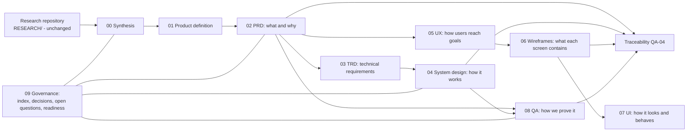

# 01 — DOCUMENTATION INDEX
## Master index of the product documentation (deliverable 09_DOCUMENTATION_INDEX)

| Field | Value |
|---|---|
| Document ID | GOV-01 |
| Version | 0.1 |
| Last updated | 2026-11-12 |
| Owner | Product (technical documentation role) |
| Status | Draft |

## 1. How to read the set

| If you are | Start with | Then |
|---|---|---|
| Founder or CEO | `00-research-synthesis/00_MASTER_RESEARCH_SYNTHESIS.md`, then `09-governance/04_DEVELOPMENT_READINESS_REPORT.md` | `01-product-definition/`, `09-governance/03_OPEN_QUESTIONS.md` |
| Product manager or business analyst | `02-prd/01_MASTER_PRODUCT_REQUIREMENTS_DOCUMENT.md` | Functional requirements, business rules, stories, acceptance criteria |
| System architect or backend developer | `04-system-design/01_SYSTEM_DESIGN_DOCUMENT.md` | Engine, genealogy, financial, database, API |
| Database engineer | `04-system-design/04_DATABASE_DESIGN.md` | ER diagrams |
| Designer or frontend developer | `05-ux/`, `06-wireframes/`, `07-ui-design/` | Screen inventory first |
| QA engineer | `08-qa/01_QA_AND_ACCEPTANCE_SPECIFICATION.md` | Test scenarios, edge cases, traceability |

## 2. Document register

All documents are **version 0.1, last updated 2026-11-12, approval status: Draft, not approved**. Approval needs the founder and, for the items named in the readiness report, an independent reviewer. "Generated" means produced from the structured source in `09-governance/traceability-data/source/`.

| Path | ID | Title | Owner | Depends on | Words | Generated |
|---|---|---|---|---|---|---|
| `00-research-synthesis/00_MASTER_RESEARCH_SYNTHESIS.md` | SYN-00 | 00 — MASTER RESEARCH SYNTHESIS. The single source of truth the product documents are built on | Product (CPO role) | — | 3,558 | No |
| `01-product-definition/01_PRODUCT_VISION.md` | PD-01 | 01 — PRODUCT VISION. What we are building, for whom, and the principles that bind every later decision | Founder / CPO role | SYN-00 | 1,300 | No |
| `01-product-definition/02_PRODUCT_STRATEGY.md` | PD-02 | 02 — PRODUCT STRATEGY. Sequence, gates, stop triggers, commercial model and risks | Founder / CPO role | SYN-00, PD-01; gap audit 31, 33, 35; Phase A | 1,476 | No |
| `01-product-definition/03_PRODUCT_MODULE_ARCHITECTURE.md` | PD-03 | 03 — PRODUCT MODULE ARCHITECTURE. Business-level modules, how they interact, and what happened to each of the brief's 25 candidates | CPO / CTO roles | SYN-00, PD-01; gap audit 15 §4, 23, 31 | 2,047 | No |
| `01-product-definition/04_MARKET_PACKS_INDIA_BANGLADESH.md` | PD-04 | 04 — MARKET PACKS: INDIA AND BANGLADESH. Content of the first two market packs, with the basis status of every item | Product, with advisers | DEC-19..21; research-completion 70–78 | 1,120 | No |
| `02-prd/01_MASTER_PRODUCT_REQUIREMENTS_DOCUMENT.md` | PRD-01 | 01 — MASTER PRODUCT REQUIREMENTS DOCUMENT. What is being built and why | Product (senior PM role) | SYN-00, PD-01..03 | 2,899 | No |
| `02-prd/02_FUNCTIONAL_REQUIREMENTS.md` | PRD-02 | 02 — FUNCTIONAL REQUIREMENTS. Every functional capability, by module, with full requirement records | Product (CPO role) | PRD-01, PRD-04 (business rules), PRD-05/06 (stories, acceptance), research gap audit 22–29 | 29,093 | Yes |
| `02-prd/03_NON_FUNCTIONAL_REQUIREMENTS.md` | PRD-03 | 03 — NON-FUNCTIONAL REQUIREMENTS. Measurable quality requirements, with the status of every number | CTO role | PRD-01; gap audit 08, 15, 16, 29; TRD-01 | 1,670 | No |
| `02-prd/04_BUSINESS_RULES.md` | PRD-04 | 04 — BUSINESS RULES. The rule catalogue: where each rule is set, its basis and how sure we are | Product (CPO role) | Research 13, 51; gap audit 24; Phase A P1 | 5,458 | Yes |
| `02-prd/05_USER_STORIES.md` | PRD-05 | 05 — USER STORIES. Stories with flows, tied to requirements and acceptance criteria | Product (CPO role) | PRD-02, PRD-06; gap audit 25 | 6,667 | Yes |
| `02-prd/06_ACCEPTANCE_CRITERIA.md` | PRD-06 | 06 — ACCEPTANCE CRITERIA. Given / When / Then criteria that QA can verify independently | Product (CPO role) | PRD-05; gap audit 26; QA-02 | 3,543 | Yes |
| `02-prd/07_MVP_AND_PRODUCT_ROADMAP.md` | PRD-07 | 07 — MVP AND PRODUCT ROADMAP. Two MVPs, what each contains, build order, and what is deferred or refused | Product | PD-02, PRD-02; gap audit 31 | 1,231 | No |
| `03-trd/01_TECHNICAL_REQUIREMENTS_DOCUMENT.md` | TRD-01 | 01 — TECHNICAL REQUIREMENTS DOCUMENT. The technical capabilities the system must provide and the constraints it must satisfy | CTO role | PRD-01..07; gap audit 08–10, 15, 16, 28, 29 | 2,436 | No |
| `03-trd/02_TECH_STACK_EVALUATION.md` | TRD-02 | 02 — TECHNOLOGY STACK EVALUATION. Alternatives compared against this product's needs, with a recommendation for each layer | CTO role | TRD-01; gap audit 08, 15, 28 | 1,980 | No |
| `03-trd/03_API_REQUIREMENTS.md` | TRD-03 | 03 — API REQUIREMENTS. Standards every endpoint must meet | CTO role | TRD-01; SDD-06 (API design and catalogue); gap audit 15 §6, 16 | 1,025 | No |
| `03-trd/04_SECURITY_REQUIREMENTS.md` | TRD-04 | 04 — SECURITY REQUIREMENTS. Security, privacy and fraud-prevention requirements with class and basis | Security architect role | TRD-01; gap audit 16, 29; SDD-10 (security architecture) | 1,850 | No |
| `03-trd/05_INTEGRATION_REQUIREMENTS.md` | TRD-05 | 05 — INTEGRATION REQUIREMENTS. Contracts with external systems: data, triggers, failure handling, security | CTO role | TRD-01, TRD-03; gap audit 07 (GAP-004), 10, 12; Phase A P2 | 1,543 | No |
| `04-system-design/01_SYSTEM_DESIGN_DOCUMENT.md` | SDD-01 | 01 — SYSTEM DESIGN DOCUMENT. The engineering blueprint: architecture choice, tenancy, events, failure and recovery | CTO / solution architect roles | PRD-01..07, TRD-01..05 | 2,418 | No |
| `04-system-design/02_HIGH_LEVEL_ARCHITECTURE.md` | SDD-02 | 02 — HIGH-LEVEL ARCHITECTURE. Components, their responsibilities and the main runtime flows | Solution architect role | SDD-01, TRD-02 | 1,124 | No |
| `04-system-design/03_MODULE_DESIGN.md` | SDD-03 | 03 — MODULE DESIGN. Module-level architecture: components, interfaces, data ownership, events, failure handling | Engineering lead role | SDD-01, SDD-02, SDD-04, PD-03 | 1,685 | No |
| `04-system-design/04_DATABASE_DESIGN.md` | SDD-04 | 04 — DATABASE DESIGN. Every table: purpose, columns, keys, constraints, indexes, tenant ownership, audit | Product (CPO role) | SDD-01, SDD-05 (ER diagrams), PRD-04; gap audit 28 | 13,319 | Yes |
| `04-system-design/05_ER_DIAGRAMS.md` | SDD-05 | 05 — ER DIAGRAMS. Entity-relationship diagrams by domain, generated from the table definitions | Product (CPO role) | SDD-04 | 2,249 | Yes |
| `04-system-design/06_API_DESIGN.md` | SDD-06 | 06 — API DESIGN. API boundaries, the endpoint catalogue and representative specifications | Backend architect role | TRD-03 (standards), PRD-02, SDD-03 | 3,052 | Yes |
| `04-system-design/07_COMPENSATION_ENGINE_DESIGN.md` | SDD-07 | 07 — COMPENSATION ENGINE DESIGN. Configuration model, execution, periods, versioning, snapshots, reversals, simulation and audit | Financial systems architect role | TRD-01 §4; PRD-04; research 13; gap audit 09; Phase A P1 | 2,879 | No |
| `04-system-design/08_GENEALOGY_ENGINE_DESIGN.md` | SDD-08 | 08 — GENEALOGY ENGINE DESIGN. Positions, bitemporal relationships, traversal, change, history, performance and cache invalidation | Database / backend architect roles | TRD-01 §5; SDD-04; gap audit 08 | 1,802 | No |
| `04-system-design/09_FINANCIAL_SYSTEM_DESIGN.md` | SDD-09 | 09 — FINANCIAL SYSTEM DESIGN. Obligations ledger, postings, payouts, reversals, chargebacks, reconciliation, idempotency and approvals | Financial systems architect role | TRD-01 §6; SDD-04; SDD-07; gap audit 10; research 51 §5 | 2,181 | No |
| `04-system-design/10_SECURITY_ARCHITECTURE.md` | SDD-10 | 10 — SECURITY ARCHITECTURE. Threat model, trust boundaries, tenant isolation strategy and control design | Cybersecurity architect role | TRD-04; SDD-01 §3; gap audit 16 | 2,471 | No |
| `04-system-design/11_DEPLOYMENT_ARCHITECTURE.md` | SDD-11 | 11 — DEPLOYMENT ARCHITECTURE. Development, staging and production environments; pipeline; operations; the self-hosted package | DevOps architect role | TRD-01 §8, TRD-02, SDD-01 | 1,604 | No |
| `05-ux/01_UX_DESIGN_SPECIFICATION.md` | UX-01 | 01 — UX DESIGN SPECIFICATION. UX principles, role-specific experiences and UX quality requirements | UX architect role | PRD-01 §3; gap audit 13, 14, 27 | 1,977 | No |
| `05-ux/02_INFORMATION_ARCHITECTURE.md` | UX-02 | 02 — INFORMATION ARCHITECTURE. Applications, navigation by role, modules, pages, settings, search, notifications, profile | UX architect role | UX-01; WF-01 (screen inventory); gap audit 14 §2 | 1,738 | No |
| `05-ux/03_APPLICATION_SITEMAP.md` | UX-03 | 03 — APPLICATION SITEMAP. Every route, the screen behind it, and who can reach it | UX architect role | UX-02; WF-01 | 967 | No |
| `05-ux/04_USER_JOURNEYS.md` | UX-04 | 04 — USER JOURNEYS. Complete journeys for the important workflows, with decision points, errors and alternative flows | UX architect role | UX-01..03; PRD-05; gap audit 27 (flows FL-01..FL-15) | 2,206 | No |
| `05-ux/05_INTERACTION_DESIGN.md` | UX-05 | 05 — INTERACTION DESIGN. Behaviour of forms, tables, filters, search, overlays, bulk actions, confirmations, notifications and states | UX architect role | UX-01; UI-04 (component library defines appearance; this document defines behaviour) | 2,168 | No |
| `06-wireframes/01_SCREEN_INVENTORY.md` | WF-01 | 01 — SCREEN INVENTORY. Master list of screens with purpose, content, permissions and trace | Product (CPO role) | UX-02 (IA), PRD-02; gap audit 27 | 7,679 | Yes |
| `06-wireframes/02_WIREFRAMING_SPECIFICATION.md` | WF-02 | 02 — WIREFRAMING SPECIFICATION. Layout templates, structural rules, screen states and what has actually been drawn | UX architect role | WF-01 (inventory), UX-02, UX-05; gap audit 14, 27 | 2,450 | No |
| `06-wireframes/03_ADMIN_WIREFRAMES.md` | WF-03 | 03 — ADMIN WIREFRAMES. Staff application and vendor console: low-fidelity wireframes and per-screen structure | UX architect role | WF-01 (inventory), WF-02 (specification), UX-02, UX-05 | 4,968 | Yes |
| `06-wireframes/04_DISTRIBUTOR_WIREFRAMES.md` | WF-04 | 04 — DISTRIBUTOR WIREFRAMES. Distributor portal at desktop and tablet width | UX architect role | WF-01 (inventory), WF-02 (specification), UX-02, UX-05 | 1,032 | Yes |
| `06-wireframes/05_CUSTOMER_WIREFRAMES.md` | WF-05 | 05 — CUSTOMER WIREFRAMES. Customer-facing touchpoints, and why there are so few | UX architect role | WF-01 (inventory), WF-02 (specification), UX-02, UX-05 | 700 | Yes |
| `06-wireframes/06_MOBILE_WIREFRAMES.md` | WF-06 | 06 — MOBILE WIREFRAMES. Phone layouts for the distributor portal and public pages; mobile behaviour of staff approvals | UX architect role | WF-01 (inventory), WF-02 (specification), UX-02, UX-05 | 1,325 | Yes |
| `07-ui-design/01_UI_DESIGN_DIRECTION.md` | UI-01 | 01 — UI DESIGN DIRECTION. Visual personality, brand direction, interface style and the reasons for each choice | UI designer / design system architect roles | UX-01, UX-05, WF-02 | 1,317 | No |
| `07-ui-design/02_DESIGN_SYSTEM.md` | UI-02 | 02 — DESIGN SYSTEM. How the visual system is organised, governed and made accessible | Design system architect role | UI-01; UX-05 | 1,257 | No |
| `07-ui-design/03_DESIGN_TOKENS.md` | UI-03 | 03 — DESIGN TOKENS. Semantic tokens for colour, type, space, shape, elevation, layout, motion and icons | Design system architect role | UI-01 | 1,945 | No |
| `07-ui-design/04_COMPONENT_LIBRARY.md` | UI-04 | 04 — COMPONENT LIBRARY. Base and advanced components: anatomy, variants, states, behaviour, accessibility | Design system architect role | UI-03 (tokens), UX-05 (interaction rules), UI-02 §4 (accessibility) | 2,805 | No |
| `07-ui-design/05_RESPONSIVE_DESIGN.md` | UI-05 | 05 — RESPONSIVE DESIGN. Desktop, tablet and mobile behaviour, with the distributor phone experience first | UI designer role | UI-03 §6 (breakpoints), WF-02 §4, WF-06 | 1,324 | No |
| `08-qa/01_QA_AND_ACCEPTANCE_SPECIFICATION.md` | QA-01 | 01 — QA AND ACCEPTANCE SPECIFICATION. How we prove the product works: strategy, test types, verified calculations, release gates | QA architect role | PRD-02, PRD-04, PRD-06; SDD-07, SDD-09; gap audit 30 | 2,922 | No |
| `08-qa/02_TEST_SCENARIOS.md` | QA-02 | 02 — TEST SCENARIOS. The test catalogue with expected results and the criteria and rules each test proves | Product (CPO role) | QA-01, PRD-06, PRD-04; gap audit 30 | 3,024 | Yes |
| `08-qa/03_EDGE_CASES.md` | QA-03 | 03 — EDGE CASES. Edge cases for complex workflows, with the expected behaviour and where it is specified | QA architect role | QA-01, QA-02; research 13 §5; gap audit 08 §2, 09 §3, 15 §3 | 3,408 | No |
| `08-qa/04_REQUIREMENTS_TRACEABILITY.md` | QA-04 (also satisfies deliverable 07_REQUIREMENTS_TO_DESIGN_TRACEABILITY) | 04 — REQUIREMENTS TRACEABILITY. Problem → need → feature → requirement → story → acceptance → screen → API → entity → test, with the disconnected items listed | Product (CPO role) | All PRD, SDD, wireframe and QA documents | 4,988 | Yes |
| `09-governance/02_DECISION_LOG.md` | GOV-02 | 02 — DECISION LOG. Important decisions with context, alternatives, reasoning, consequences and status | Founder (product and strategy decisions); CTO role (architecture decisions) | — | 1,905 | No |
| `09-governance/03_OPEN_QUESTIONS.md` | GOV-03 | 03 — OPEN QUESTIONS AND ASSUMPTIONS. What is not decided, not known or only assumed (deliverable 11_OPEN_QUESTIONS_AND_ASSUMPTIONS) | Founder | Research 66; gap audit 35; SYN-00 | 1,914 | No |
| `09-governance/04_DEVELOPMENT_READINESS_REPORT.md` | GOV-04 | 04 — DEVELOPMENT READINESS REPORT. Final audit of the documentation set and the readiness gate | Founder; CPO and CTO roles | Every document in the set | 1,977 | No |
| `09-governance/01_DOCUMENTATION_INDEX.md` | GOV-01 | This index | Product | All | — | No |

## 3. Other files

| Path | Content |
|---|---|
| `06-wireframes/wireframes/*.svg` | 42 low-fidelity wireframes (34 screens, 8 phone variants) |
| `08-qa/verification/verify_calculations.py`, `verification_output.txt` | Test oracle for every calculated expected value, and its output (55 of 55 checks pass). Run with `python3 -I verify_calculations.py`. Not application code |
| `09-governance/traceability-data/spec.json` | Machine-readable requirements, stories, criteria, rules, tests, screens, APIs and entities |
| Sibling folder `research-completion` (outside this set) | Phase 2 research (Bangladesh, India) and reconstructions of the three missing research documents; see its README |
| `09-governance/traceability-data/source/` | The structured source and generator scripts for the generated documents and wireframes; see its README |

## 4. Mapping to the brief's deliverable names

| Brief deliverable | Where |
|---|---|
| 00_MASTER_RESEARCH_SYNTHESIS | `00-research-synthesis/00_MASTER_RESEARCH_SYNTHESIS.md` |
| 01_MASTER_PRODUCT_REQUIREMENTS_DOCUMENT | `02-prd/` (7 files) |
| 02_TECHNICAL_REQUIREMENTS_DOCUMENT | `03-trd/` (5 files) |
| 03_SYSTEM_DESIGN_DOCUMENT | `04-system-design/` (11 files) |
| 04_UX_DESIGN_SPECIFICATION | `05-ux/` (5 files) |
| 05_COMPLETE_WIREFRAMING_SPECIFICATION | `06-wireframes/` (6 files and the SVG wireframes) |
| 06_UI_DESIGN_SYSTEM | `07-ui-design/` (5 files) |
| 07_REQUIREMENTS_TO_DESIGN_TRACEABILITY | `08-qa/04_REQUIREMENTS_TRACEABILITY.md` |
| 08_QA_AND_ACCEPTANCE_SPECIFICATION | `08-qa/` (4 files) |
| 09_DOCUMENTATION_INDEX | this file |
| 10_DECISION_LOG | `09-governance/02_DECISION_LOG.md` |
| 11_OPEN_QUESTIONS_AND_ASSUMPTIONS | `09-governance/03_OPEN_QUESTIONS.md` |
| Development readiness report | `09-governance/04_DEVELOPMENT_READINESS_REPORT.md` |

## 5. ID schemes

| Prefix | Artefact | Home document |
|---|---|---|
| `FR-<MOD>-nnn` | Functional requirement | PRD-02 |
| `NFR-<AREA>-nn` | Non-functional requirement | PRD-03 |
| `BR-<GRP>-nn` | Business rule | PRD-04 |
| `US-nn`, `AC-nn.n` | User story, acceptance criterion | PRD-05, PRD-06 |
| `TR-<AREA>-nn` | Technical requirement | TRD-01, -03, -05 |
| `SEC-nn`, `PRV-nn`, `CPL-nn` | Security, privacy, compliance requirement | TRD-04 |
| `SC-nn` | Screen | WF-01 |
| `UJ-nn` | User journey | UX-04 |
| `API-nn` | API endpoint group | SDD-06 |
| `TS-nn`, `E-<GRP>-nn` | Test scenario, edge case | QA-02, QA-03 |
| `DEC-nn`, `ADR-nn` | Decision, architecture decision | GOV-02 |
| `FD-nn`, `OQ-nn`, `AQ-nn`, `Q-n` | Founder decision, open question, adviser question, counsel question | GOV-03 |
| `GAP-nnn`, `F-nn`, `CMP-nn`, `MH-REQ-nn`, `P-nn`, `S-nnn`, `G-Snn` | Research IDs (gap, feature, compliance requirement, payout requirement, problem, sources) | Research repository; summarised in SYN-00 |

## 6. Change control

1. Change the structured source or the hand-written document.
2. Regenerate (source README) and run the consistency checks (IDs, links, diagrams).
3. Record any decision in the decision log and any new unknown in the open questions.
4. Raise the version of the changed documents and update this index.
5. Approval by the document owner; founder approval for PRD-01, PD-01..03 and GOV-04.
