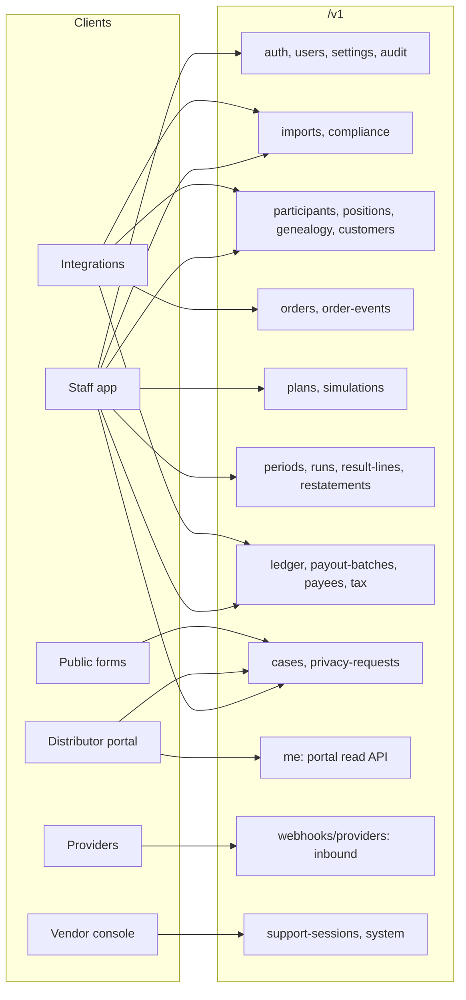

# 06 — API DESIGN
## API boundaries, the endpoint catalogue and representative specifications

| Field | Value |
|---|---|
| Document ID | SDD-06 |
| Version | 0.1 (draft for founder review) |
| Last updated | 2026-11-12 |
| Owner | Backend architect role |
| Depends on | TRD-03 (standards), PRD-02, SDD-03 |
| Status | Draft. Contracts are representative, not final OpenAPI; every endpoint traces to a requirement (catalogue column *Requirements*) |

## 1. API boundaries

| Boundary | Audience | Authentication | Notes |
|---|---|---|---|
| Staff API | Staff web application | OIDC token (staff realm) | Same endpoints are available to tenant automation with API keys where the scope exists |
| Portal API (`/v1/me/...`) | Distributors | OIDC token (portal realm) | Read-mostly; every response filtered to self or permitted downline |
| Integration API | Commerce connectors, tenant systems | API key with scopes | Writes are idempotent |
| Provider webhooks | Payout providers | Provider signature | No tenant token; tenant resolved from the endpoint path secret and provider account |
| Vendor API | Vendor console | OIDC token (vendor realm) | Tenant business data only inside an approved support session |
| Public | Privacy request form; (V1) disclosure page | None; strict rate limits and bot protection | No data returned beyond confirmation |

The API is one surface in one deployable. Module facades sit behind it; the API layer contains no business logic.

## 2. Endpoint catalogue

Paths list the main resource; sub-resources named in *Purpose* follow the same standards.

