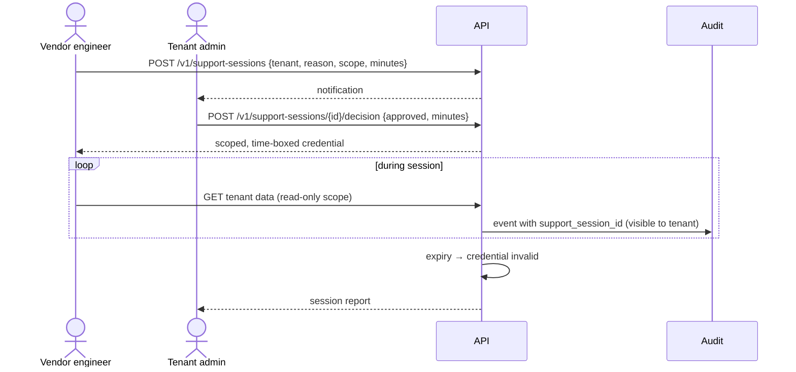

## 3. Representative specifications

Format: endpoint and method · authentication · authorisation · request · response · validation · error codes · idempotency.

### 3.1 API-01 `POST /v1/imports` (MVP-A)

| Item | Specification |
|---|---|
| Authentication / authorisation | Staff token; `import.manage` |
| Request | `multipart/form-data`: `market` (code), `period_from`, `period_to` (YYYY-MM), files `participants`, `orders`, `payout_lines` |
| Response `202` | `{ "id": "…", "state": "uploaded", "links": { "self": "/v1/imports/{id}" } }` |
| Validation | Synchronous: file presence, size limit, content type. Asynchronous: schema, keys, references, forbidden columns |
| Errors | `400 FILE_MISSING` · `413 FILE_TOO_LARGE` · `422 MARKET_UNKNOWN` · async outcome `rejected` with `FORBIDDEN_COLUMN`, `SCHEMA_MISMATCH`, `ORPHAN_REFERENCE`, `DUPLICATE_KEY` rows |
| Idempotency | `Idempotency-Key` required; replay returns the same batch |

### 3.2 API-04 `POST /v1/compliance/snapshots` (MVP-A)

```json
// request
{ "market": "DEMO", "period_from": "2025-01", "period_to": "2025-12", "reports": ["R1","R2","R3","R4","R5"] }
// response 202
{ "id": "snp_…", "state": "computing" }
// GET /v1/compliance/snapshots/{id} → 200
{ "id": "snp_…", "state": "ready", "method_version": "1.0", "mapping_version": 3,
  "inputs": { "batches": ["imp_…"] },
  "figures": [
    { "report": "R1", "period": "2025-01", "key": "customer_share_pct", "value": "62.50",
      "numerator_minor": 10000, "denominator_minor": 16000, "population_count": 3,
      "rows": "/v1/compliance/snapshots/snp_…/figures/R1.2025-01.customer_share_pct/rows" } ] }
```

| Item | Specification |
|---|---|
| Authorisation | `snapshot.create` (create); `compliance.read` (read) |
| Validation | Period range within loaded batches; reports from the allowed set |
| Errors | `422 NO_DATA_FOR_RANGE` · `409 INPUTS_CHANGING` (a load is in progress) |
| Idempotency | Key required; a snapshot is immutable, later state only `outdated` |

### 3.3 API-10 `POST /v1/orders`

```json
{ "source_system": "shopify", "source_order_id": "5123998", "market": "MY",
  "buyer": { "external_ref": "C-88121", "type_hint": "customer" },
  "attribution": { "kind": "link", "position_ref": "POS-000123" },
  "purpose": "customer",
  "paid_at": "2027-03-28T09:15:00+08:00", "fulfilled_at": null,
  "currency": "MYR", "amount_minor": 25900, "tax_minor": 1554,
  "lines": [ { "line_no": 1, "sku": "SKU-1001", "quantity": 1, "amount_minor": 25900 } ] }
```

| Item | Specification |
|---|---|
| Authentication / authorisation | API key; scope `orders:write`; key's market scope includes `market` |
| Response | `201` with order id, resolved `buyer_type`, `attributed_position`, `period_id`, per-line `volumes`; `200` on replay |
| Validation | Σ line amounts = amount; currency = market currency; market Live; quantity > 0; timestamps not in the future beyond tolerance |
| Processing | Volumes from `product_volume_map` at the crediting event time; facts fixed; period assigned; if that period is committed → late transaction (response includes `"late": true`) |
| Errors | `401`, `403` · `422 MARKET_NOT_LIVE` · `422 UNKNOWN_SKU` (order accepted into the exception queue with `202` when the tenant enables hold-and-map) · `409 IDEMPOTENCY_CONFLICT` |
| Idempotency | Key required; natural key `(source_system, source_order_id)`; a changed body for an existing order is rejected: changes arrive as order events |

### 3.4 API-18 `POST /v1/periods/{id}/runs` and API-20 `POST /v1/runs/{id}/commit`

| Item | Start run | Commit |
|---|---|---|
| Authentication | Staff token | Staff token with factor verified inside the step-up window |
| Authorisation | `run.execute` | `run.commit`; caller is not the run's preparer or a contributor |
| Request | Header `Run-Request-Id` | `{ "acknowledged_exceptions": ["exc_…"] }` |
| Response | `202 { "run_id", "state": "queued" }`; same id for a concurrent or repeated request | `200 { "run_id", "state": "committed", "journal_entry_id", "totals" }` |
| Validation | Period at or past cut-off and in state Open or Calculated; sync healthy | Run Calculated and latest for the period; review opened; no blocking exception |
| Errors | `409 PERIOD_COMMITTED` · `422 SYNC_BEHIND` (with `last_sync_at`) · `422 BEFORE_CUTOFF` | `403 STEP_UP_REQUIRED` · `422 SOD_SELF_APPROVAL` · `409 RUN_SUPERSEDED` · `500 INVARIANT_FAILED` (transaction rolled back, alert) |
| Idempotency | `Run-Request-Id` | `Idempotency-Key`; a second commit returns the first result |

### 3.5 API-14 `GET /v1/genealogy/tree`

`GET /v1/genealogy/tree?root=POS-000123&kind=sponsor&as_of=2027-03-15&known_at=2027-04-01T00:00:00Z&depth=2&limit=100`

| Item | Specification |
|---|---|
| Authorisation | `genealogy.read` (staff). Distributors use API-13 and API-34, which apply the visibility policy |
| Response | `{ "root": {...}, "data": [ { "position_ref", "parent_ref", "depth", "status", "paid_as_rank", "children_count" } ], "next_cursor", "read_model": "current" }` (or `"system_of_record"` when the read model is stale or a historical view is requested) |
| Validation | `depth` ≤ 5 per request; `known_at` ≤ now; `as_of` required when `known_at` is given |
| Errors | `404` root unknown or outside scope |

### 3.6 API-15 `POST /v1/genealogy-cases`

```json
{ "type": "correction", "kind": "sponsor", "position_ref": "POS-000456",
  "proposed_parent_ref": "POS-000789", "valid_from": "2027-01-10",
  "reason_code": "DATA_ENTRY_ERROR", "evidence_document_ids": ["doc_…"] }
```

| Item | Specification |
|---|---|
| Response `201` | Case with `policy_check` (window result, approvals needed), `structural_check` (cycle, slot), `affected_periods` and `estimated_impact` for corrections |
| Errors | `422 GEN_CYCLE` · `422 OUTSIDE_CHANGE_WINDOW` · `422 GEN_SLOT_TAKEN` · `422 EVIDENCE_REQUIRED` |
| Decision | `POST /v1/genealogy-cases/{id}/decision` `{ "decision": "approved" }` by a different user with `case.genealogy.approve` |

### 3.7 API-25 `POST /v1/payout-batches`

| Item | Specification |
|---|---|
| Request | `{ "market": "MY", "provider_config_id": "…", "periods": ["per_…"], "include_carried": true }` |
| Response `201` | Batch in Draft with `total_minor`, `count`, `exclusions: [ { "payee", "reason": "COOLING_OFF" or "BELOW_MINIMUM" or "HOLD" or "TAX_PROFILE_MISSING" or "DUPLICATE_CASE" } ]` |
| Sub-resources | `/submit` (preparer) · `/approve` (approver, step-up) · `/retry-failed` |
| Validation | Provider eligible and on the allow-list; instruction amount ≤ payee payable at approval time (re-checked in the approval transaction) |
| Errors | `422 PROVIDER_NOT_ELIGIBLE` · `422 SOD_SELF_APPROVAL` · `409 BALANCE_CHANGED` (batch returns to Draft) |
| Idempotency | Key on create and on each transition |

### 3.8 API-26 `POST /v1/webhooks/providers/{provider}` (inbound)

| Item | Specification |
|---|---|
| Authentication | Provider signature over the raw body; timestamp tolerance |
| Processing | Store `inbound_event` (dedupe on provider event id) → `2xx` → worker maps to instruction by provider reference → ledger entry 3 or 4 (SDD-09) |
| Errors | `401` bad signature · unknown reference becomes a reconciliation exception, still `2xx` |

### 3.9 API-27 `PUT /v1/payees/{id}/bank-details`

| Item | Specification |
|---|---|
| Authentication | Portal token with re-authentication inside the last minutes (step-up), or staff acting through an approved case |
| Request | Market-specific bank fields; never logged |
| Response `201` | `{ "version_id", "masked": "•••• 4821", "cooling_off_until": "…" }` |
| Side effects | Notices to previous and new contact; hold on payouts inside cooling-off; fraud signal if the fingerprint is shared above the threshold |
| Errors | `403 STEP_UP_REQUIRED` · `422 INVALID_BANK_DETAILS` |

### 3.10 API-28 / API-29 portal statements

`GET /v1/me/statements?limit=12` → list of periods with `net_minor`, `payout_status`.
`GET /v1/me/statements/{run_id}` →

```json
{ "period": "2027-03", "currency": "MYR",
  "totals": { "gross_minor": 123456, "withheld_minor": 2469, "clawback_minor": 0, "adjustment_minor": 0, "net_minor": 120987 },
  "positions": [ { "position_ref": "POS-000123", "paid_as_rank": "R2",
     "lines": [ { "id": "rl_…", "bonus": "unilevel", "amount_minor": 12500, "explain": "/v1/me/statement-lines/rl_…/explanation" } ] } ],
  "payout": { "status": "settled", "date": "2027-04-05" },
  "disclosure_url": null }
```

`GET /v1/me/statement-lines/{id}/explanation` → `{ "title": "Level 2 commission", "sentences": ["5% of 2,500.00 commissionable volume from 2 orders on your second level."], "inputs": { "rate": "5%", "base": "2,500.00", "rank_used": "R1", "period": "March 2027", "rounding": "to the nearest sen" } }`. No other person's name or contact appears. Responses for committed runs are cacheable. **No endpoint returns a projection of future or potential earnings.**

### 3.11 API-08 support sessions



## 4. Webhook event catalogue (outbound)

| Event | Payload ids | When |
|---|---|---|
| `compliance.snapshot.ready` | snapshot | Snapshot computed |
| `run.committed` | run, period, totals | Commit |
| `period.closed` | period | Close |
| `payout.batch.approved` | batch | Approval |
| `payout.settled` / `payout.returned` / `payout.failed` | instruction, batch | Reconciliation |
| `plan.version.activated` | plan, version | Activation |
| `case.decided` | case, type, decision | Decision |

## 5. Consistency checks against requirements

- Every endpoint in the catalogue names at least one functional requirement (generated; none is orphaned: QA-04 §4.7).
- No mutation endpoint exists for immutable resources (TRD-03 §4).
- Role-specific dashboards in the UX documents are served by the same endpoints with permission and scope filters; no separate "dashboard API" bypasses authorisation.
