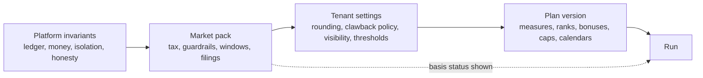

## 3. Unresolved rules (not invented here)

These decisions are open in the research. The product is designed so that either answer is configuration, and the provisional default is named. None is treated as settled.

| ID | Open rule | Why open | Options | Provisional default used in these documents | Who decides |
|---|---|---|---|---|---|
| D-R1 | The crediting event that assigns volume to a period | Depends on market law (cooling-off) and tenant policy; research left open (BR-PER-02) | Payment · shipment · end of cooling-off | Configurable per plan version; no default value shipped | Tenant with counsel |
| D-R2 | Whether a reversal may alter a closed period | Legal and policy question (13 EX-8; 11 §7) | Adjust in open period · restate | Adjust in the open period; restatement only by approved request (BR-PER-04, BR-PER-05) | Tenant with counsel |
| D-R3 | Negative balance after clawback | Practice varies (S-124) | Carry · write off · collect | Carry as receivable, net against future earnings, write off with approval; never debit a bank account (BR-REV-07..09) | Tenant with counsel (Q-10) |
| D-R4, D-R6 | Which configurations the platform blocks, warns on or reports | Founder decision FD-06 and counsel question Q-1 | Strict · Moderate · Neutral | Moderate (BR-GRD-01..05) | Founder with counsel |
| D-R5 | Not identifiable | Defined only in the missing original catalogue | — | — | See OQ-22 |
| — | Withholding rates, thresholds and forms per market | Screening-grade sources only (GAP-031) | — | None shipped; market pack values need a tax adviser (BR-TAX-01..04) | Tax adviser (FD-05) |
| — | Whether distributor-entered prospect data makes the distributor a controller | GAP-041 | — | Tenant is controller, platform is processor, data private to the distributor (BR-DAT-08) | Counsel |
| — | Succession, divorce and sale of a distributorship | GAP-002; legal per market | — | Transfer case with documents (BR-GEN-10), V1 | Counsel |
| — | Unclaimed and dormant balances | "May become legal liabilities in some jurisdictions" is unverified (GAP-035) | — | Dormant balance report only (FR-PAY-007) | Counsel |
| — | Starter-kit, renewal and subscription fees charged to participants | Ten of 21 corpus plans have fees; lawful treatment varies (CMP-14) | Block · warn · allow | Warn; block where the market pack says prohibited (BR-GRD-02, BR-GRD-03) | Founder with counsel |

## 4. Rule precedence

When rules at different levels conflict, the order is: **platform invariants** (P) > **market pack** (M) > **tenant setting** (T) > **plan version** (V). A plan cannot relax a market rule; a tenant cannot relax a platform invariant. Guardrail overrides (BR-GRD-05) are the single controlled exception and are always visible.

