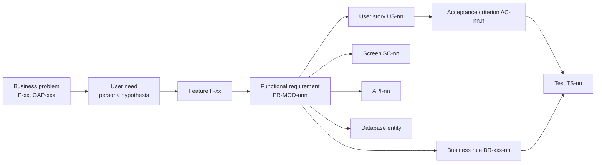

## 1. How the trace works

This document is **generated** from the same structured source as the functional requirements, stories, acceptance criteria, database design, screen inventory and test scenarios (`09-governance/traceability-data/spec.json`). A broken reference stops generation, so every ID below exists in its home document.

Business problems and user needs are carried by the research IDs in the third column: `GAP-…` (gap audit 04), `F-…` (features, gap audit 23), `CMP-…` and `MH-REQ-…` (legal research 51), `SEC-/PRV-/CPL-…` (gap audit 29). Their one-line statements are in `00-research-synthesis/00_MASTER_RESEARCH_SYNTHESIS.md` §3 and §7.

